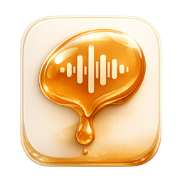
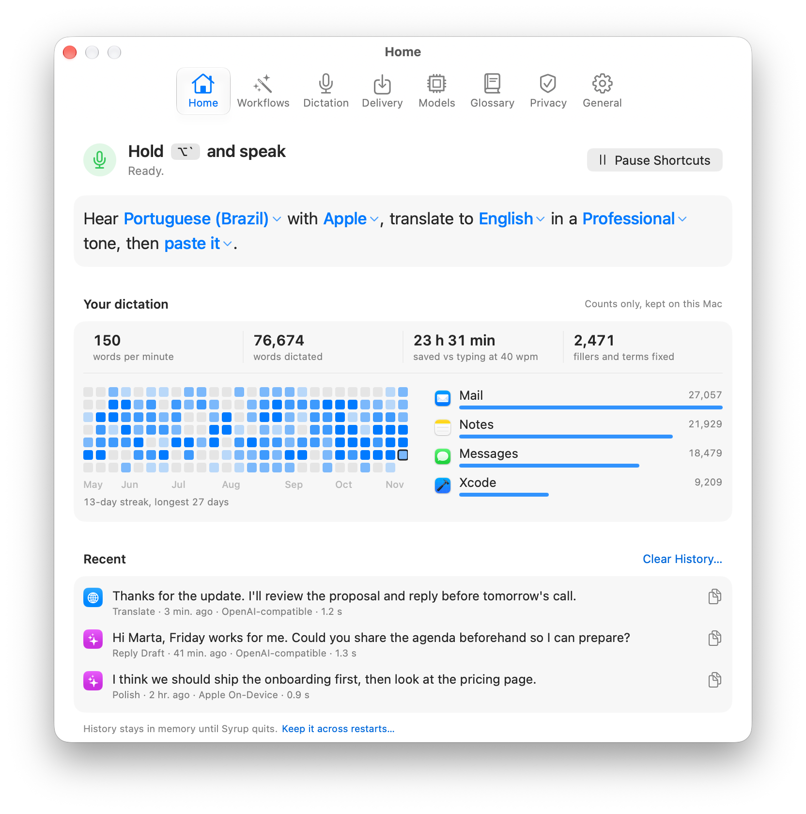
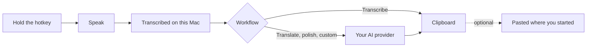
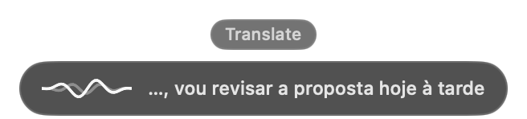
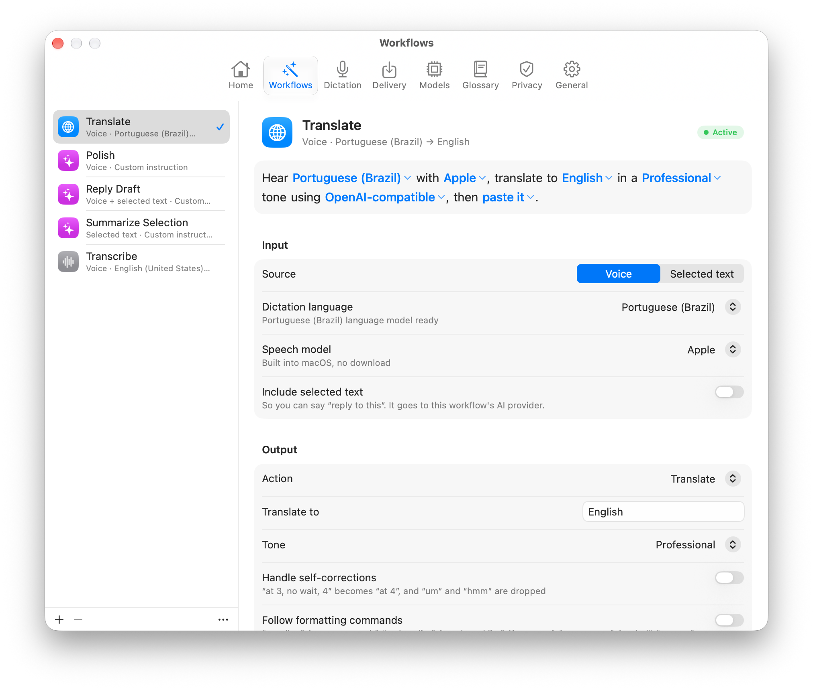
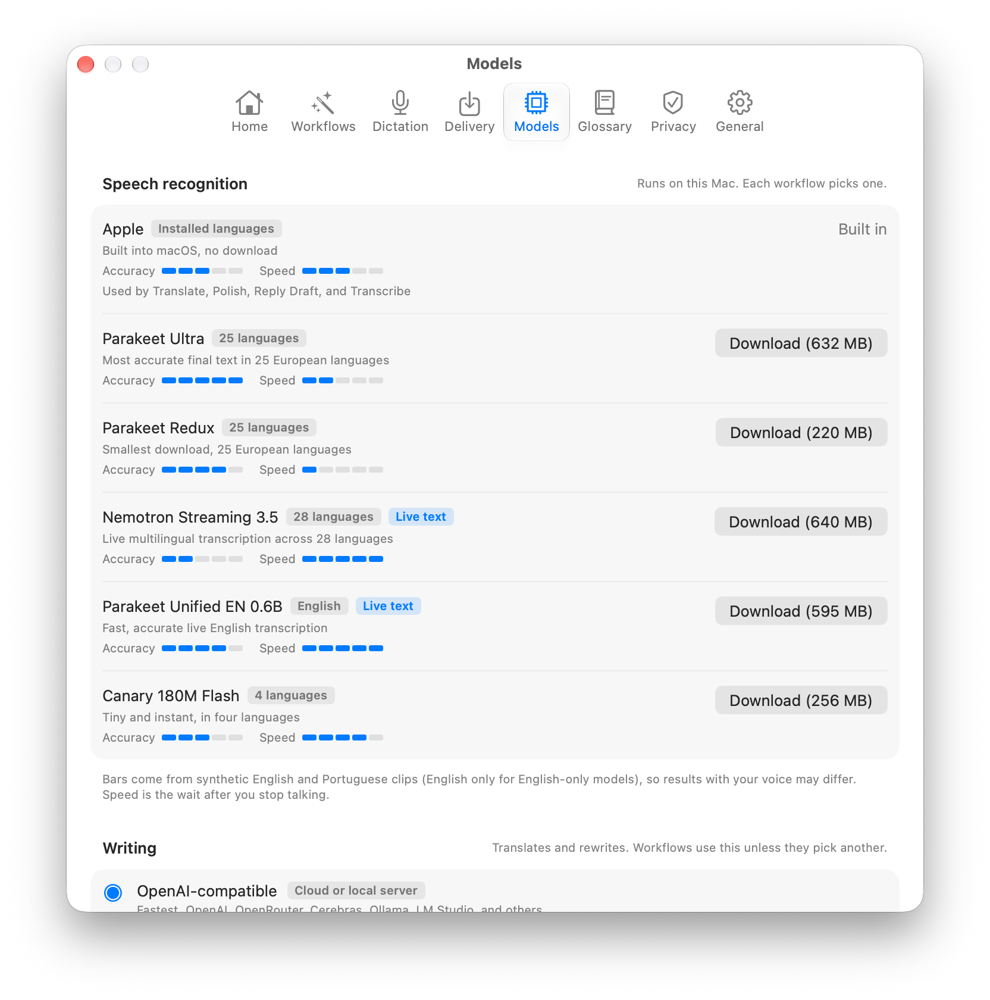
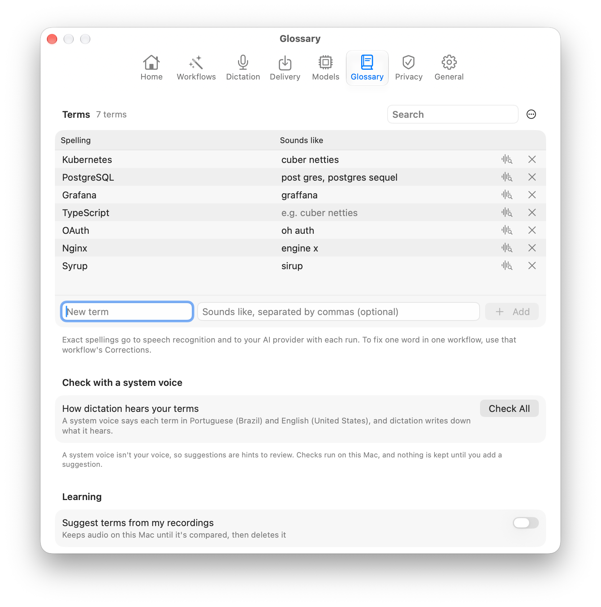
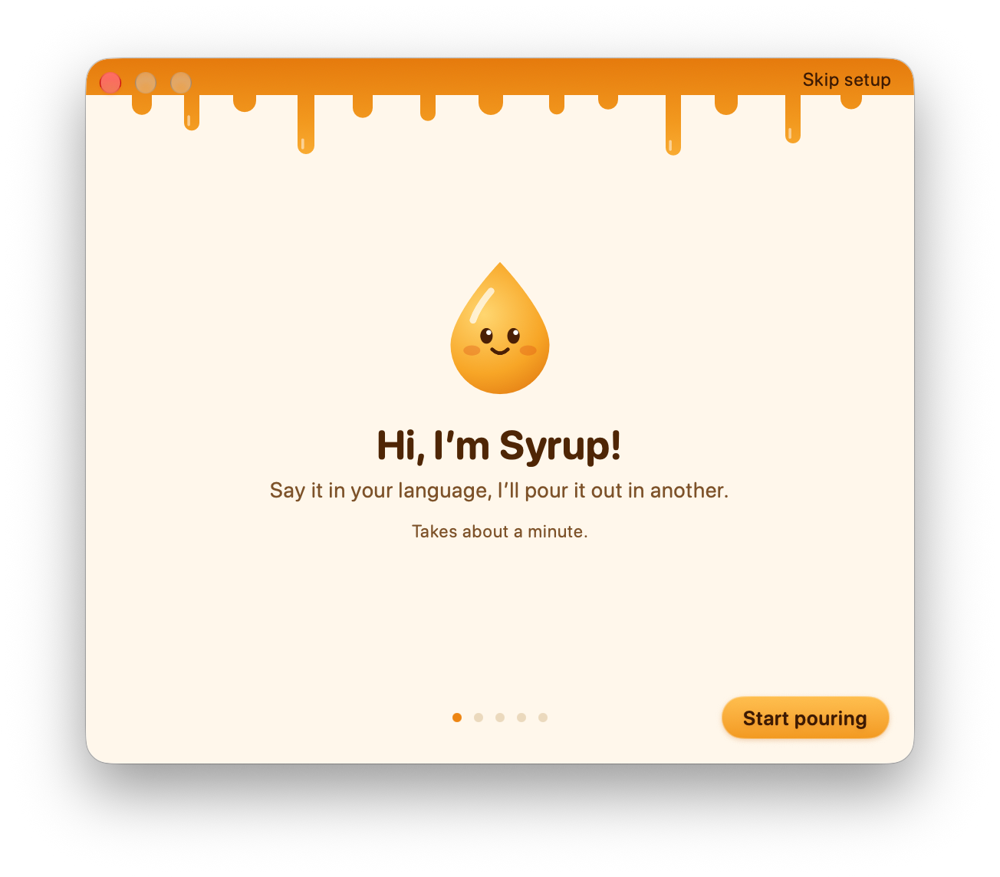

<p align="center">
  
</p>

<h1 align="center">Syrup</h1>

<p align="center">
  Hold a key, speak, and get the text you meant on your clipboard:<br>
  transcribed, translated, polished, summarized, or shaped by your own instruction.
</p>

<p align="center">
  <a href="../../releases/latest"><b>Download for macOS</b></a>
  &nbsp;·&nbsp; macOS 26 or later &nbsp;·&nbsp; free and open source
</p>

<p align="center">
  <picture>
    <source media="(prefers-color-scheme: dark)" srcset="docs/images/home-dark.png">
    
  </picture>
</p>

Syrup is a menu bar app for macOS 26 and later. Dictation tools give you what you said. Syrup gives you what you wanted to write: speak Portuguese and paste professional English, ramble and paste a clean paragraph, or say "tell her Friday works" over a selected email and paste the reply.

Speech is transcribed on your Mac. The rewrite runs on the provider you choose, which can also be on your Mac.

## How it works



1. **Hold <kbd>⌥</kbd> <kbd>`</kbd> and speak.** Release to finish. You can switch to press-to-toggle, change the shortcut, or use the Fn key alone. A small pill at the bottom of the screen shows the microphone wave and the words as they are recognized.
2. **Syrup transcribes on the Mac.** The default engine is Apple's on-device `SpeechAnalyzer`. Audio never leaves the machine.
3. **The workflow shapes the text.** A Translate or custom workflow sends the finished transcript to your provider. A Transcribe workflow uses no AI at all.
4. **The result lands on the clipboard.** With paste turned on, Syrup also pastes it into the app you started in, or types it as it arrives from a streaming provider. A sound tells you it is ready.

<p align="center">
  
  &nbsp;&nbsp;
  
</p>

A couple of sentences should take under about 3 seconds from releasing the key to having the result.

Two more shortcuts round out the loop:

- **Revise, <kbd>⌥</kbd> <kbd>⇧</kbd> <kbd>`</kbd>.** Say one change, such as "shorter" or "more formal", and Syrup rewrites the last result.
- **Cancel, <kbd>Esc</kbd>.** Stops the run. Nothing is written to the clipboard.

## Workflows

A workflow is one sentence you can edit: what Syrup hears, what it does with it, and where the result goes. Each highlighted word is a menu.

<p align="center">
  <picture>
    <source media="(prefers-color-scheme: dark)" srcset="docs/images/workflows-dark.png">
    
  </picture>
</p>

- **Built-in starting points:** Translate, Polish, Reply Draft, Summarize, Prompt Writer, Transcribe, Summarize Selection, and Translate Selection.
- **Your own instruction:** write what you want done with the text. Syrup can add the rule to output only the result, with no preamble or quotes.
- **Voice or selected text:** a workflow can listen to you, or transform the text selected in another app without using the microphone. A voice workflow can also attach the selection as context, so "reply to this" works.
- **A shortcut per workflow, or a workflow per app:** the main shortcut can run Reply Draft in Mail and Polish in Notes.
- **Spoken edits:** Translate workflows can resolve self-corrections ("at 3, no wait, 4" becomes "at 4") and follow commands like "new paragraph" or "make a list". These depend on the model, so they are off by default.
- **Recovery:** if a provider fails, retry the same dictation without speaking again, with the same provider or another, or copy the plain transcript instead.

## Models

Speech recognition and writing are separate choices, and each workflow can pick its own.

<p align="center">
  <picture>
    <source media="(prefers-color-scheme: dark)" srcset="docs/images/models-dark.png">
    
  </picture>
</p>

### Speech recognition

All of it runs on the Mac. Apple's engine is built in and is the default. The others are optional downloads that need Apple silicon, and they are fetched from Hugging Face only when you choose Download.

| Model | Languages | Download | Notes |
| --- | --- | --- | --- |
| Apple | 42 locales on macOS 26 | None | Default. Also drives the live transcript |
| Parakeet Ultra | 25 European languages | 632 MB | Most accurate final text |
| Parakeet Redux | 25 European languages | 220 MB | Smallest download, slower on long dictations |
| Nemotron Streaming 3.5 | 28 languages | 640 MB | Shows its own live text |
| Parakeet Unified EN 0.6B | English | 595 MB | Shows its own live text |
| Canary 180M Flash | English, German, Spanish, French | 256 MB | Small and quick |

On 200 real Brazilian Portuguese recordings, Parakeet Ultra got 4.2% of words wrong, Parakeet Redux 5.3%, and Apple 6.8%. Your voice and language may differ. See [PRODUCT.md](PRODUCT.md) for how the models compare.

### Writing

| Provider | Where it runs | Needs |
| --- | --- | --- |
| OpenAI-compatible | Any endpoint that speaks the OpenAI chat API: OpenAI, OpenRouter, Cerebras, or a local Ollama or LM Studio server | Base URL, model name, and an API key if the server wants one |
| Apple On-Device | On the Mac, with Apple Intelligence | A Mac with Apple Intelligence turned on |
| Codex CLI | Through your local Codex CLI and ChatGPT plan | The Codex CLI installed and signed in. Slower than the others |

Point the OpenAI-compatible provider at a local server, or choose Apple On-Device, and nothing you say leaves the Mac.

## Glossary

Names and jargon are where dictation goes wrong. The glossary holds exact spellings with optional "sounds like" hints, and Syrup uses them in recognition and in every rewrite.

<p align="center">
  <picture>
    <source media="(prefers-color-scheme: dark)" srcset="docs/images/glossary-dark.png">
    
  </picture>
</p>

- **Check with a system voice:** Syrup has a system voice say each term and shows what dictation heard, so you can add the mishearings in one click.
- **Learn from your recordings, opt-in:** Syrup can keep your recordings on the Mac, transcribe them again with WhisperKit, and have your provider compare the two transcripts to suggest terms. The audio stays on the Mac and is deleted after the comparison.

## Privacy

- **Audio stays on the Mac.** It is never sent anywhere and never logged. It is saved to disk only if you turn on glossary learning, and then it is capped, protected, and deleted after analysis.
- **A cloud provider receives only what the run needs:** the finished transcript or the selected text, the workflow instruction, and your glossary. A revision also sends the result being revised. No unrelated history or content is sent.
- **Selected text is opt-in per workflow.** Syrup reads it through Accessibility, never by pressing Copy for you, and never saves it.
- **The clipboard is written only on success.** Cancelling never touches it.
- **History is in memory** until you choose to keep it across restarts.
- **Usage stats are counts only,** stay on the Mac, and can be turned off or deleted.
- **Your API key** is stored in a file only your user account can read. It never goes to preferences or logs.

Syrup asks for Microphone and Speech Recognition access. Accessibility is needed only for pasting and for reading selected text. The Privacy tab shows what is allowed and where your words go with the current provider.

## Install

1. Download the latest version from the [releases page](../../releases/latest).
2. Open the download and drag Syrup into your Applications folder.
3. Open Syrup. It lives in the menu bar and has no Dock icon.

The first time it runs, a short welcome window asks for permissions, sets up your first workflow from your Mac's language, picks a provider, and lets you try a dictation.

<p align="center">
  <picture>
    <source media="(prefers-color-scheme: dark)" srcset="docs/images/welcome-dark.png">
    
  </picture>
</p>

Syrup needs macOS 26 or later and runs on Apple silicon and Intel Macs. The downloadable speech models need Apple silicon, and Apple On-Device writing needs Apple Intelligence. Updates arrive in the app: choose **Check for Updates…** from the menu bar icon, or turn on automatic checks in General.

## For developers

Syrup is written in Swift 6 with SwiftUI. To build it yourself you need Xcode 26 or later and [XcodeGen](https://github.com/yonaskolb/XcodeGen):

```sh
brew install xcodegen
xcodegen
xcodebuild -scheme Syrup -configuration Debug -derivedDataPath DerivedData build
open DerivedData/Build/Products/Debug/Syrup.app
```

[IMPLEMENTATION.md](IMPLEMENTATION.md) covers building, testing, and signing. [PRODUCT.md](PRODUCT.md) defines the behavior, [ARCHITECTURE.md](ARCHITECTURE.md) explains the pipeline and decisions, [AGENTS.md](AGENTS.md) lists the development rules, and [docs/UPDATES.md](docs/UPDATES.md) describes how a release is prepared and published.

Syrup builds on [KeyboardShortcuts](https://github.com/sindresorhus/KeyboardShortcuts) for global hotkeys, [FluidAudio](https://github.com/FluidInference/FluidAudio) for the downloadable speech models, [WhisperKit](https://github.com/argmaxinc/WhisperKit) for glossary learning, and [Sparkle](https://github.com/sparkle-project/Sparkle) for updates.

## License

Syrup is free software under the [GNU Affero General Public License v3.0](LICENSE). You can use it, study it, change it, and share it, as long as anything you distribute or offer as a service that builds on it is published under the same license.

If you want to use Syrup's code in a product without those obligations, a commercial license is available. Open an issue in this repository to ask about one.

Contributions are welcome. By contributing, you agree that your contribution may be distributed under both the AGPL-3.0 and Syrup's commercial license.
