# Input and output state machines

The six input and output folders (`Sources/Hotkey`, `Paste`, `Audio`, `RecordingCue`, `Clipboard`, and `Context`) hold 28 state machines: 19 are charted below, and 9 are small enough for one line each. Eleven are High importance, because their own history can break an AGENTS.md hard rule or leave something stuck that the person can see. The three Fn shortcut machines matter most: a recording must never outlive the key that would end it, and model checking found three ways it could (F1 to F3), fixed on 2026-11-15. Next come microphone capture (`AudioRecorder` and its AudioQueue session), which must never leave the microphone open or drop the last words; the output ducker's saved restore record, the only way back from lowered system audio after a crash; typed delivery and the delivery target check, where a late or misdirected key event lands in the wrong app and cannot be taken back; the clipboard write, the one place Syrup replaces the clipboard; and selection capture, which reads text that a provider may receive.

Only the three Fn machines are formally validated. `FnShortcutModel` ([model](../../Tests/SyrupTests/StateMachines/FnShortcutModel.swift), [rules](../../Tests/SyrupTests/StateMachines/FnShortcutModelTests.swift)) explores every reachable state of a finite model of them and replays it against the real `HotkeyController`, `FnKeyMonitor`, and `AppState`. It confirmed findings F1 to F3. All three are fixed: the model now holds every rule, `FnShortcutFixTests` reproduces each finding on the real app as a regression test, and the [index](README.md#findings) lists them. Every other machine here was checked against the source by reading and is not formally validated. Three suspected defects found while checking stay unverified; they are listed, with their event sequences, at the [end](#suspected-defects-not-yet-verified).

Checked against the source on 2026-11-14, branch `state-machines` at `c339c8b`; the Fn sections updated for the F1 to F3 fix on 2026-11-15, branch `fn-shortcut-fixes`. On 2026-11-15 every line link was checked again against `5386bbc`: removing glossary learning moved lines in `AppState` and `AppState+VoiceRun`, and no machine here changed. Kind: explicit means an enum names the states, implicit means Bool flags, optionals, tasks, generations, or a saved record encode them, and mixed means both. Importance: High when the machine's own history can break an AGENTS.md hard rule or strand a recording, the system volume, or typed text; Medium when a mistake is visible but a High machine or the caller contains it; Low for cosmetic or per-call state. In the invariants, enforced means a guard, lock, type, or task ownership in the code makes it hold; assumed means it depends on callers, macOS, or a framework.

| Machine | Owner | Kind | Importance | Validation |
| --- | --- | --- | --- | --- |
| [Shortcut registration, pause, and Esc](#shortcut-registration-pause-and-esc) | `HotkeyController`, `SystemHotkeyRegistration` | Implicit | High | Model-checked; F1 to F3 fixed |
| [Fn gesture](#fn-gesture) | `FnKeyGesture` | Mixed | High | Model-checked; F1 to F3 fixed |
| [Fn polling](#fn-polling) | `FnKeyMonitor` | Implicit | Medium | Not formally validated |
| [Fn hold, latch, and toggle](#fn-hold-latch-and-toggle) | `HotkeyController` | Implicit | High | Model-checked; F1 to F3 fixed |
| [Typing session](#typing-session) | `StreamingTypist` | Mixed | High | Not formally validated |
| [Flush order and cadence](#flush-order-and-cadence) | `StreamingTypist` | Implicit | High | Not formally validated |
| [Streamed text holdback](#streamed-text-holdback) | `StreamingTypist` | Implicit | Medium | Not formally validated |
| [Recorder session](#recorder-session) | `AudioRecorder` | Implicit | High | Not formally validated |
| [AudioQueue capture](#audioqueue-capture) | `AudioQueueCaptureSession` | Implicit | High | Not formally validated |
| [Bounded audio handoff](#bounded-audio-handoff) | `AudioBufferStream` | Implicit | Medium | Not formally validated |
| [Audio fan-out](#audio-fan-out) | `AudioFanOut` | Implicit | Medium | Not formally validated |
| [Level tap](#level-tap) | `AudioLevelTap` | Implicit | Medium | Not formally validated |
| [Output ducking and the restore record](#output-ducking-and-the-restore-record) | `OutputDucker` | Implicit | High | Not formally validated |
| [Recording cue panel](#recording-cue-panel) | `RecordingCueController`, `RecordingCueModel` | Mixed | Medium | Not formally validated |
| [Cue typewriter task](#cue-typewriter-task) | `RecordingCueController` | Implicit | Low | Not formally validated |
| [Clipboard write and rollback](#clipboard-write-and-rollback) | `ClipboardWriter` | Implicit | High | Not formally validated |
| [Selection capture](#selection-capture) | `SelectionReader` | Mixed | High | Not formally validated |
| [Delivery target check](#delivery-target-check) | `DeliveryTarget` | Implicit | High | Not formally validated |
| [Caret context probe](#caret-context-probe) | `DeliveryTarget`, `withOperationTimeout` | Implicit | Medium | Not formally validated |
| [Typing step planner](#small-machines) | `TypingStep` | Implicit | Low | Not formally validated |
| [Paste gate and strategy](#small-machines) | `AutoPaster`, `PasteStrategy`, `PasteKeyResolver` | Implicit | Low | Not formally validated |
| [Output volume read and write](#small-machines) | `CoreAudioOutputVolumeController` | Implicit | Low | Not formally validated |
| [Microphone choice](#small-machines) | `InputResolution`, `CoreAudioInputDeviceCatalog`, `IOKitLidStateReader` | Implicit | Low | Not formally validated |
| [Transcript typewriter](#small-machines) | `TranscriptTypewriter` | Implicit | Low | Not formally validated |
| [Cue caption](#small-machines) | `RecordingCueView` | Mixed | Low | Not formally validated |
| [Wave energy](#small-machines) | `RecordingCueView.RenderState` | Implicit | Low | Not formally validated |
| [Level smoothing](#small-machines) | `LevelSmoother` | Implicit | Low | Not formally validated |
| [Clipboard snapshot](#small-machines) | `PasteboardSnapshot` | Implicit | Low | Not formally validated |

## Shortcuts and the Fn key

### Shortcut registration, pause, and Esc

`HotkeyController` decides which global shortcuts are attached: dictate, revise, Paste Last, and one per workflow while listening, none while paused, and Esc only while listening and a run can be cancelled. Key callbacks reach the app as main-actor tasks, so a press queued just before a pause or a workflow removal still runs later; workflow callbacks recheck membership, and `AppState`'s trigger methods recheck the pause.

State: [`HotkeyController.isListening`](../../Sources/Hotkey/HotkeyController.swift#L59), [`HotkeyController.isCancelShortcutEnabled`](../../Sources/Hotkey/HotkeyController.swift#L58), [`HotkeyController.registeredWorkflowIDs`](../../Sources/Hotkey/HotkeyController.swift#L61), [`SystemHotkeyRegistration.keyDownActions`](../../Sources/Hotkey/HotkeyController.swift#L36) and [`keyUpActions`](../../Sources/Hotkey/HotkeyController.swift#L37), the weak [`HotkeyController.appState`](../../Sources/Hotkey/HotkeyController.swift#L62). Driven by [`AppState.isHotkeyPaused`](../../Sources/App/AppState.swift#L63) and [`AppState.pipelineState`](../../Sources/App/AppState.swift#L36), whose `didSet` calls [`pipelineStateChanged`](../../Sources/Hotkey/HotkeyController.swift#L219), which sets the Esc bit.

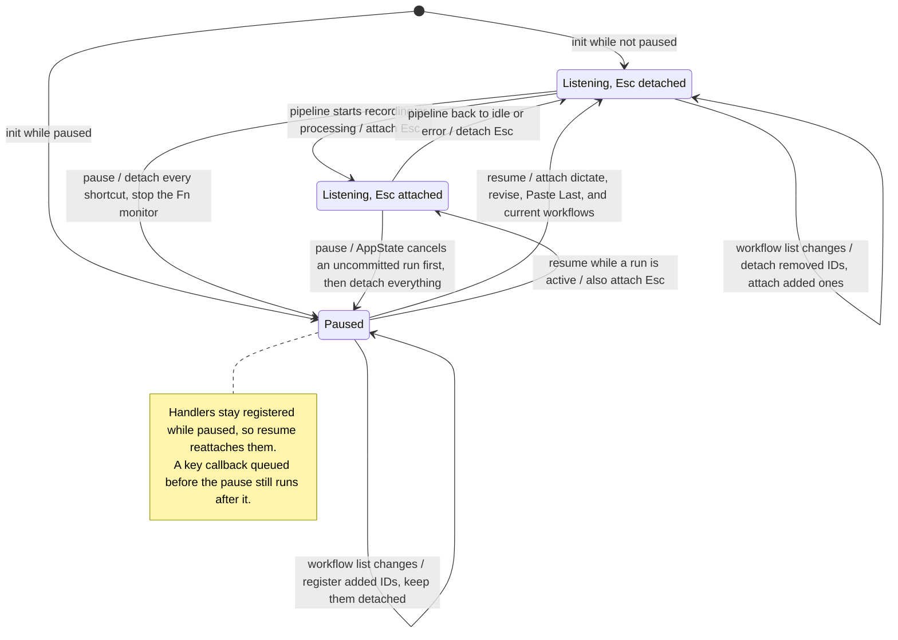

Invariants:

- Esc is attached only while listening and the pipeline allows a cancel. Enforced in `setListening` and `setCancelShortcutEnabled` ([L183-187](../../Sources/Hotkey/HotkeyController.swift#L183), [L294-303](../../Sources/Hotkey/HotkeyController.swift#L294)); the Fn replay compares Esc availability after every step.
- A shortcut never starts or ends a run while paused. Enforced in `AppState`: pausing cancels first ([L63-69](../../Sources/App/AppState.swift#L63)), and `triggerPressed`, `triggerReleased`, and the revise methods return while paused, which also drops callbacks queued before the pause ([L306-324](../../Sources/App/AppState.swift#L306)). Model-checked for Fn and the dictate shortcut ("nothing records while shortcuts are paused").
- A removed workflow's callback does nothing. Enforced: its shortcut is detached ([L142-144](../../Sources/Hotkey/HotkeyController.swift#L142)) and the queued task checks `registeredWorkflowIDs` ([L150](../../Sources/Hotkey/HotkeyController.swift#L150), [L156](../../Sources/Hotkey/HotkeyController.swift#L156)).
- The handler dictionaries and the KeyboardShortcuts library stay in step. Assumed: `enable` removes and re-adds the handlers ([L45-49](../../Sources/Hotkey/HotkeyController.swift#L45)), and nothing else registers these names.
- Paste Last and Esc callbacks are not checked against the pause. Assumed harmless: an Esc after a pause finds no run, and a queued Paste Last pastes as if pressed just before.

Tests: `HotkeyPauseTests.pauseUnregistersShortcutsAndResumeUsesCurrentWorkflows`, `HotkeyPauseTests.appPauseKeepsEditedWorkflowShortcutsDetached`, `FnShortcutModelTests.everyReachableStateKeepsTheShortcutRules`, `FnShortcutConformanceTests.theRealControllerTakesEveryTransitionAsTheModelDoes`. `FnShortcutModel` covers pausing, resuming, and Esc with the dictate shortcut; it leaves out workflow shortcuts, the revise shortcut, Paste Last, and callbacks queued across a pause.

Open questions:

- Suspected, unverified: removing a workflow while its shortcut is held in hold mode drops the release, so the recording keeps going until Esc, pausing, or the duration limit. Sequence: hold mode; press workflow W's shortcut (recording starts); remove W from the workflow list while holding; release. `rebuildWorkflowShortcuts` detaches W, the membership guard would drop a queued release, and the dictate shortcut's release does not match W's run. Same class as F1; a workflow shortcut in `FnShortcutModel` would check it.

### Fn gesture

`FnKeyGesture` turns 30 ms samples of the Fn key, the other modifiers, and the time since the last key press into pressed, released, and combined events. Fn with Command, Control, Option, or Shift, or with any key pressed after it, is a combination that belongs to macOS or the front app, so the gesture ignores Fn until it is up. A tap is a press under 300 ms, and a second tap pressed within 350 ms of the first one's release completes a double-tap.

State: [`FnKeyGesture.phase`](../../Sources/Hotkey/FnKeyMonitor.swift#L32) (`up`, `active(pressedAt:followsTap:)`, or `ignoring`, declared at [L26](../../Sources/Hotkey/FnKeyMonitor.swift#L26)), [`FnKeyGesture.lastTapEndedAt`](../../Sources/Hotkey/FnKeyMonitor.swift#L33), and the thresholds [`maximumTap`](../../Sources/Hotkey/FnKeyMonitor.swift#L22) and [`doubleTapWindow`](../../Sources/Hotkey/FnKeyMonitor.swift#L24). "Up, first tap pending" below is `up` with `lastTapEndedAt` set.

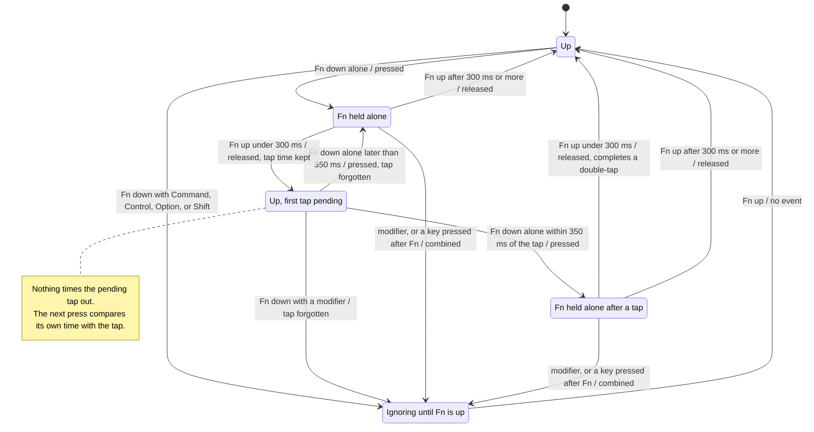

Invariants:

- One combined event per hold, and no event after it until Fn is up. Enforced by `ignoring` ([L56-63](../../Sources/Hotkey/FnKeyMonitor.swift#L56)).
- A completed double-tap never starts a third, and a hold is never half of a double-tap. Enforced: only a tap that did not complete a double-tap keeps its time ([L53](../../Sources/Hotkey/FnKeyMonitor.swift#L53)), and a double-tap needs the second press to be a tap too ([L51-52](../../Sources/Hotkey/FnKeyMonitor.swift#L51)).
- Sample time only moves forward. Assumed: it is `systemUptime` ([L115](../../Sources/Hotkey/FnKeyMonitor.swift#L115)).
- Every change shows up in some sample. Assumed: when a key goes down and Fn comes up between two samples, the release branch runs first and reports a plain release ([L48-55](../../Sources/Hotkey/FnKeyMonitor.swift#L48)); a key pressed after Fn but before the first sample that sees Fn counts as pressed before it.

Tests: `FnKeyGestureTests`: `holdingAndReleasingFnAloneIsAGesture`, `anotherKeyDuringTheHoldMakesItACombination`, `aKeyPressedBeforeFnDoesNotCount`, `otherModifiersAreNotFnAlone`, `twoQuickTapsCompleteADoubleTap`, `theDoubleTapWindowIsEnforced`, `aHoldIsNeitherHalfOfADoubleTap`, `aThirdTapStartsOver`, `aCombinationClearsTheFirstTap`, `fnWithAModifierClearsTheFirstTap`. `FnShortcutModel` restates the gesture with the real thresholds, and its replay compares the model's phase with the real gesture after every step.

Open questions:

- Suspected, unverified: a key pressed within one 30 ms poll of Fn reads as Fn alone. Sequence, hold mode, idle: Fn down; another key down less than 30 ms later, before the next poll; hold both 300 ms or more; release both. The first poll that sees Fn starts a run and dates the press after the key, so no combination is seen and the release delivers a dictation. In toggle mode the same chord released within 500 ms stops a recording. The model's key press always lands after a poll, so it cannot see this.

### Fn polling

`FnKeyMonitor` decides whether the Fn key is read at all. While the Fn option is on and shortcuts are listening, a repeating 30 ms timer on the main run loop feeds samples to the gesture; stopping drops the timer, and starting resets the gesture. The samples are HID state reads, so no event tap or extra permission is needed.

State: [`FnKeyMonitor.timer`](../../Sources/Hotkey/FnKeyMonitor.swift#L79), [`FnKeyMonitor.gesture`](../../Sources/Hotkey/FnKeyMonitor.swift#L78), [`FnKeyMonitor.onEvent`](../../Sources/Hotkey/FnKeyMonitor.swift#L76), [`pollInterval`](../../Sources/Hotkey/FnKeyMonitor.swift#L74).

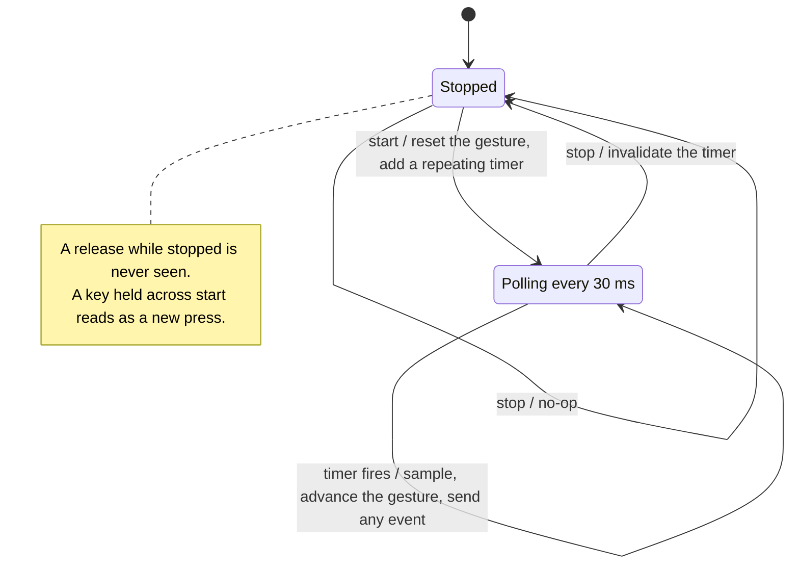

Invariants:

- At most one timer. Enforced by the `timer == nil` guard ([L88](../../Sources/Hotkey/FnKeyMonitor.swift#L88)).
- Polling runs only while the Fn option is on and shortcuts are listening. Enforced in `HotkeyController.updateFnKeyMonitor` ([L196-213](../../Sources/Hotkey/HotkeyController.swift#L196)).
- No new permission. Enforced by construction: `keyState`, `flagsState`, and `secondsSinceLastEventType` on the HID system state ([L109-117](../../Sources/Hotkey/FnKeyMonitor.swift#L109)), not an event tap, which AGENTS.md reserves as a product decision.
- No event while stopped. Assumed: `poll()` has no running check ([L103-107](../../Sources/Hotkey/FnKeyMonitor.swift#L103)); only tests call it directly.

Tests: `FnKeyHotkeyTests.pollingRunsOnlyWhileEnabledAndListening`. `FnShortcutModel` represents the monitor's running flag and the gesture reset on start, but its replay polls directly, so the timer itself is not exercised.

Open questions:

- Stopping is why F1 happened: the release of a run Fn started is never sampled, so `HotkeyController` now cancels a recording Fn started when it stops the monitor.
- Turning the Fn option on, or resuming, while Fn is held starts a hold-mode recording at once, because start resets the gesture. The model includes this; whether it is wanted is a product question.

### Fn hold, latch, and toggle

`HotkeyController` turns Fn events into trigger presses, releases, and cancels. In hold mode a press starts a run, a release stops it, a combination cancels it, and a double-tap latches it so it keeps recording until the next double-tap. In toggle mode presses do nothing: a double-tap starts a run only if its first tap landed while nothing was running, and a tap under 500 ms stops a recording. Fn's flags belong to the run Fn started and end with it, and turning the Fn option off cancels a recording Fn started, because Fn could no longer end it.

State: [`HotkeyController.isFnKeyEnabled`](../../Sources/Hotkey/HotkeyController.swift#L65), [`fnStartedRun`](../../Sources/Hotkey/HotkeyController.swift#L68), [`isFnLatched`](../../Sources/Hotkey/HotkeyController.swift#L71), [`fnStartedToggleRun`](../../Sources/Hotkey/HotkeyController.swift#L75), [`isFnDoubleTapArmed`](../../Sources/Hotkey/HotkeyController.swift#L77), [`isListening`](../../Sources/Hotkey/HotkeyController.swift#L59), the toggle limit [`fnToggleMaximumTap`](../../Sources/Hotkey/HotkeyController.swift#L57), and Home's mirror [`AppState.isFnRecordingLatched`](../../Sources/App/AppState.swift#L61), which the latch's `didSet` sets and `pipelineState`'s `willSet` also clears when the pipeline leaves recording ([L38](../../Sources/App/AppState.swift#L38)). `pipelineState`'s `didSet` calls [`pipelineStateChanged`](../../Sources/Hotkey/HotkeyController.swift#L219) on every change ([L41](../../Sources/App/AppState.swift#L41)): the latch and `fnStartedToggleRun` end when the pipeline leaves recording, and `fnStartedRun` when it returns to idle or error, which every run passes through before the next one starts. Each event also reads the live hotkey mode, the pipeline state, and whether the person is typing in Syrup ([L239-240](../../Sources/Hotkey/HotkeyController.swift#L239)). The mode decides which flags matter, so the machine is drawn twice.

Hold mode:

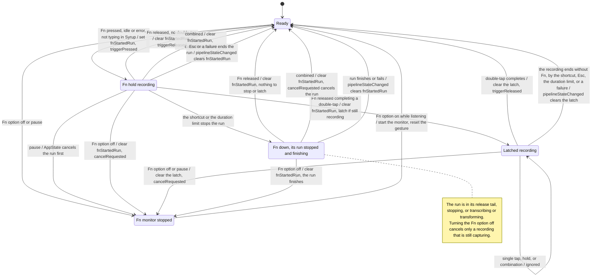

Toggle mode:

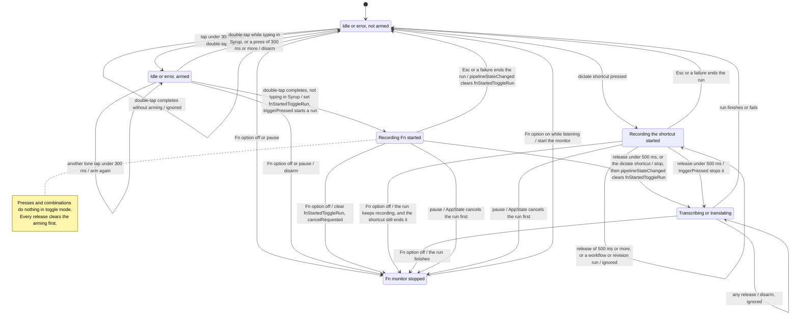

Findings, confirmed by `FnShortcutModel` and its replay on the real controller and app, fixed on 2026-11-15 (details in the [index](README.md#findings)):

- **F1, fixed.** Turning the Fn option off cancelled a latched Fn run but left an ordinary Fn hold, or a toggle run Fn started, recording with no Fn way to end it. Shortest trace: Fn down, Fn option off. `updateFnKeyMonitor` now cancels any recording Fn started, held, latched, or toggled, while it is still capturing ([L196-213](../../Sources/Hotkey/HotkeyController.swift#L196)). A recording already stopping, a selection run, and work in flight finish; before the fix, a latched run in its release tail was cancelled.
- **F2, fixed.** In hold mode, a double-tap that completed after its run was already stopped or cancelled still latched, and Home showed the latch while idle; a latch also outlived a run stopped by the shortcut, Esc, or the duration limit until the next Fn event, so turning the Fn option off then cancelled the next run or a transcription. Shortest trace: Fn down, Fn up, Fn down, dictate shortcut released, Fn up. A double-tap now latches only a run still recording ([L248](../../Sources/Hotkey/HotkeyController.swift#L248)), and the latch ends with its recording ([L219-229](../../Sources/Hotkey/HotkeyController.swift#L219)).
- **F3, fixed.** `fnStartedRun` and the latch were not tied to a run, so Fn could stop or cancel a run the dictate shortcut started. Shortest trace: Fn down, dictate shortcut released, dictate shortcut pressed, Fn up. Fn's flags now end when the pipeline returns to idle or error, before any later run can start.

Invariants:

- A recording Fn started never outlives the Fn route: turning the option off or pausing cancels it while it is capturing. Enforced ([L196-213](../../Sources/Hotkey/HotkeyController.swift#L196)); model-checked.
- Fn, time, and completions alone can always end a recording Fn started. Enforced; model-checked.
- Fn's flags belong to the run Fn started and end with it, and Home's mirror shows a latch only while a latched run records. Enforced by `pipelineStateChanged` ([L219-229](../../Sources/Hotkey/HotkeyController.swift#L219)) and the latch check ([L248](../../Sources/Hotkey/HotkeyController.swift#L248)); model-checked. Assumed: the controller is installed in its `AppState` (`AppState.install`), as the app always does; a controller that is not, as in `FnKeyHotkeyTests`, still drops a stale latch at the next Fn event ([L233](../../Sources/Hotkey/HotkeyController.swift#L233)) but keeps `fnStartedRun` until Fn is released.
- Turning the Fn option off never touches work in flight or a recording Fn did not start. Enforced: the cancel needs Fn's flag and a capturing recording ([L208-209](../../Sources/Hotkey/HotkeyController.swift#L208)); model-checked.
- Fn never starts a recording while the person types in Syrup. Enforced ([L239](../../Sources/Hotkey/HotkeyController.swift#L239), [L280](../../Sources/Hotkey/HotkeyController.swift#L280)); model-checked.
- A single short Fn tap never records in hold mode. Enforced by the pipeline discarding holds under `AppState.minimumHold`, which equals `FnKeyGesture.maximumTap`; model-checked, and `theModelUsesTheAppsMinimumHold` keeps the model's copy equal.
- In toggle mode only an armed double-tap starts a recording, so a double-tap meant to stop never starts another. Enforced: arming happens only in idle or error ([L277-287](../../Sources/Hotkey/HotkeyController.swift#L277)); model-checked, and the toggle replay caught a mutation that armed after any tap.
- A stray tap never cancels a result on its way. Enforced ([L288-290](../../Sources/Hotkey/HotkeyController.swift#L288)).

Tests: `FnKeyHotkeyTests`: `holdStartsOnPress`, `aCombinationCancelsTheRunItStarted`, `typingInSyrupIgnoresFn`, `holdSingleTapIsStillDiscarded`, `holdDoubleTapKeepsRecordingUntilTheNextDoubleTap`, `tapsAHoldAndCombinationsDoNotStopALatchedRun`, `homeTellsALatchedRunHowToFinishAndForgetsWhenItEnds`, `tapThenHoldIsAnOrdinaryHold`, `aLatchEndsWithItsRun`, `turningFnOffCancelsALatchedRun`, `toggleSingleTapWhileIdleDoesNothing`, `toggleDoubleTapStartsOnTheSecondRelease`, `toggleSingleTapStopsARecordingAndDelivers`, `toggleSingleTapAlsoStopsARunFromTheDictateShortcut`, `toggleSlowSecondTapDoesNotStart`, `toggleLongPressesAreNotTaps`, `toggleLongPressDoesNotStopARecording`, `toggleIgnoresCombinationsWhenIdleAndWhileRecording`, `toggleDoubleTapToStopDoesNotStartAgain`, `toggleTapsDoNotCancelAResultOnItsWay`, `toggleDoubleTapDoesNotStartWhileTypingInSyrup`. `FnShortcutModelTests`: `theFnKeyCanAlwaysEndARecordingItStarted` (F1), `everyReachableStateKeepsTheShortcutRules` (F2, and Fn's flags ending with their run), `everyStepKeepsTheShortcutRules` (F3, and the Fn option sparing other work), `theModelUsesTheAppsMinimumHold`. `FnShortcutConformanceTests.theRealControllerTakesEveryTransitionAsTheModelDoes`. `FnShortcutFixTests`, each failing before the fix: `turningTheFnOptionOffCancelsARecordingFnStarted` (F1, hold and toggle), `aDoubleTapDoesNotLatchARunThatAlreadyEnded`, `aDoubleTapDoesNotLatchARunBeingTranscribed`, `aLatchEndsWithItsRunSoTurningFnOffSparesTheNextRun`, `turningFnOffDoesNotCancelALatchedRunThatIsBeingTranscribed` (F2), `fnDoesNotEndARunTheShortcutStartedAfterFnsRunEnded` (F3); and pinning what the fix keeps: `turningFnOffDuringTheReleaseTailLetsTheRunFinish`, `turningFnOffLeavesASelectionRunFnStartedToFinish`, `fnWithAnotherKeyStillCancelsItsOwnRunDuringTranscription`.

Open questions:

- Suspected, unverified: switching the hotkey mode from toggle to hold during a toggle recording Fn started leaves Fn unable to end it. Sequence: toggle mode; Fn double-tap (recording starts); set the hotkey mode to hold; Fn tap or hold. A press needs an idle pipeline and a release needs `fnStartedRun`, a latch, or toggle mode, so both are ignored; Esc, the dictate shortcut, and the duration limit still end the run. The model fixes the mode per configuration, and the F1 fix cancels only when the monitor stops, which it does not here.
- Hold handling reads the live hotkey mode, while the pipeline uses the mode the run started with ([PipelineTransitions.swift L71-82](../../Sources/App/PipelineTransitions.swift#L71)). The F2 and F3 fix ends Fn's flags with their run rather than recording the run, so it does not carry the run's mode; a fix for the mode switch above would need it.

## Typed delivery

### Typing session

`StreamingTypist` decides whether typed delivery may post key events, and into which app. `start` checks Accessibility trust, Secure Event Input, and the frontmost app, then pins that app; each flush checks the focused field once, and each posted step rechecks the app and secure input. Any failure stops typing for the rest of the run and keeps the reason; cancel stops it without one.

State: [`isActive`](../../Sources/Paste/StreamingTypist.swift#L113), [`stopReason`](../../Sources/Paste/StreamingTypist.swift#L114), [`hasPostedText`](../../Sources/Paste/StreamingTypist.swift#L115), [`pinnedApplicationID`](../../Sources/Paste/StreamingTypist.swift#L106), [`generation`](../../Sources/Paste/StreamingTypist.swift#L105), [`targetValidator`](../../Sources/Paste/StreamingTypist.swift#L99), [`onTextPosted`](../../Sources/Paste/StreamingTypist.swift#L98).

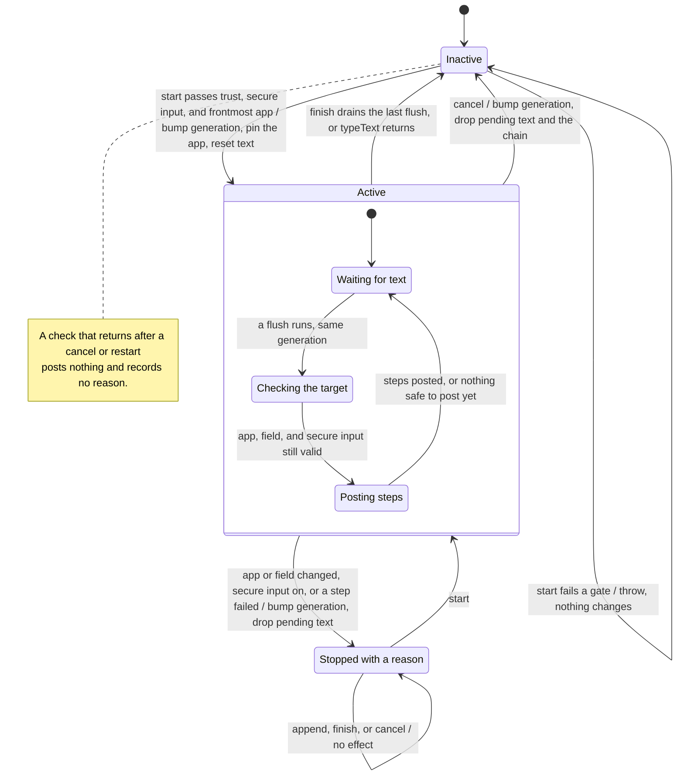

Invariants:

- Nothing is typed for an old generation or after cancel. Enforced: each flush checks `generation` and `isActive` on entry and again after the async field check ([L263](../../Sources/Paste/StreamingTypist.swift#L263), [L268](../../Sources/Paste/StreamingTypist.swift#L268), [L309](../../Sources/Paste/StreamingTypist.swift#L309)).
- Typing never resumes in the same run after a stop. Enforced: `stop` clears `isActive` and bumps the generation ([L372-379](../../Sources/Paste/StreamingTypist.swift#L372)), and `append` and `finish` need `isActive` ([L195](../../Sources/Paste/StreamingTypist.swift#L195), [L205](../../Sources/Paste/StreamingTypist.swift#L205)).
- The pinned app and secure input are checked before every step, the field once per flush. Enforced ([L305-328](../../Sources/Paste/StreamingTypist.swift#L305), [L362](../../Sources/Paste/StreamingTypist.swift#L362)); that the field stays the same until the flush's last step is assumed.
- Typed text carries no held modifiers, and a line break is Shift-Return. Enforced in `events(for:)` ([L391-413](../../Sources/Paste/StreamingTypist.swift#L391)).
- A posted step means the events were posted, not that the editor accepted them. Assumed.
- The run cancels its own typist. Assumed here; see [streamed delivery](run-pipeline.md#streamed-delivery).

Tests: `StreamingTypistTests`: `focusChangeStopsTypingPermanently`, `unavailableInitialTargetPreventsEventPosting`, `secureInputAppearingMidStreamStopsTyping`, `rechecksAppAndSecureInputBetweenSteps`, `checksTheFocusedFieldOncePerFlushNotPerStep`, `aFieldChangeStopsTheNextFlush`, `cancelDuringAFocusCheckPostsNothing`, `typedTextCarriesNoHeldModifiers`; `DeliveryTargetPinningTests.sameApplicationFieldChangeStopsStreaming`.

Open questions:

- Trust is checked only at start, so the typist does not notice Accessibility being revoked mid-run; it keeps posting, and `hasPostedText` still turns true.
- The streamed path has no model; [run-pipeline.md](run-pipeline.md#streamed-delivery) names it as the next candidate.

### Flush order and cadence

`StreamingTypist` queues a flush when 200 characters are pending, from a 50 ms cadence timer while 3 or more are pending, and once more from `finish`. Each flush waits for the one before it, so text keeps its order even though each one waits on an Accessibility check. Cancel, stop, and restart leave queued flushes to run but make them post nothing.

State: [`cadenceTask`](../../Sources/Paste/StreamingTypist.swift#L100), [`flushChain`](../../Sources/Paste/StreamingTypist.swift#L104), [`generation`](../../Sources/Paste/StreamingTypist.swift#L105), [`pendingText`](../../Sources/Paste/StreamingTypist.swift#L107), and the defaults for [cadence and size threshold](../../Sources/Paste/StreamingTypist.swift#L118). Drawn as two charts: the cadence task slot, and one queued flush.

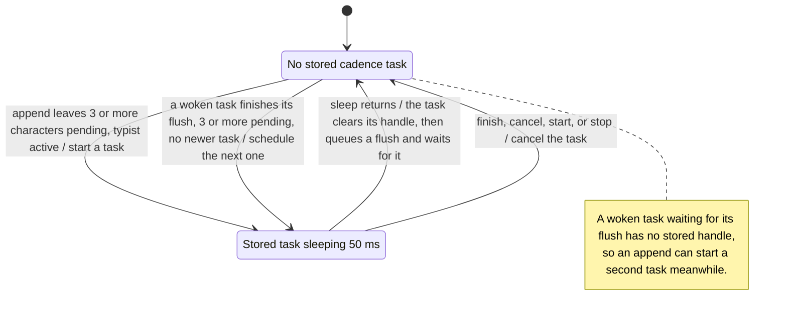

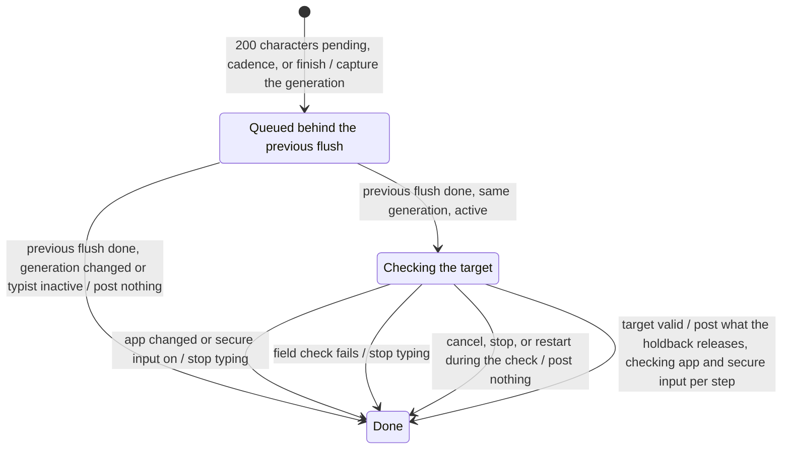

Invariants:

- Flushes post in the order they were queued. Enforced: each awaits the previous task ([L230-235](../../Sources/Paste/StreamingTypist.swift#L230)).
- A flush queued before a cancel, stop, or restart posts nothing. Enforced by its captured generation ([L231](../../Sources/Paste/StreamingTypist.swift#L231), [L263](../../Sources/Paste/StreamingTypist.swift#L263), [L268](../../Sources/Paste/StreamingTypist.swift#L268)).
- At most one sleeping cadence task with a stored handle. Enforced ([L242](../../Sources/Paste/StreamingTypist.swift#L242)). A woken task waiting for its flush is not counted, so two cadence tasks can be alive at once; assumed harmless, because both only queue ordered flushes.
- `finish` comes after the provider stream ends, so no append races the final flush. Assumed; the caller finishes the stream first.

Tests: `StreamingTypistTests`: `cadenceCoalescesDeltasAndKeepsTwoCharacterTail`, `bufferSizeFlushesWithoutWaitingForCadence`, `cadenceRetainsUndecidedQuoteAndWhitespaceSuffix`, `aSlowFocusCheckKeepsTextInOrder`, `cancelDuringAFocusCheckPostsNothing`.

Open questions:

- `cancelDuringAFocusCheckPostsNothing` ends with `waitForQueuedFlushes`, but cancel has already dropped the chain ([L218](../../Sources/Paste/StreamingTypist.swift#L218)), so the wait returns at once and the test can pass before the old flush resumes. It may not catch a broken generation check after the await.

### Streamed text holdback

`StreamingTypist` decides which part of the streamed text is safe to type now, so that nothing typed has to be taken back. Until the start is decided, everything is held: a possible wrapper quote, fewer than 3 non-space characters, or, when the caret continues a sentence, an unfinished first word. After that, each flush types up to the normalizer's holdback point and keeps the undecided tail, plus the last word when text follows the caret.

State: [`pendingText`](../../Sources/Paste/StreamingTypist.swift#L107), [`pendingLeadingSpace`](../../Sources/Paste/StreamingTypist.swift#L108), [`keepsWrapperQuotes`](../../Sources/Paste/StreamingTypist.swift#L109), [`sentenceContext`](../../Sources/Paste/StreamingTypist.swift#L110), [`protectedTerms`](../../Sources/Paste/StreamingTypist.swift#L111), [`hasStartedTyping`](../../Sources/Paste/StreamingTypist.swift#L112).

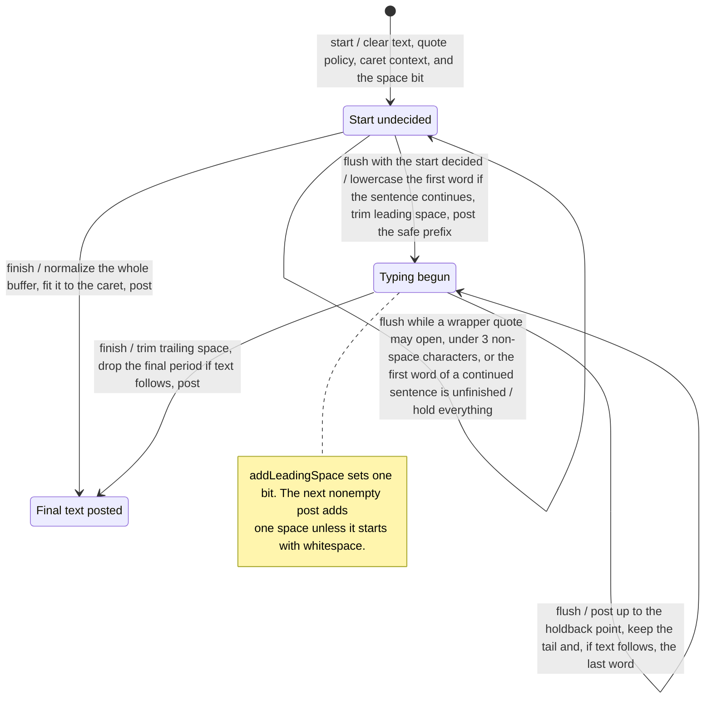

Invariants:

- Typed text is never edited afterwards. Enforced by holding undecided text back ([L279-297](../../Sources/Paste/StreamingTypist.swift#L279)).
- A wrapper quote is held unless the workflow keeps quotes. Enforced ([L333](../../Sources/Paste/StreamingTypist.swift#L333)).
- One leading space per request, and an empty post does not use it. Enforced ([L357-360](../../Sources/Paste/StreamingTypist.swift#L357)).
- The typed text matches the fitted text on the clipboard. Assumed: it depends on `ModelOutputNormalizer` and `SentenceFit` agreeing with the caller's final normalization, and on the caller setting the caret context and quote policy before the first append.

Tests: `StreamingTypistTests`: `requestedQuotesSurviveIncrementalAndForcedFlush`, `sizeThresholdRetainsUndecidedQuoteAndWhitespaceSuffix`, `cadenceRetainsUndecidedQuoteAndWhitespaceSuffix`, `finishAppliesStreamingQuoteAndTailNormalization`; `TypedDeliveryTests.repeatedSpacingRequestPostsOnlyOneSpace`, `TypedDeliveryTests.streamingSmartSpacingSurvivesTheRealTypist`; `CaretFitStreamingTests`: `waitsForCompleteFirstWordAndDropsFinalPeriod`, `preservesNamesAndAbbreviationsAcrossDeltas`, `protectsGlossaryPhrasesAcrossDeltas`, `finishOnlyUsesSameFit`; `CaretFitDeliveryTests.streamingClipboardMatchesTheTypedText`.

Open questions:

- The setters still work after typing began, which would change the fit midway. No caller does this today; nothing prevents it.

## Microphone and audio

### Recorder session

`AudioRecorder` decides whether a microphone session exists and which run it belongs to. `start` stops any old session, waits for microphone permission, and starts capture only if no stop or newer start happened meanwhile; `finish` hands the session to a detached task that drains the last buffers, and `stop` ends it at once. A session failure ends its stream with the error and tells the owner only if the generation still matches.

State: [`AudioRecorder.generation`](../../Sources/Audio/AudioRecorder.swift#L52), [`captureSession`](../../Sources/Audio/AudioRecorder.swift#L53), [`continuation`](../../Sources/Audio/AudioRecorder.swift#L54), [`onFailure`](../../Sources/Audio/AudioRecorder.swift#L46).

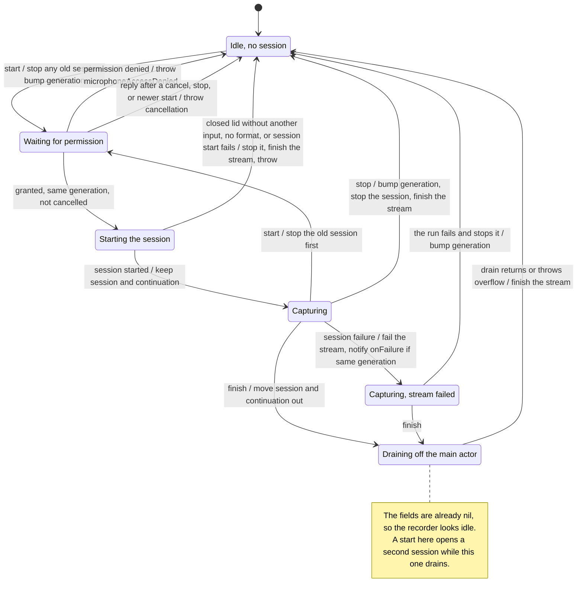

Invariants:

- A permission reply after a stop or a newer start never opens the microphone. Enforced by the cancellation and generation checks after the await ([L86-87](../../Sources/Audio/AudioRecorder.swift#L86)).
- A failed start leaves nothing running, and a denial creates no session. Enforced ([L82-84](../../Sources/Audio/AudioRecorder.swift#L82), [L131-137](../../Sources/Audio/AudioRecorder.swift#L131)).
- A late failure from an old session never reaches the current run. Enforced by `captureGeneration` ([L122-128](../../Sources/Audio/AudioRecorder.swift#L122)); `AppState` also tags its handler with the run ID ([AppState+VoiceRun.swift L69-71](../../Sources/App/AppState+VoiceRun.swift#L69)).
- `finish` keeps the final buffers; `stop` drops them. Enforced ([L99-107](../../Sources/Audio/AudioRecorder.swift#L99)) with the session's drain below.
- `finish` follows a `start` that returned, and no `start` runs while a session drains. Assumed: `finish` does not bump the generation, so it would not invalidate a start still waiting for permission. The voice run's order provides this ([AppState+VoiceRun.swift L72](../../Sources/App/AppState+VoiceRun.swift#L72), [L199-204](../../Sources/App/AppState+VoiceRun.swift#L199)).
- A failure does not stop the session by itself. Assumed: the run's failure path calls `stop` ([AppState+VoiceRun.swift L52-55](../../Sources/App/AppState+VoiceRun.swift#L52)).

Tests: `AudioRecorderTests`: `startDoesNotRetryFailedCaptureSessionStart`, `deniedMicrophonePermissionDoesNotCreateCaptureSession`, `normalFinishPreservesFinalCallbackWhileCancelDiscardsIt`, `closedLidUsesReplacementFormatWithoutChangingPreference`, `closedLidFailureNeverCreatesCaptureSession`; `PipelineLifecycleRegressionTests.cancellationDuringPermissionMustNotLeaveCaptureRunning`; `AudioFailureTests.lateCaptureOverflowMustPreventDelivery`.

Open questions:

- The run lifecycle replay uses a fake recorder, so this ordering is covered by example tests only. A model with permission replies, failures, finish, and stop as actions would check "the microphone is never left open" directly.

### AudioQueue capture

`AudioQueueCaptureSession` is the native capture under the recorder: three 4,096-frame buffers cycle through an AudioQueue whose callbacks run on one serial queue. Finishing marks the session as draining, stops the queue, and keeps the callbacks the stop delivers; stopping marks it stopped first, so those callbacks are dropped. The first buffer the stream drops marks an overflow, reports it once, and stops re-enqueueing.

State: [`queue`](../../Sources/Audio/AudioRecorder.swift#L189), [`stopped`](../../Sources/Audio/AudioRecorder.swift#L190), [`draining`](../../Sources/Audio/AudioRecorder.swift#L191), [`overflowed`](../../Sources/Audio/AudioRecorder.swift#L192), and [`onFailure`](../../Sources/Audio/AudioRecorder.swift#L181), guarded by [`lock`](../../Sources/Audio/AudioRecorder.swift#L188), with callbacks on [`callbackQueue`](../../Sources/Audio/AudioRecorder.swift#L187).

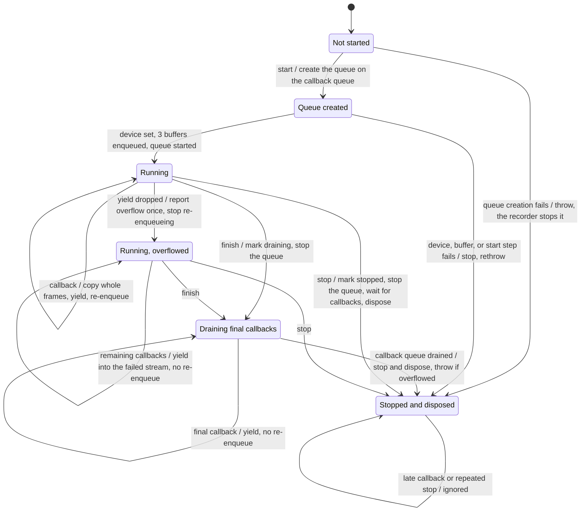

Invariants:

- Buffers are disposed only after the last callback returns. Enforced: `callbackQueue.sync {}` before `AudioQueueDispose` ([L241-245](../../Sources/Audio/AudioRecorder.swift#L241)).
- Final callbacks are kept on finish and dropped on stop. Enforced by order: draining is set and the callback queue drained before `stop` marks the session stopped ([L250-260](../../Sources/Audio/AudioRecorder.swift#L250)).
- No buffer is re-enqueued after a stop, a finish, or an overflow. Enforced under the lock ([L337-346](../../Sources/Audio/AudioRecorder.swift#L337)).
- Overflow is reported once. Enforced by the locked flag ([L319-324](../../Sources/Audio/AudioRecorder.swift#L319)).
- Neither caller runs on the callback queue, and a session is used once. Assumed (comment at [L242-243](../../Sources/Audio/AudioRecorder.swift#L242)); `start` sets `queue` outside the lock, before the queue starts ([L217](../../Sources/Audio/AudioRecorder.swift#L217)).
- Native stop, dispose, and re-enqueue succeed. Assumed: their status codes are ignored ([L241](../../Sources/Audio/AudioRecorder.swift#L241), [L245](../../Sources/Audio/AudioRecorder.swift#L245), [L345](../../Sources/Audio/AudioRecorder.swift#L345)).

Tests: `AudioRecorderTests.audioQueueBytesAreCopiedIntoPCMBuffer`, `AudioRecorderTests.aTrailingPartialFrameIsNotCopied`; `normalFinishPreservesFinalCallbackWhileCancelDiscardsIt` checks the finish and stop contract with a fake session.

Open questions:

- No test drives a real AudioQueue, so the native start, drain, and dispose order and a callback racing `stop` are unexercised. A replay would need a fake AudioQueue seam.

### Bounded audio handoff

Every audio stage passes buffers on through a stream that holds at most 256. A buffer that does not fit ends the stream with `audioBufferOverflow`, after the 256 held ones, so dropped speech fails the run instead of becoming a shorter transcript delivered as a success.

State: [`AudioBufferStream.capacity`](../../Sources/Audio/AudioBufferStream.swift#L7) and the stream from [`make()`](../../Sources/Audio/AudioBufferStream.swift#L9); its queue and finish state live inside `AsyncThrowingStream`. Producers hold the continuation, for example [`AudioRecorder.continuation`](../../Sources/Audio/AudioRecorder.swift#L54) and [`AudioQueueCaptureSession.continuation`](../../Sources/Audio/AudioRecorder.swift#L186).

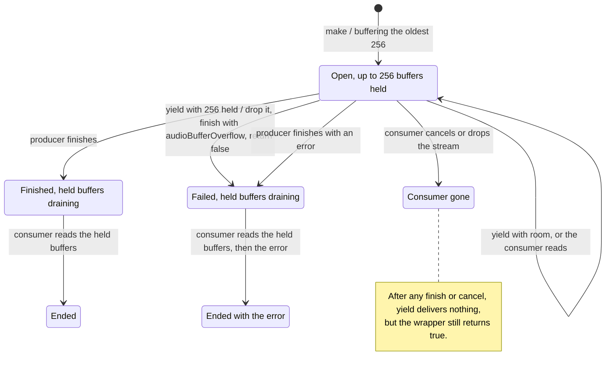

Invariants:

- At most 256 buffers wait in any stage. Enforced by `.bufferingOldest(256)` ([L10](../../Sources/Audio/AudioBufferStream.swift#L10)).
- Overflow is never silent. Enforced: `yield` finishes the stream with the error and returns false ([L13-19](../../Sources/Audio/AudioBufferStream.swift#L13)).
- True from `yield` does not mean delivered: it is also true after the stream finished or the consumer left. By design; `AudioFanOut` reads the raw result where it needs to know.
- Concurrent yield, finish, and cancel are ordered by `AsyncThrowingStream`. Assumed.

Tests: `AudioFailureTests.audioBufferOverflowFailsExplicitlyAndBoundsQueue`, `AudioFailureTests.audioStagesPreserveUpstreamFailure`.

Open questions:

- A producer cannot tell that its consumer left, so the recorder keeps capturing until the run stops it. Harmless today, because every ending of a run stops the recorder.

### Audio fan-out

`AudioFanOut` splits one audio stream into two bounded streams, the live preview and the final transcription ([AppState+VoiceRun.swift L151](../../Sources/App/AppState+VoiceRun.swift#L151)), fed by one detached task. A branch that drops a buffer, or whose consumer stopped, is left out from the next buffer on without affecting the other; the producer is cancelled once both branches have terminated.

State: the two streams [`first` and `second`](../../Sources/Audio/AudioFanOut.swift#L6), the producer [`task`](../../Sources/Audio/AudioFanOut.swift#L8), its live set [`outputs`](../../Sources/Audio/AudioFanOut.swift#L9), and the termination count [`openOutputs`](../../Sources/Audio/AudioFanOut.swift#L33).

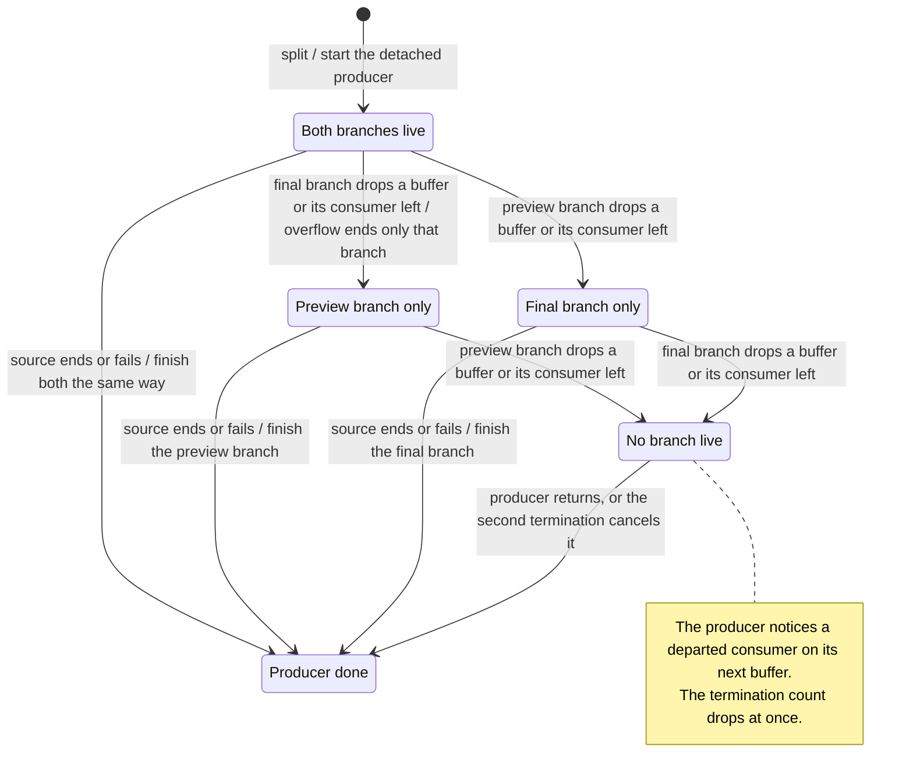

Invariants:

- A slow or cancelled branch never stops its sibling. Enforced: each yield result is handled per branch ([L13-25](../../Sources/Audio/AudioFanOut.swift#L13)).
- A source error reaches every live branch. Enforced ([L29-31](../../Sources/Audio/AudioFanOut.swift#L29)).
- The producer stops once both branches end. Enforced by the counter ([L33-41](../../Sources/Audio/AudioFanOut.swift#L33)); assumes each termination handler runs exactly once and the source iteration honors cancellation.
- Nobody changes a buffer after yielding it, because both branches get the same object. Assumed ([AVAudioPCMBuffer+Sendable.swift L3](../../Sources/Audio/AVAudioPCMBuffer+Sendable.swift#L3)).

Tests: `ParakeetPipelineTests.fanOutKeepsFeedingOneOutputAfterTheOtherConsumerIsCancelled`, `ParakeetPipelineTests.fanOutForwardsASourceErrorToBothOutputs`.

Open questions:

- No test overflows one branch while the other keeps going.

### Level tap

`AudioLevelTap` sits between the recorder and transcription. It forwards each buffer into its own bounded stream first, then reports the buffer's loudness for the cue and the release tail. If its output is full it fails the stream with overflow and calls `onOverflow`, which fails the run, so audio lost after the key was released cannot reach delivery.

State: the output stream and [`continuation`](../../Sources/RecordingCue/AudioLevelMeter.swift#L93), the producer [`task`](../../Sources/RecordingCue/AudioLevelMeter.swift#L94), its own [`smoother`](../../Sources/RecordingCue/AudioLevelMeter.swift#L95), and the output's [`onTermination`](../../Sources/RecordingCue/AudioLevelMeter.swift#L111).

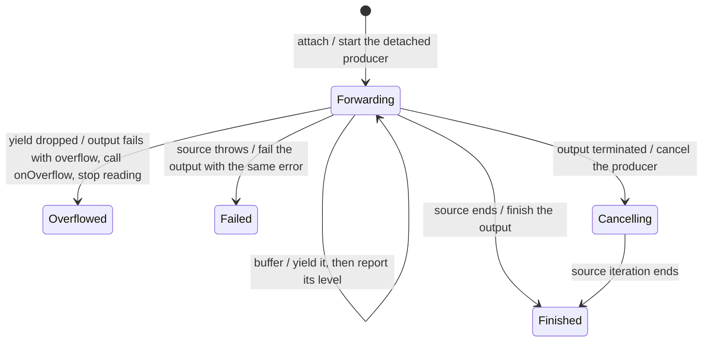

Invariants:

- Overflow fails the output and the run. Enforced ([L98-101](../../Sources/RecordingCue/AudioLevelMeter.swift#L98)); `AppState` turns `onOverflow` into a run failure ([AppState+VoiceRun.swift L74-75](../../Sources/App/AppState+VoiceRun.swift#L74)).
- An upstream error reaches the output unchanged. Enforced ([L107-108](../../Sources/RecordingCue/AudioLevelMeter.swift#L107)).
- Only scalar levels leave the tap; no audio or text is logged or saved. Enforced by construction ([L93-113](../../Sources/RecordingCue/AudioLevelMeter.swift#L93)).
- A consumer can see a buffer before its level is reported, and a level can arrive after cancellation. Assumed harmless: `AppState` drops levels for any run but the current one ([AppState+VoiceRun.swift L78](../../Sources/App/AppState+VoiceRun.swift#L78)).

Tests: `AudioLevelTapTests.forwardsEveryBufferAndReportsLevels`, `AudioFailureTests.audioStagesPreserveUpstreamFailure`, `AudioFailureTests.productionLevelTapOverflowAfterReleaseMustPreventDelivery`.

Open questions:

- No test cancels the tap's output and checks that the producer stops reading its source.

### Output ducking and the restore record

`OutputDucker` lowers the default output device to 30 percent of each channel while recording, and puts it back. Before touching the volume it saves the original and lowered levels under `outputVolumeRestore` and synchronizes UserDefaults, so a crash at any point leaves a record the next launch restores. Restoring touches only channels still within 0.015 of the lowered level, so a change the person made meanwhile wins.

State: the saved record under [`restoreKey`](../../Sources/Audio/OutputDucker.swift#L21) (device UID, original, and lowered levels), written by [`save`](../../Sources/Audio/OutputDucker.swift#L74) and read and validated by [`restoreRecord()`](../../Sources/Audio/OutputDucker.swift#L86); the tolerance [`unchangedLevelTolerance`](../../Sources/Audio/OutputDucker.swift#L23); and the device volumes themselves. There is no in-memory flag. The caller's ordering is in [run-pipeline.md](run-pipeline.md#output-volume).

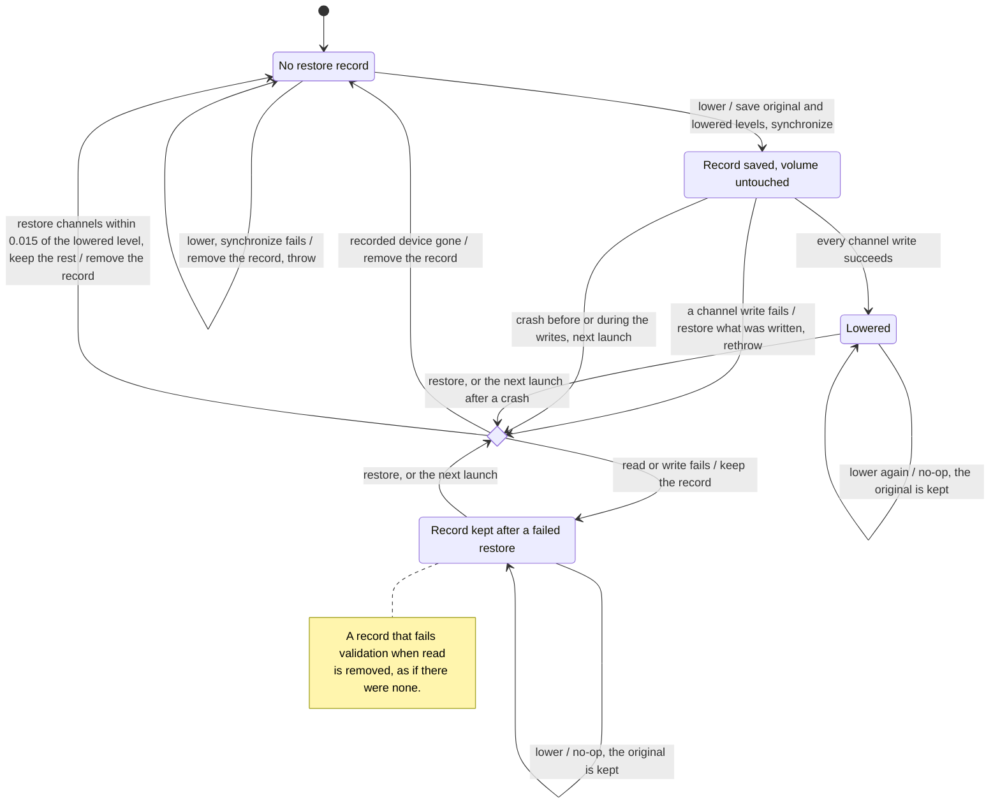

Invariants:

- The original is saved and synchronized before any write. Enforced: `save` throws when synchronizing fails, and `lower` writes only after it ([L41-43](../../Sources/Audio/OutputDucker.swift#L41), [L80-83](../../Sources/Audio/OutputDucker.swift#L80)).
- A second lower never overwrites the saved original. Enforced: `lower` returns while a valid record exists ([L36](../../Sources/Audio/OutputDucker.swift#L36)).
- Restore addresses the recorded device, not today's default. Enforced ([L52](../../Sources/Audio/OutputDucker.swift#L52), [L58](../../Sources/Audio/OutputDucker.swift#L58)).
- A change the person made survives restore, per channel. Enforced by the tolerance ([L53-56](../../Sources/Audio/OutputDucker.swift#L53)). A change back to within 0.015 of the lowered level cannot be told apart and is restored, by design.
- The record goes only after a restore that did not throw, or when the device is gone. Enforced ([L51-62](../../Sources/Audio/OutputDucker.swift#L51)). The removal's synchronize result is ignored; a removal lost in a crash causes a second restore that finds the original levels and changes nothing.
- A corrupt record is deleted when read. Enforced ([L86-108](../../Sources/Audio/OutputDucker.swift#L86)).
- One writer for the key. Assumed: actor isolation covers one `OutputDucker`, and production makes one, used through `OutputVolumeChain`.

Tests: `OutputDuckerTests`: `loweringTwiceRestoresOriginalLevelsExactly`, `restoreWithoutLoweringDoesNothing`, `userChangesSurviveRestore`, `restoresWhenTheDeviceRoundsTheLoweredLevel`, `theSmallestKeyboardVolumeStepCountsAsAUserChange`, `aChangedChannelIsPreservedWhileOtherChannelRestores`, `devicesWithoutSettableVolumeAreSilentNoOps`, `crashRecoveryRestoresRecordedDeviceDespiteDefaultChangeAndRunsOnce`, `crashRecoveryPreservesUserVolumeChange`, `missingRecordedDeviceClearsRecoveryRecord`, `savesOriginalAndLoweredValuesBeforeTouchingVolume`, `virtualMainVolumeAndZeroVolumeRestore`, `partiallyFailedLowerRestoresChangedChannel`, `recoveryAfterCrashBeforeLoweringLeavesOriginalVolumeAlone`, `failedRestoreRetainsRecordForRecovery`; `OutputVolumeCharacterizationTests.crashRecoveryRestoresThroughTheChainThatPendingWorkAwaits`, `OutputVolumeCharacterizationTests.quittingWaitsForACancelledRunsVolumeRestore`. All use a fake controller; none mutates a real device.

Open questions:

- This is the best next candidate for a model: a crash action after each channel write would check that every crash state leads back to the original levels or keeps the person's change, which AGENTS.md's restore rule asks for.
- While a record is kept after a failed restore, later runs do not lower the volume until a restore succeeds. That protects the original; whether a notice is wanted is a product question.

## Recording cue

### Recording cue panel

`RecordingCueController` shows the floating cue for the pipeline's phase: the wave and live transcript while recording, a breathing line while processing, then a success or error flash. Hiding fades the panel out and orders it out 250 ms later, unless a new visible state arrived meanwhile. `StatusIndicator` maps the pipeline state and the [success flash](run-pipeline.md#success-flash) to the state it applies.

State: [`currentState`](../../Sources/RecordingCue/RecordingCueController.swift#L37), [`panel`](../../Sources/RecordingCue/RecordingCueController.swift#L36), [`hideTask`](../../Sources/RecordingCue/RecordingCueController.swift#L38), and the view model [`RecordingCueModel`](../../Sources/RecordingCue/RecordingCueView.swift#L22) with `phase`, `level`, `transcript`, `isOutputPreview`, and `recordingStartedAt` ([L23-27](../../Sources/RecordingCue/RecordingCueView.swift#L23)).

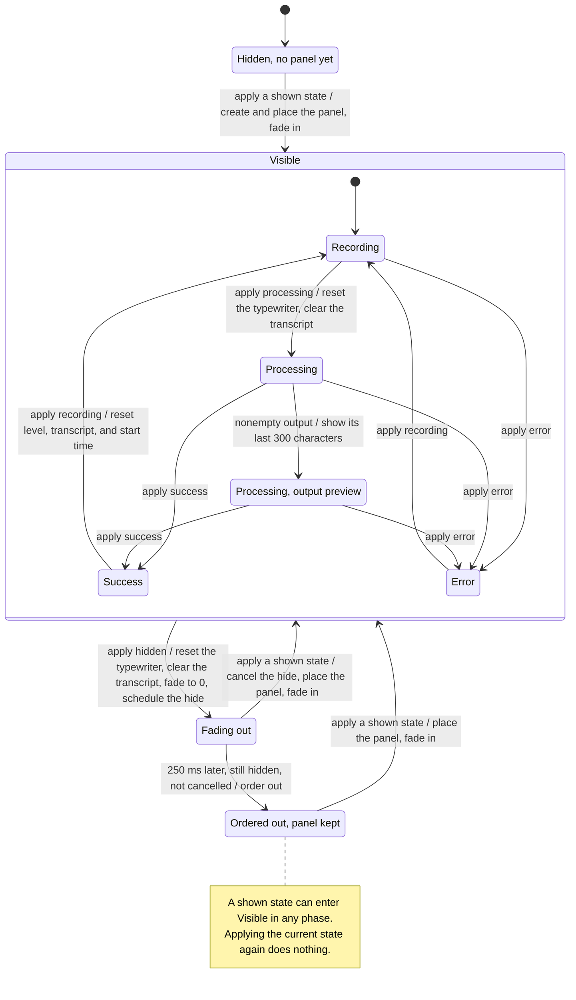

Invariants:

- An old hide never orders out a visible cue. Enforced: `fadeIn` cancels the hide task, and the task rechecks that the state is still hidden ([L126-127](../../Sources/RecordingCue/RecordingCueController.swift#L126), [L152](../../Sources/RecordingCue/RecordingCueController.swift#L152)).
- The panel never takes focus or clicks. Enforced at creation: non-activating and `ignoresMouseEvents` ([L160](../../Sources/RecordingCue/RecordingCueController.swift#L160), [L168](../../Sources/RecordingCue/RecordingCueController.swift#L168)).
- The transcript is cleared on hidden, recording, and processing ([L53-80](../../Sources/RecordingCue/RecordingCueController.swift#L53)). Enforced; on success and error it stays in the model, and the view not showing it there is assumed.
- Applying the state already shown does nothing ([L48](../../Sources/RecordingCue/RecordingCueController.swift#L48)). Enforced; that a new run is separated from the last by another state is assumed.
- Level and transcript updates belong to the current run. Assumed: `AppState` checks the run ID before calling ([AppState+VoiceRun.swift L78](../../Sources/App/AppState+VoiceRun.swift#L78)).

Tests: `RecordingCuePresentationTests`: `cueMirrorsSuccessfulRunLifecycle`, `cueReceivesPartialTranscripts`, `cueHidesOnCancelWithoutSuccessFlash`, `failedRunShowsErrorStateThenHides`, `disabledCueSettingKeepsCueHiddenThroughRun`, `disabledLiveTranscriptKeepsCueButSkipsPartials`, `revisionRunShowsRevisionCaption`; `StatusDisplayCharacterizationTests`. All use a presenter spy, not this panel.

Open questions:

- No test drives the real panel's fade and hide timing.

### Cue typewriter task

`RecordingCueController` reveals the live transcript a few characters every 28 ms. One task runs at a time, and a new transcript only replaces its target. Hidden, recording, and processing cancel it and bump a generation, so a cancelled task that returns late cannot clear a newer task's handle.

State: [`typewriter`](../../Sources/RecordingCue/RecordingCueController.swift#L39), [`typewriterGeneration`](../../Sources/RecordingCue/RecordingCueController.swift#L40), [`typewriterTask`](../../Sources/RecordingCue/RecordingCueController.swift#L41).

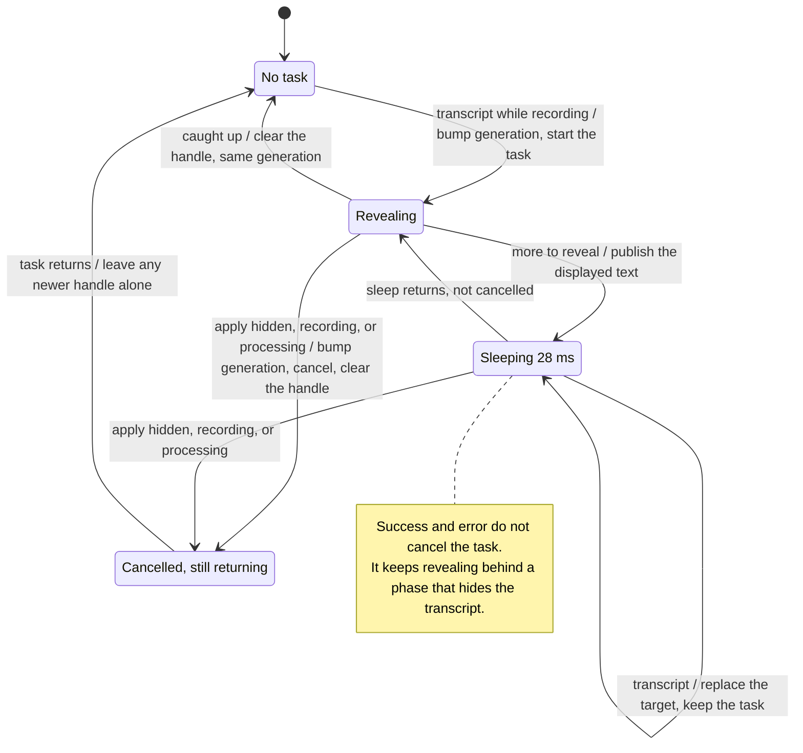

Invariants:

- One task at a time. Enforced by the nil check ([L110](../../Sources/RecordingCue/RecordingCueController.swift#L110)).
- A late return never clears a newer task. Enforced by the generation ([L112-113](../../Sources/RecordingCue/RecordingCueController.swift#L112), [L121](../../Sources/RecordingCue/RecordingCueController.swift#L121)).
- Reveal work runs only while recording. Not enforced: success and error leave the task running until it catches up.

Tests: `TranscriptTypewriterTests` pins the reveal steps; no test drives the task.

Open questions:

- Should success and error cancel the task, as the other phases do? Today it finishes revealing text nobody sees.

## Clipboard

### Clipboard write and rollback

`ClipboardWriter` replaces the clipboard with a result. It first snapshots the plain text already there, up to 1,000,000 bytes, then clears the clipboard and writes the string; if the write is refused, it puts the snapshot back and reports whether the previous clipboard came back whole. Images, files, and other non-text data are never read, so a failed write loses them; the snapshot rules are in [Small machines](#small-machines).

State: the per-call locals [`snapshot`](../../Sources/Clipboard/ClipboardWriter.swift#L44), [`didWrite`](../../Sources/Clipboard/ClipboardWriter.swift#L48), and [`restored`](../../Sources/Clipboard/ClipboardWriter.swift#L52), the snapshot's [`lostItem`](../../Sources/Clipboard/ClipboardWriter.swift#L66), and the pasteboard itself. Between calls the writer keeps only [`pasteboard`](../../Sources/Clipboard/ClipboardWriter.swift#L31) and [`snapshotByteLimit`](../../Sources/Clipboard/ClipboardWriter.swift#L32).

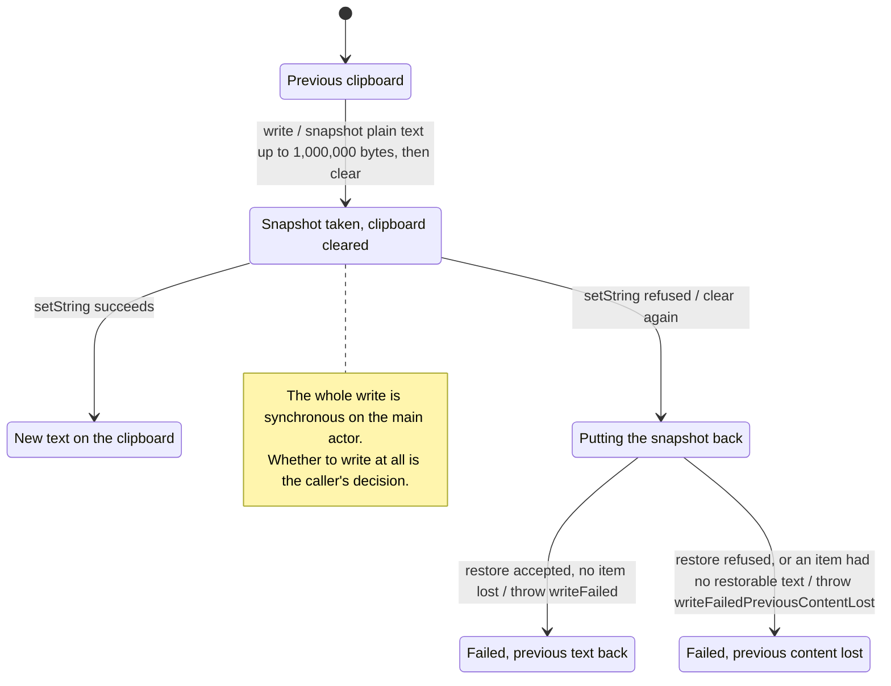

Invariants:

- The snapshot comes before the clear, and a failed write always throws. Enforced ([L44-57](../../Sources/Clipboard/ClipboardWriter.swift#L44)).
- The clipboard is written only on success or an explicit copy, and cancel never writes it. Assumed here: the writer has no run or cancellation context. The run's single commit point enforces it, model-checked in [run-pipeline.md](run-pipeline.md#run-task-and-the-commit-point).
- Promised data is never requested. Enforced: only `.string` is read ([L123](../../Sources/Clipboard/ClipboardWriter.swift#L123), [L128](../../Sources/Clipboard/ClipboardWriter.swift#L128), [L145](../../Sources/Clipboard/ClipboardWriter.swift#L145)).
- No clipboard content is logged. Enforced: the metrics log only the stage, an operation ID, the outcome, the duration, the snapshot's byte count, and whether data was skipped ([L180-196](../../Sources/Clipboard/ClipboardWriter.swift#L180)).
- No other app writes between the snapshot and the write. Assumed: the call has no suspension point, but there is no change-count check.

Tests: `ClipboardWriterTests`: `writeStoresStringOnInjectedPasteboard`, `failedWriteRestoresPreviousString`, `aRefusedRestoreReportsThePreviousClipboardAsLost`, `failedWriteDoesNotRestoreUnsupportedNonStringItem`, `failedWriteRestoresTextFromMixedRichItem`, and the five snapshot tests listed under [Small machines](#small-machines); `RecoveryReliabilityTests.cancellationBeforeDeliveryCreatesNoRecoveryOrHistory`. All use an injected pasteboard.

Open questions:

- A rollback after a refused write restores plain text only, so the person's rich text or image is gone; the error says so ("previous content lost"), but nothing can bring it back. Whether to keep more is a product question, since reading other types makes the source app render promised data on every write.

## Accessibility reads

### Selection capture

`SelectionReader` reads, for a workflow that opted in, the selected text of the app that was in front when the shortcut was pressed. It reads only while that app stays in front and its focused element stays the same, never reads a field whose subrole says secure, trims the text and caps it at 20,000 characters, and returns the element as the run's delivery source.

State: per call: the requested PID, the detached read [`result`](../../Sources/Context/SelectionReader.swift#L55), the focused [`element`](../../Sources/Context/SelectionReader.swift#L69) and its reread [`current`](../../Sources/Context/SelectionReader.swift#L74), and the outcome [`SelectionCapture`](../../Sources/Context/SelectionReader.swift#L5) with an optional [`source`](../../Sources/Context/SelectionReader.swift#L14). Between calls the reader keeps only its injected closures ([L26-28](../../Sources/Context/SelectionReader.swift#L26)).

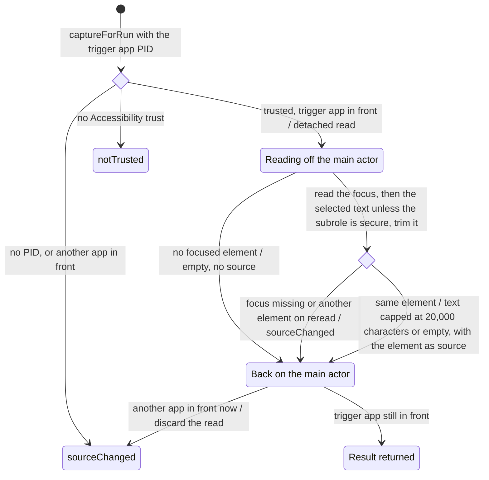

Invariants:

- The trigger app is in front before and after the read, and the focused element is the same before and after the selected-text read. Enforced ([L51-60](../../Sources/Context/SelectionReader.swift#L51), [L69-77](../../Sources/Context/SelectionReader.swift#L69)).
- A field whose subrole says secure is never read. Enforced ([L110-118](../../Sources/Context/SelectionReader.swift#L110)). A secure field that reports no subrole is read; that macOS exposes no text for it is assumed.
- The text is trimmed, capped at 20,000 characters, and kept in memory only: never logged, saved, or obtained by a synthesized Command-C. Enforced by construction ([L72-86](../../Sources/Context/SelectionReader.swift#L72)).
- The opt-in and a cancelled run's late result are the caller's job. Assumed here: the reader ignores task cancellation, and `AppState` reads only for opted-in workflows and drops a result that arrives after cancel ([run-pipeline.md](run-pipeline.md#run-context-at-the-trigger)).
- Each Accessibility read times out after 100 ms; the capture as a whole has no deadline. Enforced per read ([L137](../../Sources/Context/SelectionReader.swift#L137)).

Tests: `SelectionReaderTests`: `changedForegroundProcessDoesNotReadSelection`, `untrustedReaderReturnsNotTrustedWithoutReading`, `fieldChangeDuringSelectionReadDiscardsTextAndIdentity`, `validatedSelectionRetainsItsSourceAndCharacterCap`, `missingOrWhitespaceSelectionIsEmpty`, `captureDoesNotReadSelectedTextFromSecureField`; `RecoveryReliabilityTests.cancellationDuringSourceCaptureIgnoresLateSelection`, `RecoveryReliabilityTests.selectionDeliveryUsesCapturedSourceWithoutRecapturingAnotherField`.

Open questions:

- The caret probe refuses while Secure Event Input is on; selection capture checks only the subrole. Should it check both?

### Delivery target check

`DeliveryTarget` pins delivery to the editor that had focus at the trigger: the app's PID and its focused Accessibility element. Before a paste or a typed flush, `isCurrent` checks that the app is in front, reads the focused element off the main actor, and checks the app again, because someone can switch apps while the read is pending and the old app still reports its old field as focused.

State: [`processID`](../../Sources/Context/DeliveryTarget.swift#L7), [`element`](../../Sources/Context/DeliveryTarget.swift#L8), and the test seams [`contextProbe`](../../Sources/Context/DeliveryTarget.swift#L9) and [`checkCurrent`](../../Sources/Context/DeliveryTarget.swift#L10). No result is cached.

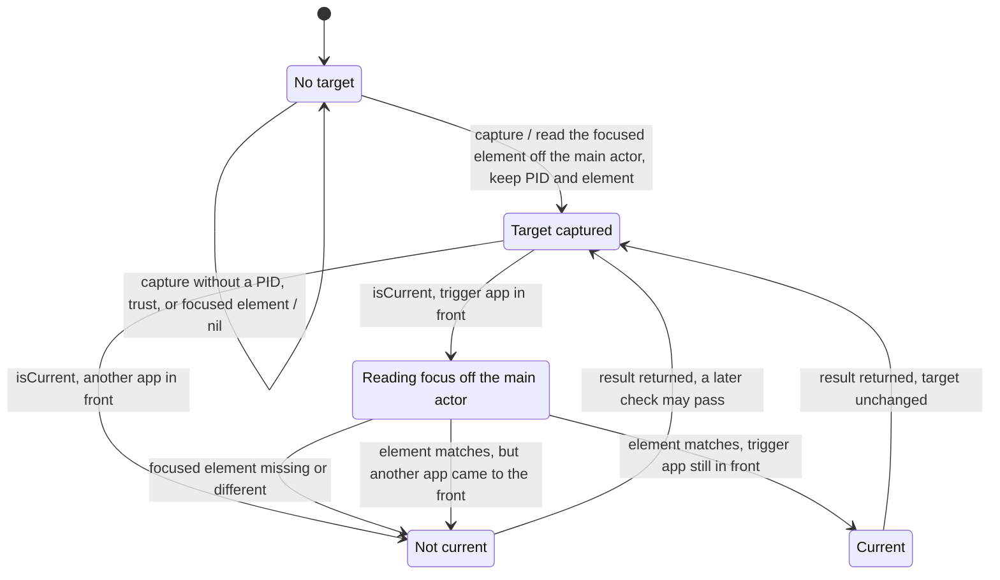

Invariants:

- The front app is checked on both sides of the focus read. Enforced in `focusStillHeld` ([L65-73](../../Sources/Context/DeliveryTarget.swift#L65)).
- Only identity is kept, never field contents. Enforced: an immutable PID and an opaque element ([L5-10](../../Sources/Context/DeliveryTarget.swift#L5)).
- True is a sample, not a lease. Assumed: callers use it at once, and the typist rechecks the app and secure input per step.
- Production targets have an element and no closures; test targets the reverse. Enforced by the initializers ([L13-32](../../Sources/Context/DeliveryTarget.swift#L13)).
- Cancellation is the caller's job. Assumed: `isCurrent` does not check it.

Tests: `DeliveryTargetPinningTests`: `switchingAppsDuringTheFocusReadFailsTheCheck`, `editorChangeDuringPasteDelayFallsBackToClipboard`, `sameApplicationFieldChangeStopsStreaming`.

Open questions:

- None of these tests drives a real editor through Accessibility.

### Caret context probe

`DeliveryTarget.caretContext` reads a bounded window around the caret in the pinned field, for smart spacing and opt-in caret fit: one UTF-16 unit before the caret for spacing, 64 before and 16 after for caret fit. Only three booleans come back. The read races a 100 ms deadline; a late, refused, or changed read gives nil, and delivery goes on without the context.

State: all per call: the result of the timeout race ([L89](../../Sources/Context/DeliveryTarget.swift#L89)), the detached [`reader`](../../Sources/Context/DeliveryTarget.swift#L91), the selected range and character count it reads, and the text before and after the caret. [`withOperationTimeout`](../../Sources/Core/OperationTimeout.swift#L7) owns the worker and the timer.

```mermaid
stateDiagram-v2
    state EntryChoice <<choice>>
    state "Reading off the main actor" as Reading
    state "Reading before the caret" as BeforeRead
    state "Reading one unit before the caret" as OneUnit
    state "Rechecking the field" as Recheck
    state ExitChoice <<choice>>
    state "nil" as Rejected
    state "Booleans returned" as Booleans
    [*] --> EntryChoice: caretContext
    EntryChoice --> Rejected: cancelled, untrusted, secure input on, or another app in front
    EntryChoice --> Reading: checks pass / race the read against 100 ms
    Reading --> Rejected: focus moved, secure subrole, bad range, or range past the character count
    Reading --> BeforeRead: valid range / 64 units before and 16 after for caret fit, 1 before for spacing
    BeforeRead --> OneUnit: window read refused
    BeforeRead --> Recheck: text before read / read the text after, unreadable means empty
    OneUnit --> Recheck: one unit read / read the text after
    OneUnit --> Rejected: nothing readable, or cancelled
    Recheck --> Rejected: field changed, or cancelled
    Recheck --> ExitChoice: same field / parse three booleans
    Reading --> Rejected: 100 ms deadline / cancel the reader, ignore late work
    ExitChoice --> Rejected: caller cancelled, secure input on, or another app in front
    ExitChoice --> Booleans: still safe
    note right of Rejected
        The deadline can end the call in any reading state.
        Delivery then goes on without the context.
    end note
```

Invariants:

- The read window is bounded. Enforced ([L112-119](../../Sources/Context/DeliveryTarget.swift#L112)).
- Secure fields and Secure Event Input give nil. Enforced: secure input on entry and on return ([L86](../../Sources/Context/DeliveryTarget.swift#L86), [L128](../../Sources/Context/DeliveryTarget.swift#L128)), the secure subrole before any text read ([L95-97](../../Sources/Context/DeliveryTarget.swift#L95)).
- The front app and the focused element are checked before, during, and after. Enforced ([L87](../../Sources/Context/DeliveryTarget.swift#L87), [L92](../../Sources/Context/DeliveryTarget.swift#L92), [L121](../../Sources/Context/DeliveryTarget.swift#L121), [L128](../../Sources/Context/DeliveryTarget.swift#L128)).
- Only booleans leave the method. Enforced: `CaretContext.parse` ([L122](../../Sources/Context/DeliveryTarget.swift#L122)).
- The caller waits about 100 ms at most. Enforced: `withOperationTimeout` does not wait for the cancelled worker ([OperationTimeout.swift L24-28](../../Sources/Core/OperationTimeout.swift#L24)); an Accessibility call already in flight finishes on its own and its result is dropped.
- The caret and text do not move within the same field during the reads. Assumed: the recheck compares the element, not a version.

Tests: `CaretFitDeliveryTests.contextTimeoutAndChangedTargetFallBack`, `CaretFitDeliveryTests.aStreamThatTypedNothingFitsTheClipboardAfresh`, `SmartSpacingTests.aSlowReadTimesOutWithoutHoldingDelivery`, `SmartSpacingTests.classifiesOnlyOnePrecedingUnit`, `SentenceFitTests.parsesBoundedContext`.

Open questions:

- The tests use injected probes, so real Accessibility range formats, secure-field metadata, and the native messaging timeout are untested.

## Suspected defects not yet verified

The inventory's one suspicion, turning the Fn option off during an ordinary Fn hold, became F1, confirmed and fixed. These three came up while checking the code for this document. None has been reproduced, and no model covers them.

- **Removing a workflow during its hold drops the release.** Section: [Shortcut registration, pause, and Esc](#shortcut-registration-pause-and-esc). Sequence: hold mode; press workflow W's shortcut (recording starts); remove W from the workflow list while holding; release. `rebuildWorkflowShortcuts` detaches W and the membership guard drops a queued release, so recording continues until Esc, pausing, or the duration limit.
- **A key pressed within one Fn poll of Fn reads as Fn alone.** Section: [Fn gesture](#fn-gesture). Sequence: hold mode, idle; Fn down; another key down less than 30 ms later, before the next poll; hold both 300 ms or more; release both. The press is dated at the first poll that sees Fn, after the key, so no combination is seen and the release delivers a dictation. In toggle mode the same chord released within 500 ms stops a recording.
- **Fn ends no toggle run after a mode switch.** Section: [Fn hold, latch, and toggle](#fn-hold-latch-and-toggle). Sequence: toggle mode; Fn double-tap (recording starts); set the hotkey mode to hold; Fn tap or hold. Both are ignored, so only Esc, the dictate shortcut, or the duration limit ends the run.

## Small machines

| Machine | State | What it remembers or decides |
| --- | --- | --- |
| Typing step planner | locals of [`TypingStep.plan`](../../Sources/Paste/StreamingTypist.swift#L10) | Splits text into chunks of at most 20 UTF-16 units without splitting a grapheme, and turns each line break into Shift-Return; a single grapheme over the limit goes whole. Tests: `unicodeChunksNeverSplitSurrogatePairsOrGraphemes`, `surrogateAtChunkBoundaryStaysIntact`, `mixedTextUsesExplicitLineBreaks`, `splitCRLFDeltasProduceOneLineBreak`. |
| Paste gate and strategy | none between calls: [`AutoPaster.paste`](../../Sources/Paste/AutoPaster.swift#L86), [`PasteStrategy.choose`](../../Sources/Paste/PasteStrategy.swift#L8), [`PasteKeyResolver.resolve`](../../Sources/Paste/PasteKeyResolver.swift#L8) | Each paste checks trust, then Secure Event Input, then posts Command with the V key of the current layout; apps on Chromium 155 or 156 get typed text instead. The target check and paste delay live in `DeliveryCoordinator`. Tests: `AutoPasterTests`, `PasteStrategyTests`, `PasteKeyResolverTests`. |
| Output volume read and write | none between calls: [`CoreAudioOutputVolumeController`](../../Sources/Audio/CoreAudioOutputVolumeController.swift#L5) | Reads the main volume, or each settable channel; writes channels in order and stops at the first failure, leaving earlier channels written, which the ducker's record covers. Tests: `OutputDuckerTests` with a fake controller; nothing touches a real device. |
| Microphone choice | none between calls: [`InputResolution.resolve`](../../Sources/Audio/InputResolution.swift#L26) | The saved microphone if present, else the system default. With no saved choice and Bluetooth avoidance on, a Bluetooth default gives way to the built-in or another real non-Bluetooth input. With the lid closed, the built-in gives way to another input, or the start fails. Tests: `InputResolutionTests`, the `selectedDeviceResolution` and `recordingFormat` tests in `AudioRecorderTests`. |
| Transcript typewriter | [`displayed` and `target`](../../Sources/RecordingCue/TranscriptTypewriter.swift#L8) | Reveals at least two characters per step, and snaps back to the common prefix when recognition rewrites earlier words. Tests: `TranscriptTypewriterTests`. |
| Cue caption | [`captionText(at:)`](../../Sources/RecordingCue/RecordingCueView.swift#L113), from `RecordingCueModel` | Derived each frame: "esc to cancel" after 5 seconds of recording, "Writing result" during an output preview, else the run's caption. No direct test. |
| Wave energy | [`RenderState`](../../Sources/RecordingCue/RecordingCueView.swift#L40) | The drawn wave eases toward its target, rising faster than it falls, with frame gaps clamped to 0.1 s. No direct test. |
| Level smoothing | [`LevelSmoother.current`](../../Sources/RecordingCue/AudioLevelMeter.swift#L11) | Maps RMS between -50 and -8 dBFS onto 0 to 1 and smooths it, attack 0.55 and release 0.2. Tests: `LevelSmootherTests`. |
| Clipboard snapshot | locals of [`PasteboardSnapshot.capture`](../../Sources/Clipboard/ClipboardWriter.swift#L69) | Keeps each item's plain text while the total stays within the limit; an item with no restorable text, or past the limit, is lost on its own and makes the error "previous content lost". Tests: `writeDoesNotRequestPromisedRichDataDuringSnapshot`, `failedWriteDoesNotSnapshotLargeUnsupportedExistingPasteboard`, `failedWriteDoesNotRestoreOversizedTextSnapshot`, `anItemPastTheLimitIsLostButTheItemsThatFitComeBack`, `failedWriteRestoresTextWhenExistingPasteboardIsWithinSnapshotLimit`. |
