# Providers, persistence, settings, and shell state machines

This area has 51 state machines: 43 have a statechart below and 8 are small enough for the [closing table](#small-machines). Seventeen are High importance because an AGENTS.md hard rule or a visible failure depends on them. The history opt-out must delete its file or stay on, and never claim an opt-out while data remains (M16, M17, M22). A newer build's settings blob must never be overwritten (M25). Private input may reach only the provider frozen at the trigger, and the two CLIs get no tools and no saved session (M11, M12, M15). Every provider request must end, by its deadlines, by cancellation, or by stopping the CLI's process group, without accepting a cut-off answer (M01, M03 to M06). The API key must stay in the local file store and never read as missing after a read failure (M32, M33), and an update must not relaunch the app during dictation (M51, M52). None is formally validated. The one machine here that was, the learning opt-out (M23, model-checked by `LearningOptOutModel`), was removed with glossary learning in `a3dec87`, together with the startup recording cleanup (M24) and the Glossary learning controls (M41); the cleanup of the files learning left is charted as [M38 in the speech and glossary check inventory](speech-learning.md#m38-retired-learning-cleanup). Nine suspected defects remain unverified ([SH1 to SH9](#suspected-defects)). As read, none lets data persist without an opt-in or lets an opt-out claim success while data remains; they are stale or misleading UI and stats state.

Checked again on 2026-11-15 against commit `5386bbc`, after glossary learning was removed and reasoning in content parts counted as stream progress again (`a3dec87`), and after the OpenAI-compatible provider changed which chunks count as progress and how it remembers a temperature rejection (`a3c29a1` to `fb5f1c6`). M01 to M03, M21, M22, M27, M28, M39, M47, and M51 to M53 were compared with their source lines again, and every other line link was checked and moved where its lines moved. Line anchors refer to `5386bbc`. M23, M24, and M41 were removed with the code they charted, and their numbers are not reused. The first check, on 2026-11-14 against `42b82ba`, compared every High machine's states, events, and guards with its source lines and spot-checked Medium and Low machines for their state variables and line numbers. UserDefaults keys and files on disk count as state. Charts write guards in words. M27 and M42 overlap the [speech and glossary check](speech-learning.md) inventory (its M35 and M30), and the cleanup that M52 waits for is charted in [run-pipeline.md](run-pipeline.md#quitting).

| Machine | Owner | Kind | Importance | Validation |
| --- | --- | --- | --- | --- |
| [M01 OpenAI request and fallback](#m01-openai-request-and-fallback) | `OpenAICompatibleTransformer` | Mixed | High | Not formally validated |
| [M02 Temperature capability memory](#m02-temperature-capability-memory) | `OpenAICompatibleTransformer` | Implicit | Medium | Not formally validated |
| [M03 SSE framing, progress, and completion](#m03-sse-framing-progress-and-completion) | `OpenAISSEParser`, `consumeSSE` | Mixed | High | Not formally validated |
| [M04 Streaming inactivity deadline](#m04-streaming-inactivity-deadline) | `StreamingInactivityWatchdog` | Implicit | High | Not formally validated |
| [M05 Cancellable deadline race](#m05-cancellable-deadline-race) | `withOperationTimeout`, `awaitCancellableValue` | Implicit | High | Not formally validated |
| [M06 CLI process and termination](#m06-cli-process-and-termination) | `ProcessCommandRunner`, `RunningProcessBox` | Mixed | High | Not formally validated |
| [M07 Process exit latch](#m07-process-exit-latch) | `ProcessExitSignal` | Implicit | Medium | Not formally validated |
| [M08 Nonblocking stdin](#m08-nonblocking-stdin) | `StdinFeeder` | Implicit | Medium | Not formally validated |
| [M09 Bounded pipe collection and drain](#m09-bounded-pipe-collection-and-drain) | `PipeDataCollector` | Mixed | Medium | Not formally validated |
| [M10 CLI metrics once flags](#small-machines) | `CLIProcessMetricsRecorder` | Implicit | Low | Not formally validated |
| [M11 Codex invocation and temporary workspace](#m11-codex-invocation-and-temporary-workspace) | `CodexCLITransformer` | Implicit | High | Not formally validated |
| [M12 Claude invocation and temporary workspace](#m12-claude-invocation-and-temporary-workspace) | `ClaudeCLITransformer` | Implicit | High | Not formally validated |
| [M13 Prepared Apple session and generation](#m13-prepared-apple-session-and-generation) | `AppleOnDeviceTransformer` | Mixed | Medium | Not formally validated |
| [M14 Cumulative snapshot adaptation](#m14-cumulative-snapshot-adaptation) | `CumulativeSnapshotDeltaAdapter` | Mixed | Medium | Not formally validated |
| [M15 Provider configuration snapshots](#m15-provider-configuration-snapshots) | `AppSettingsTransformerProvider`, `TransformerSnapshot` | Mixed | High | Not formally validated |
| [M16 History persistence, ordered writes, clear, and flush](#m16-history-persistence-ordered-writes-clear-and-flush) | `HistoryStore`, `HistoryDisk` | Implicit | High | Not formally validated |
| [M17 Leftover history cleanup and retry](#m17-leftover-history-cleanup-and-retry) | `HistoryStore` | Implicit | High | Not formally validated |
| [M18 History outcome and recovery capabilities](#m18-history-outcome-and-recovery-capabilities) | `DictationRecord` | Mixed | Medium | Not formally validated |
| [M19 Usage writes, deletion, and flush](#m19-usage-writes-deletion-and-flush) | `UsageStatsStore`, `UsageStatsDisk` | Implicit | Medium | Not formally validated |
| [M20 Usage accumulator](#small-machines) | `UsageStats` | Implicit | Low | Not formally validated |
| [M21 Privacy store attachment](#m21-privacy-store-attachment) | `PrivacyOptIns`, `AppSettings` | Implicit | High | Not formally validated |
| [M22 Persist-history opt-in transaction](#m22-persist-history-opt-in-transaction) | `PrivacyOptIns`, `HistoryStore` | Implicit | High | Not formally validated |
| [M25 Versioned settings blobs and backups](#m25-versioned-settings-blobs-and-backups) | `AppSettings` | Mixed | High | Not formally validated |
| [M26 Saved workflow lifecycle and normalization](#m26-saved-workflow-lifecycle-and-normalization) | `Workflow`, `WorkflowList`, `WorkflowBindings` | Mixed | Medium | Not formally validated |
| [M27 Glossary and proposal memory](#m27-glossary-and-proposal-memory) | `GlossaryList`, `GlossaryProposalList` | Mixed | Medium | Not formally validated |
| [M28 Scalar settings and one-time migrations](#m28-scalar-settings-and-one-time-migrations) | `AppSettings` | Mixed | Medium | Not formally validated |
| [M29 Asynchronous locale repair](#m29-asynchronous-locale-repair) | `AppSettings` | Implicit | Medium | Not formally validated |
| [M30 Permission observations](#m30-permission-observations) | `PermissionStatusModel` | Mixed | Medium | Not formally validated |
| [M31 Connection-test generation](#m31-connection-test-generation) | `EndpointConnectionTest` | Mixed | Medium | Not formally validated |
| [M32 Local credential file lifecycle](#m32-local-credential-file-lifecycle) | `KeychainStore` | Implicit | High | Not formally validated |
| [M33 Credential editor and onboarding endpoint check](#m33-credential-editor-and-onboarding-endpoint-check) | `ProviderSections`, `OnboardingView` | Mixed | High | Not formally validated |
| [M34 CLI readiness and catalog display](#m34-cli-readiness-and-catalog-display) | `ProviderSections`, `OnboardingView`, CLI status checkers | Mixed | Medium | Not formally validated |
| [M35 CLI model selection](#m35-cli-model-selection) | `CLIModelPicker` | Implicit | Low | Not formally validated |
| [M36 Launch-at-login mirror](#m36-launch-at-login-mirror) | `LaunchAtLoginController` | Mixed | Low | Not formally validated |
| [M37 Settings navigation and focus requests](#m37-settings-navigation-and-focus-requests) | `SettingsNavigation` | Mixed | Low | Not formally validated |
| [M38 Home projection, provider diagnosis, and seen-results clock](#m38-home-projection-provider-diagnosis-and-seen-results-clock) | `HomeStatus`, `HomeSettingsPane` | Mixed | Medium | Not formally validated |
| [M39 Privacy-pane disk and destination observations](#m39-privacy-pane-disk-and-destination-observations) | `PrivacySettingsPane` | Implicit | Medium | Not formally validated |
| [M40 Glossary editor drafts, selection, and export](#m40-glossary-editor-drafts-selection-and-export) | `GlossarySettingsView` | Implicit | Medium | Not formally validated |
| [M42 Mishearing checks and their UI projection](#m42-mishearing-checks-and-their-ui-projection) | `MishearingSuggestionModel`, `MishearingCheckCopy` | Mixed | Medium | Not formally validated |
| [M43 Delayed settings refocus](#small-machines) | `SettingsWindowFocusController` | Implicit | Low | Not formally validated |
| [M44 Microphone list snapshot](#small-machines) | `DictationSettingsPane` | Implicit | Low | Not formally validated |
| [M45 App name and icon caches](#small-machines) | `AppInfoCache` | Implicit | Low | Not formally validated |
| [M46 Activity-grid hover](#small-machines) | `HomeStatsSection` | Implicit | Low | Not formally validated |
| [M47 Persistent onboarding gate](#m47-persistent-onboarding-gate) | `OnboardingGate` | Mixed | Medium | Not formally validated |
| [M48 Onboarding navigation and first recipe defaults](#m48-onboarding-navigation-and-first-recipe-defaults) | `OnboardingView`, `OnboardingStep`, `OnboardingRecipe` | Mixed | Medium | Not formally validated |
| [M49 Taste result window and celebration](#m49-taste-result-window-and-celebration) | `OnboardingView` | Implicit | Medium | Not formally validated |
| [M50 Onboarding animation clocks](#small-machines) | `FallingDrop`, `SyrupSprinkles` | Implicit | Low | Not formally validated |
| [M51 Updater checks, postponed relaunch, and Dock state](#m51-updater-checks-postponed-relaunch-and-dock-state) | `UpdateController` | Mixed | High | Not formally validated |
| [M52 Application termination handshake](#m52-application-termination-handshake) | `SyrupAppDelegate`, `MenuBarLabel` | Implicit | High | Not formally validated |
| [M53 App bootstrap and inert test host](#m53-app-bootstrap-and-inert-test-host) | `SyrupMain`, `SyrupApp` | Mixed | Medium | Not formally validated |
| [M54 Modal choices and pending app-routing panel](#small-machines) | `confirmDestructiveAction`, `everydayHintAlert`, `WorkflowEditorView` | Implicit | Low | Not formally validated |

## Suspected defects

All nine come from reading the code. None was reproduced, so each stays unverified. SH1 to SH5 come from the inventory; SH6 to SH9 were found while checking it. SH2 and SH6 are alternative outcomes of the same sequence; which one happens depends on when SwiftUI delivers `onChange`, and the static reading favors SH6.

- **SH1, unverified, [M19](#m19-usage-writes-deletion-and-flush). A failed Delete Stats can bring back old numbers over a newer sample.** Delete Stats clears memory and waits for the delete; a dictation records a sample, which queues a write after the delete; the delete fails; the store reloads the old file into memory, dropping the new sample; the queued write then saves the post-delete snapshot. Memory shows the old numbers while the file holds the new snapshot. Requires the later write to succeed where the delete failed. Cause: no guard on the restore at [`UsageStatsStore.swift#L58-L61`](../../Sources/Stats/UsageStatsStore.swift#L58-L61).
- **SH2, unverified, [M33](#m33-credential-editor-and-onboarding-endpoint-check). Onboarding Test can show endpoint A's result under endpoint B.** With a typed key, Test captures URL A and model, then awaits the key save; the person edits the URL to B, and `onChange` invalidates the old generation; the save finishes and `begin()` takes a new current generation; A's result is then published next to B. Cause: the generation is taken after the save at [`OnboardingView.swift#L673-L688`](../../Sources/Onboarding/OnboardingView.swift#L673-L688).
- **SH3, unverified, [M33](#m33-credential-editor-and-onboarding-endpoint-check). A stale existence check can show "Not set" while a key is saved.** The pane appears and starts a detached existence load that reads "absent"; the person adds and saves a key, which sets `hasStoredAPIKey` true; the older load's continuation runs after it and sets it false. The store's lock and the main queue's order make this unlikely. Cause: no request identity at [`ProviderSections.swift#L353-L363`](../../Sources/Settings/ProviderSections.swift#L353-L363).
- **SH4, unverified, [M34](#m34-cli-readiness-and-catalog-display). A CLI status or model list can describe the previous path or account.** Check Claude Code with account folder A; edit the folder to B while the check runs; `onChange` clears the status; A's result then lands as B's status. For Codex, the busy flag clears before the catalog request, so a second check for another path can start and either catalog can land last. Onboarding's problem strings have the same gap. Cause: no identity check at [`ProviderSections.swift#L450-L485`](../../Sources/Settings/ProviderSections.swift#L450-L485) and [`OnboardingView.swift#L690-L715`](../../Sources/Onboarding/OnboardingView.swift#L690-L715).
- **SH5, unverified, [M48](#m48-onboarding-navigation-and-first-recipe-defaults). A key save that finishes after Back, or after a second Continue, moves the guide from the page now shown.** On flavor with a typed key, press Continue; press Back while the save runs; the save succeeds and `advance()` moves from recipe to flavor again. Two Continue presses during one save advance twice: the first reaches taste, and the second, now on taste, finishes the guide and closes the window. The window is one small file write. Cause: no busy flag or captured step at [`OnboardingView.swift#L162-L183`](../../Sources/Onboarding/OnboardingView.swift#L162-L183).
- **SH6, unverified, [M33](#m33-credential-editor-and-onboarding-endpoint-check). Onboarding Test with a typed key can drop its own result.** Test saves the key and clears the draft, then `begin()` marks the check as testing and the check suspends; SwiftUI then delivers `onChange(of: apiKeyInput)`, which invalidates that same generation. The check's result is discarded and the status returns to idle, so the first Test after typing a key shows nothing. Cause: the draft clearing at [`OnboardingView.swift#L663`](../../Sources/Onboarding/OnboardingView.swift#L663) and the invalidation at [`OnboardingView.swift#L524`](../../Sources/Onboarding/OnboardingView.swift#L524).
- **SH7, unverified, [M33](#m33-credential-editor-and-onboarding-endpoint-check). Settings may wipe its own "API key saved" message.** Save stores the key, clears the draft, and shows "API key saved"; the following `onChange(of: apiKeyInput)` calls `invalidate()`, which resets the status to idle. Remove is not affected, because its draft is already empty. Cause: [`ProviderSections.swift#L375-L377`](../../Sources/Settings/ProviderSections.swift#L375-L377) with the invalidation at [`ProviderSections.swift#L40`](../../Sources/Settings/ProviderSections.swift#L40).
- **SH8, unverified, [M34](#m34-cli-readiness-and-catalog-display). Editing a CLI executable path leaves the old path's status on screen.** Only the Claude account folder clears the status when edited ([`ProviderSections.swift#L46`](../../Sources/Settings/ProviderSections.swift#L46)); editing the Codex or Claude path keeps showing the last check, for example "signed in", until Check Status runs again.
- **SH9, unverified, [M17](#m17-leftover-history-cleanup-and-retry). The leftover-history notice can outlive the file.** At launch with Keep history off, deleting an old `history.json` fails, which sets the notice and Try Again. If Keep history is then turned on, the next save replaces the file, but the notice stays and Try Again returns at once while history is on. If Clear history succeeds instead, the message clears but the flag stays, so Try Again reappears beside any later, unrelated history error. Cause: only [`HistoryStore.swift#L92-L95`](../../Sources/History/HistoryStore.swift#L92-L95) clears the flag, and only while off.

## Providers

### M01. OpenAI request and fallback

One OpenAI-compatible run streams its request, retries once without `temperature` when the server rejects that parameter, and falls back to one non-streamed request only when the server says it cannot stream. It returns a normalized answer only if the stream completed and the caller was not cancelled. Three deadlines bound it: the request's 30 s idle timeout until headers, a first-answer limit (ten times the timeout, 5 minutes by default) that covers everything until the first answer text, and the inactivity deadline of M04 once a stream is open; the fallback request has one fixed 30 s deadline for headers, body, and its own temperature retry.

State: [configuration and limits](../../Sources/Translation/OpenAICompatibleTransformer.swift#L86-L91), [`transform` output](../../Sources/Translation/OpenAICompatibleTransformer.swift#L120), the [stream and continuation](../../Sources/Translation/OpenAICompatibleTransformer.swift#L146) with its [producer task](../../Sources/Translation/OpenAICompatibleTransformer.swift#L148) cancelled from [`onTermination`](../../Sources/Translation/OpenAICompatibleTransformer.swift#L170-L172), [`firstAnswerDeadline`](../../Sources/Translation/OpenAICompatibleTransformer.swift#L153-L157) cancelled by [`answerStarted`](../../Sources/Translation/OpenAICompatibleTransformer.swift#L181-L184), and the per-request `sendsTemperature` and `rejectionNamedTemperature` flags in the [stream](../../Sources/Translation/OpenAICompatibleTransformer.swift#L185-L186) and the [fallback](../../Sources/Translation/OpenAICompatibleTransformer.swift#L269-L270).

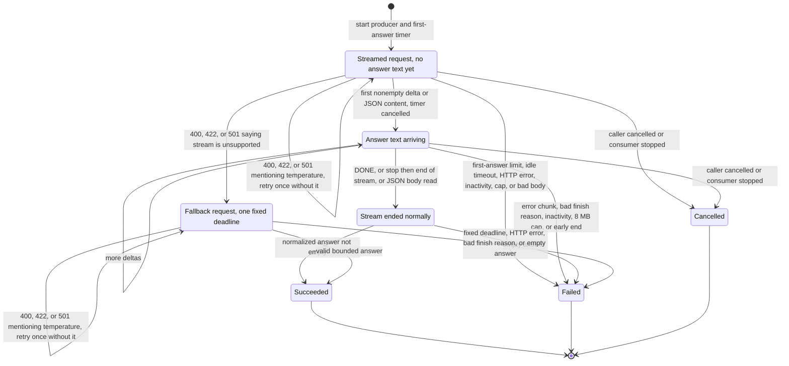

Invariants:

- The fallback runs only for a 400, 422, or 501 whose JSON names `stream` with a known unsupported code; an interrupted or malformed stream never retries. Enforced at [L199-L201](../../Sources/Translation/OpenAICompatibleTransformer.swift#L199-L201) and [L373-L378](../../Sources/Translation/OpenAICompatibleTransformer.swift#L373-L378).
- At most one temperature retry per request path, and only while that path still sends the parameter. Enforced at [L202-L206](../../Sources/Translation/OpenAICompatibleTransformer.swift#L202-L206) and [L277-L282](../../Sources/Translation/OpenAICompatibleTransformer.swift#L277-L282).
- A cancelled caller gets `CancellationError`, never the prefix that arrived. Enforced at [L128-L129](../../Sources/Translation/OpenAICompatibleTransformer.swift#L128-L129).
- The first nonempty text ends the first-answer limit, so a slow model writing a long answer is bounded only by inactivity and the 8 MB cap. Enforced at [L149-L157](../../Sources/Translation/OpenAICompatibleTransformer.swift#L149-L157).
- Every body goes through the 8 MB bounded reader, and only the instruction and the input become messages. Enforced at [L349-L368](../../Sources/Translation/OpenAICompatibleTransformer.swift#L349-L368) and [L440-L443](../../Sources/Translation/OpenAICompatibleTransformer.swift#L440-L443).
- Assumed: URLSession treats `timeoutInterval` as an idle timeout and stops byte iteration on cancellation; M03's cleanup waits for that.
- Assumed: a streaming consumer other than `transform` treats yielded text as provisional and calls `transformAfterStreamingFallback` on the fallback error.

Tests: `OpenAICompatibleTransformerTests.aNonStreamedReplyWhoseHeadersAndBodyTogetherTakeTooLongTimesOut`, `OpenAICompatibleTransformerTests.aSlowAnswerNobodyWatchesIsStreamedAndNotCutOff`, `OpenAICompatibleTransformerTests.aStreamThatNeverAnswersStopsAtTheFirstAnswerLimit`, `OpenAICompatibleTransformerTests.aSlowAnswerPastTheFirstAnswerLimitIsNotCutOff`, `OpenAICompatibleTransformerTests.aCancelledTransformThrowsInsteadOfReturningPartOfTheAnswer`, `RecoveryReliabilityTests.explicitStreamingRejectionFallsBackOnceBeforeOutput`, `RecoveryReliabilityTests.unrelatedHTTPFailureNeverRetries`, `RecoveryReliabilityTests.interruptedOrMalformedStreamNeverRetries`, `RecoveryReliabilityTests.incompleteResponseNeverCommitsOutput`.

Open questions: none from reading the code.

### M02. Temperature capability memory

Decides whether a request sends `temperature`. Any 400, 422, or 501 rejection body that mentions the parameter earns one retry without it. When the rejection blamed `temperature` and the retry then answered (a streamed retry once its answer text starts, a fallback retry once its answer decodes and is not empty), the endpoint and model are remembered for the rest of the process, so later requests leave the parameter out from the start. A rejection whose `param` names another parameter is retried but never remembered.

State: [`modelsWithoutTemperature`](../../Sources/Translation/OpenAICompatibleTransformer.swift#L412) (process-wide, not persisted), keyed by [base URL and model](../../Sources/Translation/OpenAICompatibleTransformer.swift#L414), read by [`sendsTemperatureFirst`](../../Sources/Translation/OpenAICompatibleTransformer.swift#L416-L418), written by [`rememberTemperatureRejection(for:)`](../../Sources/Translation/OpenAICompatibleTransformer.swift#L420-L422), and the per-request `rejectionNamedTemperature` flag in the [stream](../../Sources/Translation/OpenAICompatibleTransformer.swift#L186) and the [fallback](../../Sources/Translation/OpenAICompatibleTransformer.swift#L270), set by [`namesTemperatureAsRejected`](../../Sources/Translation/OpenAICompatibleTransformer.swift#L388-L408).

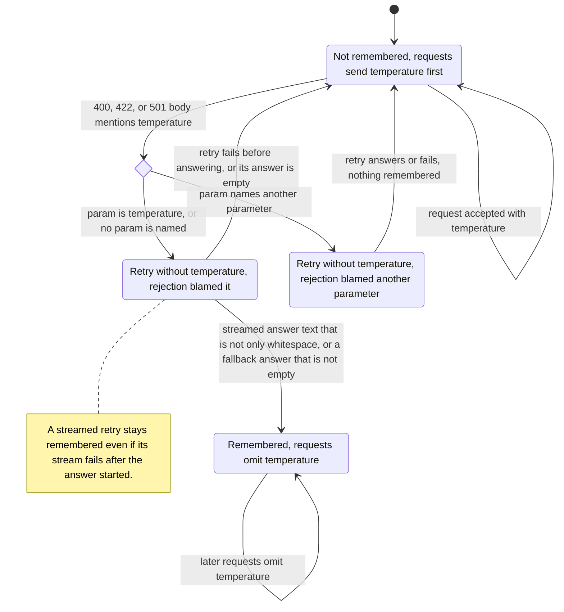

Invariants:

- One retry per request path. Only a rejection whose `error.param` or top-level `param` is `temperature` (trimmed, in any case, or as the last part of a dotted path), or that names no parameter (empty, `None`, or `null` count as none), is remembered. Enforced at [L202-L206](../../Sources/Translation/OpenAICompatibleTransformer.swift#L202-L206), [L277-L282](../../Sources/Translation/OpenAICompatibleTransformer.swift#L277-L282), and [L397-L408](../../Sources/Translation/OpenAICompatibleTransformer.swift#L397-L408).
- A streamed retry is remembered on its first answer text that is not only whitespace; a fallback retry only after its answer decodes and normalizes to something. Enforced at [L209-L219](../../Sources/Translation/OpenAICompatibleTransformer.swift#L209-L219) and [L283-L287](../../Sources/Translation/OpenAICompatibleTransformer.swift#L283-L287).
- Cache access is mutex-protected. Enforced at [L412](../../Sources/Translation/OpenAICompatibleTransformer.swift#L412) and [L416-L422](../../Sources/Translation/OpenAICompatibleTransformer.swift#L416-L422).
- Assumed: a URL and model keep the same capability for the process lifetime and for every key; the key is not part of the identity.
- Assumed, as the code documents: a rejection that names no parameter and mentions temperature for another reason, followed by a retry that answers, is remembered wrongly, which costs the provider's default temperature for that model until relaunch ([L393-L396](../../Sources/Translation/OpenAICompatibleTransformer.swift#L393-L396)). Concurrent first requests may each pay one rejected attempt.

Tests: `OpenAICompatibleTransformerTests.aModelThatRejectsTemperatureIsAskedAgainWithoutIt`, `OpenAICompatibleTransformerTests.aTemperatureRejectionIsRememberedForTheModel`, `OpenAICompatibleTransformerTests.aTemperatureRejectionInAnotherShapeIsRetried`, `OpenAICompatibleTransformerTests.aRejectionIsRememberedByTheParameterItBlames`, `OpenAICompatibleTransformerTests.aMentionOfTemperatureForAnotherReasonIsNotRemembered`, `OpenAICompatibleTransformerTests.aMentionOfTemperatureWhoseRetryFailsIsNotRemembered`, `OpenAICompatibleTransformerTests.aStreamedRetryRemembersTheRejectionOnlyOnceItsAnswerStarts`, `OpenAICompatibleTransformerTests.aStreamedRetryIsRememberedOnceItsAnswerTextStarts`, `OpenAICompatibleTransformerTests.aStreamedRetryWithOnlyWhitespaceDoesNotRememberTheRejection`, `OpenAICompatibleTransformerTests.aRetryWithAnEmptyAnswerDoesNotRememberTheRejection`, `OpenAICompatibleTransformerTests.anotherRejectedParameterIsNotRetried`, `ProviderCorpusTests.noDocumentedErrorReadsAsATemperatureOrStreamingRejection`.

Open questions: none.

### M03. SSE framing, progress, and completion

Turns the streamed body into answer text and decides whether its end is a complete answer. A `[DONE]` line, or a `stop` finish reason followed by the end of the stream, completes it; an end with neither is a dropped connection; an error chunk or a forbidden finish reason fails it even after a stop. Only chunks that carry something reset the inactivity deadline, so keepalives cannot hold a run open.

State: [`OpenAISSEParser`](../../Sources/Translation/OpenAISSEParser.swift#L9-L21) (`buffer`, `endedWithCarriageReturn`, `didReceiveDone`, `didReceiveStop`, `dataChunks`, `progressChunks`) and the [`consumeSSE` locals](../../Sources/Translation/OpenAICompatibleTransformer.swift#L470-L488) (event stream, watchdog, parser task, `lineBytes`, `byteCount`, `bodyBeforeEvents`).

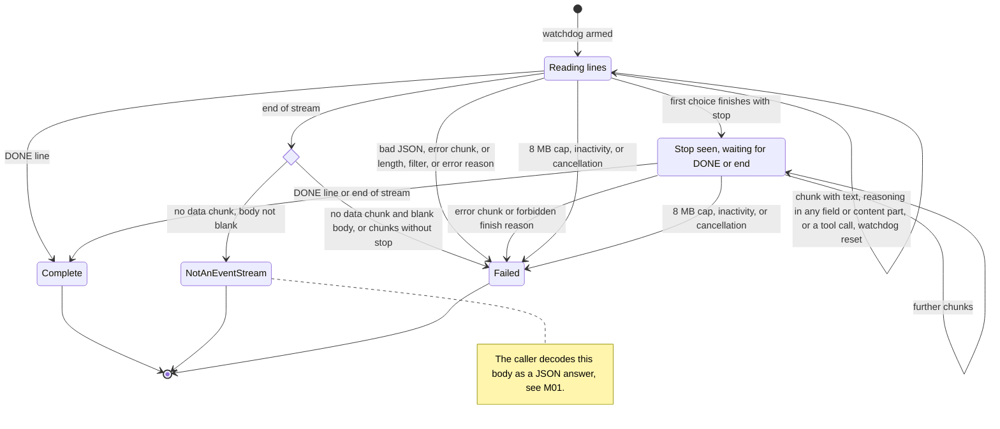

Invariants:

- A CRLF split across chunks makes one line break. Enforced at [parser L28-L33](../../Sources/Translation/OpenAISSEParser.swift#L28-L33).
- After `[DONE]` the parser ignores input and `consumeSSE` returns. Enforced at [parser L24](../../Sources/Translation/OpenAISSEParser.swift#L24) and [L566-L569](../../Sources/Translation/OpenAICompatibleTransformer.swift#L566-L569).
- A chunk is progress when any choice's delta carries generated text: `content` text that is not empty, a content part without a `text` string that carries something (such as Mistral's thinking part), or another field other than `role` holding a non-empty string. Numbers, flags, and the `type` and `index` labels inside an object carry nothing. Answer text, read from a string or joined from the parts' `text`, and finish reasons come from the first choice. Enforced at [parser L75-L82](../../Sources/Translation/OpenAISSEParser.swift#L75-L82), [L119-L129](../../Sources/Translation/OpenAISSEParser.swift#L119-L129), and [L160-L197](../../Sources/Translation/OpenAISSEParser.swift#L160-L197).
- Every byte counts toward the 8 MB cap, including a line that never ends. Enforced at [L493-L494](../../Sources/Translation/OpenAICompatibleTransformer.swift#L493-L494).
- Assumed: byte iteration stops on cancellation, because every exit awaits the parser task ([L573-L582](../../Sources/Translation/OpenAICompatibleTransformer.swift#L573-L582)).
- Assumed: servers stream one choice; a second choice's text is ignored.

Tests: `OpenAISSEParsingTests.sseAcceptsLineEndingsSplitAcrossChunks`, `OpenAISSEParsingTests.aStreamThatEndsOnStopWithoutDoneSucceeds`, `OpenAISSEParsingTests.aStreamThatEndsWithoutStopOrDoneIsADroppedConnection`, `OpenAISSEParsingTests.anErrorPartwayThroughIsAFailureEvenWhenDoneFollows`, `OpenAISSEParsingTests.aReplyWithoutOneEventGoesBackToTheCallerUnlessItIsEmpty`, `OpenAISSEParsingTests.manySmallDeltasStopAtTheByteLimit`, `OpenAISSEParsingTests.aLineThatNeverEndsStopsAtTheByteLimit`, `StreamingTransformerTests.sseParserReassemblesLinesSplitAcrossChunks`, `StreamingTransformerTests.sseParserSkipsEmptyAndRoleOnlyDeltas`, `StreamingTransformerTests.doneStopsConsumptionBeforeBufferedTransportFailure`, `OpenAISSEParsingTests.mistralThinkingChunksAreProgressButNotAnswerText`, `OpenAISSEParsingTests.chunksCarryingNothingAreNotProgress`, `OpenAISSEPropertyTests.generatedDeltasFollowTheRule`, `ProviderCorpusTests.documentedStreamsParseAsDocumented`, `OpenAICompatibleTransformerTests.answerContentGivenAsAListOfPartsIsRead`.

Open questions: none.

### M04. Streaming inactivity deadline

Decides whether an open stream has been silent too long. Each progress chunk replaces the deadline with a new generation, and only the current generation's expiry calls the timeout, so a stale sleeper can never end a stream that is still progressing.

State: [`generation`](../../Sources/Translation/StreamingInactivityWatchdog.swift#L9), [`deadlineTask`](../../Sources/Translation/StreamingInactivityWatchdog.swift#L10), and each task's [`scheduledGeneration`](../../Sources/Translation/StreamingInactivityWatchdog.swift#L38).

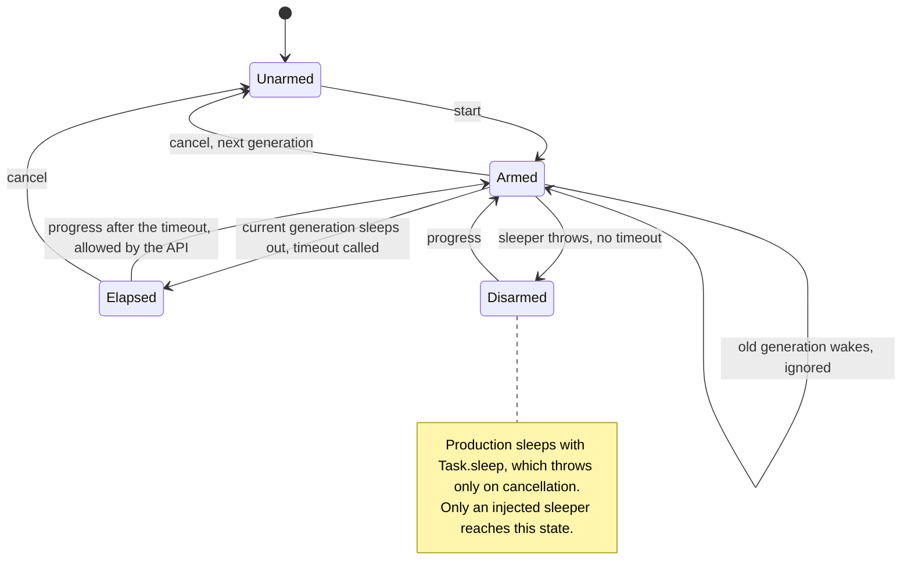

Invariants:

- An older generation can never call the timeout. Enforced at [L55-L57](../../Sources/Translation/StreamingInactivityWatchdog.swift#L55-L57).
- Reset and cancel are serialized by the actor.
- Assumed: the production sleeper throws only on cancellation ([L98-L100](../../Sources/Translation/OpenAICompatibleTransformer.swift#L98-L100)).
- Assumed: the owner does not rearm after the timeout; `consumeSSE` cancels the watchdog on every exit ([L567](../../Sources/Translation/OpenAICompatibleTransformer.swift#L567), [L575](../../Sources/Translation/OpenAICompatibleTransformer.swift#L575), [L580](../../Sources/Translation/OpenAICompatibleTransformer.swift#L580)).

Tests: `inactivityDeadlineIgnoresNonDeltaTrafficAndInterruptsAnOpenStream`, `aChunkWithoutAnswerTextStillResetsTheInactivityDeadline`, `chunksWithoutTextDoNotResetTheInactivityDeadline`.

Open questions: none.

### M05. Cancellable deadline race

`withOperationTimeout` returns the first of three outcomes: the operation's value or error, the timeout error, or the caller's cancellation. It returns without waiting for an operation that ignores cancellation; the detached worker and the timer are only cancelled. The fallback request (M01) and the quit path (M52) depend on it for bounded waiting.

State: the [stream](../../Sources/Core/OperationTimeout.swift#L11), the detached [worker](../../Sources/Core/OperationTimeout.swift#L12-L17), the [timer](../../Sources/Core/OperationTimeout.swift#L18-L23), the [deferred cancellation](../../Sources/Core/OperationTimeout.swift#L24), and the [iterator](../../Sources/Core/OperationTimeout.swift#L25-L28). The companion [`awaitCancellableValue`](../../Sources/Core/OperationTimeout.swift#L50-L68) has the same shape with a waiter task.

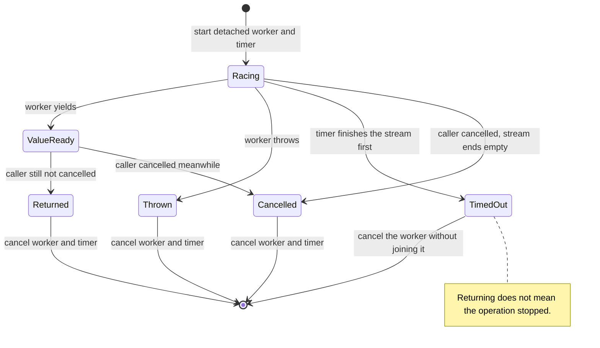

Invariants:

- The caller never waits past the timeout for the operation. Enforced at [L18-L26](../../Sources/Core/OperationTimeout.swift#L18-L26).
- A cancelled caller does not accept a value. Enforced at [L27](../../Sources/Core/OperationTimeout.swift#L27).
- `awaitCancellableValue` cancels the underlying task on caller cancellation; `runWhileMonitoring` is a structured race that joins both children ([L33-L46](../../Sources/Core/OperationTimeout.swift#L33-L46)).
- Assumed: owners stop the underlying resource themselves when cancellation is not enough ([L3-L6](../../Sources/Core/OperationTimeout.swift#L3-L6)); the quit path accepts losing unfinished writes ([AppState.swift#L375-L379](../../Sources/App/AppState.swift#L375-L379)).

Tests: `OperationTimeoutTests.timeoutReturnsEvenWhenOperationIgnoresCancellation`, `OperationTimeoutTests.frameworkMonitorCannotHoldTimeoutCleanupOpen`.

Open questions: none.

### M06. CLI process and termination

One command-line provider run spawns the CLI with the prompt on stdin, waits for it to exit, gives its pipes 500 ms to close, and returns the exit status and bounded output. A timeout, a cancellation, or stdout past 4 MB records the first termination reason, sends SIGTERM to the whole process group, and schedules a SIGKILL after a 2 s grace in a detached task that nothing cancels. The machine is split into two charts: the run phases, then the termination latch.

State: [`processBox`](../../Sources/Translation/CommandRunner.swift#L90), the [two-child task group](../../Sources/Translation/CommandRunner.swift#L93-L117) with its [timeout child](../../Sources/Translation/CommandRunner.swift#L106-L111) and [cancellation handler](../../Sources/Translation/CommandRunner.swift#L118-L122), the [`runProcess` locals](../../Sources/Translation/CommandRunner.swift#L135-L160) (process, pipes, collectors of M09, exit signal of M07), the [feeder](../../Sources/Translation/CommandRunner.swift#L194-L195) of M08, and [`RunningProcessBox`](../../Sources/Translation/CommandRunner.swift#L479-L538) with `TerminationReason` (`canceled`, `timedOut`, `outputTooLarge`), `process`, `terminationReason`, and `escalation`.

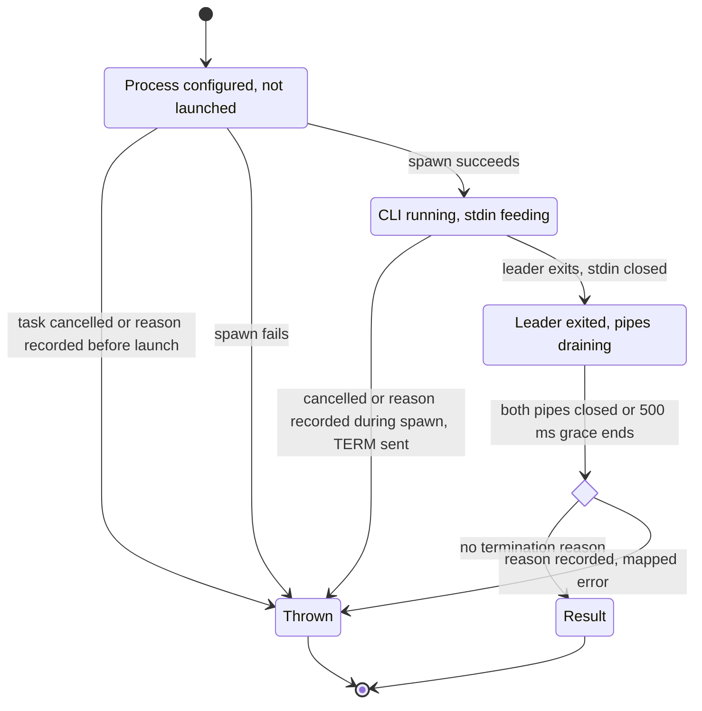

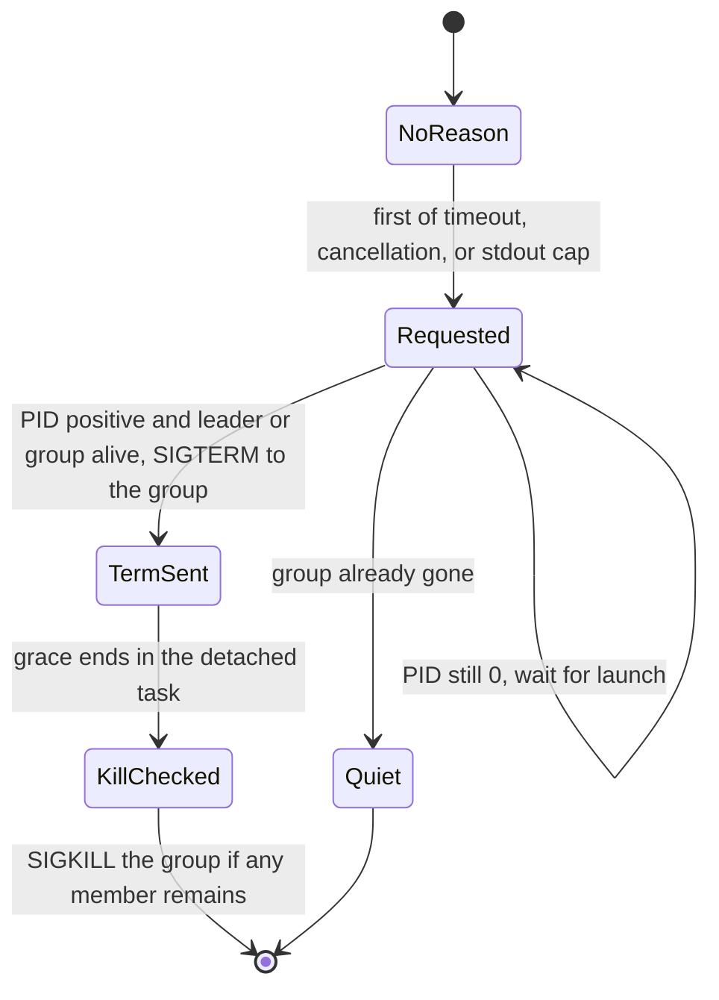

Invariants:

- The first recorded reason wins. Enforced at [L494-L499](../../Sources/Translation/CommandRunner.swift#L494-L499).
- At most one escalation task, and PID 0 is never signalled. Enforced at [L503-L512](../../Sources/Translation/CommandRunner.swift#L503-L512).
- The group is signalled even after the leader exits, while any member remains. Enforced at [L505-L513](../../Sources/Translation/CommandRunner.swift#L505-L513).
- A run with a recorded reason never returns a normal result. Enforced at [L205-L216](../../Sources/Translation/CommandRunner.swift#L205-L216).
- Output is bounded and the drain wait is capped (M09).
- Assumed: `Process` starts the CLI as the leader of its own process group, and helpers stay in it; a helper that starts its own session is out of reach ([L505-L519](../../Sources/Translation/CommandRunner.swift#L505-L519)). The tests exercise this with `/bin/sh` children.
- Assumed: the termination callback fires once SIGKILL lands; `exit.wait()` is not cancellable, so a process that cannot be killed would hold its caller ([L198](../../Sources/Translation/CommandRunner.swift#L198)).
- Assumed: the group ID still names the CLI's group when the delayed SIGKILL fires.

Tests: `CommandRunnerTests.aHelperThatKeepsTheOutputOpenDoesNotHoldTheResult`, `CommandRunnerTests.theTimeoutBoundsTheCallEvenWhenAHelperKeepsTheOutputOpen`, `CommandRunnerTests.aTimeoutAlsoStopsTheHelpersTheCLIStarted`, `CommandRunnerTests.aHelperThatIgnoresSIGTERMIsKilledAfterTheGracePeriod`, `CommandRunnerTests.aTimeoutAfterTheCLIExitedStillStopsItsHelper`, `CommandRunnerTests.runawayOutputIsStoppedAtTheLimit`, `CodexCLITransformerTests.processRunnerTimeoutTerminatesStubbornProcess`, `CodexCLITransformerTests.runsThatNeverReadTheirPromptStillEndAtTheTimeout`.

Open questions:

- After a zero exit, a helper that still holds the pipes is not signalled: no reason is recorded, so the group is left alone and the helper outlives the call, and for Claude Code its deleted working folder. `aHelperThatKeepsTheOutputOpenDoesNotHoldTheResult` checks that the result returns, not that the helper stops. Should a normal exit also stop the group after the drain grace?
- A timeout and a cancellation at the same moment can make the group throw `timedOut` while the box recorded `canceled`. The run is no longer current by then, so the caller ignores the difference.

### M07. Process exit latch

Decides whether the runner's wait for exit can miss the termination callback. The callback and the wait may come in either order; the mutex makes the wait resume exactly once.

State: [`State.exited` and `waiter`](../../Sources/Translation/CommandRunner.swift#L294-L297) behind a [`Mutex`](../../Sources/Translation/CommandRunner.swift#L299).

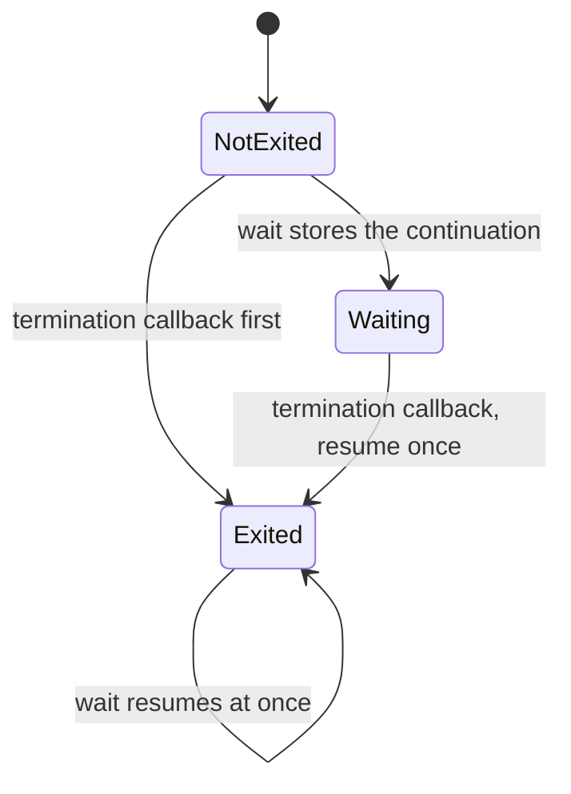

Invariants:

- No lost exit and no double resume. Enforced at [L301-L319](../../Sources/Translation/CommandRunner.swift#L301-L319).
- Assumed: one waiter; a second wait before exit would replace the first. Production waits once ([L198](../../Sources/Translation/CommandRunner.swift#L198)).

Tests: covered through `CommandRunnerTests.aHelperThatKeepsTheOutputOpenDoesNotHoldTheResult`; no direct test.

Open questions: none.

### M08. Nonblocking stdin

Decides how the prompt reaches the CLI without blocking a thread. The pipe is nonblocking with SIGPIPE disabled; a full pipe waits for the writability callback; the end of the data, a write error, or the runner's close after exit closes the pipe.

State: [`offset`](../../Sources/Translation/CommandRunner.swift#L233), [`isClosed`](../../Sources/Translation/CommandRunner.swift#L234), and the [writability handler](../../Sources/Translation/CommandRunner.swift#L247-L249).

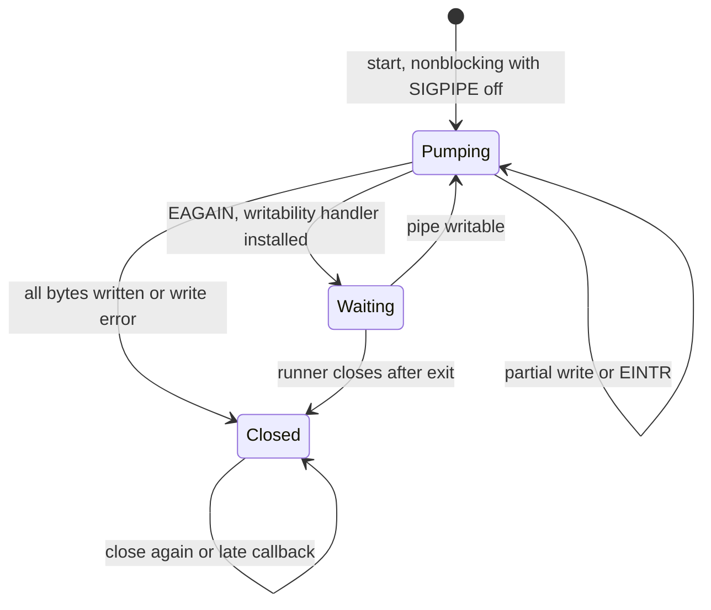

Invariants:

- No thread blocks on a write; close is idempotent and removes the handler under the lock. Enforced at [L258-L289](../../Sources/Translation/CommandRunner.swift#L258-L289).
- The write-failure log carries only `errno`. Enforced at [L274-L275](../../Sources/Translation/CommandRunner.swift#L274-L275).
- `start` runs once, before the runner's `close`. Enforced by call order at [L194-L199](../../Sources/Translation/CommandRunner.swift#L194-L199).
- Assumed: the two `fcntl` calls succeed; their results are ignored ([L244-L245](../../Sources/Translation/CommandRunner.swift#L244-L245)).

Tests: `CodexCLITransformerTests.runsThatNeverReadTheirPromptStillEndAtTheTimeout`, `CodexCLITransformerTests.stdinFeederNeverWaitsOnAReaderThatDoesNotRead`, `CodexCLITransformerTests.stdinFeederDeliversEverythingThenEndOfFile`.

Open questions: none.

### M09. Bounded pipe collection and drain

Decides how much CLI output is kept and how long the runner waits for it. Stdout keeps its first 4 MB and reports overflow once, which makes M06 stop the process; stderr keeps its last 64 KB, where failure messages are. After exit, `finish` waits for end of file or the 500 ms grace, whichever comes first.

State: [`Retention`](../../Sources/Translation/CommandRunner.swift#L324-L329), [`bufferedData`, `didReceiveData`, `didOverflow`, `reachedEnd`, `endWaiter`](../../Sources/Translation/CommandRunner.swift#L336-L340), the [readability handler](../../Sources/Translation/CommandRunner.swift#L352-L360), and the [grace task](../../Sources/Translation/CommandRunner.swift#L365-L368).

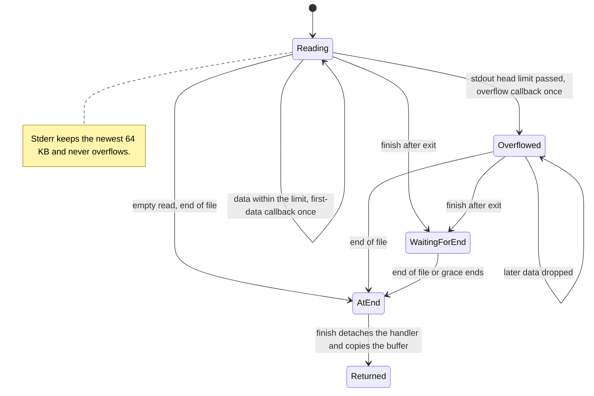

Invariants:

- Retained stdout never exceeds the head limit, stderr stays within the tail limit, and the first-data and overflow callbacks fire once. Enforced at [L391-L417](../../Sources/Translation/CommandRunner.swift#L391-L417).
- The drain wait is bounded by the grace. Enforced at [L364-L380](../../Sources/Translation/CommandRunner.swift#L364-L380).
- Assumed: one `finish` per collector ([L201-L202](../../Sources/Translation/CommandRunner.swift#L201-L202)); a read callback in flight while finishing can still append, so the result is a snapshot, not an exact end-of-file fence.

Tests: `CommandRunnerTests.aHelperThatKeepsTheOutputOpenDoesNotHoldTheResult`, `CommandRunnerTests.runawayOutputIsStoppedAtTheLimit`, `CommandRunnerTests.stderrKeepsItsEndWhereFailureMessagesAre`.

Open questions: none.

### M11. Codex invocation and temporary workspace

One Codex rewrite checks that the sign-in file is readable, creates a private temporary folder, runs `codex exec --ephemeral` with every acting feature off and the fenced prompt on stdin, and maps the result. The folder is removed on every exit.

State: the frozen [configuration, runner, and timeout](../../Sources/Translation/CodexCLITransformer.swift#L84-L87) (60 s), the [auth-file check](../../Sources/Translation/CodexCLITransformer.swift#L134-L136), the [temporary folder](../../Sources/Translation/CodexCLITransformer.swift#L138-L143) with deferred removal, the random [boundary](../../Sources/Translation/CodexCLITransformer.swift#L145) and [fenced prompt](../../Sources/Translation/CodexCLITransformer.swift#L146-L150), and the [arguments](../../Sources/Translation/CodexCLITransformer.swift#L125-L131). Files: `auth.json` in `CODEX_HOME` or `~/.codex` ([existence only](../../Sources/Translation/CodexCLITransformer.swift#L10-L13)) and `SyrupCodex.<UUID>` in the temporary folder.

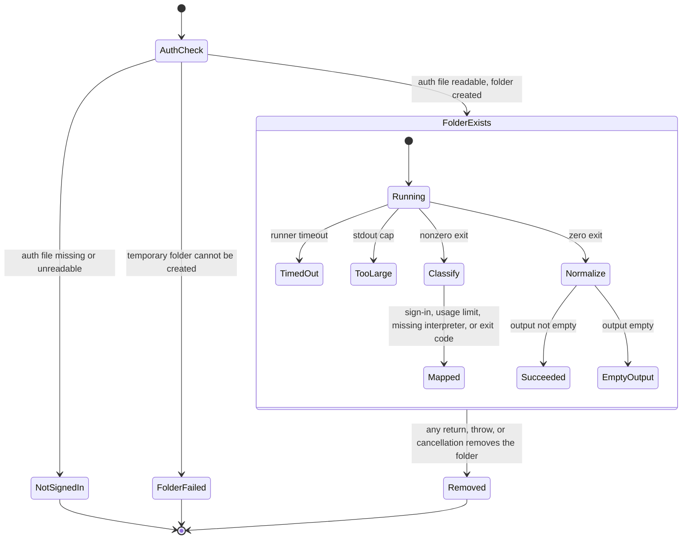

Invariants:

- The prompt goes on stdin only; argv carries fixed flags, the folder path, and the model. Enforced at [L125-L131](../../Sources/Translation/CodexCLITransformer.swift#L125-L131).
- The run is ephemeral, ignores the user's config, uses a read-only sandbox, never asks for approval, and has the shell, exec, web search, apps, plugins, browser, computer use, image, multi-agent, memories, and hooks features off. Enforced at [L105-L120](../../Sources/Translation/CodexCLITransformer.swift#L105-L120).
- The child environment is only HOME, PATH, and an optional CODEX_HOME. Enforced at [L15-L24](../../Sources/Translation/CodexCLITransformer.swift#L15-L24).
- Failures are classified from stderr after the random end marker only, so the person's words cannot read as a sign-in or limit error, and stderr is never shown. Enforced at [L186-L215](../../Sources/Translation/CodexCLITransformer.swift#L186-L215).
- The auth file is checked for readability, never parsed. Enforced at [L134](../../Sources/Translation/CodexCLITransformer.swift#L134).
- Assumed: the CLI honors these flags and prints only its final message on stdout; folder removal errors are ignored ([L141-L143](../../Sources/Translation/CodexCLITransformer.swift#L141-L143)).

Tests: `CodexCLITransformerTests.translateInvokesCodexWithExpectedArgumentsAndPromptOnStdin`, `CodexCLITransformerTests.missingAuthFileFailsBeforeSpawningCommand`, `CodexCLITransformerTests.successfulCommandIgnoresBenignAuthWarningsOnStderr`, `CodexCLITransformerTests.nonZeroExitMapsWithoutLeakingStderr`, `CodexCLITransformerTests.runnerTimeoutMapsToCodexTimedOut`, `codexErrorsIgnoreTheUsersWordsInTheEchoedPrompt`.

Open questions: a helper that outlives a zero exit is not stopped (M06).

### M12. Claude invocation and temporary workspace

One Claude Code rewrite runs `claude -p` once in a private temporary folder with no tools, no MCP servers, safe mode, no slash commands, no permission prompts, and no saved session, with the fenced prompt on stdin. The account comes from the account-folder setting, then a `CLAUDE_CONFIG_DIR` the app was launched with; a configured folder that does not exist fails as not signed in when the run's snapshot is taken (M15).

State: [`ClaudeCLIConfiguration`](../../Sources/Translation/ClaudeCLITransformer.swift#L3-L10) (executable, model, HOME, user name, optional account folder), its [process environment](../../Sources/Translation/ClaudeCLITransformer.swift#L15-L28), the [account-folder resolution](../../Sources/Translation/ClaudeCLITransformer.swift#L105-L121), the [working folder](../../Sources/Translation/ClaudeCLITransformer.swift#L165-L168) with deferred removal, and the [result mapping](../../Sources/Translation/ClaudeCLITransformer.swift#L171-L196).

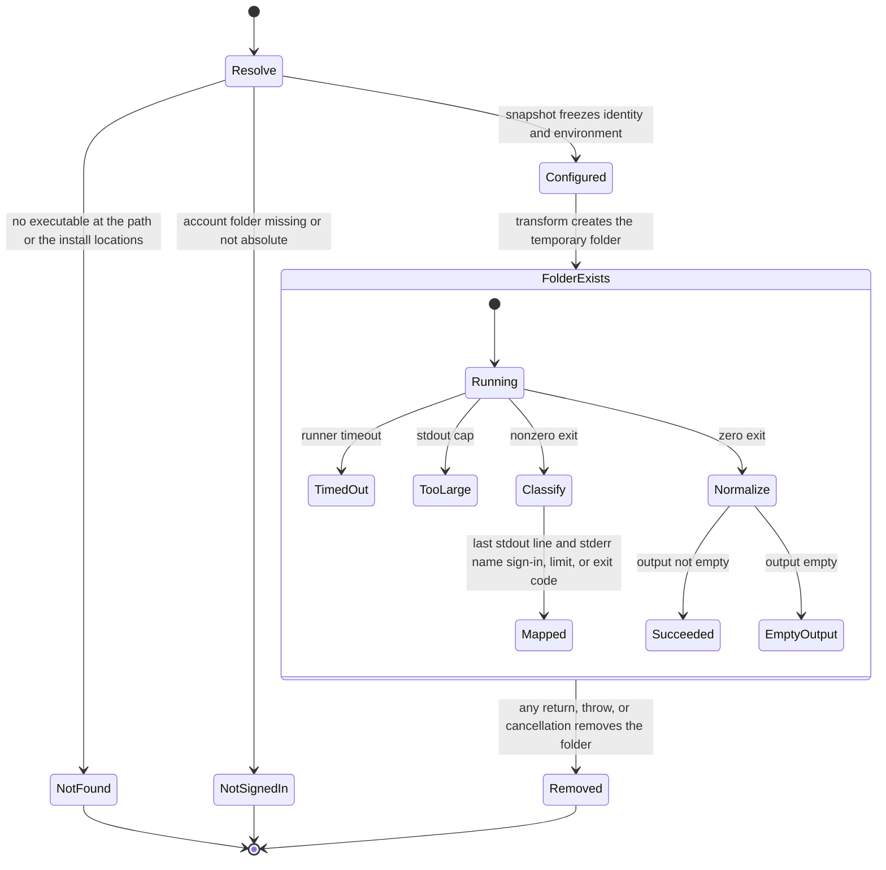

Invariants:

- Argv carries only fixed flags, the model, and a fixed system prompt; the instruction and input go on stdin. Enforced at [L142-L162](../../Sources/Translation/ClaudeCLITransformer.swift#L142-L162) and [L170-L180](../../Sources/Translation/ClaudeCLITransformer.swift#L170-L180).
- Only HOME, USER, LOGNAME, PATH, two fixed switches, and the account folder reach the child, so an ambient `ANTHROPIC_API_KEY` cannot switch billing. Enforced at [L15-L28](../../Sources/Translation/ClaudeCLITransformer.swift#L15-L28).
- The CLI runs in the temporary folder. Enforced at [L178](../../Sources/Translation/ClaudeCLITransformer.swift#L178).
- Classification uses the last nonblank stdout line plus stderr, so model text earlier in stdout cannot read as an error. Enforced at [L203-L206](../../Sources/Translation/ClaudeCLITransformer.swift#L203-L206).
- Assumed: the CLI honors the flags, and its last stdout line on failure is its own message; folder removal errors are ignored.

Tests: `ClaudeCLITransformerTests.invocationHasNoToolsNoCustomizationsAndNoSavedSession`, `ClaudeCLITransformerTests.environmentCarriesOnlyTheSignInLookupAndNeverAnAPIKey`, `ClaudeCLITransformerTests.accountFolderComesFromTheSettingThenTheLaunchEnvironmentAndMustExist`, `ClaudeCLITransformerTests.transformSendsTheFencedPromptOnStdinFromAPrivateFolder`, `ClaudeCLITransformerTests.failuresMapToOneMessageEach`, `ClaudeCLITransformerTests.emptyOutputAndTimeoutAreTheirOwnErrors`.

Open questions: a helper that outlives a zero exit can outlive the deleted folder (M06).

### M13. Prepared Apple session and generation

Decides which `LanguageModelSession` answers an on-device run and what happens when streaming rewrites text it already sent. A transformer built for a nonempty instruction keeps one prepared, optionally prewarmed session for that instruction; any other instruction gets a fresh session. A snapshot that does not extend the previous one fails the stream with the fallback signal, and the fallback builds a clean transformer with no prepared session.

State: [`preparedInstruction`, `session`, `availabilityProvider`, `responseProvider`](../../Sources/Translation/AppleOnDeviceTransformer.swift#L7-L10), the [session choice](../../Sources/Translation/AppleOnDeviceTransformer.swift#L34-L37), the [stream task](../../Sources/Translation/AppleOnDeviceTransformer.swift#L85-L110) with its adapter (M14), and the [fallback](../../Sources/Translation/AppleOnDeviceTransformer.swift#L117-L126). The session's conversation lives inside the framework.

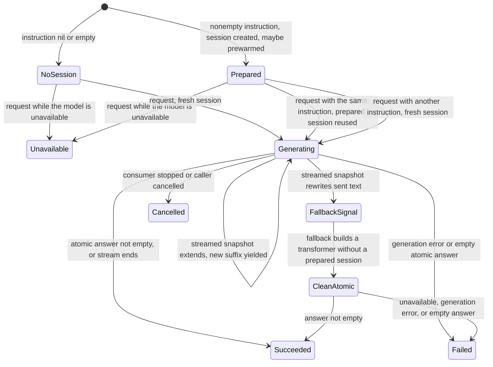

Invariants:

- No session exists for an empty instruction. Enforced at [L23-L31](../../Sources/Translation/AppleOnDeviceTransformer.swift#L23-L31).
- The fallback never reuses a session its failed stream touched. Enforced at [L117-L126](../../Sources/Translation/AppleOnDeviceTransformer.swift#L117-L126).
- Availability is checked before any session use. Enforced at [L40-L43](../../Sources/Translation/AppleOnDeviceTransformer.swift#L40-L43) and [L76-L82](../../Sources/Translation/AppleOnDeviceTransformer.swift#L76-L82).
- Assumed: a prepared session serves one generation per run; nothing stops concurrent calls on it.
- Assumed: the framework and the caller bound generation time; there is no local timeout, and the atomic path does not check cancellation after `respond` returns ([L50-L63](../../Sources/Translation/AppleOnDeviceTransformer.swift#L50-L63)).

Tests: `AppleOnDeviceTransformerTests.atomicResponsePreservesOnlyRequestedQuotes`, `AppleOnDeviceTransformerTests.unavailableModelThrowsTypedErrorWithoutSessionUse`, `AppleOnDeviceTransformerTests.availabilityMessagesAreUserFacing`; `AppleOnDeviceTransformerTests.availableModelSmokeTransformsShortPhrase` needs a Mac with the model and is gated by its environment.

Open questions: none.

### M14. Cumulative snapshot adaptation

Turns the framework's cumulative snapshots into deltas. A snapshot that starts with the previous one yields its new suffix; one that does not asks for the atomic fallback, because text already delivered would otherwise be contradicted.

State: [`previousSnapshot`](../../Sources/Translation/CumulativeSnapshotDeltaAdapter.swift#L7) and the [output enum](../../Sources/Translation/CumulativeSnapshotDeltaAdapter.swift#L1-L4).

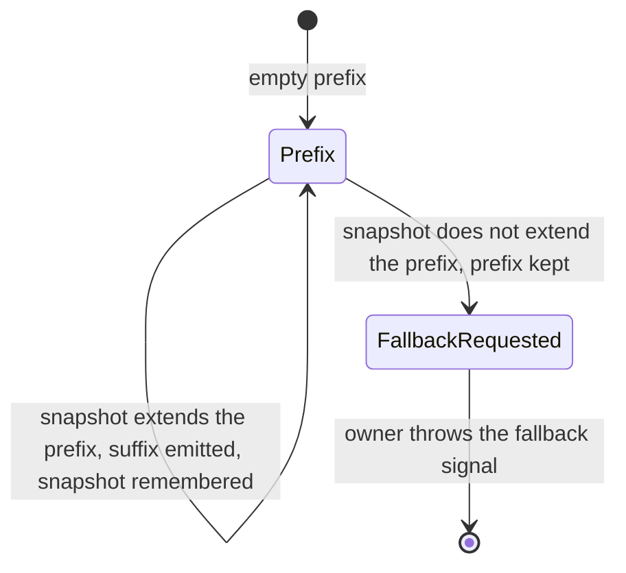

Invariants:

- Emitted deltas only append; an equal snapshot emits an empty delta, which the owner drops. Enforced at [L9-L17](../../Sources/Translation/CumulativeSnapshotDeltaAdapter.swift#L9-L17) and [AppleOnDeviceTransformer.swift#L93-L97](../../Sources/Translation/AppleOnDeviceTransformer.swift#L93-L97).
- Assumed: the owner stops on the fallback signal; the adapter itself is not sticky ([AppleOnDeviceTransformer.swift#L98-L99](../../Sources/Translation/AppleOnDeviceTransformer.swift#L98-L99)).

Tests: `StreamingTransformerTests.cumulativeSnapshotAdapterEmitsOnlyNewSuffixes`, `StreamingTransformerTests.cumulativeSnapshotAdapterSignalsNonExtension`.

Open questions: none.

### M15. Provider configuration snapshots

At the trigger, a run freezes the configuration of its one selected provider: endpoint, model, and key for OpenAI-compatible, executable and account for the two CLIs, or a factory for Apple on-device. Later settings edits do not reach that run. A configuration that cannot be resolved, including a saved key that cannot be read, freezes a failing transformer instead of falling back to another destination.

State: [`TransformerSnapshot.permitsUnfinalizedInput`](../../Sources/Translation/TextTransformer.swift#L39) and [`make`](../../Sources/Translation/TextTransformer.swift#L40), the provider's [inputs](../../Sources/Translation/TextTransformer.swift#L94-L101), [`snapshot(for:)`](../../Sources/Translation/TextTransformer.swift#L125-L157), and [`openAICompatibleConfiguration`](../../Sources/Translation/TextTransformer.swift#L161-L169), which reads the key file at the trigger. The [resolver](../../Sources/Translation/OpenAICompatibleSettingsConfiguration.swift#L18-L47) orders a typed key, the saved key, a Debug-only environment, and the saved endpoint with no key. Durable inputs: UserDefaults `baseURL`, `modelName`, `translationProvider`, `codexPath`, `codexModel`, `claudePath`, `claudeModel`, `claudeConfigDirectory`, and the key file of M32.

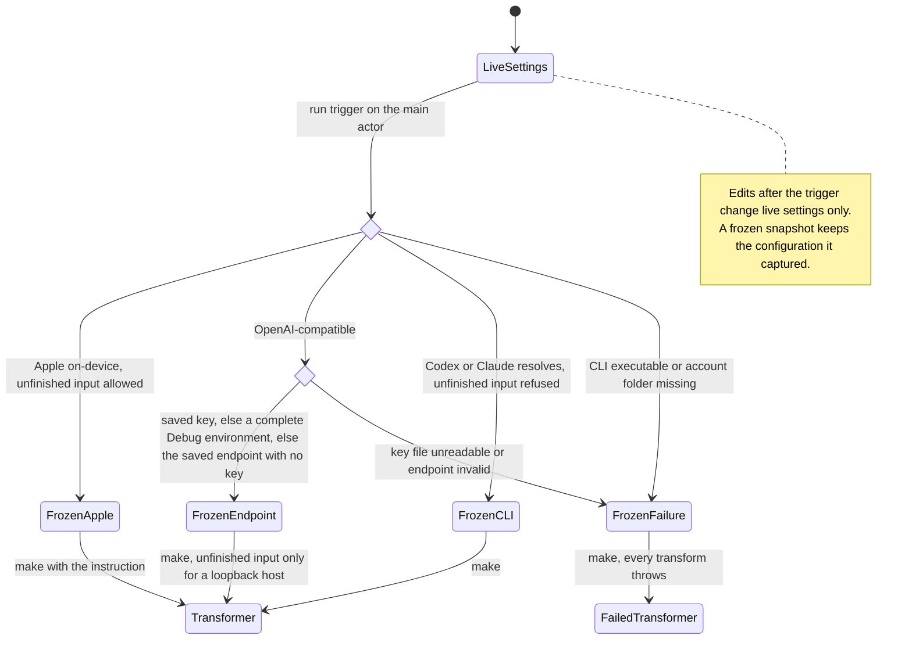

Invariants:

- Only the selected provider's configuration is resolved. Enforced at [L128-L153](../../Sources/Translation/TextTransformer.swift#L128-L153).
- An unreadable saved key throws instead of falling back to the environment or to no key. Enforced at [L161-L169](../../Sources/Translation/TextTransformer.swift#L161-L169) and [resolver L26-L47](../../Sources/Translation/OpenAICompatibleSettingsConfiguration.swift#L26-L47).
- Release builds ignore the environment fallback. Enforced at [resolver L10-L16](../../Sources/Translation/OpenAICompatibleSettingsConfiguration.swift#L10-L16).
- Unfinished input may go only to Apple on-device or a loopback endpoint, never to a CLI. Enforced at [L130-L152](../../Sources/Translation/TextTransformer.swift#L130-L152).
- Assumed: a run uses its one snapshot from trigger to delivery. Injected fixed transformers and `TransformerSource` fakes ask their source again ([L63-L75](../../Sources/Translation/TextTransformer.swift#L63-L75)).
- Assumed: in a Debug build with no saved key, a complete `OPENAI_COMPATIBLE_*` environment overrides the saved endpoint; Privacy names that override (M39).

Tests: `ProviderCredentialTests.providerConfigurationIsFrozenBeforeTransformation`, `ProviderCredentialTests.unreadableSavedKeyDoesNotFallBackToEnvironment`, `OpenAICompatibleTransformerTests.releaseBuildsIgnoreTheEnvironmentFallback`, `OpenAICompatibleTransformerTests.runsAndConnectionTestTreatAWhitespaceSavedKeyTheSame`, `OfferedProviderTests.commandLineProvidersNeverSendUnfinishedTranscripts`, `PauseTransformationPolicyTests.resolvedEndpointControlsEligibilityAndIsFrozen`, `contextualRunSnapshotExcludesCapturedSelection`.

Open questions: none.

## History and usage stats

### M16. History persistence, ordered writes, clear, and flush

Decides whether a finished run's record reaches `history.json`. Records reach disk only while Keep history is on, and a record made while it was off stays in memory only, even after it is turned on. Turning it off, or clearing, first waits for queued writes and then deletes the file; a failed deletion keeps the records and, for an opt-out, keeps Keep history on.

State: [`records`](../../Sources/History/HistoryStore.swift#L17), [`persistenceError`](../../Sources/History/HistoryStore.swift#L18), [`leftoverFileRemains`](../../Sources/History/HistoryStore.swift#L21), [`isChangingPersistence`](../../Sources/History/HistoryStore.swift#L22), [`isPersistenceEnabled`](../../Sources/History/HistoryStore.swift#L28), [`pendingWrite`](../../Sources/History/HistoryStore.swift#L30) (the tail of the write chain), and [`memoryOnlyIDs`](../../Sources/History/HistoryStore.swift#L33). File: `Application Support/Syrup/History/history.json`, written by [`HistoryDisk`](../../Sources/History/HistoryStore.swift#L170-L192) with a 0700 folder and a 0600 file.

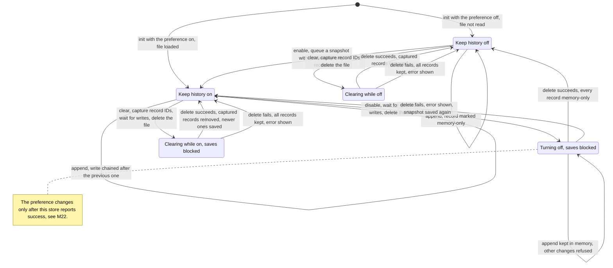

Invariants:

- Nothing is written while off or while a clear or opt-out runs. Enforced at [L144-L145](../../Sources/History/HistoryStore.swift#L144-L145).
- A record made while off is never written later. Enforced at [L58](../../Sources/History/HistoryStore.swift#L58), [L117](../../Sources/History/HistoryStore.swift#L117), and [L146](../../Sources/History/HistoryStore.swift#L146).
- Clear and opt-out delete only after every earlier queued write. Enforced at [L68](../../Sources/History/HistoryStore.swift#L68), [L113](../../Sources/History/HistoryStore.swift#L113), and [L147-L149](../../Sources/History/HistoryStore.swift#L147-L149).
- A failed opt-out deletion leaves the store on and says so; only "already absent" counts as a successful delete. Enforced at [L121-L125](../../Sources/History/HistoryStore.swift#L121-L125) and [L185-L191](../../Sources/History/HistoryStore.swift#L185-L191).
- Records appended during a clear are not in the captured set and survive it. Enforced at [L66](../../Sources/History/HistoryStore.swift#L66) and [L71](../../Sources/History/HistoryStore.swift#L71).
- Written files get 0700 and 0600 permissions. Enforced at [L178-L182](../../Sources/History/HistoryStore.swift#L178-L182).
- Assumed: one store per history file.
- Assumed: `flush` is a barrier for writes queued before it, not for a clear or opt-out in progress ([L129](../../Sources/History/HistoryStore.swift#L129)). A quit in that window leaves the file and the preference as they were, and neither has claimed success yet.
- Assumed: an unreadable file loads empty, and the next save replaces it without a backup ([L131-L141](../../Sources/History/HistoryStore.swift#L131-L141)). A successful save does not clear an older `persistenceError`.

Tests: `HistoryStoreTests.appendOrdersNewestFirstAndTrimsCapacity`, `HistoryStoreTests.clearRemovesMemoryAndPersistedFile`, `HistoryStoreTests.persistenceRoundTripsOnlyWhenEnabled`, `HistoryStoreTests.turningPersistenceOnKeepsOnlyResultsMadeAfterwards`, `HistoryStoreTests.disablingPersistenceDeletesFile`, `HistoryStoreTests.corruptFileLoadsAsEmpty`, `HistorySafeguardTests.historyDeletionFailurePreservesOptInAndRecords`, `HistorySafeguardTests.historyDeletionWaitsForQueuedWrites`.

Open questions: the queued-write test checks the final file order; no test appends while a clear waits.

### M17. Leftover history cleanup and retry

At launch with Keep history off, a `history.json` left from an earlier session, for example after the preferences were reset, is deleted. If that fails, Privacy shows the failure with Try Again, so Syrup never implies that no history remains.

State: [`leftoverFileRemains`](../../Sources/History/HistoryStore.swift#L21) and [`persistenceError`](../../Sources/History/HistoryStore.swift#L18); false means no failure was seen, not that the disk was checked. Entry: [`deleteLeftoverFileIfPersistenceIsOff`](../../Sources/History/HistoryStore.swift#L88-L101), called by the [launch task](../../Sources/App/SyrupApp.swift#L115-L117) and by [Try Again](../../Sources/Settings/PrivacySettingsPane.swift#L116-L126). File: `history.json`.

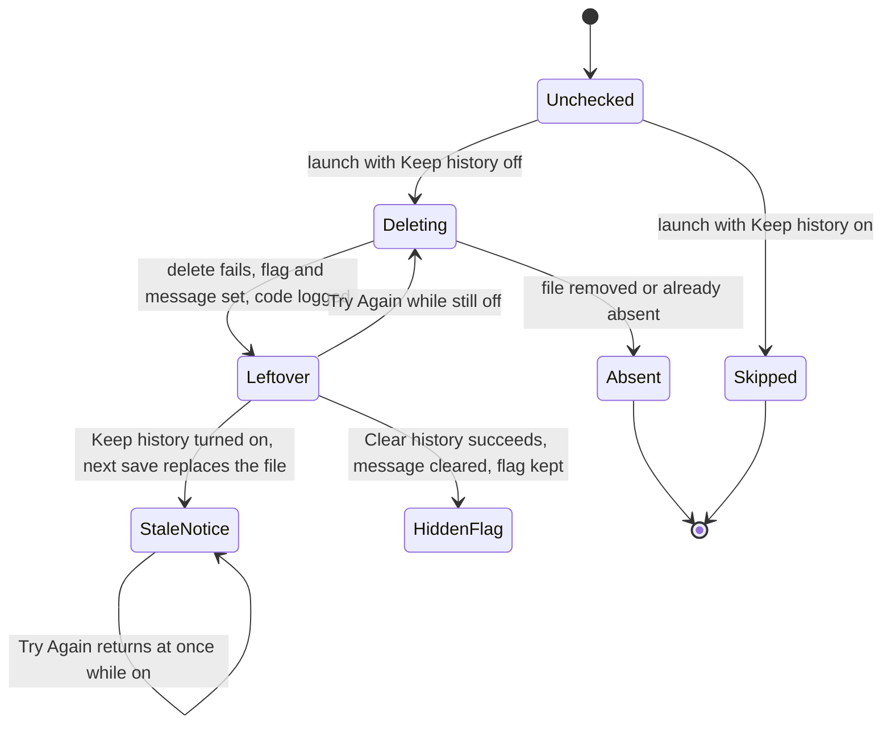

Invariants:

- A store constructed off never reads a leftover file. Enforced at [L48-L50](../../Sources/History/HistoryStore.swift#L48-L50).
- A failed deletion is shown with a retry, never swallowed. Enforced at [L96-L100](../../Sources/History/HistoryStore.swift#L96-L100) and [PrivacySettingsPane.swift#L116-L126](../../Sources/Settings/PrivacySettingsPane.swift#L116-L126).
- The log carries only the error code. Enforced at [L97](../../Sources/History/HistoryStore.swift#L97).
- Assumed: the launch cleanup does not race an enable. Unlike clear and opt-out, it neither sets `isChangingPersistence` nor rechecks the preference after its await ([L88-L91](../../Sources/History/HistoryStore.swift#L88-L91)); a race could only delete newly kept history, never keep unwanted history.

Tests: `HistorySafeguardTests.aLeftoverHistoryFileGoesAtLaunchOnlyWhenKeepHistoryIsOff`, `HistorySafeguardTests.aLeftoverHistoryFileThatCannotBeDeletedIsShownWithARetry`.

Open questions: [SH9](#suspected-defects).

### M18. History outcome and recovery capabilities

Decides which recovery actions a history record offers. A record never changes after it is made; its outcome and transformation kind decide whether it offers retry, a transcript fallback, and copying.

State: [`Outcome`](../../Sources/History/DictationRecord.swift#L4-L7), [`transformation` and `provider`](../../Sources/History/DictationRecord.swift#L15-L17), the [capabilities](../../Sources/History/DictationRecord.swift#L41-L71), and [`LossyDictationRecord`](../../Sources/History/DictationRecord.swift#L90-L96) for entries this build cannot read.

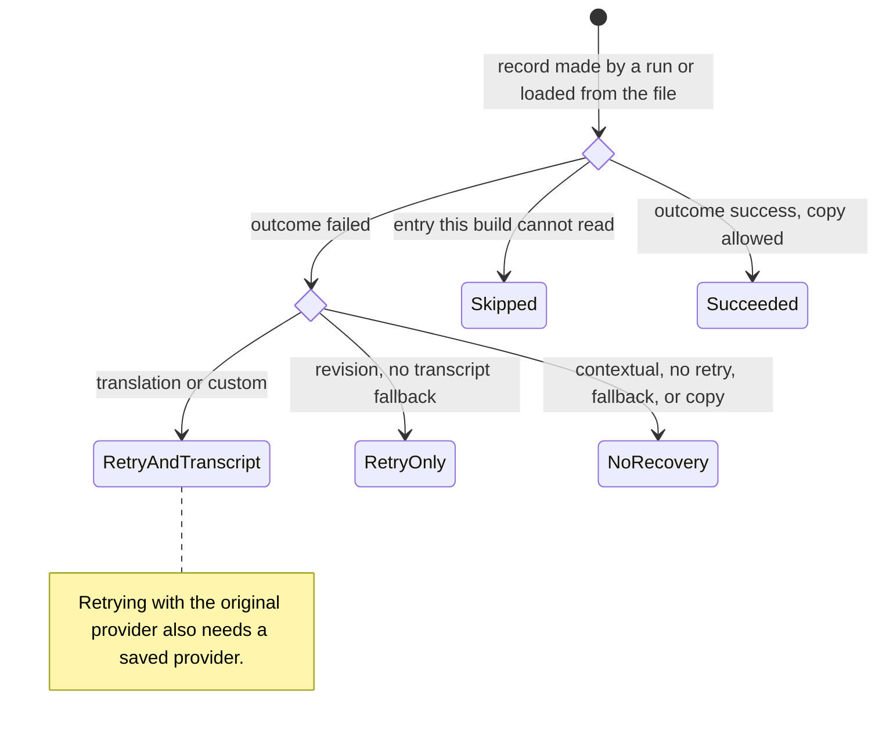

Invariants:

- A failed contextual record offers no retry, fallback, or copy, and a failed revision offers retry but no transcript fallback. Enforced at [L41-L67](../../Sources/History/DictationRecord.swift#L41-L67).
- One unreadable entry costs only itself. Enforced at [L90-L96](../../Sources/History/DictationRecord.swift#L90-L96) and [HistoryStore.swift#L136](../../Sources/History/HistoryStore.swift#L136).
- Assumed: the producer never puts a captured selection in a record and keeps outcome and output consistent; the type allows a success with no output.

Tests: `HistoryStoreTests.snapshotCasesGuardFallbackAndRetryBehavior`, `HistoryStoreTests.providerMetadataRoundTripsAndLegacyFailureRemainsReadable`, `ForwardCompatibilityTests.aHistoryRecordWithAnUnknownProviderStillLoads`, `ForwardCompatibilityTests.oneUnreadableHistoryRecordDoesNotCostTheOthers`.

Open questions: none.

### M19. Usage writes, deletion, and flush

Keeps the content-free usage numbers in memory and writes each new snapshot after the previous disk operation. Delete Stats clears memory at once and deletes the file after any queued write; if the file survives, the numbers still on disk come back on screen with an error, instead of returning silently at the next launch.

State: [`stats`](../../Sources/Stats/UsageStatsStore.swift#L8), [`deletionError`](../../Sources/Stats/UsageStatsStore.swift#L10), [`disk` and `fileURL`](../../Sources/Stats/UsageStatsStore.swift#L11-L12) (nil means memory only), [`lastDiskWork`](../../Sources/Stats/UsageStatsStore.swift#L15), and the [deletion task](../../Sources/Stats/UsageStatsStore.swift#L51-L57). File: `Application Support/Syrup/usage-stats.json`, written by [`UsageStatsDisk`](../../Sources/Stats/UsageStatsStore.swift#L87-L116). Collection is gated upstream by [`keepsUsageStats`](../../Sources/App/AppState+VoiceRun.swift#L288).

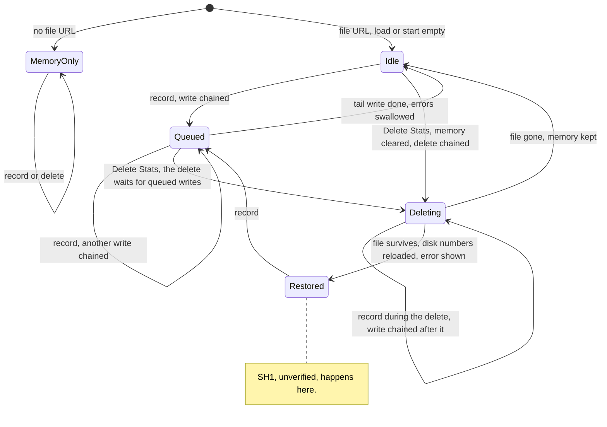

Invariants:

- A write queued before Delete Stats cannot land after it. Enforced at [L51-L56](../../Sources/Stats/UsageStatsStore.swift#L51-L56) and [L70-L76](../../Sources/Stats/UsageStatsStore.swift#L70-L76).
- A delete that leaves the file returns false and shows an error. Enforced at [L58-L61](../../Sources/Stats/UsageStatsStore.swift#L58-L61) and [L108-L115](../../Sources/Stats/UsageStatsStore.swift#L108-L115).
- The stats hold numbers, day keys, and app bundle IDs only, never text. Enforced by the type at [UsageStats.swift#L3-L22](../../Sources/Stats/UsageStats.swift#L3-L22).
- A run records only when its trigger-time flag and the current Keep usage stats setting are both on. Enforced at [AppState+VoiceRun.swift#L288](../../Sources/App/AppState+VoiceRun.swift#L288).
- Assumed: no sample arrives while a failing delete is in flight; the restore has no guard ([SH1](#suspected-defects)).
- Assumed: losing a failed write is acceptable, because the next sample rewrites the whole file ([L102-L104](../../Sources/Stats/UsageStatsStore.swift#L102-L104)).

Tests: `UsageStatsStoreTests.survivesARestartWithAPrivateFileAndDeletes`, `UsageStatsStoreTests.aDeleteAfterManyWritesAlwaysLandsLast`, `UsageStatsStoreTests.aFailedDeleteShowsTheStatsStillOnDiskAndSaysSo`, `UsageStatsStoreTests.aDamagedFileStartsEmptyInsteadOfFailing`. None holds a delete open while a sample arrives.

Open questions: [SH1](#suspected-defects).

## Settings and privacy

### M21. Privacy store attachment

Gives the history opt-in exactly one owner, bound once to the store an opt-out must empty: the app's history store. Until it is attached, turning Keep history off is refused, because a file from an earlier launch may be on disk with nothing to delete it.

State: [`AppSettings.privacyOptIns`](../../Sources/Settings/AppSettings.swift#L27) (one lazy owner), [`PrivacyOptIns.settings`](../../Sources/Settings/AppSettings.swift#L697) (unowned), [`PrivacyOptIns.history`](../../Sources/Settings/AppSettings.swift#L698), [`attach(history:)`](../../Sources/Settings/AppSettings.swift#L705-L709), [`detachForTesting`](../../Sources/Settings/AppSettings.swift#L711-L717), and the one production [attach call](../../Sources/App/AppState.swift#L214).

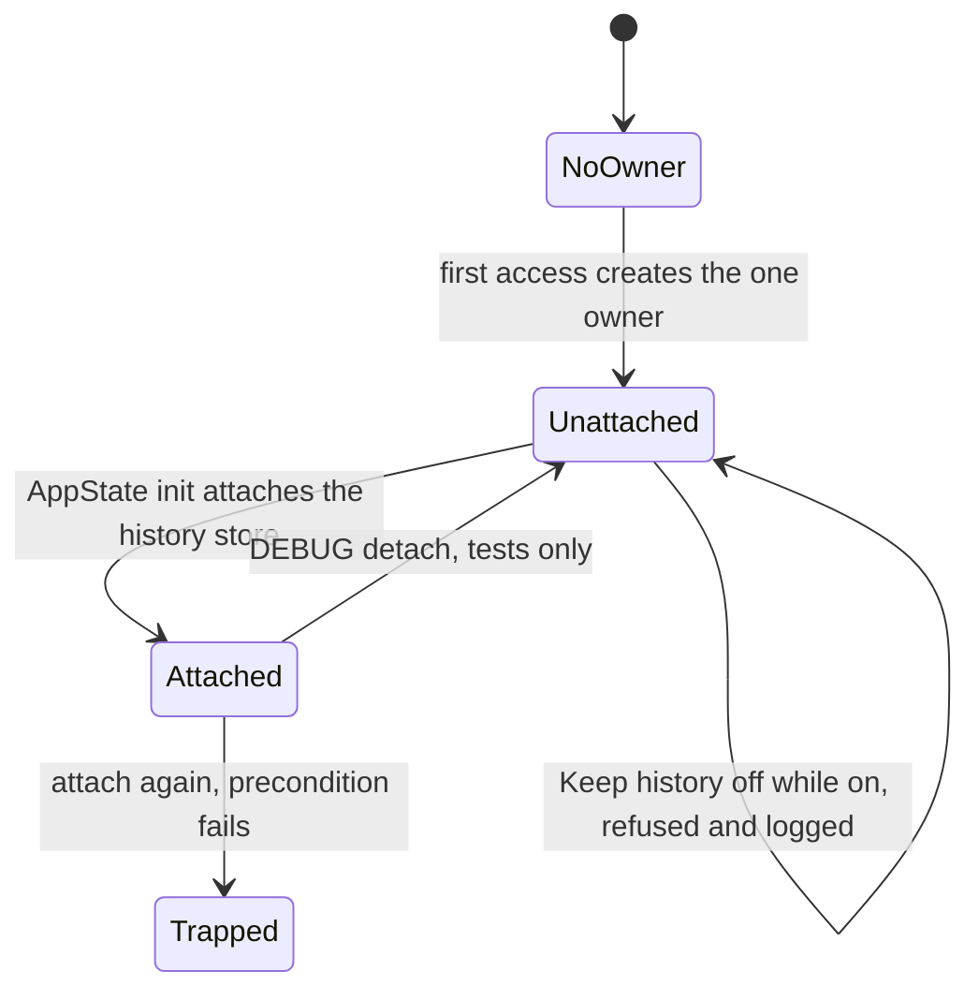

Invariants:

- Only AppSettings.swift can create the owner or set the preference. Enforced at [L162-L167](../../Sources/Settings/AppSettings.swift#L162-L167) and [L701-L703](../../Sources/Settings/AppSettings.swift#L701-L703).
- A second attach traps. Enforced at [L707](../../Sources/Settings/AppSettings.swift#L707).
- Assumed: AppSettings outlives the unowned reference.
- Assumed: the attached history store starts aligned with the preference; production builds it from `settings.persistHistory` ([SyrupApp.swift#L184](../../Sources/App/SyrupApp.swift#L184)), and `attach` does not reconcile them.

Tests: `AppSettingsTests.anOptOutBeforeTheStoresAreAttachedIsRefused`. No test covers the second-attach trap.

Open questions: none.

### M22. Persist-history opt-in transaction

The Keep history preference follows the history store and never leads it. Turning it on enables the store, then saves the preference; turning it off asks the store to delete the file and saves `false` only if that worked.

State: [`persistHistory`](../../Sources/Settings/AppSettings.swift#L163-L167) with UserDefaults key [`persistHistory`](../../Sources/Settings/AppSettings.swift#L319), [`PrivacyOptIns.history`](../../Sources/Settings/AppSettings.swift#L698), [`setPersistHistory`](../../Sources/Settings/AppSettings.swift#L719-L732), the store's [`isPersistenceEnabled`](../../Sources/History/HistoryStore.swift#L28) and [`isChangingPersistence`](../../Sources/History/HistoryStore.swift#L22), and the Privacy [toggle](../../Sources/Settings/PrivacySettingsPane.swift#L109-L110) with its [binding](../../Sources/Settings/PrivacySettingsPane.swift#L187-L193). File: `history.json` (M16).

```mermaid
stateDiagram-v2
    state "Unattached, off" as UnattachedOff
    state "Unattached, on" as UnattachedOn
    state "Attached, off" as AttachedOff
    state "Attached, on" as AttachedOn
    state "Store deleting, preference still on" as Deleting
    [*] --> UnattachedOff: preference false or missing
    [*] --> UnattachedOn: preference true
    UnattachedOff --> UnattachedOn: turn on, preference only
    UnattachedOn --> UnattachedOn: turn off refused, no store
    UnattachedOff --> AttachedOff: attach, store built off
    UnattachedOn --> AttachedOn: attach, store built on
    AttachedOff --> AttachedOn: turn on, store enables, then preference true
    AttachedOn --> Deleting: turn off, store flushes and deletes
    AttachedOn --> AttachedOn: turn off while a clear runs, refused
    Deleting --> AttachedOff: delete succeeds, preference false
    Deleting --> AttachedOn: delete fails, preference stays true
```

Invariants:

- The preference turns off only after the store deleted the file. Enforced at [L731](../../Sources/Settings/AppSettings.swift#L731).
- A busy store refuses a change instead of queueing it, and the toggle is disabled while the store changes. Enforced at [HistoryStore.swift#L105](../../Sources/History/HistoryStore.swift#L105) and [PrivacySettingsPane.swift#L110](../../Sources/Settings/PrivacySettingsPane.swift#L110).
- The setter is private to AppSettings.swift. Enforced at [L163](../../Sources/Settings/AppSettings.swift#L163).
- Assumed: callers accept a refused change; there is no latest-wins queue.
- Assumed: nothing in production calls `HistoryStore.setPersistenceEnabled` directly, because it does not update the preference.

Tests: `HistorySafeguardTests.historyDeletionFailurePreservesOptInAndRecords`, `AppSettingsTests.anOptOutBeforeTheStoresAreAttachedIsRefused`, `AppSettingsTests.milestone7SettingsPersistRawValuesInUserDefaults`.

Open questions: none.

### M25. Versioned settings blobs and backups

Decides how the three JSON blobs in UserDefaults (workflow list, glossary, glossary proposals) load and save across versions. A blob from a newer build loads empty, or as the default workflow, and is never overwritten. A blob this build cannot read is copied once to `<key>.unreadable.<digest>` before an edit replaces it, and only the newest backup per key is kept.

State: [`workflowList`, `glossaryList`, `glossaryProposals`](../../Sources/Settings/AppSettings.swift#L183-L197), saved by `didSet`; keys [`workflowListV3`, `workflowListV1`, `glossaryV1`, `glossaryProposalsV1`](../../Sources/Settings/AppSettings.swift#L334-L337); the marker [`migratedFlatSettingsToWorkflowListV1`](../../Sources/Settings/AppSettings.swift#L288); the [version header](../../Sources/Settings/AppSettings.swift#L630-L632); backups named by [digest](../../Sources/Settings/AppSettings.swift#L625-L628) and pruned by [`removeUnusableBlobBackups`](../../Sources/Settings/AppSettings.swift#L618-L623).

```mermaid
stateDiagram-v2
    state Inspect <<choice>>
    [*] --> Inspect: launch reads the key
    Inspect --> Absent: no data
    Inspect --> Current: decodes with the current version
    Inspect --> OlderWorkflow: workflow list version 1 or 2, or only the V1 key
    Inspect --> Unreadable: decode fails or unsupported older version
    Inspect --> Newer: version header above current
    Absent --> Current: workflow list writes the migrated default and marker, or first edit
    OlderWorkflow --> Current: upgrade written to V3 at launch, V1 kept
    Unreadable --> BackedUp: copied to the digest key, other backups for the key removed
    BackedUp --> Current: first successful edit replaces the blob, backup kept
    Newer --> Newer: edits stay in memory, every write skipped and logged
    Current --> Current: edit encodes and writes
    note right of BackedUp
        Memory holds an empty glossary or proposals, a readable V1 workflow list, or the default workflow.
    end note
```

Invariants:

- A newer blob is never overwritten and gets no backup. Enforced at [L547-L552](../../Sources/Settings/AppSettings.swift#L547-L552) and [L608-L610](../../Sources/Settings/AppSettings.swift#L608-L610).
- An unreadable blob is copied before the first edit replaces it, and preserving prunes the key's other backups. Enforced at [L605-L616](../../Sources/Settings/AppSettings.swift#L605-L616).
- `workflowListV1` is never deleted. Enforced at [L634-L674](../../Sources/Settings/AppSettings.swift#L634-L674).
- Logs carry the blob name and an error code, never content. Enforced at [L550](../../Sources/Settings/AppSettings.swift#L550) and [L557-L559](../../Sources/Settings/AppSettings.swift#L557-L559).
- Assumed: each key holds Data with a meaningful `version`; a corrupt blob whose header reads as newer is treated as newer.
- Assumed: one AppSettings per defaults domain, with no observer for external writes.
- Pruning runs only when preservation runs, not after edits to a healthy blob, so a backup survives deleting the visible glossary terms ([HardRuleTests.swift#L43-L62](../../Tests/SyrupTests/HardRuleTests.swift#L43-L62)).

Tests: `HardRuleTests.settingsANewerBuildsBlobsLoadEmptyOrAsTheDefaultWorkflowAndAreNeverOverwritten`, `HardRuleTests.settingsAnUnreadableBlobKeepsItsNewestBackup`, `GlossaryTests.unusableBlobsSurviveTheFirstEdit`, `GlossaryTests.onlyTheNewestBackupPerKeyIsKept`, `GlossaryTests.olderBackupsGoEvenWhenTheCurrentOneAlreadyExists`, `GlossaryTests.aNewerBlobGetsNoBackup`, `GlossaryTests.unknownVersionRunsEmptyWithoutReplacingStoredBlob`, `GlossaryTests.unknownProposalVersionSurvivesNewProposals`, `AppSettingsTests.aCorruptCurrentWorkflowListFallsBackToTheOlderOne`, `AppSettingsTests.versionOneWorkflowBlobUpgradesWithoutLosingWorkflows`, `AppSettingsTests.versionTwoWorkflowBlobDecodesThroughMigrationScaffold`.

Open questions: none.

### M26. Saved workflow lifecycle and normalization

Keeps the saved workflow list valid after every edit: at least one workflow, an active ID and routes that name members, a speech engine that supports the locale, and Transcribe workflows that take only voice, with no selection context and no provider. That last rule keeps a Transcribe action from capturing a selection or reaching a provider.

State: [`Workflow` fields](../../Sources/Core/Workflow.swift#L47-L59), [`WorkflowKind`](../../Sources/Core/Workflow.swift#L3-L6), [`WorkflowInput`](../../Sources/Core/Workflow.swift#L41-L44), [`WorkflowList.version`, `workflows`, `appRouting`, `activeWorkflowID`](../../Sources/Core/Workflow.swift#L128-L131), [`normalize`](../../Sources/Core/Workflow.swift#L196-L202), the editor's [`WorkflowBindings.workflowID`](../../Sources/Settings/WorkflowBindings.swift#L7) and [kind setter](../../Sources/Settings/WorkflowBindings.swift#L105-L128), and [`SettingsNavigation.selectedWorkflowID`](../../Sources/Settings/SettingsNavigation.swift#L64). Saved as `workflowListV3` (M25).

```mermaid
stateDiagram-v2
    [*] --> Translation: migrated default workflow
    Translation --> Custom: editor picks custom, empty instruction
    Translation --> Transcribe: editor picks transcribe, cleanup on
    Custom --> Translation: editor picks translation, flat defaults
    Custom --> Transcribe: editor picks transcribe
    Transcribe --> Translation: editor picks translation
    Transcribe --> Custom: editor picks custom
    Transcribe --> Transcribe: input, context, or provider edit forced back
    note right of Transcribe
        Normalization forces voice input, no selection context, and no provider.
    end note
```

Invariants:

- The list is never empty: deleting the last workflow is refused, and an empty saved list fails to decode. Enforced at [L138](../../Sources/Core/Workflow.swift#L138), [L150-L154](../../Sources/Core/Workflow.swift#L150-L154), and [L181](../../Sources/Core/Workflow.swift#L181).
- The active ID and routes are repaired after every mutation. Enforced at [L196-L202](../../Sources/Core/Workflow.swift#L196-L202).
- Transcribe forces voice input, no context, and no provider, and an engine that does not support the locale falls back to Apple. Enforced at [L101-L110](../../Sources/Core/Workflow.swift#L101-L110).
- Assumed: workflow IDs are unique. A direct `activeWorkflowID` assignment can be briefly invalid; the getter falls back to the first workflow ([L131-L135](../../Sources/Core/Workflow.swift#L131-L135)).
- An editor whose workflow was deleted falls back to the active workflow ([WorkflowBindings.swift#L30-L32](../../Sources/Settings/WorkflowBindings.swift#L30-L32)).

Tests: `AppSettingsTests.workflowMutationsPreserveLastWorkflowInvariant`, `ForwardCompatibilityTests.aWorkflowListWithNoWorkflowsFailsToDecodeInsteadOfTrappingLater`, `ForwardCompatibilityTests.aWorkflowWithAnUnknownProviderLoadsWithTheDefaultProvider`, `WorkflowAbilitiesTests.allKindsRoundTripAndTranscriptionCannotCaptureSelection`, `SpeechEngineTests.parakeetPersistsAndUnsupportedLanguagesKeepApple`.

Open questions: none.

### M27. Glossary and proposal memory

Decides which spellings the glossary keeps and which proposals may wait. Glossary terms are trimmed, collapsed to one line, and deduplicated without regard to case. A proposal is admitted only if it is new to the glossary, the pending list, and the persistent dismissals; at most 50 wait, and the oldest of 500 dismissals is forgotten. Glossary learning was the only producer of proposals, and it is gone (`a3dec87`): [`addGlossaryProposal`](../../Sources/Settings/AppSettings.swift#L457-L460) is now called only by tests, so the pending list holds proposals stored by an earlier version and can only shrink. The speech and glossary check inventory charts the proposal list as [M35](speech-learning.md#m35-proposal-and-dismissal-lifetime).

State: [`GlossaryList.version` and `terms`](../../Sources/Core/Glossary.swift#L47-L48) with [normalization](../../Sources/Core/Glossary.swift#L97-L106); [`GlossaryProposalList.version`, `proposals`, `dismissedKeys`](../../Sources/Learning/GlossaryProposal.swift#L18-L20) with their [caps](../../Sources/Learning/GlossaryProposal.swift#L14-L16); the [accept action](../../Sources/Settings/GlossarySettingsView.swift#L280-L286). Saved as `glossaryV1` and `glossaryProposalsV1` (M25).

```mermaid
stateDiagram-v2
    [*] --> Absent
    [*] --> Pending: stored by an earlier version, loaded at launch
    Absent --> Pending: addIfNew, tests only, fewer than 50 pending
    Absent --> Saved: person adds the term
    Pending --> Saved: person accepts, term added, proposal removed
    Pending --> Dismissed: person dismisses, key remembered
    Pending --> Absent: proposal removed
    Dismissed --> Dismissed: proposed again, blocked
    Dismissed --> Absent: 500 newer dismissals push it out
    Saved --> Saved: proposed again, blocked
    Saved --> Absent: term deleted
```

Invariants:

- No proposal for a spelling already saved, pending, or dismissed; the lists stay bounded on additions. Enforced at [L23-L48](../../Sources/Learning/GlossaryProposal.swift#L23-L48) and [L54-L62](../../Sources/Learning/GlossaryProposal.swift#L54-L62).
- Glossary normalization drops empty terms and keeps the first of duplicates that differ only in case. Enforced at [Glossary.swift#L97-L106](../../Sources/Core/Glossary.swift#L97-L106).
- Assumed: decoded proposal lists are within bounds; nothing revalidates them on load.
- Assumed: accepting removes the proposal even when the glossary refuses the term, for example as a duplicate ([GlossarySettingsView.swift#L280-L286](../../Sources/Settings/GlossarySettingsView.swift#L280-L286)).

Tests: `GlossaryTests.modelTrimsRejectsEmptyTermsAndKeepsFirstCaseInsensitiveDuplicate`, `GlossaryTests.appSettingsPersistsAndReloadsNormalizedGlossaryBlob`, `GlossaryTests.storedProposalsAndDismissalsAreCapped`, `GlossaryProposalTests.addIfNewNormalizesAndDeduplicatesAcrossAllSources`, `GlossaryProposalTests.removeProposalRemovesOnlyMatchingID`, `GlossaryProposalTests.dismissRemovesProposalAndRecordsPermanentKey`, `GlossaryProposalTests.codableRoundTripPreservesProposalList`.

Open questions: none beyond M35's, whether the proposals section should be retired.

### M28. Scalar settings and one-time migrations

Each scalar preference is a raw string, bool, or integer in UserDefaults, written on every change. Two one-time migrations run at load: an old English dictation default moves to pt-BR once, and flat translation settings become the first workflow (M25).

State: the [scalar properties](../../Sources/Settings/AppSettings.swift#L29-L182) and their [keys](../../Sources/Settings/AppSettings.swift#L300-L337), [`init`](../../Sources/Settings/AppSettings.swift#L199-L264), the [locale migration](../../Sources/Settings/AppSettings.swift#L355-L378) with marker [`migratedDictationDefaultToPortugueseBrazil`](../../Sources/Settings/AppSettings.swift#L287), the [duration clamp](../../Sources/Settings/AppSettings.swift#L348-L353), the [tone bridge](../../Sources/Settings/AppSettings.swift#L266-L285), and the [first-run microphone](../../Sources/Settings/AppSettings.swift#L260-L263).

```mermaid
stateDiagram-v2
    state LocaleMigration {
        [*] --> Unmarked
        Unmarked --> Marked: locale missing or blank, pt-BR and marker written
        Unmarked --> Marked: en, en-US, or en_US, pt-BR and marker written
        Unmarked --> Marked: any other locale kept, marker written
        Marked --> Marked: later choice kept, English included
        Marked --> Marked: locale missing or blank, pt-BR written
    }
    state ScalarValue {
        [*] --> Defaulted: key missing or enum value unknown
        [*] --> Saved: valid raw value
        Defaulted --> Saved: edit writes the raw value
        Saved --> Saved: edit writes the raw value, duration clamped to 1 to 3600 s
    }
```

Invariants:

- Every scalar is written as a raw value in its `didSet`, and none is a secret. Enforced at [L29-L182](../../Sources/Settings/AppSettings.swift#L29-L182).
- The recording duration is clamped to 1 through 3600 seconds on load and on set. Enforced at [L100-L110](../../Sources/Settings/AppSettings.swift#L100-L110) and [L225-L232](../../Sources/Settings/AppSettings.swift#L225-L232).
- The locale migration runs once, and a later English choice survives. Enforced at [L355-L378](../../Sources/Settings/AppSettings.swift#L355-L378).
- The microphone default is saved only when no key exists and the detected default is not empty. Enforced at [L260-L263](../../Sources/Settings/AppSettings.swift#L260-L263).
- Assumed: external UserDefaults writes need a relaunch; nothing observes them.
- Turning Keep usage stats off stops collection but does not delete the stats file (M19). The workflow migration marker is written, but blob presence decides resolution (M25).

Tests: `AppSettingsTests.defaultSettingsUseMilestone7Values`, `AppSettingsTests.milestone7SettingsPersistRawValuesInUserDefaults`, `AppSettingsTests.invalidPersistedEnumValuesFallBackToSafeDefaults`, `AppSettingsTests.accidentalEnglishDictationDefaultMigratesOnceToPortugueseBrazil`, `AppSettingsTests.nonEnglishDictationLocaleSurvivesPortugueseDefaultMigration`, `AppSettingsTests.toneInstructionBridgesPresetAndCustomStorage`, `AppSettingsTests.maximumRecordingDurationIsClampedAndPersisted`.

Open questions: none.

### M29. Asynchronous locale repair

After an asynchronous check of the active workflow's dictation locale, stores the replacement only on the workflow that was checked, and only if its locale did not change meanwhile.

State: the captured [workflow](../../Sources/Settings/AppSettings.swift#L401), the [awaited replacement and identity check](../../Sources/Settings/AppSettings.swift#L402-L404), and the [update](../../Sources/Settings/AppSettings.swift#L405), against the saved [`workflowList`](../../Sources/Settings/AppSettings.swift#L183).

```mermaid
stateDiagram-v2
    [*] --> Checking: capture the active workflow and its locale
    Checking --> Checking: active workflow switches, original subject kept
    Checking --> Applied: same workflow still has the checked locale, replacement found
    Checking --> Discarded: no replacement, workflow deleted, or locale edited
```

Invariants:

- A replacement never moves onto a newly active workflow and never overwrites an edit. Enforced at [L400-L406](../../Sources/Settings/AppSettings.swift#L400-L406).
- Assumed: equal locale strings mean the result still applies; an edit from A to B and back to A during the check is not detected, and overlapping checks of one workflow may finish in either order.

Tests: `AppSettingsTests.aDictationLocaleReplacementStaysOnTheWorkflowItWasFoundFor`, `AppSettingsTests.aDictationLocaleEditedDuringTheCheckIsKept`.

Open questions: none.

### M30. Permission observations

Mirrors four permission states for Settings and onboarding without asking for any. Microphone, speech, and Accessibility are read synchronously on refresh; notifications arrive later from an untracked task. Asking happens only through explicit Allow buttons.

State: [`Status`](../../Sources/Settings/PermissionStatusModel.swift#L9-L24), the [four fields](../../Sources/Settings/PermissionStatusModel.swift#L26-L29), [`refresh`](../../Sources/Settings/PermissionStatusModel.swift#L37-L77) with its [notification task](../../Sources/Settings/PermissionStatusModel.swift#L64-L76). Settings and onboarding each own one instance ([SettingsView.swift#L18](../../Sources/Settings/SettingsView.swift#L18), [OnboardingView.swift#L15](../../Sources/Onboarding/OnboardingView.swift#L15)).

```mermaid
stateDiagram-v2
    [*] --> Unknown
    Unknown --> Observed: refresh reads microphone, speech, and Accessibility
    Observed --> Observed: notification settings reply
    Observed --> Observed: window appears or app becomes active, refresh
    Observed --> Requesting: explicit Allow
    Requesting --> Observed: platform replies, refresh and refocus
    Observed --> InSystemSettings: explicit Open Settings
    InSystemSettings --> Observed: app active again, refresh
```

Invariants:

- Refreshing never requests a permission. Enforced at [L37-L77](../../Sources/Settings/PermissionStatusModel.swift#L37-L77).
- Unknown does not count as needing attention, and untrusted Accessibility reads as not requested, not denied. Enforced at [L16-L23](../../Sources/Settings/PermissionStatusModel.swift#L16-L23) and [L62](../../Sources/Settings/PermissionStatusModel.swift#L62).
- Assumed: overlapping refreshes may finish in any order and overwrite the notification status; there is no request ID ([L64](../../Sources/Settings/PermissionStatusModel.swift#L64)).

Tests: none for the model itself. `HomeStatusTests.missingAccessibilityOnlyMattersWhenPasting` and `HomeStatusTests.voicePermissionsAndLanguageDoNotMatterForSelectionWorkflows` cover its consumers.

Open questions: none.

### M31. Connection-test generation

Keeps the connection indicator about the current endpoint, model, and key. Every edit, save, or new test advances a generation; a request whose generation is stale does not start, and a stale completion does not publish.

State: [`Status`](../../Sources/Settings/EndpointConnectionTest.swift#L7-L13), [`status`](../../Sources/Settings/EndpointConnectionTest.swift#L15), [`generation`](../../Sources/Settings/EndpointConnectionTest.swift#L16), [`invalidate`](../../Sources/Settings/EndpointConnectionTest.swift#L18-L21), [`show`](../../Sources/Settings/EndpointConnectionTest.swift#L23-L26), [`begin`](../../Sources/Settings/EndpointConnectionTest.swift#L28-L32), and [`run`](../../Sources/Settings/EndpointConnectionTest.swift#L34-L44).

```mermaid
stateDiagram-v2
    [*] --> Idle
    Idle --> Testing: begin, next generation
    Testing --> Testing: begin again, old request superseded
    Testing --> Succeeded: current request completes
    Testing --> Failed: current request throws
    Testing --> Idle: current request cancelled
    Testing --> Idle: invalidate, old request can no longer publish
    Succeeded --> Idle: input edited, invalidate
    Failed --> Idle: input edited, invalidate
    Succeeded --> Testing: begin
    Failed --> Testing: begin
    Idle --> Message: show saved, removed, or a load failure
    Message --> Idle: input edited, invalidate
    Message --> Testing: begin
```

Invariants:

- A stale request does not start, and a stale completion does not publish. Enforced at [L34-L43](../../Sources/Settings/EndpointConnectionTest.swift#L34-L43).
- Invalidation hides an old result; it does not stop the request.
- Assumed: callers take the generation before any await that belongs to the same test, and invalidate on every input that changes the target. Onboarding takes it after saving the key, and the draft clearing that follows can invalidate the new test (SH2, SH6 in M33).

Tests: `ProviderCredentialTests.oldConnectionSuccessCannotReplaceNewFailure`, `ProviderCredentialTests.changedEndpointIgnoresOldSuccessAndFailure`.

Open questions: none in the model; see M33 for its callers.

### M32. Local credential file lifecycle

Keeps the API key in one 0600 file under `Application Support/Syrup/Secrets/`, not in macOS Keychain or UserDefaults, as AGENTS.md requires. Every load reads the file, so a corrupt or unreadable key is an error, never a missing key. No secret was read for this review.

State: the [folder and file URLs](../../Sources/Core/KeychainStore.swift#L23-L24) and the [lock](../../Sources/Core/KeychainStore.swift#L25); [`save`](../../Sources/Core/KeychainStore.swift#L57-L66), [`load`](../../Sources/Core/KeychainStore.swift#L68-L81), [`delete`](../../Sources/Core/KeychainStore.swift#L83-L92), and [folder preparation](../../Sources/Core/KeychainStore.swift#L94-L98). File: `Secrets/org.syrup.SyrupApp/apiKey.secret`, its existence, contents, and permissions.

```mermaid
stateDiagram-v2
    [*] --> Absent
    Absent --> Present: save writes atomically, then sets 0600
    Absent --> NotPrivate: write succeeds, permission change fails, save throws
    Present --> Present: load returns the key, or save replaces it
    Present --> NotPrivate: replacement written, permission change fails, save throws
    NotPrivate --> Present: later save succeeds
    Present --> Unreadable: file damaged or access denied outside the app
    Unreadable --> Unreadable: load throws readFailed, never nil
    Present --> Absent: delete succeeds
    Unreadable --> Absent: delete succeeds
    NotPrivate --> Absent: delete succeeds
    Present --> Present: delete fails, deleteFailed thrown
    Absent --> Absent: load returns nil, delete succeeds
    note right of NotPrivate
        The two Secrets folders are 0700, so the file stays private to the account.
    end note
```

Invariants:

- Only a missing file reads as nil; anything else throws. Enforced at [L68-L81](../../Sources/Core/KeychainStore.swift#L68-L81).
- Logs carry the error domain and code, never the key. Enforced at [L107-L110](../../Sources/Core/KeychainStore.swift#L107-L110).
- A successful save leaves a 0600 file in 0700 folders. Enforced at [L57-L61](../../Sources/Core/KeychainStore.swift#L57-L61) and [L94-L98](../../Sources/Core/KeychainStore.swift#L94-L98).
- Each instance serializes its file access with a mutex. Enforced at [L45-L55](../../Sources/Core/KeychainStore.swift#L45-L55).
- Assumed: one instance per file, because locks are per instance.
- Assumed: callers do not read a thrown save as a rollback; the new key may already be on disk ([L59-L64](../../Sources/Core/KeychainStore.swift#L59-L64)).

Tests: `KeychainStoreTests.saveLoadUpdateAndDeleteRoundTripUsesLocalSecretFile`, `ProviderCredentialTests.failedCredentialDeletionMustNotLookSuccessful`, `ProviderCredentialTests.unreadableSavedKeyDoesNotFallBackToEnvironment`.

Open questions: none.

### M33. Credential editor and onboarding endpoint check

The Settings key editor and the onboarding flavor page show whether a key is saved, edit and save it, remove it, and test the endpoint. Each action is an untracked task, and the UI reports saved or removed only after the store succeeded. Settings takes the test's generation before any await; onboarding saves a typed key first and takes the generation after. The second chart shows only the test paths.

State: Settings [`apiKeyInput`](../../Sources/Settings/ProviderSections.swift#L12), [`hasStoredAPIKey`](../../Sources/Settings/ProviderSections.swift#L13), [`isEditingAPIKey`](../../Sources/Settings/ProviderSections.swift#L14), [`connectionTest`](../../Sources/Settings/ProviderSections.swift#L15), the [invalidating `onChange` handlers](../../Sources/Settings/ProviderSections.swift#L37-L40), and the [load, save, remove, and test actions](../../Sources/Settings/ProviderSections.swift#L353-L416). Onboarding [`apiKeyInput`, `hasStoredAPIKey`, `isReplacingAPIKey`, `connectionTest`](../../Sources/Onboarding/OnboardingView.swift#L19-L22), its [`onChange` handlers](../../Sources/Onboarding/OnboardingView.swift#L522-L524), [`saveTypedAPIKey`](../../Sources/Onboarding/OnboardingView.swift#L656-L671), and [`testEndpoint`](../../Sources/Onboarding/OnboardingView.swift#L673-L688). File: the key file of M32.

```mermaid
stateDiagram-v2
    state "Saved, masked" as Masked
    state "Not set" as NotSet
    [*] --> Loading: pane appears, detached existence check
    Loading --> Masked: key exists
    Loading --> NotSet: no key
    Loading --> LoadError: key unreadable, failure shown
    Masked --> Editing: Change
    NotSet --> Editing: Add
    Editing --> Saving: Save with a nonblank key, test invalidated
    Editing --> Masked: Cancel with a key saved
    Editing --> NotSet: Cancel with no key saved
    Saving --> Masked: store saved, draft cleared, saved shown
    Saving --> Editing: store failed, failure shown
    Masked --> Removing: Remove, test invalidated
    Removing --> NotSet: store deleted, removed shown
    Removing --> Masked: store failed, failure shown
    note right of Saving
        No busy flag or request ID ties these completions to the editor.
    end note
```

```mermaid
stateDiagram-v2
    state "Onboarding, saving the typed key" as SavingFirst
    [*] --> SettingsTest: Settings Test Connection
    [*] --> SavingFirst: onboarding Test with a typed key
    [*] --> OnboardingTest: onboarding Test with no typed key
    SettingsTest --> Testing: inputs captured and generation taken before any await
    SavingFirst --> OnboardingTest: key saved, draft cleared
    SavingFirst --> SaveFailed: save failed, failure shown
    OnboardingTest --> Testing: URL and model captured earlier, generation taken now
    Testing --> Result: generation still current
    Testing --> Dropped: input edit or draft clearing changed the generation
```

Invariants:

- Saved or removed is shown only after the store succeeded. Enforced at [ProviderSections.swift#L369-L397](../../Sources/Settings/ProviderSections.swift#L369-L397) and [OnboardingView.swift#L656-L670](../../Sources/Onboarding/OnboardingView.swift#L656-L670).
- The key lives only in the secure-field draft and the store, never in UserDefaults or a visible field. Enforced at [ProviderSections.swift#L151-L165](../../Sources/Settings/ProviderSections.swift#L151-L165) and [OnboardingView.swift#L579-L602](../../Sources/Onboarding/OnboardingView.swift#L579-L602).
- An unreadable key shows a failure instead of "Not set". Enforced at [ProviderSections.swift#L353-L362](../../Sources/Settings/ProviderSections.swift#L353-L362) and [OnboardingView.swift#L643-L652](../../Sources/Onboarding/OnboardingView.swift#L643-L652).
- Assumed: existence loads, saves, and removes finish in an order that suits the current editor; nothing ties them to a request (SH3).
- Assumed: SwiftUI delivers `onChange(of: apiKeyInput)` after the task that cleared the draft has moved on; that ordering decides SH2, SH6, and SH7.

Tests: `ProviderCredentialTests` covers failed deletion, unreadable keys, and stale test results, and `OpenAICompatibleTransformerTests.settingsResolverUsesTypedAPIKeyBeforeSavedKeyAndEnvironment` covers key precedence. No test drives these SwiftUI task orderings.

Open questions: [SH2, SH3, SH6, SH7](#suspected-defects).

### M34. CLI readiness and catalog display

Shows whether Codex or Claude Code is installed and signed in, and lists Codex's models. A check captures the path, and for Claude the account folder, runs a short status command, and publishes its result without checking that those inputs are still the same.

State: Settings [`codexStatus`, `isCheckingCodexStatus`, `codexModels`, `claudeStatus`, `isCheckingClaudeStatus`](../../Sources/Settings/ProviderSections.swift#L16-L20), the [account-folder `onChange`](../../Sources/Settings/ProviderSections.swift#L46), [Detect](../../Sources/Settings/ProviderSections.swift#L418-L443), [`refreshClaudeStatus`](../../Sources/Settings/ProviderSections.swift#L450-L459), and [`refreshCodexStatus`](../../Sources/Settings/ProviderSections.swift#L466-L485); onboarding [`codexProblem` and `claudeProblem`](../../Sources/Onboarding/OnboardingView.swift#L23-L24) and their [checks](../../Sources/Onboarding/OnboardingView.swift#L690-L715). Status kinds: [Codex](../../Sources/Translation/CodexCLITransformer.swift#L218-L228) and [Claude](../../Sources/Translation/ClaudeCLITransformer.swift#L227-L231); the [catalog](../../Sources/Translation/CodexCLITransformer.swift#L300-L327).

```mermaid
stateDiagram-v2
    [*] --> Unchecked
    Unchecked --> Checking: pane appears with the provider selected, Check Status, or Detect
    Checking --> Checking: another check refused while busy
    Checking --> Ready: status command succeeds
    Checking --> Problem: not found, not signed in, folder missing, or failed
    Ready --> CatalogPending: Codex only, busy cleared, catalog requested
    CatalogPending --> Listed: visible models returned
    CatalogPending --> TextField: catalog fails or is empty
    Ready --> Unchecked: Claude account folder edited
    Problem --> Unchecked: Claude account folder edited
    Unchecked --> Ready: older check completes after the edit
    note right of CatalogPending
        A second check can start here, and either catalog can land last.
    end note
```

Invariants:

- Codex readiness reads only whether the auth file is readable, plus `--version`. Enforced at [CodexCLITransformer.swift#L253-L273](../../Sources/Translation/CodexCLITransformer.swift#L253-L273).
- Claude readiness decodes only `loggedIn` and `authMethod`. Enforced at [ClaudeCLITransformer.swift#L270-L287](../../Sources/Translation/ClaudeCLITransformer.swift#L270-L287).
- A hidden, empty, or unreadable catalog becomes nil, and the picker shows a text field. Enforced at [CodexCLITransformer.swift#L311-L327](../../Sources/Translation/CodexCLITransformer.swift#L311-L327).
- One status check per provider at a time. Enforced at [L451](../../Sources/Settings/ProviderSections.swift#L451) and [L467](../../Sources/Settings/ProviderSections.swift#L467).
- Assumed: inputs stay the same until a check completes (SH4, SH8).
- Assumed: ready means the limited check passed, not that a run will succeed.

Tests: `ClaudeCLITransformerTests.statusReadsOnlyWhetherItIsSignedIn`, `CodexModelChoiceTests.catalogListsVisibleModelsInPriorityOrder`. No test drives stale results.

Open questions: [SH4, SH8](#suspected-defects).

### M35. CLI model selection

Keeps a CLI model choice visible and editable. A saved model missing from the catalog shows as custom instead of looking like another choice; choosing Custom keeps the current value; with no catalog the picker is a plain text field.

State: [`choices`](../../Sources/Settings/CLIModelPicker.swift#L22), the bound [`model`](../../Sources/Settings/CLIModelPicker.swift#L23) (UserDefaults `codexModel` or `claudeModel`), [`choosesCustom`](../../Sources/Settings/CLIModelPicker.swift#L24), and the [custom tag](../../Sources/Settings/CLIModelPicker.swift#L26).

```mermaid
stateDiagram-v2
    state Shown <<choice>>
    [*] --> Shown
    Shown --> TextField: no catalog
    Shown --> Listed: model empty or in the list
    Shown --> Custom: model not in the list
    Listed --> Custom: pick Custom, value kept
    Custom --> Listed: pick the default or a listed model
    Listed --> TextField: catalog lost
    Custom --> TextField: catalog lost
    TextField --> Shown: catalog arrives
```

Invariants:

- A saved model missing from the list stays visible. Enforced at [L10-L13](../../Sources/Settings/CLIModelPicker.swift#L10-L13) and [L51-L53](../../Sources/Settings/CLIModelPicker.swift#L51-L53).
- Assumed: the private sentinel tag never equals a real model ID.

Tests: `aSavedModelMissingFromTheListShowsAsCustom`, `theAccountDefaultLeavesTheModelFlagOut`.

Open questions: none.

### M36. Launch-at-login mirror

Shows the real login-item status from `SMAppService` and changes it on request. There is no stored preference; after every change, success or failure, the controller rereads the system status.

State: [`isEnabled`, `statusMessage`, `errorMessage`](../../Sources/Settings/LaunchAtLoginController.swift#L49-L51), [`refresh`](../../Sources/Settings/LaunchAtLoginController.swift#L60-L63), [`setEnabled`](../../Sources/Settings/LaunchAtLoginController.swift#L65-L74), and the system [status and register guards](../../Sources/Settings/LaunchAtLoginController.swift#L13-L43). Owner: [GeneralSettingsPane.swift#L7](../../Sources/Settings/GeneralSettingsPane.swift#L7).

```mermaid
stateDiagram-v2
    [*] --> Observed: init reads the system status
    Observed --> Observed: refresh when the app becomes active
    Observed --> Observed: turn on while enabled or awaiting approval, skipped
    Observed --> Registering: turn on while off or not found
    Observed --> Unregistering: turn off unless already not registered
    Registering --> Observed: success clears the error, status reread
    Unregistering --> Observed: success clears the error, status reread
    Registering --> WithError: register throws, status reread
    Unregistering --> WithError: unregister throws, status reread
    WithError --> WithError: refresh keeps the error
    WithError --> Registering: turn on
    WithError --> Unregistering: turn off
```

Invariants:

- No UserDefaults shadow; the toggle shows the system status after every attempt. Enforced at [L60-L74](../../Sources/Settings/LaunchAtLoginController.swift#L60-L74).
- Registering again while approval is pending is skipped. Enforced at [L37](../../Sources/Settings/LaunchAtLoginController.swift#L37).
- Assumed: the two status reads describe one consistent system state.

Tests: `LaunchAtLoginControllerTests.refreshMirrorsManagerStatus`, `LaunchAtLoginControllerTests.setEnabledDelegatesAndRefreshesState`, `LaunchAtLoginControllerTests.setEnabledFailureKeepsRefreshedStateAndShowsError`.

Open questions: none.

### M37. Settings navigation and focus requests

Remembers which Settings tab is open, which workflow the Workflows tab edits, an uncommitted glossary draft, a focus request counter, and when Home last showed recent results. It lives as long as the app, so tab views can come and go.

State: [`selectedTab`](../../Sources/Settings/SettingsNavigation.swift#L62), [`selectedWorkflowID`](../../Sources/Settings/SettingsNavigation.swift#L64), [`glossaryDraftTerm`](../../Sources/Settings/SettingsNavigation.swift#L65), [`glossaryFocusRequest`](../../Sources/Settings/SettingsNavigation.swift#L66), [`recentSeenAt`](../../Sources/Settings/SettingsNavigation.swift#L68), [`openWorkflow`](../../Sources/Settings/SettingsNavigation.swift#L70-L73), [`openGlossary`](../../Sources/Settings/SettingsNavigation.swift#L75-L78), and the Glossary [focus task](../../Sources/Settings/GlossarySettingsView.swift#L79-L81).

```mermaid
stateDiagram-v2
    [*] --> Home
    Home --> Workflows: openWorkflow, editor ID set
    Workflows --> OtherTab: pick a tab, editor ID kept
    OtherTab --> Workflows: pick Workflows
    Home --> Glossary: openGlossary, draft stored, counter up
    OtherTab --> Glossary: openGlossary
    Glossary --> Glossary: openGlossary again, counter up, field focused again
    Glossary --> OtherTab: pick a tab, draft kept
```

Invariants:

- The tab is an enum, and a repeated `openGlossary` still refocuses because the counter grows. Enforced at [L75-L78](../../Sources/Settings/SettingsNavigation.swift#L75-L78).
- Assumed: a deleted editor workflow is repaired by the editor falling back to the active one (M26).

Tests: `HomeStatusTests.navigationOpensAWorkflowAndKeepsItAcrossTabs`.

Open questions: none.

### M38. Home projection, provider diagnosis, and seen-results clock

Home derives its phase and attention items from the pipeline and settings on every render. Two pieces are stored: the provider setup message from an asynchronous check, and a highlight cutoff that marks results finished since Home was last seen.

State: [`HomeStatus.Phase`](../../Sources/Settings/HomeStatus.swift#L5-L12) and [`Inputs`](../../Sources/Settings/HomeStatus.swift#L48-L60) (pure), [`providerSetupMessage`](../../Sources/Settings/HomeSettingsPane.swift#L11), [`highlightAfter`](../../Sources/Settings/HomeSettingsPane.swift#L13), the [diagnosis task](../../Sources/Settings/HomeSettingsPane.swift#L38-L39), [`markRecentSeen`](../../Sources/Settings/HomeSettingsPane.swift#L349-L358), the [phase projection](../../Sources/Settings/HomeSettingsPane.swift#L393-L402), and the shared [`recentSeenAt`](../../Sources/Settings/SettingsNavigation.swift#L68).

```mermaid
stateDiagram-v2
    state Phase {
        [*] --> IdlePhase
        IdlePhase --> PausedPhase: shortcuts paused while idle
        PausedPhase --> IdlePhase: resume
        IdlePhase --> ActivePhase: pipeline records, transcribes, or translates
        PausedPhase --> ActivePhase: pipeline leaves idle while paused
        ActivePhase --> IdlePhase: pipeline idle
        ActivePhase --> ErrorPhase: pipeline error
        ErrorPhase --> IdlePhase: error clears
    }
    state Highlight {
        [*] --> Quiet
        Quiet --> Highlighted: Home appears or a new record, cutoff is the old watermark
        Highlighted --> Quiet: delay ends, cutoff moved far into the future
        Highlighted --> Highlighted: another new record, another delay
    }
```

Invariants:

- Warnings, not info items, decide the idle status; voice permissions do not block selection workflows; Transcribe has no provider warning; missing Accessibility matters only with auto-paste. Enforced in [`attentionItems`](../../Sources/Settings/HomeStatus.swift#L124).
- Assumed: SwiftUI cancels the diagnosis task when its identity changes; the assignment after its await has no generation check ([L38-L39](../../Sources/Settings/HomeSettingsPane.swift#L38-L39)).
- Assumed: overlapping highlight timers may end a newer highlight early ([L352-L358](../../Sources/Settings/HomeSettingsPane.swift#L352-L358)).
- The diagnosis runs when the workflow or effective provider changes, not on endpoint, model, or key edits ([L38](../../Sources/Settings/HomeSettingsPane.swift#L38)).

Tests: `HomeStatusTests.headlineMatchesHowTheShortcutWorks`, `HomeStatusTests.missingAccessibilityOnlyMattersWhenPasting`, `HomeStatusTests.voicePermissionsAndLanguageDoNotMatterForSelectionWorkflows`, `HomeStatusTests.onlyWarningsChangeTheStatus`, `HomeStatusTests.providerSetupProblemsOpenModels`, `HomeStatusTests.recentDetailSaysWhereTheResultCameFrom`.

Open questions: none.

### M39. Privacy-pane disk and destination observations

Privacy shows two observations it fetches asynchronously: which folders the removed glossary learning left on disk, read only once the launch cleanup has finished, and which host runs send text to. The leftover row appears only while some folder is left; Delete Now tries again and adds a failure line if any folder remains. The launch cleanup and its folder rules are charted as [M38 in the speech and glossary check inventory](speech-learning.md#m38-retired-learning-cleanup).

State: [`retiredLearningLeftovers` and `retiredLearningDeletionFailed`](../../Sources/Settings/PrivacySettingsPane.swift#L16-L17), [`resolvedEndpointHost`](../../Sources/Settings/PrivacySettingsPane.swift#L20), their [tasks](../../Sources/Settings/PrivacySettingsPane.swift#L40-L47), the [leftover row](../../Sources/Settings/PrivacySettingsPane.swift#L152-L154), and its [Show in Finder and Delete Now](../../Sources/Settings/PrivacySettingsPane.swift#L158-L185).

```mermaid
stateDiagram-v2
    state Destination {
        [*] --> NoHost: before the first reply
        NoHost --> Resolving: pane appears
        Resolving --> HostKnown: host resolved, nil if the configuration fails
        HostKnown --> Resolving: base URL or model changes
        HostKnown --> HostKnown: key saved or removed, no refresh
    }
    state Leftovers {
        state "Waiting for the launch cleanup" as Waiting
        state "Row hidden" as RowHidden
        state "Row shown" as RowShown
        state "Delete Now running" as Deleting
        state "Row shown with the failure line" as RowFailed
        [*] --> Waiting: pane appears
        Waiting --> RowHidden: no folder left
        Waiting --> RowShown: some folder left
        RowShown --> Deleting: Delete Now
        RowFailed --> Deleting: Delete Now
        Deleting --> RowHidden: every folder gone
        Deleting --> RowFailed: some folder still left
    }
```

Invariants:

- The row appears only while some folder is left, and its text names only those folders. Enforced at [L152-L154](../../Sources/Settings/PrivacySettingsPane.swift#L152-L154) and [L178-L179](../../Sources/Settings/PrivacySettingsPane.swift#L178-L179), with the wording at [RetiredGlossaryLearning.swift#L72-L81](../../Sources/Learning/RetiredGlossaryLearning.swift#L72-L81).
- The folders are read only after the launch cleanup has finished, so a deletion still under way is never shown as one that failed. Enforced at [L40-L42](../../Sources/Settings/PrivacySettingsPane.swift#L40-L42) and [RetiredGlossaryLearning.swift#L61-L68](../../Sources/Learning/RetiredGlossaryLearning.swift#L61-L68).
- Delete Now deletes off the main actor, then shows what is left, with the failure line while anything is. Enforced at [L167-L175](../../Sources/Settings/PrivacySettingsPane.swift#L167-L175) and [L181-L184](../../Sources/Settings/PrivacySettingsPane.swift#L181-L184).
- Only the host is kept, never the key. Enforced at [L44-L46](../../Sources/Settings/PrivacySettingsPane.swift#L44-L46).
- Assumed: the snapshots are fresh enough. Only Delete Now reads the folders again while the pane stays open, and only a URL or model change re-resolves the host, although a key change can change the Debug environment precedence (M15).
- Assumed: Delete Now has no running state, so a second click runs a second deletion; both end by reading the folders again.

Tests: `RetiredGlossaryLearningTests.privacyReadsTheFoldersOnlyAfterTheLaunchCleanup`, `RetiredLearningCopyTests.theLeftoverRowNamesOnlyWhatIsLeft`, `HomeStatusTests.destinationNamesADevelopmentOverrideRunsActuallyUse`. No test hosts the row.

Open questions: none.

### M40. Glossary editor drafts, selection, and export

Each glossary row keeps its own draft, so an invalid edit (blank or duplicate) stays on screen while the saved term keeps its old spelling. Valid edits save at once; adding a term clears the new-term fields only when the add was accepted.

State: [`selectedTermID`, `termDrafts`, `mishearingDrafts`, `newMishearingsDraft`, `isExportingGlossary`, `searchText`](../../Sources/Settings/GlossarySettingsView.swift#L37-L42), the new-term draft [`glossaryDraftTerm`](../../Sources/Settings/SettingsNavigation.swift#L65), [`persistDraft`](../../Sources/Settings/GlossarySettingsView.swift#L336-L347), [`addTerm`](../../Sources/Settings/GlossarySettingsView.swift#L349-L362), [`deleteTerm`](../../Sources/Settings/GlossarySettingsView.swift#L364-L371), and [`synchronizeDrafts`](../../Sources/Settings/GlossarySettingsView.swift#L373-L383).

```mermaid
stateDiagram-v2
    state RowEdit {
        [*] --> Synced
        Synced --> SavedEdit: valid edit, normalized into settings
        SavedEdit --> SavedEdit: further valid edit
        Synced --> InvalidDraft: blank or duplicate spelling, saved term unchanged
        SavedEdit --> InvalidDraft: blank or duplicate spelling
        InvalidDraft --> SavedEdit: edit becomes valid
    }
    state NewTerm {
        [*] --> EmptyDraft
        EmptyDraft --> TypedDraft: typing, or openGlossary with a draft
        TypedDraft --> EmptyDraft: add accepted, new term selected and focused
        TypedDraft --> TypedDraft: add refused, draft kept
    }
    RowEdit --> Deleted: delete the term, its drafts removed
```

Invariants:

- An invalid draft never overwrites the saved term, and its mishearing edits wait too. Enforced at [L336-L347](../../Sources/Settings/GlossarySettingsView.swift#L336-L347).
- Deleting a term removes its drafts and clears the selection. Enforced at [L364-L371](../../Sources/Settings/GlossarySettingsView.swift#L364-L371).
- Assumed: keeping an old draft after an external valid edit is intended ([L373-L383](../../Sources/Settings/GlossarySettingsView.swift#L373-L383)), and export errors need no visible response.

Tests: `GlossaryTests.exportDocumentProducesDecodableGlossaryJSON`, `GlossaryTests.persistedDuplicateRemainsRejectedWhileExistingEditorDraftIsCleared`.

Open questions: none.

### M42. Mishearing checks and their UI projection

Runs mishearing checks one term at a time with up to three voice locales and the current vocabulary, and yields to dictation: a foreground run cancels the check and gives the running term its previous state back. A result shows only while the term's spelling still matches the one checked; heard forms are saved only when accepted, and dismissals last for the session. The speech and glossary check inventory charts this model in more detail as [M30](speech-learning.md#m30-suggestion-batch-and-per-term-results); the copy functions in [`MishearingCheckCopy`](../../Sources/Settings/MishearingCheckCopy.swift#L9-L24) are pure.

State: [`TermState`](../../Sources/Learning/MishearingSuggestionModel.swift#L7-L14), [`states`, `progress`, `isRunning`, `isForegroundActive`](../../Sources/Learning/MishearingSuggestionModel.swift#L21-L24), [`canProbe`](../../Sources/Learning/MishearingSuggestionModel.swift#L25), [`task`, `probedTerms`, `dismissed`](../../Sources/Learning/MishearingSuggestionModel.swift#L38-L40), [`state(for:)`](../../Sources/Learning/MishearingSuggestionModel.swift#L47-L54), [`setForegroundActive`](../../Sources/Learning/MishearingSuggestionModel.swift#L67-L70), [`accept` and `dismiss`](../../Sources/Learning/MishearingSuggestionModel.swift#L72-L96), and the [run loop](../../Sources/Learning/MishearingSuggestionModel.swift#L98-L156). The model is split into the check and one term's result.

```mermaid
stateDiagram-v2
    state Probing {
        [*] --> NextTerm
        NextTerm --> NextTerm: term deleted or renamed, skipped
        NextTerm --> RunningTerm: term unchanged, previous state saved
        RunningTerm --> NextTerm: result stored for the same spelling
        RunningTerm --> NextTerm: term renamed meanwhile, result dropped
    }
    [*] --> Idle
    Idle --> Blocked: dictation starts
    Blocked --> Idle: dictation ends
    Idle --> Probing: check requested, not running, locales and terms present
    Probing --> Idle: all terms done
    Probing --> Restoring: Cancel, caller cancelled, or dictation starts
    Restoring --> Idle: running term gets its previous state, task ends
```

```mermaid
stateDiagram-v2
    [*] --> Unchecked
    Unchecked --> Checking: the check reaches the term
    Checking --> Results: usable heard forms
    Checking --> Correct: recognized correctly
    Checking --> Unavailable: no usable attempt and no failure
    Checking --> Failed: failure or no usable samples
    Checking --> Unchecked: cancelled with no earlier result
    Results --> Results: accept saves a form, dismiss hides it for the session
    Results --> Unchecked: spelling edited, result hidden
    Correct --> Unchecked: spelling edited, result hidden
    Unavailable --> Checking: check again
    Failed --> Checking: check again
```

Invariants:

- No check starts during dictation, and dictation cancels a running one. Enforced at [L25](../../Sources/Learning/MishearingSuggestionModel.swift#L25) and [L67-L70](../../Sources/Learning/MishearingSuggestionModel.swift#L67-L70).
- A result never shows for a renamed term. Enforced at [L47-L54](../../Sources/Learning/MishearingSuggestionModel.swift#L47-L54) and [L132-L137](../../Sources/Learning/MishearingSuggestionModel.swift#L132-L137).
- Accepting rechecks the spelling and merges into the current hints through settings; dismissals stay in memory. Enforced at [L72-L96](../../Sources/Learning/MishearingSuggestionModel.swift#L72-L96).
- Assumed: the engine honors cancellation, or `isRunning` stays true and no new check can start.
- Assumed: only spelling marks freshness, so editing locales or the vocabulary keeps old results on screen.

Tests: `MishearingSuggestionModelTests.sequentialProgressStatesAndSharedVocabulary`, `MishearingSuggestionModelTests.viewsReadingAnUncheckedTermHearItsFirstCheck`, `MishearingSuggestionModelTests.acceptancePersistsThroughSettingsAndDismissalOnlyLivesInMemory`, `MishearingSuggestionModelTests.cancellationRestoresStateAndForegroundBlocksStarts`, `MishearingSuggestionModelTests.callerCancellationReachesOwnedTask`, `MishearingSuggestionModelTests.unavailableFailedAndDiscardedStates`, `MishearingSuggestionModelTests.editsDuringProbeDiscardStaleResultsAndAcceptanceMergesCurrentHints`, `MishearingCheckCopyTests.statusLineCoversEveryState`, `MishearingCheckCopyTests.issuesAreListedOnceWithTheirFix`, `MishearingCheckCopyTests.summaryCountsOnlyWhatWasChecked`, `MishearingCheckCopyTests.descriptionNamesTheLanguagesAndBlockedStates`, `MishearingCheckCopyTests.everydayFormsAreLabeledAndConfirmed`.

Open questions: none.

## Onboarding

### M47. Persistent onboarding gate

Decides whether the welcome window opens by itself. A fresh install, with none of four setup keys present, is marked pending and stays pending until the guide is finished or closed; an existing install is marked done. The decision is made before AppSettings writes its defaults.

State: UserDefaults key [`onboardingState`](../../Sources/Onboarding/OnboardingGate.swift#L9) with values [`pending` and `done`](../../Sources/Onboarding/OnboardingGate.swift#L10-L11), the [setup keys](../../Sources/Onboarding/OnboardingGate.swift#L12) whose presence marks an existing install, [`resolve`](../../Sources/Onboarding/OnboardingGate.swift#L15-L26), [`markDone`](../../Sources/Onboarding/OnboardingGate.swift#L32-L34), and the [launch decision](../../Sources/App/SyrupApp.swift#L89).

```mermaid
stateDiagram-v2
    state Fresh <<choice>>
    [*] --> Unknown: key missing or unrecognized
    Unknown --> Fresh: resolve at launch
    Fresh --> Pending: no setup key exists
    Fresh --> Done: any setup key exists
    Pending --> Pending: resolve again at a later launch
    Pending --> Done: guide finished, skipped, or window closed
    Done --> Done: resolve, window stays closed
```

Invariants:

- `resolve` runs before AppSettings is created. Enforced at [SyrupApp.swift#L89-L93](../../Sources/App/SyrupApp.swift#L89-L93).
- Pending survives the defaults AppSettings writes and later launches. Enforced at [L16-L18](../../Sources/Onboarding/OnboardingGate.swift#L16-L18).
- Closing the window counts as done. Enforced at [OnboardingView.swift#L81-L84](../../Sources/Onboarding/OnboardingView.swift#L81-L84).
- Assumed: one process resolves the defaults domain at a time.

Tests: `OnboardingLogicTests.aFreshInstallStaysPendingUntilDone`, `OnboardingLogicTests.anyExistingSetupSkipsIt`, `OnboardingLogicTests.creatingSettingsCountsAsExistingForTheNextDecision`.

Open questions: none.

### M48. Onboarding navigation and first recipe defaults

Steps the guide through welcome, permissions, recipe, flavor, and taste; a Transcribe recipe has no flavor step. On a fresh install it picks the Mac's language and a starting target once, may switch the provider to Apple on-device, and turns on auto-paste if Accessibility is already granted. Continue on flavor first saves a typed key.

State: [`step`, `permissions`, `isFreshInstall`, `didApplyRecipeDefaults`](../../Sources/Onboarding/OnboardingView.swift#L14-L17), the derived [`steps`](../../Sources/Onboarding/OnboardingView.swift#L37) and [`stepIndex`](../../Sources/Onboarding/OnboardingView.swift#L142), [Back, Forward, advance, and finish](../../Sources/Onboarding/OnboardingView.swift#L157-L188), the [first appearance](../../Sources/Onboarding/OnboardingView.swift#L74-L80), the [recipe defaults](../../Sources/Onboarding/OnboardingView.swift#L485-L499), and the [step list](../../Sources/Onboarding/OnboardingGate.swift#L45-L47). It writes UserDefaults `translationProvider`, `autoPasteEnabled`, the active workflow (M25), and `onboardingState` (M47).

```mermaid
stateDiagram-v2
    state AfterRecipe <<choice>>
    [*] --> Welcome
    Welcome --> Permissions: Start pouring
    Permissions --> Recipe: Continue or Skip for now, auto-paste on if fresh and trusted
    Recipe --> AfterRecipe: Continue
    AfterRecipe --> Taste: Transcribe recipe
    AfterRecipe --> Flavor: transforming recipe
    Flavor --> SavingKey: Continue with a typed OpenAI-compatible key
    Flavor --> Taste: Continue with nothing to save
    SavingKey --> Taste: save succeeds, advance from the step now shown
    SavingKey --> Flavor: save fails, message shown
    Permissions --> Welcome: Back
    Recipe --> Permissions: Back
    Flavor --> Recipe: Back, allowed while saving
    Recipe --> Flavor: stale save success after Back, SH5
    Taste --> Flavor: Back on a transforming recipe
    Taste --> Recipe: Back on a Transcribe recipe
    Taste --> Closed: All done or Skip
    Welcome --> Closed: Skip setup, offered on every step but taste
    Closed --> [*]: marked done
```

Invariants:

- Recipe defaults apply once per view, and only on a fresh install. Enforced at [L485-L499](../../Sources/Onboarding/OnboardingView.swift#L485-L499).
- A renamed workflow keeps its name when the target changes. Enforced at [OnboardingGate.swift#L91-L105](../../Sources/Onboarding/OnboardingGate.swift#L91-L105).
- Missing permissions never block Forward. Enforced at [L144-L155](../../Sources/Onboarding/OnboardingView.swift#L144-L155) and [L162-L168](../../Sources/Onboarding/OnboardingView.swift#L162-L168).
- An explicit Accessibility Allow turns auto-paste on before asking for trust. Enforced at [L262-L272](../../Sources/Onboarding/OnboardingView.swift#L262-L272).
- Assumed: no navigation while a forward save is pending; there is no busy flag or captured step (SH5).
- Assumed: the active workflow does not change during the asynchronous defaults ([L490-L498](../../Sources/Onboarding/OnboardingView.swift#L490-L498)).

Tests: `OnboardingLogicTests.transcribeSkipsFlavor`, `OnboardingLogicTests.theRecipeSwitchesBetweenTranslateAndTranscribe`, `OnboardingLogicTests.aRenamedWorkflowKeepsItsName`, `OnboardingLogicTests.customWorkflowsHaveNoTargetToChange`, `OnboardingLogicTests.theDictationLanguageComesFromThisMac`, `OnboardingLogicTests.anEnglishSpeakerStartsWithoutTranslatingToEnglish`. These test the pure gate and recipe, not the view's asynchronous navigation.

Open questions: [SH5](#suspected-defects).

### M49. Taste result window and celebration

On the taste page, Syrup holds paste so the first result does not land in its own window, and shows the newest history record that finished after the page opened. A success starts a 3.2 s celebration.

State: [`tasteStartedAt`, `isShowingShortcutPopover`, `showsSprinkles`](../../Sources/Onboarding/OnboardingView.swift#L26-L28), the app-wide [`holdsPasteForOnboarding`](../../Sources/App/AppState.swift#L57), the [step and result `onChange` handlers](../../Sources/Onboarding/OnboardingView.swift#L88-L94), the [taste result](../../Sources/Onboarding/OnboardingView.swift#L835-L837), and the [celebration timer](../../Sources/Onboarding/OnboardingView.swift#L843-L849).

```mermaid
stateDiagram-v2
    [*] --> OutsideTaste
    OutsideTaste --> Waiting: enter taste, paste held, cutoff now
    Waiting --> Working: a run starts
    Working --> ShowFailure: newest record since the cutoff failed, or pipeline error
    Working --> Celebrating: newest record since the cutoff succeeded
    Celebrating --> ShowSuccess: 3.2 s timer ends
    ShowFailure --> Working: another run
    ShowSuccess --> Working: another run
    Waiting --> OutsideTaste: leave taste, hold released
    Celebrating --> OutsideTaste: leave taste, hold released
    ShowSuccess --> OutsideTaste: leave taste, hold released
    ShowFailure --> OutsideTaste: leave taste, hold released
```

Invariants:

- Paste is held only while the taste page shows and is released when the window goes away. Enforced at [L81-L91](../../Sources/Onboarding/OnboardingView.swift#L81-L91).
- Only records finished after entering the page count. Enforced at [L835-L837](../../Sources/Onboarding/OnboardingView.swift#L835-L837).
- The page never starts a recording itself.
- Assumed: wall-clock order is good enough, and overlapping celebration timers may hide a newer celebration early ([L843-L849](../../Sources/Onboarding/OnboardingView.swift#L843-L849)).

Tests: `TypedDeliveryTests.onboardingHoldsPasteOnlyWhileSyrupIsInFront`, `CaretFitDeliveryTests.onboardingTasteHoldsTheFit`.

Open questions: none.

## App shell

### M51. Updater checks, postponed relaunch, and Dock state

Runs Sparkle only when the app has a feed URL and a public key, refuses update checks during a run, and postpones an update's relaunch until the run ends. While Sparkle shows an update, Syrup becomes a regular app with an optional Dock badge, then returns to being a menu bar app.

State: [`controller`, `isRunActive`, `subscriptions`, `updaterCanCheck`, `automaticChecksEnabled`, `deferredInstall`, `updateAvailable`](../../Sources/App/UpdateController.swift#L9-L15), the [start condition](../../Sources/App/UpdateController.swift#L29-L33) on Info.plist `SUFeedURL` and `SUPublicEDKey`, the [check guards](../../Sources/App/UpdateController.swift#L46-L63), the [postpone and resume](../../Sources/App/UpdateController.swift#L55-L70), the [activation policy and badge](../../Sources/App/UpdateController.swift#L74-L85), and the [activity hookup](../../Sources/App/SyrupApp.swift#L107-L114). Sparkle's own preferences, including `lastUpdateCheckDate`, are external state.

```mermaid
stateDiagram-v2
    [*] --> Unstarted
    Unstarted --> Started: feed URL and public key both present
    Unstarted --> Unstarted: either missing, as in source builds
    state Started {
        [*] --> Idle
        Idle --> Checking: Check button or schedule, no run active, updater can check
        Idle --> Idle: check refused while a run is active
        Checking --> Showing: update found, regular app, badge if scheduled
        Checking --> Idle: no update
        Showing --> Idle: session ends, badge cleared, menu bar app again
        Showing --> Relaunch: person installs
        state RelaunchGate <<choice>>
        Relaunch --> RelaunchGate: Sparkle asks to postpone
        RelaunchGate --> Postponed: run active, install callback kept
        RelaunchGate --> Installing: no run active
        Postponed --> Postponed: activity ended but a run is active again
        Postponed --> Installing: run ends, still inactive, callback cleared first
    }
```

Invariants:

- Checks are refused during a run, both at the button and in the delegate. Enforced at [L46-L53](../../Sources/App/UpdateController.swift#L46-L53) and [L61-L63](../../Sources/App/UpdateController.swift#L61-L63).
- A postponed install runs once, after its callback is cleared, and only when no run is active. Enforced at [L55-L59](../../Sources/App/UpdateController.swift#L55-L59).
- The resume sees the run as ended: every run end sets an inactive pipeline state before or in the same main-actor turn as the activity callback, and the callback defers the resume to a later task. Enforced by call order at [AppState.swift#L603-L607](../../Sources/App/AppState.swift#L603-L607), [L611-L620](../../Sources/App/AppState.swift#L611-L620), [L352-L359](../../Sources/App/AppState.swift#L352-L359), and [L744](../../Sources/App/AppState.swift#L744), with [SyrupApp.swift#L109-L112](../../Sources/App/SyrupApp.swift#L109-L112).
- No automatic downloads or system profile, and no updater without both values. Enforced at [L21-L22](../../Sources/App/UpdateController.swift#L21-L22) and [L29-L33](../../Sources/App/UpdateController.swift#L29-L33).
- Assumed: Sparkle calls its delegates on the main actor and offers one pending install at a time; a second postpone replaces the first.
- Assumed: a pending install does not need to survive process death.

Tests: none for the updater itself; `SmokeTests.unitTestsRunInTheInertHost` shows that it never starts under tests.

Open questions: none.

### M52. Application termination handshake

Every quit (menu, Command-Q, logout, update relaunch) asks the delegate, which answers "terminate later", runs the app's bounded cleanup, and then replies. The cleanup itself, ending the run and waiting up to 2 s for run work and up to 2 s for stats and history writes, is charted in [run-pipeline.md](run-pipeline.md#quitting).

State: [`openMainWindow` and `prepareForTermination`](../../Sources/App/SyrupApp.swift#L31-L32), [`applicationShouldTerminate`](../../Sources/App/SyrupApp.swift#L42-L50), the [arming in `MenuBarLabel`](../../Sources/App/SyrupApp.swift#L67-L75), and [`AppState.prepareForTermination`](../../Sources/App/AppState.swift#L364-L380). AppKit's outstanding terminate-later request is external state.

```mermaid
stateDiagram-v2
    [*] --> Unarmed
    Unarmed --> Armed: menu bar label appears, callbacks installed
    Unarmed --> Immediate: quit before the label appeared
    Armed --> Preparing: quit, callback cleared, terminate later
    state Preparing {
        [*] --> EndRun
        EndRun --> AwaitWork: active run cancelled
        AwaitWork --> Flush: run tasks and volume restore done, or 2 s
        Flush --> Ready: stats and history written, or 2 s
    }
    Preparing --> Replied: reply terminate
    Preparing --> Immediate: another quit request finds no callback
    Replied --> [*]
    Immediate --> [*]
    note right of Immediate
        Whether AppKit sends a second request while it waits is not verified.
    end note
```

Invariants:

- The callback is cleared before its task starts, so one quit runs one cleanup. Enforced at [L43-L49](../../Sources/App/SyrupApp.swift#L43-L49).
- The cleanup finishes before the reply, and both of its waits are bounded by M05. Enforced at [L45-L47](../../Sources/App/SyrupApp.swift#L45-L47) and [AppState.swift#L371-L379](../../Sources/App/AppState.swift#L371-L379).
- Assumed: the menu bar label appears before any quit; otherwise quit is immediate and skips the cleanup ([L43](../../Sources/App/SyrupApp.swift#L43), [L67-L75](../../Sources/App/SyrupApp.swift#L67-L75)).
- Assumed: main-actor tasks keep running while AppKit waits for the reply.
- Assumed: writes unfinished at the deadline may be lost, as in a crash ([AppState.swift#L375](../../Sources/App/AppState.swift#L375)).

Tests: `PipelineRunTests.quittingEndsTheActiveRun`, `PipelineRunTests.quittingWaitsForACancelledRunToUnwind`, `OutputVolumeCharacterizationTests.quittingWaitsForACancelledRunsVolumeRestore`, `OutputDuckingTests.quittingWaitsForTheVolumeRestore`. No test drives the delegate.

Open questions: none.

### M53. App bootstrap and inert test host

Chooses an inert app under XCTest, so tests never register hotkeys, start downloads, or run retention cleanup. In production it resolves onboarding before AppSettings writes defaults, builds the services once, restores an output volume left lowered by a crash, starts two launch cleanups, one for a leftover history file and one for the files glossary learning left, and refreshes the dictation locales.

State: [`SyrupMain`](../../Sources/App/SyrupApp.swift#L7-L15), [`TestHost.isActive`](../../Sources/App/SyrupApp.swift#L17-L24), the app's [stored services](../../Sources/App/SyrupApp.swift#L80-L86), [`init`](../../Sources/App/SyrupApp.swift#L88-L124) with its [launch tasks](../../Sources/App/SyrupApp.swift#L115-L123), and the [scenes](../../Sources/App/SyrupApp.swift#L126-L170).

```mermaid
stateDiagram-v2
    state Host <<choice>>
    [*] --> Host
    Host --> InertHost: XCTest environment or class present
    Host --> ResolveOnboarding: production
    ResolveOnboarding --> BuildServices: before AppSettings writes defaults
    BuildServices --> RestoreVolume: speech models, AppState, history store attached
    RestoreVolume --> ShellReady: mishearing checks, updater, activity callback, scenes
    ShellReady --> ShellReady: launch cleanups and locale refresh finish on their own
    InertHost --> [*]: empty Settings scene only
```

Invariants:

- The test host never constructs `SyrupApp`. Enforced at [L8-L13](../../Sources/App/SyrupApp.swift#L8-L13).
- Onboarding is resolved before AppSettings exists. Enforced at [L89-L93](../../Sources/App/SyrupApp.swift#L89-L93).
- Assumed: SwiftUI creates the app once; the launch tasks may overlap the person's first actions (M17, and M38 in [speech-learning.md](speech-learning.md#m38-retired-learning-cleanup)).

Tests: `SmokeTests.unitTestsRunInTheInertHost`, `OnboardingLogicTests.creatingSettingsCountsAsExistingForTheNextDecision`.

Open questions: none.

## Small machines

| Machine | State | What it remembers |
| --- | --- | --- |
| M10 CLI metrics once flags | [`didRecordFirstOutput`, `didRecordCompletion`](../../Sources/Translation/CommandRunner.swift#L429-L430) | Whether a CLI run logged its first output and its completion; each logs once, with a fixed stage, tool word, run ID, outcome, and duration, never input or output. |
| M20 Usage accumulator | [`UsageStats` totals, day and app maps, recent samples](../../Sources/Stats/UsageStats.swift#L14-L22) | Running counts; a record with no words is ignored, and only dictations under 400 s enter the last 100 speed samples. Delete Stats replaces it with an empty value (M19). |
| M43 Delayed settings refocus | [an unretained delay task](../../Sources/Settings/SettingsWindowFocusController.swift#L45-L50) | A pending refocus after a permission dialog; it orders only windows still visible when it fires, even if its sleep throws. |
| M44 Microphone list snapshot | [`DictationSettingsPane.microphones`](../../Sources/Settings/DictationSettingsPane.swift#L10) | The device list read on appear or Refresh; a saved device missing from it shows a warning. |
| M45 App name and icon caches | [`AppInfoCache.names`, `icons`](../../Sources/Settings/SettingsComponents.swift#L302-L303) | Display names and icons per bundle ID for the process lifetime; a missing icon is not cached. |
| M46 Activity-grid hover | [`HomeStatsSection.hoveredDay`](../../Sources/Settings/HomeStatsSection.swift#L9) | The grid day under the pointer, or nil for the summary caption. |
| M50 Onboarding animation clocks | [`FallingDrop.hasArrived`](../../Sources/Onboarding/OnboardingArt.swift#L205), [`SyrupSprinkles.startedAt`](../../Sources/Onboarding/OnboardingArt.swift#L257) | Whether the drop animation ran, and when the sprinkles started; visuals only, static with reduced motion. |
| M54 Modal choices and pending app-routing panel | [`confirmDestructiveAction`](../../Sources/Settings/SettingsComponents.swift#L357-L366), [`everydayHintAlert`](../../Sources/Settings/MishearingCheckViews.swift#L291-L305), [the add-app panel](../../Sources/Settings/WorkflowEditorView.swift#L392-L402) | An alert or open panel awaiting one reply; the routing target workflow is resolved when the panel completes. |
