# Run pipeline state machines

`Sources/App/` holds 13 state machines worth a chart and 6 small ones. Three of them, the pipeline state, the recording phase, and the run task with its single commit point, decide whether the clipboard is written, whether Esc still applies, and whether a recording can get stuck. All three, together with the success flash, the error reset, Copy result again, and pausing shortcuts, are model-checked by `RunLifecycleModel` and replayed against the real `AppState`. Every rule checked holds. The Fn latch mirror is checked by `FnShortcutModel` (see [input-output.md](input-output.md)). The rest are covered by example-based tests only.

| Machine | Owner | Kind | Importance | Validation |
| --- | --- | --- | --- | --- |
| [Pipeline state and run ownership](#pipeline-state-and-run-ownership) | `AppState`, `PipelineTransitions` | Mixed | High | Model-checked |
| [Recording phase](#recording-phase) | `PipelineRun`, `ReleaseTail`, `AppState+VoiceRun` | Mixed | High | Model-checked |
| [Run task and the commit point](#run-task-and-the-commit-point) | `AppState+VoiceRun`, `AppState+Delivery`, `PipelineRun` | Implicit | High | Model-checked |
| [Success flash](#success-flash) | `StatusIndicator` | Implicit | Medium | Model-checked |
| [Error reset](#error-reset) | `StatusIndicator` | Implicit | Medium | Model-checked |
| [Copy result again](#copy-result-again) | `ResultActions` | Implicit | Medium | Model-checked |
| [Paste Last request](#paste-last-request) | `ResultActions` | Implicit | Medium | Characterization tests |
| [Streamed delivery](#streamed-delivery) | `AppState+Delivery`, `PipelineRun.streamingTypist` | Implicit | High | Not formally validated |
| [Run context at the trigger](#run-context-at-the-trigger) | `AppState.resolveRunContext` | Implicit | Medium | Not formally validated |
| [Early transformation](#early-transformation) | `PipelineRun`, `AppState+VoiceRun` | Implicit | Medium | Not formally validated |
| [Recording filing](#recording-filing) | `RecordingFiler`, `VoiceRunWork` | Implicit | High | Characterization tests |
| [Output volume](#output-volume) | `OutputVolumeChain`, `OutputDucker` | Implicit | Medium | Characterization tests |
| [Quitting](#quitting) | `AppState.prepareForTermination` | Implicit | Medium | Example tests |
| Speech warm-up, once-per-launch notices, foreground activity | see [Small machines](#small-machines) | Implicit | Low | Example tests |

## Pipeline state and run ownership

`AppState.pipelineState` is what the menu bar icon, the recording cue, and the menu show. `AppState.activeRun` is the run that owns it. Every key, menu, and cancel event goes through the pure `PipelineTransitions.command(for:in:run:hasLastResult:)`, which returns start, stop, cancel, or ignore; `AppState` performs the command, and the run task's completions move the state on.

State: [`AppState.pipelineState`](../../Sources/App/AppState.swift#L37), [`AppState.activeRun`](../../Sources/App/AppState.swift#L110), [`AppState.runTasks`](../../Sources/App/AppState.swift#L114), [`PipelineRun.deliveryCommitted`](../../Sources/App/PipelineRun.swift#L75), the event table in [`PipelineTransitions`](../../Sources/App/PipelineTransitions.swift#L61).

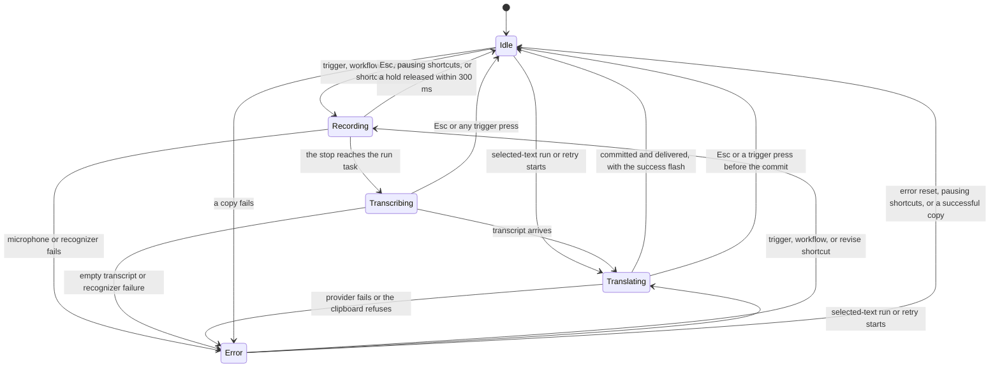

Invariants:

- A run owns the pipeline exactly while the state is recording, transcribing, or translating. Enforced: `beginRun` sets both, `clearRunTracking` clears the run before the state leaves; model-checked.
- Only the shortcut that started a recording stops it; another workflow's shortcut or the revise shortcut is ignored. Enforced in `PipelineTransitions`; model-checked.
- Paused shortcuts change nothing; pausing cancels a run that has not committed. Enforced by the guards in `triggerPressed` and friends and by `isHotkeyPaused`'s `didSet`; model-checked.
- The cancel shortcut is enabled exactly while not paused and the state is recording, transcribing, or translating. Enforced by `pipelineState`'s `didSet`; checked by the conformance replay.
- From every state, idle can be reached, and without further input every run ends, given the duration limit. Model-checked.

Tests: `PipelineTransitionsTests` (the whole event table), `AppStateTriggerTests`, `AppStateRevisionTests`, `HotkeyPauseTests`, `RunLifecycleModelTests`, `RunLifecycleConformanceTests`.

## Recording phase

While the state is recording, `PipelineRun.recordingPhase` decides what a stop does. A hold released within 300 ms is a tap and is discarded. A hotkey stop after a loud buffer starts a release tail, so a last word spoken while releasing is kept; it ends at the first quiet buffer or after 200 ms. Menu stops, the duration limit, and failures stop at once.

State: [`PipelineRun.recordingPhase`](../../Sources/App/PipelineRun.swift#L65), [`PipelineRun.lastBufferWasQuiet`](../../Sources/App/PipelineRun.swift#L66), [`PipelineRun.releaseTailDeadline`](../../Sources/App/PipelineRun.swift#L71), [`PipelineRun.recordingDurationTask`](../../Sources/App/PipelineRun.swift#L63), [`PipelineRun.stopWaiter`](../../Sources/App/PipelineRun.swift#L64), decisions in [`ReleaseTail`](../../Sources/App/ReleaseTail.swift#L19) and [`requestStopRecording`](../../Sources/App/AppState+VoiceRun.swift#L369).

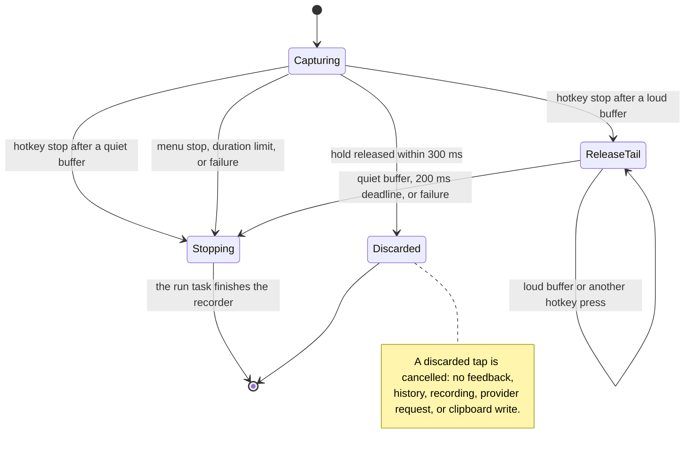

Invariants:

- A stop request in the release tail or while stopping changes nothing, except a failure, which ends the tail at once. Enforced in `requestStopRecording`; model-checked.
- The duration limit stops only a run still capturing. Enforced in `stopRecordingIfDurationExceeded`; model-checked.
- A hold released within 300 ms is discarded silently, for dictation and revision alike. Model-checked: no clipboard write, history, error, or flash.

Tests: `ReleaseTailDecisionTests`, `ReleaseTailPipelineTests`, `ShortTapTests`, `AppStateTriggerTests.recordingDurationLimitStopsRecordingAndCompletesPipeline`, `RunLifecycleModelTests`.

## Run task and the commit point

A voice run's task is `runPipeline`: open the microphone, wait for the run's configuration, start transcription, wait for the stop, wait for the transcript, wait for the provider, then commit. The commit, in `commit(_:runID:recordReleaseToClipboard:)`, writes the clipboard, appends the success record, and sets `deliveryCommitted`; after it, Esc and trigger presses no longer apply, and the run pastes and succeeds. After every wait the task checks that it still owns the pipeline, so a cancelled run's late transcript or provider output changes nothing.

State: the task's position (implicit in `runPipeline`'s awaits), [`VoiceRunWork`](../../Sources/App/AppState+VoiceRun.swift#L7), [`PipelineRun.failure`](../../Sources/App/PipelineRun.swift#L72), [`PipelineRun.failedRecordID`](../../Sources/App/PipelineRun.swift#L74), [`PipelineRun.deliveryCommitted`](../../Sources/App/PipelineRun.swift#L75), [`PipelineRun.preparedTransformer`](../../Sources/App/PipelineRun.swift#L77).

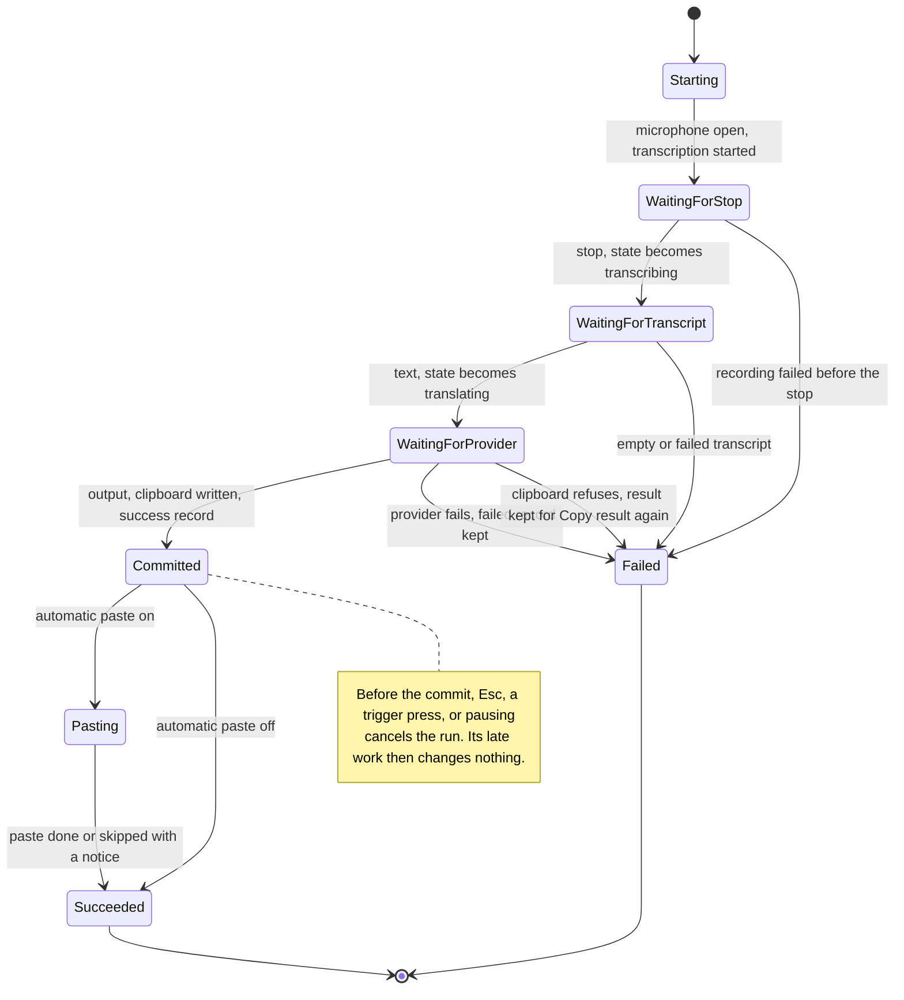

Invariants:

- Only the commit and explicit copy actions write the clipboard; Esc never writes the clipboard or history; a committed run is never cancelled. Model-checked, and the conformance replay compares clipboard writes and history records after every step.
- `finishRunSucceeded` and `finishRunFailed` act only for the run that owns the pipeline. Enforced by `isCurrentRun`; covered by the replay's late completions of cancelled runs.
- A cancelled run's late transcript or provider output changes nothing, even when it arrives at the same instant as Esc or a trigger press. Model-checked with races of a completion and a key before the run task runs; replayed.
- Selected-text and retry runs share the transformation and commit but are not in the model.

Tests: `AppStateDeliveryTests`, `AppStateFailureTests`, `AppStateResultTests`, `PipelineLifecycleRegressionTests`, `RecoveryReliabilityTests`, `RunLifecycleModelTests`, `RunLifecycleConformanceTests`.

## Success flash

A successful run or copy shows a checkmark on the menu bar icon and the recording cue for one second, with the success sound. Every change to the flag re-applies the cue.

State: [`StatusIndicator.isShowingSuccess`](../../Sources/App/StatusIndicator.swift#L23), [`StatusIndicator.flashTask`](../../Sources/App/StatusIndicator.swift#L35).

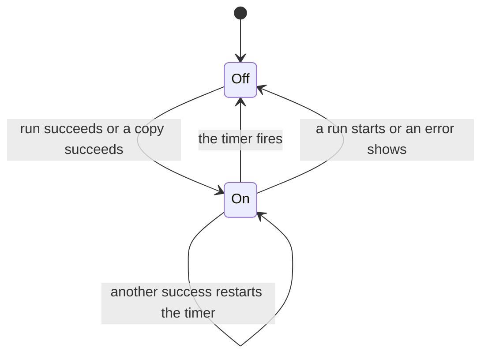

Invariants: the flash shows only while idle with no run (model-checked). The timer is cancelled rather than checked when it fires, so the flash relies on `Task.sleep` honoring cancellation (assumed; the error reset, below, checks its run ID instead).

Tests: `AppStateResultTests.successFeedbackFlashClearsAfterDelay`, `StatusDisplayCharacterizationTests`, `RunLifecycleModelTests`.

## Error reset

An error clears itself after four seconds, unless a newer error replaced it or a run owns the pipeline.

State: [`StatusIndicator.errorResetTask`](../../Sources/App/StatusIndicator.swift#L38), [`StatusIndicator.errorResetRunID`](../../Sources/App/StatusIndicator.swift#L40).

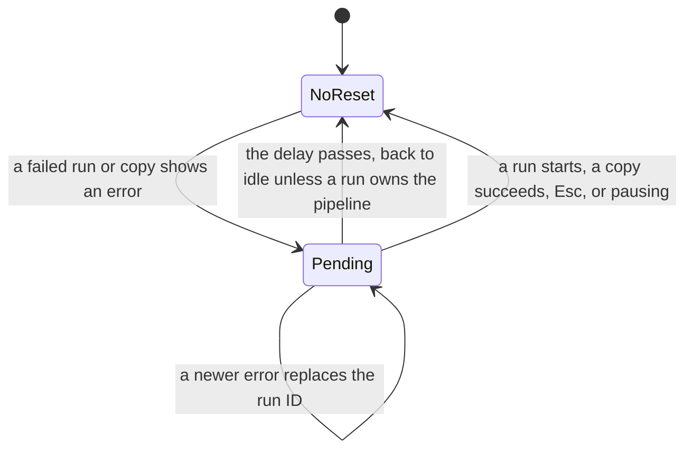

Invariants: a pending reset always sits behind an error with no run (model-checked); a reset for an older error never clears a newer one (enforced by the run ID; `AppStateTriggerTests.canceledStaleErrorResetDoesNotClearNewError`).

## Copy result again

When the clipboard refuses a committed result, the result is kept so Copy result again can deliver it later. `output` is what history keeps, `delivered` the sentence-fitted text.

State: [`ResultActions.pendingClipboardResult`](../../Sources/App/ResultActions.swift#L43).

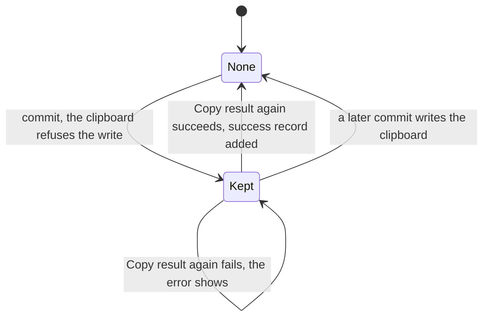

Tests: `AppStateFailureTests.clipboardFailureMovesToErrorAndDoesNotMarkSuccess`, `ResultActionsCharacterizationTests.copyResultAgainObserversHearAFailedClipboardWrite`, `RunLifecycleModelTests`.

## Paste Last request

Paste Last copies the newest result and, with automatic paste on, pastes it where automatic paste would. It awaits the delivery target, an optional caret read, and the paste delay; a newer Paste Last or any new run supersedes it.

State: [`ResultActions.pendingPasteID`](../../Sources/App/ResultActions.swift#L45), cleared by `cancelPendingPaste()` from [`clearRunTracking`](../../Sources/App/AppState.swift#L731).

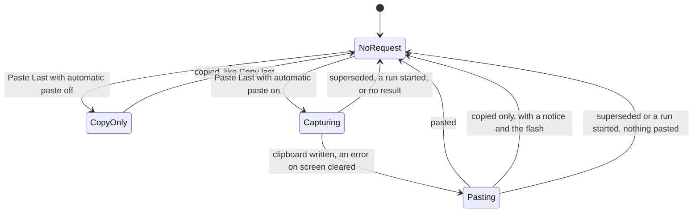

Tests: `AppStateDeliveryTests.pasteLast*`, `ResultActionsCharacterizationTests`.

## Streamed delivery

With a streaming provider, the result is typed into the editor, or previewed in the cue only, as deltas arrive. The run owns its typist; cancel stops it at once, and a provider that cannot stream falls back to one atomic request. Delivery still ends at the single commit point.

State: [`PipelineRun.streamingTypist`](../../Sources/App/PipelineRun.swift#L76) and the locals of [`streamAndDeliver`](../../Sources/App/AppState+Delivery.swift#L170): whether it types into the editor, whether the caret context was read, and the atomic fallback text.

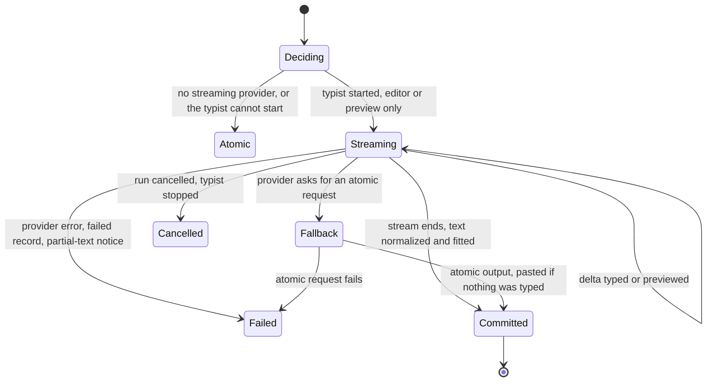

Invariants: a typist the run no longer owns is never cancelled or cleared by it (enforced by `isActiveStreamingTypist`); typed text and the clipboard carry the same fitted text (enforced). Not modeled: the streamed path is the next candidate for a model, because typing into the wrong app is a user-visible failure.

Tests: `AppStateDeliveryTests` (streaming cases), `StreamingTransformerTests`, `TypedDeliveryTests`, `RecoveryReliabilityTests`.

## Run context at the trigger

A voice run opens the microphone first; the opt-in selection read and the delivery-target capture run beside it and finish before the instruction is used. A selected-text run reads the selection before anything else and fails fast without one.

State: the outcome of [`resolveRunContext`](../../Sources/App/AppState.swift#L478), `PipelineRun.deliveryTarget`, and three once-per-launch flags from [`didNotifyEmptySelectionContext`](../../Sources/App/AppState.swift#L117) on.

```mermaid
stateDiagram-v2
    [*] --> Reading: the workflow asks for the selection
    [*] --> Target: no selection needed
    Reading --> Target: text captured
    Reading --> Target: voice run, nothing selected or no Accessibility, notice once per launch
    Reading --> StartFailed: selected-text run, nothing selected, no Accessibility, or editor changed
    Reading --> Abandoned: the run no longer owns the pipeline
    Target --> Ready: delivery target captured if pinning, spacing, or caret fit need it
    Target --> Abandoned: the run no longer owns the pipeline
    Ready --> [*]
    StartFailed --> [*]
    Abandoned --> [*]
```

Tests: `AppStateSelectionTests`, `RecoveryReliabilityTests.selectionIsReadBeforeDelayedDeliveryCapture`, `RecoveryReliabilityTests.cancellationDuringSourceCaptureIgnoresLateSelection`.

## Early transformation

With early transformation on, a pause of 300 ms during dictation runs an offline pass over the audio so far and sends it to the provider. At delivery the attempt is used only if its input and instruction match the final ones exactly.

State: [`PipelineRun.pauseCheckTask`](../../Sources/App/PipelineRun.swift#L41), [`PipelineRun.pauseAttempt`](../../Sources/App/PipelineRun.swift#L42), [`PipelineRun.pauseOutcome`](../../Sources/App/PipelineRun.swift#L44), `quietSince`, `pauseCheckedQuiet`, and the [`schedulePauseTransformation`](../../Sources/App/AppState+VoiceRun.swift#L435) task.

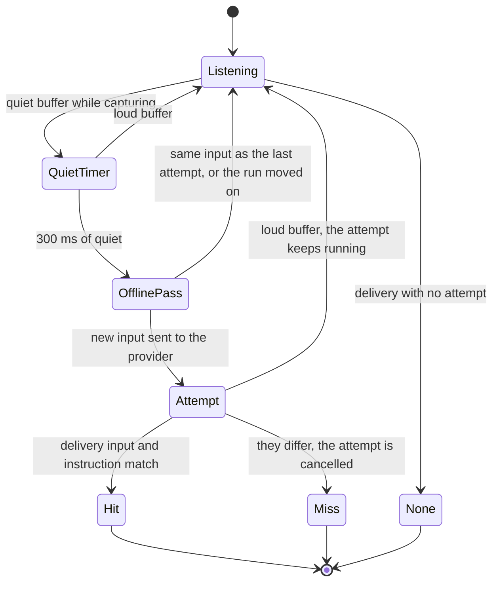

Tests: `PauseTransformationTests`.

## Recording filing

For an opted-in voice run, the audio is copied into a provisional archive entry while it is captured. After delivery the entry is committed once the WAV is complete and Apple's transcript is known, unless learning was turned off meanwhile; a failed, cancelled, or empty run discards it.

State: `VoiceRunWork.provisionalRecordingID` and `recordingTee` in [`VoiceRunWork`](../../Sources/App/AppState+VoiceRun.swift#L7), [`RecordingFiler.work`](../../Sources/App/RecordingFiler.swift#L11). The archive's own entry lifecycle is in [speech-learning.md](speech-learning.md).

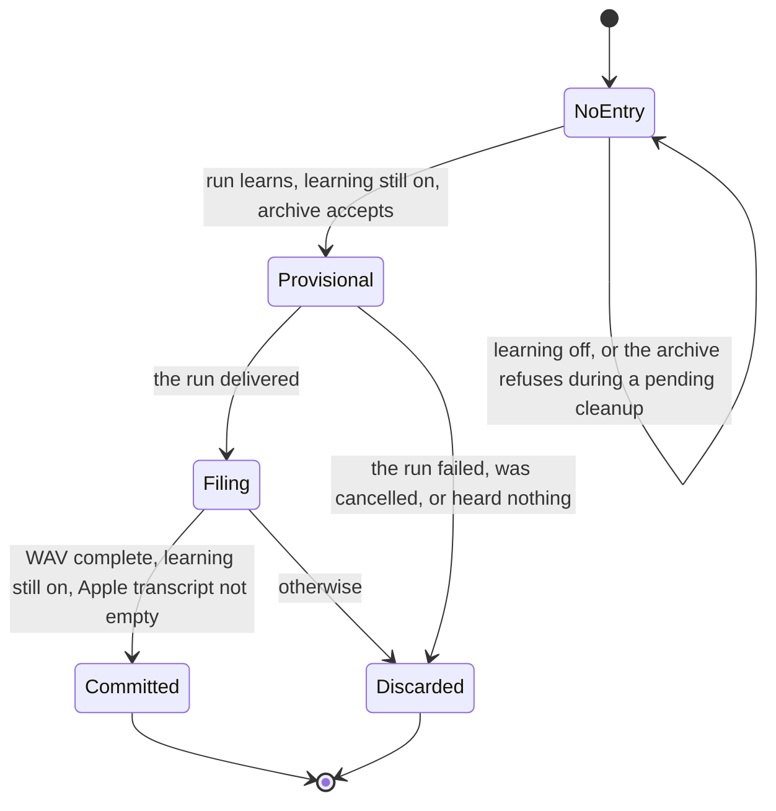

Tests: `AppStateLearningTests`, `RecordingFilingCharacterizationTests`, `PipelineRunTests.quittingWaitsForACancelledRecordingToBeDiscarded`.

## Output volume

A run that lowers other audio lowers it once the microphone is open and restores it when the recorder finishes, and again on any other ending; the repeated restore is a no-op. All changes run in order on one chain.

State: [`OutputVolumeChain.pending`](../../Sources/App/OutputVolumeChain.swift#L12), and the ducker's saved restore record (see [input-output.md](input-output.md)).

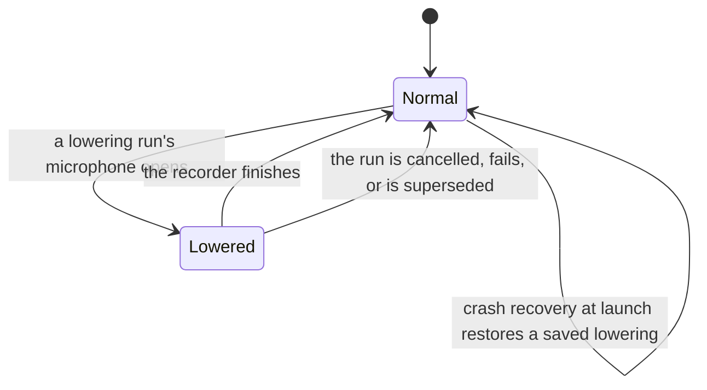

Tests: `OutputDuckingTests`, `OutputDuckerTests`, `OutputVolumeCharacterizationTests`.

## Quitting

Every quit path ends the run, waits up to two seconds for run tasks, recordings being filed, and the volume restore, then up to two seconds to flush usage stats and history.

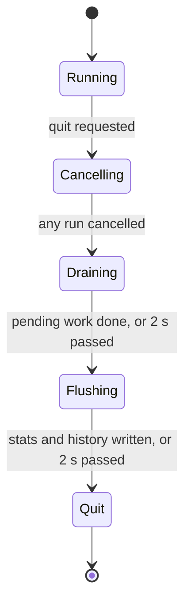

Tests: `PipelineRunTests.quittingEndsTheActiveRun`, `PipelineRunTests.quittingWaitsForACancelledRecordingToBeDiscarded`, `OutputVolumeCharacterizationTests.quittingWaitsForACancelledRunsVolumeRestore`, `RecordingFilingCharacterizationTests.quittingWaitsForADeliveredRunsRecordingToBeFiled`.

## Small machines

| Machine | State | What it remembers |
| --- | --- | --- |
| Speech warm-up | [`SpeechReadiness.preparedLocaleIDs`](../../Sources/App/SpeechReadiness.swift#L13) | The bound locales last prepared, so an unchanged set is not prepared again. |
| Speech fallback notice | [`SpeechReadiness.didShowFallbackNotice`](../../Sources/App/SpeechReadiness.swift#L14) | Whether the model-fallback notice was shown this launch. |
| Accessibility notice for paste | [`DeliveryCoordinator.didNotifyAutoPasteNotTrusted`](../../Sources/App/DeliveryCoordinator.swift#L24) | Shown once per launch. |
| Foreground activity | [`AppState.foregroundActivityChanged`](../../Sources/App/AppState.swift#L115), the run's `ProcessInfo` activity | Begun when a run starts, ended in `clearRunTracking`; learning and updates wait while it is active. |
| Onboarding paste hold | [`AppState.holdsPasteForOnboarding`](../../Sources/App/AppState.swift#L57) | While the onboarding's try-it page is open and Syrup is in front, runs do not paste. |
| Recording cue caption | `AppState.recordingCueCaption` | Derived on demand: the revision note, or a workflow other than the active one. |
