# Speech and learning state machines

`Sources/Transcription` and `Sources/Learning` contain 37 state machines, and ten of them matter most. Four guard the AGENTS.md privacy rule on recordings: the recording entry lifetime ([M23](#m23-recording-entry-lifetime)), archive retention and cleanup debt ([M24](#m24-archive-retention-and-cleanup-debt)), the tee that copies live audio to disk ([M27](#m27-live-forwarding-and-the-archive-writer)), and the learning pass ([M28](#m28-learning-schedule-and-pass)). A mistake there keeps a recording after a cancel, a failure, or an opt-out, or analyzes one after opt-out. Four keep a model's published state in step with its files: the speech model queue ([M01](#m01-download-load-and-remove-queue)), staged publication ([M02](#m02-staged-model-publication)), per-locale Apple assets ([M04](#m04-per-locale-asset-preparation)), and the Whisper model manager ([M22](#m22-whisper-model-download-removal-and-load-latch)). A mistake there shows a broken model as ready, hides a model that is on disk, or shows a download that nothing is running. The last two keep each dictation's audio inside its own run: the Apple analyzer session ([M07](#m07-apple-analyzer-session)) and the ordered streaming sessions ([M12](#m12-ordered-streaming-sessions)). Only the recording archive's opt-out path is formally validated: `LearningOptOutModel` model-checks M23 and the cleanup-debt part of M24 against the real archive. SpeechModelManager's queue has bounded sequence tests, and the other 34 machines are not formally validated. Five suspected defects are recorded, all unverified: four from the 2026-11-14 inventory and one found while checking M01 against the code.

## How to read this

The charts were drawn from the source on 2026-11-14, starting from a read-only inventory made that day at commit `4837945`. Every source file linked here is unchanged from that commit through `42b82ba`, so machine numbers follow the inventory and line links match both. For each High machine, every state, event, and guard in the chart was checked against the code. For Medium and Low machines, the state variables and line numbers were spot-checked.

- **Kind.** Explicit: a Swift enum names the states. Implicit: the state lives in flags, optionals, tasks, continuations, counters, or files. Mixed: an enum plus hidden variables that change what the enum means.
- **Importance.** High: an AGENTS.md hard rule, or a failure the person sees across runs, is at stake. Medium: a wrong transcript, a stall, or a misleading status within one feature. Low: diagnostics, or a helper that lives for one call.
- **Invariants.** Enforced: a guard, lock, actor, or ordered queue in the cited code makes it hold. Assumed: it holds only if a caller, the OS, or a framework behaves as described.
- **Charts.** Files on disk count as state where the code reads them. A choice point is a decision inside one handler. "Queued" means the work waits behind an earlier task.
- **Validation status.** "Model-checked" means a finite model's every reachable state is explored and its walks are replayed against the real types; the [README](README.md) describes the method. "Not formally validated" means no model checking or exhaustive search covers the machine; unit tests may still pin parts of it. A suspected defect is a reading of the code with an event sequence; none was reproduced.

## Machines

| Machine | Owner type | Kind | Importance | Validation status |
|---|---|---|---|---|
| [M01 Download, load, and remove queue](#m01-download-load-and-remove-queue) | `SpeechModelManager` | mixed | High | Bounded sequence tests (SpeechModelSequenceTests) |
| [M02 Staged model publication](#m02-staged-model-publication) | `SpeechModelCatalog` | implicit | High | Not formally validated |
| [M03 Retired-model handover](#m03-retired-model-handover) | `SpeechModelManager`, `SpeechModelCatalog` | implicit | Medium | Not formally validated |
| [M04 Per-locale asset preparation](#m04-per-locale-asset-preparation) | `TranscriberAssetManager` | mixed | High | Not formally validated |
| [M05 Installed-locale cache](#m05-installed-locale-cache) | `TranscriberInstalledLocaleCache` | implicit | Medium | Not formally validated |
| [M06 Speech authorization bridge](#m06-speech-authorization-bridge) | `TranscriberAssetManager`, `SpeechPermissionRequester` | mixed | Medium | Not formally validated |
| [M07 Apple analyzer session](#m07-apple-analyzer-session) | `AppleTranscriber` | implicit | High | Not formally validated |
| [M08 Final and volatile transcript accumulator](#m08-final-and-volatile-transcript-accumulator) | `AppleTranscriber` | implicit | Medium | Not formally validated |
| [M09 Audio conversion, feed, and drain](#m09-audio-conversion-feed-and-drain) | `AnalyzerAudioConverter`, `AnalyzerAudioFeedWorker` | implicit | Medium | Not formally validated |
| [M10 One-shot converter input callbacks](#small-machines) | `SingleBufferInputProvider`, `EndOfStreamInputProvider` | implicit | Low | Not formally validated |
| [M11 Speech metric intervals](#small-machines) | `AppleTranscriberMetricsRecorder` | implicit | Low | Not formally validated |
| [M12 Ordered streaming sessions](#m12-ordered-streaming-sessions) | `StreamingSpeechEngine` | implicit | High | Not formally validated |
| [M13 Streaming run, feed, and drain](#m13-streaming-run-feed-and-drain) | `StreamingTranscriber` | implicit | Medium | Not formally validated |
| [M14 Streaming backend residency and reset](#m14-streaming-backend-residency-and-reset) | `NemotronBackend`, `ParakeetUnifiedBackend` | implicit | Medium | Not formally validated |
| [M15 Parakeet residency](#m15-parakeet-residency) | `ParakeetEngine` | implicit | Medium | Not formally validated |
| [M16 Parakeet segmentation](#m16-parakeet-segmentation) | `ParakeetTranscriber` | implicit | Medium | Not formally validated |
| [M17 Canary residency](#m17-canary-residency) | `CanaryEngine` | implicit | Medium | Not formally validated |
| [M18 Canary token decode and empty-window recovery](#m18-canary-token-decode-and-empty-window-recovery) | `CanaryModel` | implicit | Medium | Not formally validated |
| [M19 Resumable Canary bundle fetch](#m19-resumable-canary-bundle-fetch) | `CanaryModel` | implicit | Medium | Not formally validated |
| [M20 URL download continuation](#m20-url-download-continuation) | `FileDownload` | implicit | Medium | Not formally validated |
| [M21 Canary window segmentation](#m21-canary-window-segmentation) | `CanaryTranscriber` | implicit | Medium | Not formally validated |
| [M22 Whisper model download, removal, and load latch](#m22-whisper-model-download-removal-and-load-latch) | `WhisperModelManager` | mixed | High | Not formally validated |
| [M23 Recording entry lifetime](#m23-recording-entry-lifetime) | `RecordingArchive` | implicit | High | Model-checked (`LearningOptOutModel`) |
| [M24 Archive retention and cleanup debt](#m24-archive-retention-and-cleanup-debt) | `RecordingArchive` | implicit | High | Partly model-checked (`LearningOptOutModel`): cleanup debt, not the caps |
| [M25 Pending-count subscriptions](#small-machines) | `RecordingArchive` | implicit | Low | Not formally validated |
| [M26 Recording retry and backoff](#m26-recording-retry-and-backoff) | `RecordingArchive`, `GlossaryLearningCoordinator` | implicit | Medium | Not formally validated |
| [M27 Live forwarding and the archive writer](#m27-live-forwarding-and-the-archive-writer) | `RecordingTee`, `RecordingTeeSession` | implicit | High | Not formally validated |
| [M28 Learning schedule and pass](#m28-learning-schedule-and-pass) | `GlossaryLearningCoordinator` | implicit | High | Not formally validated |
| [M29 Whisper pipeline residency and decode cancellation](#m29-whisper-pipeline-residency-and-decode-cancellation) | `WhisperKitBatchTranscriber` | implicit | Medium | Not formally validated |
| [M30 Suggestion batch and per-term results](#m30-suggestion-batch-and-per-term-results) | `MishearingSuggestionModel` | mixed | Medium | Not formally validated |
| [M31 Probe sample accumulation](#m31-probe-sample-accumulation) | `MishearingProbeEngine` | mixed | Medium | Not formally validated |
| [M32 Synthetic speech callbacks and timer](#m32-synthetic-speech-callbacks-and-timer) | `SystemMishearingSynthesizer` | implicit | Medium | Not formally validated |
| [M33 Check-only recognition](#m33-check-only-recognition) | `AppleMishearingRecognizer` | mixed | Medium | Not formally validated |
| [M34 Pair judging and proposal publication](#m34-pair-judging-and-proposal-publication) | `JudgingCrossCheckSink`, `LLMMishearingJudge` | implicit | Medium | Not formally validated |
| [M35 Proposal and dismissal lifetime](#m35-proposal-and-dismissal-lifetime) | `GlossaryProposalList` | implicit | Medium | Not formally validated |
| [M36 Launch cleanup decision](#m36-launch-cleanup-decision) | `deleteLeftoverRecordingsIfLearningIsOff` (function) | implicit | Medium | Not formally validated |
| [M37 Small algorithm, resource, and global latches](#small-machines) | `SpeechSegmenter`, `CanaryMelSpectrogram`, scan helpers, `FluidAudioLogging` | implicit | Low | Not formally validated |

## Suspected defects

All five are unverified. Each section gives the full event sequence.

- [M01](#m01-download-load-and-remove-queue), found in this check: a Cancel that lands after the model is moved into place leaves it on disk while Settings shows Not downloaded.
- [M03](#m03-retired-model-handover): if deleting the retired Parakeet v3 folder fails during a cancelled handover, the next launch starts the cancelled download again.
- [M04](#m04-per-locale-asset-preparation): a framework `CancellationError` leaves a locale shown as Checking or Downloading with no worker.
- [M22](#m22-whisper-model-download-removal-and-load-latch): Retry after a load failure republishes the same model as Ready if deleting its folder fails.
- [M24](#m24-archive-retention-and-cleanup-debt): a failed `deleteAll` records no cleanup debt, so a new recording is admitted while the leftovers remain; learning is back on by then. The [README](README.md) records the new recordings as documented behavior, not a rule violation.

## Speech models and transcription

### M01 Download, load, and remove queue

`SpeechModelManager` decides what one downloadable speech model shows in Settings and whether dictation can use it. Every download, load, and removal for the model waits for the one before it, and a generation counter stops a superseded operation from publishing its result. The published enum is only part of the state: a queued removal shows Not downloaded while the files are still on disk, and a Delete must never leave a model that dictation can load.

**State variables**

- [`SpeechModelManager.state`](../../Sources/Transcription/SpeechModelManager.swift#L15), the published [`SpeechModelState`](../../Sources/Transcription/SpeechModelState.swift#L9-L16)
- [`SpeechModelManager.generation`](../../Sources/Transcription/SpeechModelManager.swift#L19)
- [`SpeechModelManager.downloadTask`](../../Sources/Transcription/SpeechModelManager.swift#L20)
- [`SpeechModelManager.lastOperation`](../../Sources/Transcription/SpeechModelManager.swift#L24)
- [`SpeechModelManager.replacedDirectory`](../../Sources/Transcription/SpeechModelManager.swift#L26), see [M03](#m03-retired-model-handover)
- On disk: the model folder [`directory`](../../Sources/Transcription/SpeechModelManager.swift#L39) and its staging sibling from [`stagingDirectory`](../../Sources/Transcription/SpeechModelManager.swift#L48-L52), judged by [`Operations.modelsExist`](../../Sources/Transcription/SpeechModelManager.swift#L8)

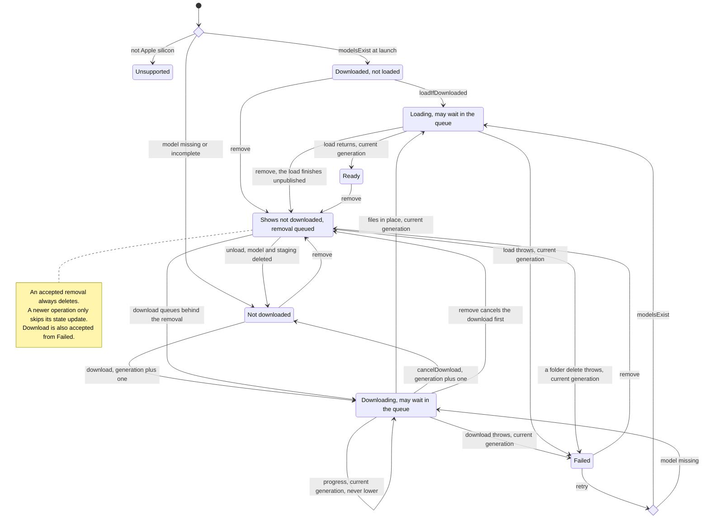

**Invariants**

- Enforced: operations on one manager run one at a time, in call order, through `lastOperation` ([L66-L83](../../Sources/Transcription/SpeechModelManager.swift#L66-L83), [L134-L139](../../Sources/Transcription/SpeechModelManager.swift#L134-L139), [L153-L171](../../Sources/Transcription/SpeechModelManager.swift#L153-L171)).
- Enforced: a superseded operation never publishes its state; each compares its generation first ([L69](../../Sources/Transcription/SpeechModelManager.swift#L69), [L75](../../Sources/Transcription/SpeechModelManager.swift#L75), [L137](../../Sources/Transcription/SpeechModelManager.swift#L137), [L169](../../Sources/Transcription/SpeechModelManager.swift#L169), [L193-L195](../../Sources/Transcription/SpeechModelManager.swift#L193-L195)).
- Enforced: an accepted removal unloads and deletes even when a later download has changed what the state shows ([L154-L168](../../Sources/Transcription/SpeechModelManager.swift#L154-L168)).
- Enforced: published progress stays between 0 and 1 and never moves backwards ([L205-L208](../../Sources/Transcription/SpeechModelManager.swift#L205-L208)).
- Enforced: `loadIfDownloaded` starts at most one load, because it acts only in Downloaded and `startLoad` leaves that state at once ([L124-L140](../../Sources/Transcription/SpeechModelManager.swift#L124-L140)).
- Enforced: on a Mac without Apple silicon nothing downloads or loads, and a removal leaves the state Unsupported ([L58](../../Sources/Transcription/SpeechModelManager.swift#L58), [L151](../../Sources/Transcription/SpeechModelManager.swift#L151), [L169](../../Sources/Transcription/SpeechModelManager.swift#L169)).
- Assumed: each queued operation finishes. The queue has no timeout, so a hung download or load holds every later operation.
- Assumed: a load that returns means the engine can transcribe.
- Assumed: only this manager writes its two folders.

**Validation.** `SpeechModelSequenceTests.everySequenceLeavesTheManagerAgreeingWithTheDisk` runs all 155 sequences of up to three steps (download, cancel, delete, load, retry) against the real manager, from a model on disk and from none, with a marker-file fake whose download takes 2 ms. Once the work settles, the state must agree with the disk, and no two downloads may have overlapped. The steps are issued back to back before any operation runs, so the test never places an event inside a running operation, and it injects no filesystem failure.

**Tests.** [`SpeechModelManagerTests`](../../Tests/SyrupTests/SpeechModelManagerTests.swift): `loadIfDownloadedNeverDownloads`, `loadIfDownloadedLoadsAModelAlreadyOnDisk`, `downloadIsExplicitReportsProgressAndLoads`, `failuresAreReportedAndRetryable`, `retryAfterALoadFailureLoadsAgainInsteadOfDownloading`, `retryAfterADownloadFailureDownloadsAgain`, `removeUnloadsAndDeletesTheModel`, `cancelStopsTheDownload`, `aNewDownloadWaitsForACancelledOneToStop`, `aLoadAskedForRightAfterDeleteDoesNotKeepTheModel`, `deleteDuringAStartedLoadStillRemovesTheModel`, `downloadRightAfterDeleteStartsFromNothing`, `deleteWhileDownloadingCancelsTheDownloadThenRemovesWhatItFetched`, `unsupportedMacsNeverDownloadOrLoad`. [`SpeechModelSequenceTests`](../../Tests/SyrupTests/SpeechModelSequenceTests.swift): `everySequenceLeavesTheManagerAgreeingWithTheDisk`.

**Suspected defect (unverified, found in this check).** A Cancel can land after the files are in place but before the manager sees the result. Sequence: a download runs; `stagedDownload` moves the model into its folder on the main actor ([SpeechModelCatalog.swift L122-L127](../../Sources/Transcription/SpeechModelCatalog.swift#L122-L127)); it returns through the nonisolated `Operations.download` closure, so the manager's task has to hop back onto the main actor; the person presses Cancel in that gap, and `cancelDownload` advances the generation and shows Not downloaded ([L89-L95](../../Sources/Transcription/SpeechModelManager.swift#L89-L95)); the task resumes and its generation check returns ([L75](../../Sources/Transcription/SpeechModelManager.swift#L75)). The model is complete on disk, yet Settings shows Not downloaded and offers only Download ([SpeechModelViews.swift L12-L15](../../Sources/Settings/SpeechModelViews.swift#L12-L15)), and dictation with that engine falls back to Apple. It heals at the next Download, which finds the files and loads without a network call, or at the next launch. The gap is short and depends on main-actor scheduling; `SpeechModelSequenceTests` cannot reach it.

**Open questions**

- After a failed removal the state is Failed, and Settings offers Retry beside Delete ([SpeechModelViews.swift L41-L51](../../Sources/Settings/SpeechModelViews.swift#L41-L51)). `retry` loads the model if it is still complete on disk ([L115-L122](../../Sources/Transcription/SpeechModelManager.swift#L115-L122)) instead of removing it again. Is that what Retry should mean after a failed Delete? [M22](#m22-whisper-model-download-removal-and-load-latch) keeps a separate removal reason for this case.

### M02 Staged model publication

`SpeechModelCatalog.stagedDownload` decides when downloaded files may become the model folder. It downloads into a hidden sibling folder and moves the finished child into place only if the task was not cancelled, so a model folder that exists is meant to be complete. Every downloader in the catalog goes through it; a partial folder published as installed would fail to load on every retry.

**State variables**

- On disk: the destination folder and its completeness through `modelsExist` ([L111](../../Sources/Transcription/SpeechModelCatalog.swift#L111))
- On disk: the staging folder from [`SpeechModelManager.stagingDirectory`](../../Sources/Transcription/SpeechModelManager.swift#L48-L52) and the staged child named after the destination ([L112-L125](../../Sources/Transcription/SpeechModelCatalog.swift#L112-L125))
- The task's cancellation flag, checked at [L115](../../Sources/Transcription/SpeechModelCatalog.swift#L115) and [L120](../../Sources/Transcription/SpeechModelCatalog.swift#L120)

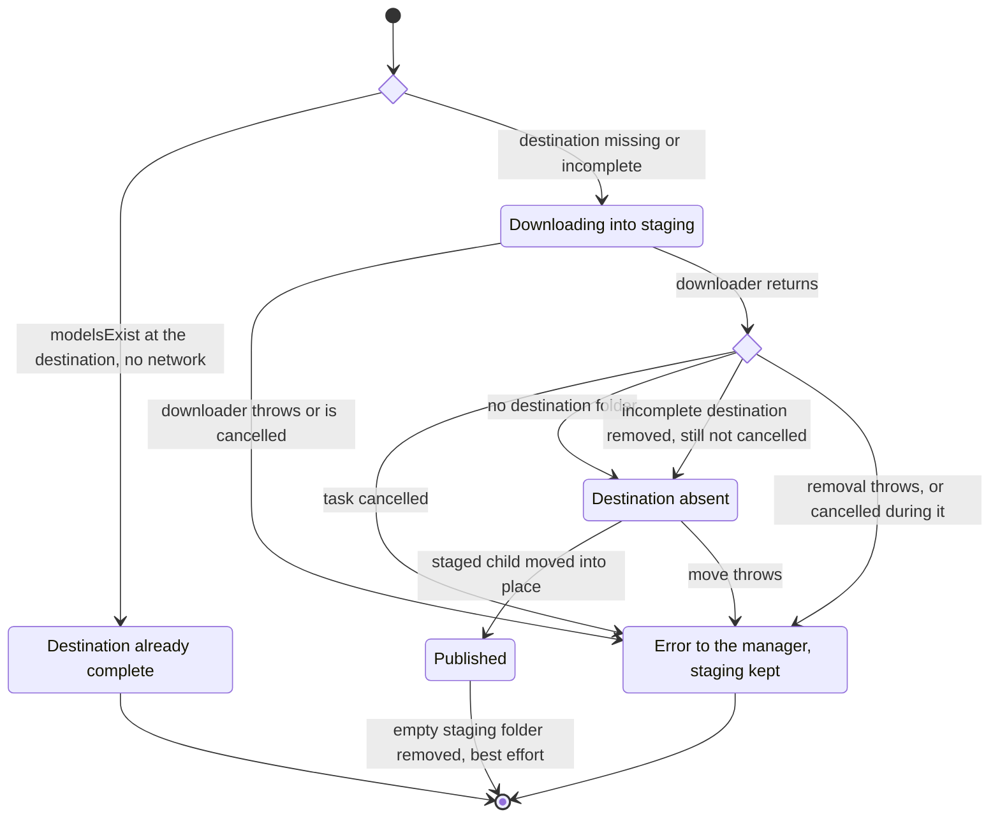

**Invariants**

- Enforced: a complete destination is kept and nothing downloads ([L111](../../Sources/Transcription/SpeechModelCatalog.swift#L111)).
- Enforced: a cancelled download is never moved into place, even if it finished; cancellation is checked after the download and after removing an old folder ([L115](../../Sources/Transcription/SpeechModelCatalog.swift#L115), [L120](../../Sources/Transcription/SpeechModelCatalog.swift#L120)).
- Enforced: an incomplete destination is removed before the move, so a broken folder does not block every retry ([L117-L121](../../Sources/Transcription/SpeechModelCatalog.swift#L117-L121)).
- Assumed: the downloader returns only when the staged child is complete and named after the destination. Parakeet checks `modelsExist` after fetching ([ParakeetEngine.swift L56-L64](../../Sources/Transcription/ParakeetEngine.swift#L56-L64)), Canary verifies every file ([M19](#m19-resumable-canary-bundle-fetch)), and the Unified backend loads what it fetched ([StreamingSpeech.swift L207-L211](../../Sources/Transcription/StreamingSpeech.swift#L207-L211)). Nemotron returns whatever FluidAudio's `downloadVariant` leaves ([StreamingSpeech.swift L141-L145](../../Sources/Transcription/StreamingSpeech.swift#L141-L145)).
- Assumed: the manager's queue ([M01](#m01-download-load-and-remove-queue)) is the only writer of these folders; there is no file lock.
- Assumed: the move is the publication point. A crash after an old folder is removed and before the move leaves no destination, and the next download publishes from staging.

**Tests.** [`SpeechModelManagerTests`](../../Tests/SyrupTests/SpeechModelManagerTests.swift): `aDownloadReplacesAnIncompleteModelFolder`, `aCompleteModelAtTheDestinationIsKeptAndNothingDownloads`, `removeLeavesOtherModelsInPlaceAndClearsItsUnfinishedDownload`. [`StreamingSpeechTests`](../../Tests/SyrupTests/StreamingSpeechTests.swift): `aStreamingModelCountsAsInstalledOnlyWithEveryFileItLoads`. [`CanaryTests`](../../Tests/SyrupTests/CanaryTests.swift): `aBundleIsCompleteOnlyWithEveryFileAtItsSize`. No test injects a failure between the steps.

**Open questions**

- Should the Nemotron download check `modelsExist` on the staged child, as Parakeet does, before it can be published?

### M03 Retired-model handover

At launch, a Parakeet v3 folder left by Syrup 0.9 means Ultra should replace it. `SpeechModelManager.replace` downloads Ultra if needed and deletes the v3 folder once Ultra is on disk, or once the person cancels or deletes Ultra. The v3 folder is the only record: no flag is stored, so the folder makes every launch try again.

**State variables**

- [`SpeechModelManager.replacedDirectory`](../../Sources/Transcription/SpeechModelManager.swift#L26)
- On disk: the retired folder found by [`SpeechModelCatalog.replaceRetiredParakeetV3`](../../Sources/Transcription/SpeechModelCatalog.swift#L30-L36), named by [`SpeechEngine.retiredParakeetV3Folder`](../../Sources/Core/SpeechEngine.swift#L168)
- Ultra's published state from [M01](#m01-download-load-and-remove-queue), read as a guard in [`replace`](../../Sources/Transcription/SpeechModelManager.swift#L101-L111)

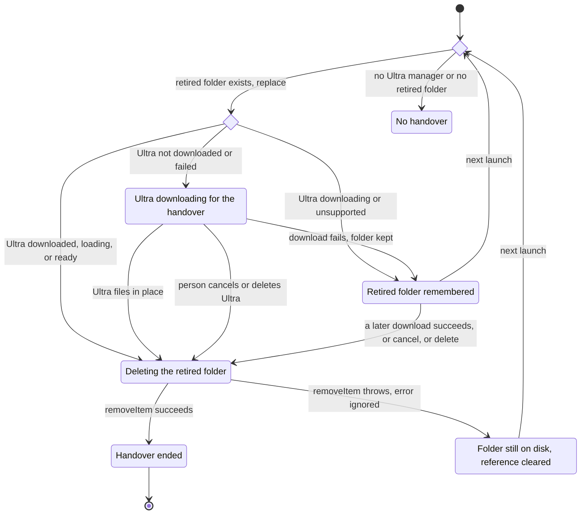

**Invariants**

- Enforced: the v3 folder is kept when the Ultra download fails, so the next launch tries again ([L75-L80](../../Sources/Transcription/SpeechModelManager.swift#L75-L80)).
- Enforced: Cancel and Delete end the handover and request the folder's deletion ([L94](../../Sources/Transcription/SpeechModelManager.swift#L94), [L152](../../Sources/Transcription/SpeechModelManager.swift#L152)).
- Enforced: only the retired sibling folder is targeted ([SpeechModelCatalog.swift L32-L35](../../Sources/Transcription/SpeechModelCatalog.swift#L32-L35)).
- Assumed: deleting the folder succeeds. The reference is cleared before the `try?` removal, and a failure is not recorded ([L183-L187](../../Sources/Transcription/SpeechModelManager.swift#L183-L187)).
- Assumed: `replace` runs once, right after the catalog is built at launch ([SyrupApp.swift L95](../../Sources/App/SyrupApp.swift#L95)), when Ultra can only be Unsupported, Not downloaded, or Downloaded.

**Tests.** [`SpeechModelManagerTests`](../../Tests/SyrupTests/SpeechModelManagerTests.swift): `aParakeetV3DownloadIsRemovedAndUltraDownloadsInItsPlace`, `cancellingTheUltraHandoverDeletesV3SoTheNextLaunchDoesNotStartItAgain`, `aFailedUltraDownloadKeepsParakeetV3SoTheNextLaunchTriesAgain`, `withoutAParakeetV3DownloadNothingDownloads`.

**Suspected defect (unverified, from the inventory).** A cancelled handover can restart at a later launch. Sequence: launch with a v3 folder and no Ultra; `replace` starts the Ultra download; the person cancels; `removeReplacedDirectory` clears the reference, and its `try?` removal of the v3 folder fails ([L89-L95](../../Sources/Transcription/SpeechModelManager.swift#L89-L95), [L183-L187](../../Sources/Transcription/SpeechModelManager.swift#L183-L187)); the folder stays; the next launch finds it ([SpeechModelCatalog.swift L30-L36](../../Sources/Transcription/SpeechModelCatalog.swift#L30-L36)), and `replace` starts the download the person cancelled. It needs a filesystem failure and was not induced.

**Open questions**

- Should a failed removal keep the reference, or be logged, so the cleanup can be retried without starting the download again?

### M04 Per-locale asset preparation

`TranscriberAssetManager` decides, for each BCP 47 locale, whether Apple's on-device language model is installed, downloading, unsupported, or failed, and runs at most one preparation per locale. Settings shows the selected locale's state, and other locales prepare in the background without changing it. The hotkey path never waits for a download: it starts preparation and fails the run with "installing", so a state stuck in Downloading or wrongly Installed leaves the locale unusable.

**State variables**

- [`TranscriberAssetManager.AssetState`](../../Sources/Transcription/TranscriberAssetManager.swift#L25-L32)
- [`localeStates`](../../Sources/Transcription/TranscriberAssetManager.swift#L39), one entry per normalized key
- [`preparationTasks`](../../Sources/Transcription/TranscriberAssetManager.swift#L37) and [`progressTasks`](../../Sources/Transcription/TranscriberAssetManager.swift#L38)
- [`selectedLocaleID`](../../Sources/Transcription/TranscriberAssetManager.swift#L40) and [`selectedLocaleAssetState`](../../Sources/Transcription/TranscriberAssetManager.swift#L35), the Settings projection
- [`supportedLocales`](../../Sources/Transcription/TranscriberAssetManager.swift#L34)
- [`installedLocaleCache`](../../Sources/Transcription/TranscriberAssetManager.swift#L41), see [M05](#m05-installed-locale-cache)
- Outside the app: `SpeechTranscriber.installedLocales` and the `AssetInventory` installation request with its `Progress` ([L209-L233](../../Sources/Transcription/TranscriberAssetManager.swift#L209-L233))

One machine runs per locale key.

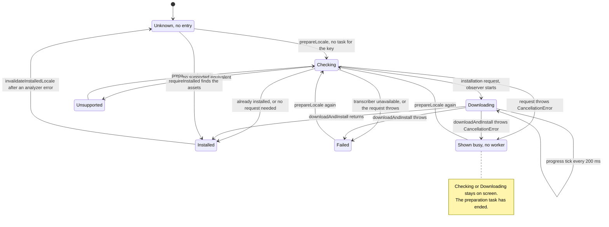

`requireInstalled` can also write Installed, Unsupported, or Failed for the requested key from any state ([L157-L186](../../Sources/Transcription/TranscriberAssetManager.swift#L157-L186)); the chart shows one such edge.

**Invariants**

- Enforced: keys are normalized to BCP 47, and a key has at most one preparation task ([L105](../../Sources/Transcription/TranscriberAssetManager.swift#L105), [L113](../../Sources/Transcription/TranscriberAssetManager.swift#L113), [L117-L118](../../Sources/Transcription/TranscriberAssetManager.swift#L117-L118)).
- Enforced: an Installed key is not prepared again ([L119](../../Sources/Transcription/TranscriberAssetManager.swift#L119)).
- Enforced: a key's result reaches Settings only if it is the selected key ([L137-L140](../../Sources/Transcription/TranscriberAssetManager.swift#L137-L140)), so a background locale never retargets the display.
- Enforced: progress is clamped to 0 to 1, or nil when not finite ([L273-L278](../../Sources/Transcription/TranscriberAssetManager.swift#L273-L278)).
- Enforced: `requireInstalled` never waits for a download; it starts preparation and throws `languageModelInstalling` ([L175-L181](../../Sources/Transcription/TranscriberAssetManager.swift#L175-L181)).
- Enforced: a check-only caller (`allowPreparation` false) never prompts, skips the cache fast path, and never starts preparation ([L151-L155](../../Sources/Transcription/TranscriberAssetManager.swift#L151-L155), [L157](../../Sources/Transcription/TranscriberAssetManager.swift#L157), [L177-L181](../../Sources/Transcription/TranscriberAssetManager.swift#L177-L181)).
- Assumed: a nil installation request means the assets are usable; the state becomes Installed without caching ([L217-L219](../../Sources/Transcription/TranscriberAssetManager.swift#L217-L219)).
- Assumed: nothing in the app cancels a preparation task, so `CancellationError` comes only from the framework.
- Assumed: `invalidateInstalledLocale` clears the key's entry but not the selected projection; Settings keeps its last value until the next write for that key ([L142-L145](../../Sources/Transcription/TranscriberAssetManager.swift#L142-L145)).
- Assumed: `refreshSupportedLocales` writes Failed straight to the projection, not to `localeStates` ([L74-L86](../../Sources/Transcription/TranscriberAssetManager.swift#L74-L86)).

**Tests.** [`LocalePreparationTests`](../../Tests/SyrupTests/LocalePreparationTests.swift): `localePreparationsAreIndependentAndDeduplicated`. [`TranscriberAssetManagerTests`](../../Tests/SyrupTests/TranscriberAssetManagerTests.swift): `bcp47ComparisonTreatsUnderscoreAndHyphenLocaleIDsAsEquivalent`, `downloadingStateExposesMessageAndProgress`, `installedStateHasNoProgressValue`. No test drives a real installation or its cancellation branch.

**Suspected defect (unverified, from the inventory, extended in this check).** A framework `CancellationError` leaves a key shown as busy with no worker. Sequence: `prepareLocale` sets Checking; the installation request returns; `observeProgress` sets Downloading ([L222](../../Sources/Transcription/TranscriberAssetManager.swift#L222), [L236-L245](../../Sources/Transcription/TranscriberAssetManager.swift#L236-L245)); `downloadAndInstall` throws `CancellationError`; the handler cancels the observer and writes no state ([L227-L228](../../Sources/Transcription/TranscriberAssetManager.swift#L227-L228)); the task clears `preparationTasks[key]` ([L128](../../Sources/Transcription/TranscriberAssetManager.swift#L128)). Settings shows a download that nothing is running until another prepare or readiness check for that key. This check adds a second case: if the installation request itself throws `CancellationError`, Checking stays on screen the same way. Both need the framework to throw `CancellationError` and were not induced.

**Open questions**

- `requireInstalled` records state under the requested key but prepares the supported locale's key ([L148](../../Sources/Transcription/TranscriberAssetManager.swift#L148), [L178](../../Sources/Transcription/TranscriberAssetManager.swift#L178)). When they differ, for example a stored `en` that the framework maps to `en-US`, does Settings watch a key the preparation never updates?

### M05 Installed-locale cache

A small cache of locales the framework has confirmed installed, so a warm dictation skips the framework queries. It has no expiry: an entry goes only when readiness finds the assets missing, preparation fails, or an analyzer error invalidates the locale.

**State variables**

- [`TranscriberInstalledLocaleCache.localesByIdentifier`](../../Sources/Transcription/TranscriberAssetManager.swift#L311)
- [`TranscriberAssetManager.installedLocaleCache`](../../Sources/Transcription/TranscriberAssetManager.swift#L41)

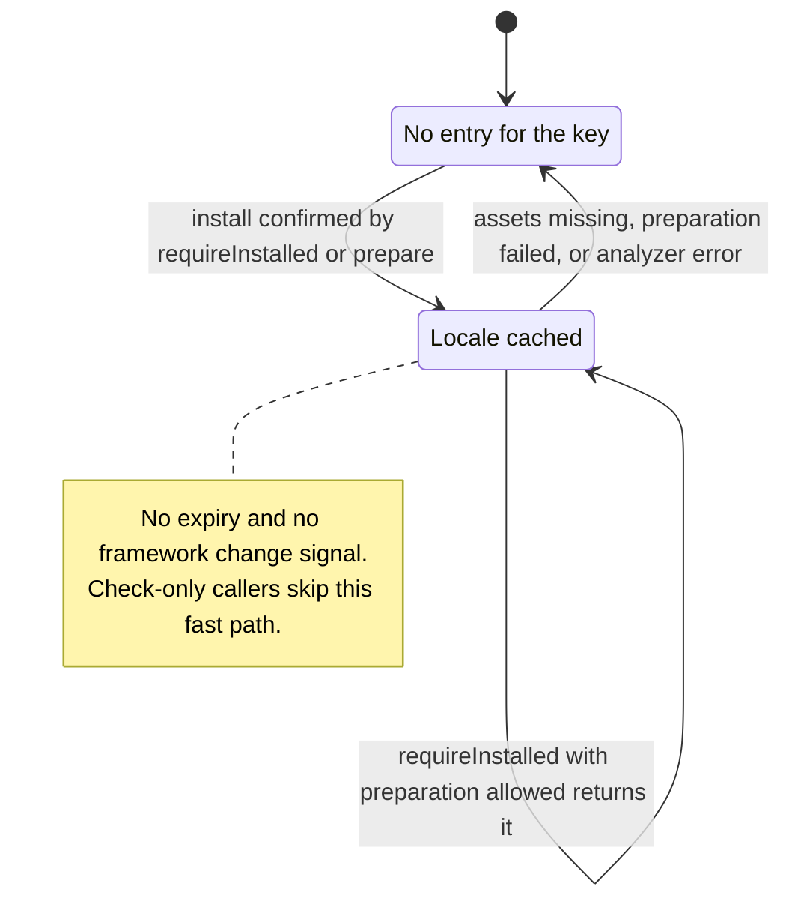

**Invariants**

- Enforced: store, remove, and lookup use the BCP 47 key ([L313-L324](../../Sources/Transcription/TranscriberAssetManager.swift#L313-L324)).
- Enforced: entries are stored only after the framework lists the locale as installed or a download succeeds ([L184](../../Sources/Transcription/TranscriberAssetManager.swift#L184), [L211](../../Sources/Transcription/TranscriberAssetManager.swift#L211), [L225](../../Sources/Transcription/TranscriberAssetManager.swift#L225)).
- Assumed: an entry stays true until an error says otherwise. If Apple removes a model while Syrup runs, the next dictation fails once before [M07](#m07-apple-analyzer-session) invalidates it ([AppleTranscriber.swift L86-L87](../../Sources/Transcription/AppleTranscriber.swift#L86-L87)).

**Tests.** [`TranscriberAssetManagerTests`](../../Tests/SyrupTests/TranscriberAssetManagerTests.swift): `installedLocaleCacheReturnsNormalizedLocale`.

**Open questions.** None.

### M06 Speech authorization bridge

Decides whether a dictation may use Speech recognition, and prompts when the status is not yet determined. The status lives in the system; Syrup holds only a checked continuation while the system callback is pending. Check-only callers never prompt. Microphone permission is a separate machine outside this area.

**State variables**

- The system status, read at [L248](../../Sources/Transcription/TranscriberAssetManager.swift#L248) and, for check-only callers, at [L152](../../Sources/Transcription/TranscriberAssetManager.swift#L152)
- The checked continuation in [`SpeechPermissionRequester.requestAuthorization`](../../Sources/Transcription/SpeechPermissionRequester.swift#L7-L19)


**Invariants**

- Enforced: a check-only call never prompts ([L151-L155](../../Sources/Transcription/TranscriberAssetManager.swift#L151-L155)).
- Enforced: the system completion only resumes a Sendable continuation, so no actor-isolated closure runs on the callback's queue ([SpeechPermissionRequester.swift L7-L19](../../Sources/Transcription/SpeechPermissionRequester.swift#L7-L19)).
- Assumed: the system calls the completion exactly once; a checked continuation reports a second resume but does not prevent it.
- Assumed: a cancelled caller keeps waiting for the system callback; there is no cancellation handler.

**Tests.** [`SpeechPermissionRequesterTests`](../../Tests/SyrupTests/SpeechPermissionRequesterTests.swift): `requestAuthorizationCanResumeFromBackgroundQueueWhenCalledOnMainActor`. No test covers denial, two callers at once, or a cancel before the callback.

**Open questions**

- Two first dictations at notDetermined each request authorization. Does the system show one prompt and answer both?

### M07 Apple analyzer session

`AppleTranscriber.transcribe` runs one `SpeechAnalyzer` session for one dictation: readiness, format, prepare, feed, finalize, collect. It decides when the session ends. On cancel or error it closes the input and cancels the session without waiting for the framework, so a stuck analyzer cannot hold the run open or delay a cancel.

**State variables** (locals of one call)

- [`supportedLocale`](../../Sources/Transcription/AppleTranscriber.swift#L21-L23), from readiness ([M04](#m04-per-locale-asset-preparation), [M06](#m06-speech-authorization-bridge))
- [`transcriber` and `analyzer`](../../Sources/Transcription/AppleTranscriber.swift#L24-L32)
- [`analyzerFormat`](../../Sources/Transcription/AppleTranscriber.swift#L34-L39)
- [`analyzerInput`](../../Sources/Transcription/AppleTranscriber.swift#L41), bounded to `AudioBufferStream.capacity`
- [`resultsTask`](../../Sources/Transcription/AppleTranscriber.swift#L42-L45), see [M08](#m08-final-and-volatile-transcript-accumulator)
- The cancellation handler and error paths ([L47-L97](../../Sources/Transcription/AppleTranscriber.swift#L47-L97))
- [`AppleTranscriber.allowAssetPreparation`](../../Sources/Transcription/AppleTranscriber.swift#L8), false for check-only recognition ([M33](#m33-check-only-recognition))

The results task runs alongside feeding; the chart folds it into the Feeding state.

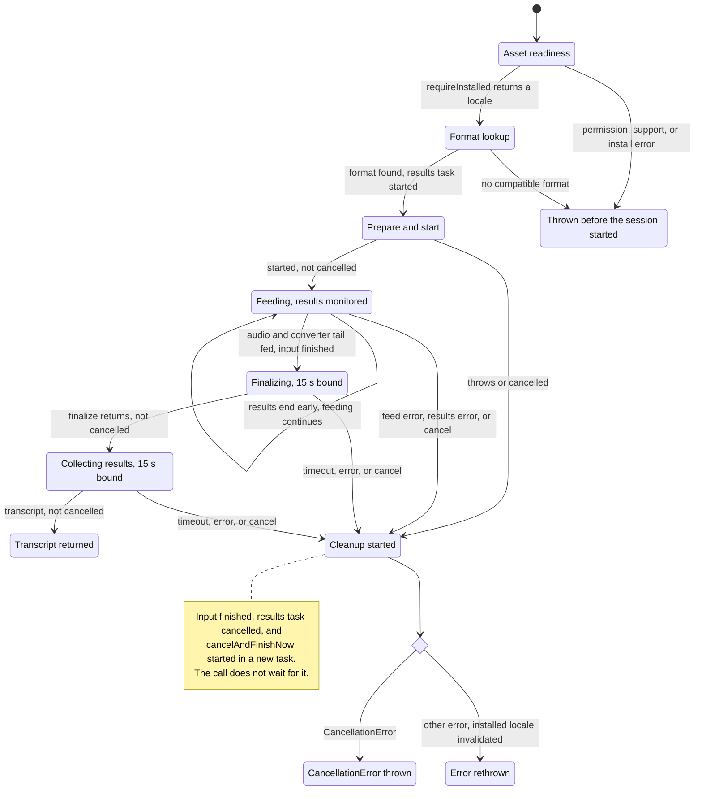

**Invariants**

- Enforced: the analyzer input holds at most `AudioBufferStream.capacity` buffers, and a dropped buffer fails the run ([L41](../../Sources/Transcription/AppleTranscriber.swift#L41), [L238-L247](../../Sources/Transcription/AppleTranscriber.swift#L238-L247)).
- Enforced: cancellation is checked after start, after feeding, after finalization, and after collection ([L57](../../Sources/Transcription/AppleTranscriber.swift#L57), [L66](../../Sources/Transcription/AppleTranscriber.swift#L66), [L72](../../Sources/Transcription/AppleTranscriber.swift#L72), [L76](../../Sources/Transcription/AppleTranscriber.swift#L76)).
- Enforced: a results error cancels the feed, and results ending normally do not cut it short ([L59-L80](../../Sources/Transcription/AppleTranscriber.swift#L59-L80), [OperationTimeout.swift L31-L46](../../Sources/Core/OperationTimeout.swift#L31-L46)).
- Enforced: finalization and result collection each return within 15 s, even if the framework ignores cancellation ([L68-L75](../../Sources/Transcription/AppleTranscriber.swift#L68-L75), [OperationTimeout.swift L7-L29](../../Sources/Core/OperationTimeout.swift#L7-L29)).
- Enforced: cancel and error paths close the input, cancel the results task, and request `cancelAndFinishNow` without awaiting it ([L81-L97](../../Sources/Transcription/AppleTranscriber.swift#L81-L97)).
- Enforced: log lines carry the stage, the outcome, a per-call UUID, and the duration only ([L218-L220](../../Sources/Transcription/AppleTranscriber.swift#L218-L220)).
- Assumed: `cancelAndFinishNow` tolerates two requests, from the cancellation handler and from the catch, and frees the session later.
- Assumed: readiness, format lookup, and prepare return in bounded time; only finalization and collection have timeouts.

**Tests.** [`AppleTranscriberTests`](../../Tests/SyrupTests/AppleTranscriberTests.swift): `onlyExplicitFastPreferenceEnablesFastResults`, `analysisContextUsesOnlyFirstHundredExactTerms`. [`AudioFailureTests`](../../Tests/SyrupTests/AudioFailureTests.swift): `recognitionFailureCancelsAudioFeedBeforeRelease`. [`OperationTimeoutTests`](../../Tests/SyrupTests/OperationTimeoutTests.swift): `timeoutReturnsEvenWhenOperationIgnoresCancellation`, `frameworkMonitorCannotHoldTimeoutCleanupOpen`. No test starts a real analyzer.

**Open questions**

- Every error other than a cancel invalidates the installed-locale entry, including audio overflow and capture errors that say nothing about assets ([L86-L87](../../Sources/Transcription/AppleTranscriber.swift#L86-L87)). The cost is one extra framework query. Is the broad trigger intended?
- `prepareToAnalyze` and `start` have no timeout. If either stalls, the run waits for the person's cancel. Is that bound enough?

### M08 Final and volatile transcript accumulator

The results task builds the transcript from the analyzer's results. Final results are appended; the latest volatile result is kept as a suffix that the next result replaces. It publishes each partial and returns prefix plus suffix when the sequence ends.

**State variables**

- [`finalized`](../../Sources/Transcription/AppleTranscriber.swift#L122) and [`volatile`](../../Sources/Transcription/AppleTranscriber.swift#L123) in `collectResults`
- Each result's `isFinal` ([L128](../../Sources/Transcription/AppleTranscriber.swift#L128)) and the partial callback ([L134](../../Sources/Transcription/AppleTranscriber.swift#L134))

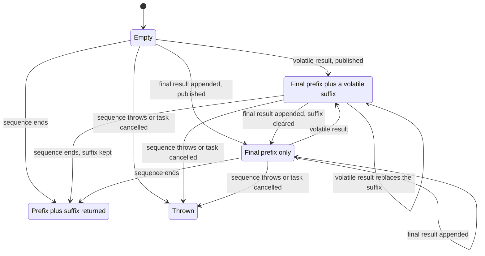

**Invariants**

- Enforced: at most one volatile suffix; a new one replaces the old ([L131-L133](../../Sources/Transcription/AppleTranscriber.swift#L131-L133)).
- Enforced: a final result clears the suffix ([L128-L130](../../Sources/Transcription/AppleTranscriber.swift#L128-L130)).
- Enforced: a cancel surfaces as `CancellationError`, and other errors propagate from the task ([L136-L138](../../Sources/Transcription/AppleTranscriber.swift#L136-L138)).
- Assumed: final segments are incremental, do not overlap, and carry their own spacing; they are joined verbatim ([L129](../../Sources/Transcription/AppleTranscriber.swift#L129), [L140](../../Sources/Transcription/AppleTranscriber.swift#L140)).
- Assumed: the partial callback is safe to call off the main actor; it is `@Sendable` ([L119](../../Sources/Transcription/AppleTranscriber.swift#L119)).

**Tests.** None target the accumulator directly.

**Open questions**

- If the sequence ends with a volatile suffix, the returned text includes words the analyzer never finalized ([L140](../../Sources/Transcription/AppleTranscriber.swift#L140)). Is that wanted for the delivered transcript?

### M09 Audio conversion, feed, and drain

`AnalyzerAudioConverter` turns capture buffers into the model's format, keeps one converter per source format, and drains the converter's tail at the end. `AnalyzerAudioFeedWorker` feeds the converted buffers into the analyzer's bounded input. A lost tail or a silent overflow would cut off spoken words. The streaming, Parakeet, and Canary transcribers use their own copy of the converter but not the worker ([StreamingSpeech.swift L81](../../Sources/Transcription/StreamingSpeech.swift#L81), [ParakeetTranscriber.swift L27](../../Sources/Transcription/ParakeetTranscriber.swift#L27), [CanaryTranscriber.swift L47](../../Sources/Transcription/CanaryTranscriber.swift#L47)).

**State variables**

- [`AnalyzerAudioFeedWorker.converter`](../../Sources/Transcription/AppleTranscriber.swift#L225) and its feed loop ([L235-L248](../../Sources/Transcription/AppleTranscriber.swift#L235-L248))
- [`AnalyzerAudioConverter.targetFormat`](../../Sources/Transcription/AppleTranscriber.swift#L253), [`sourceFormat`](../../Sources/Transcription/AppleTranscriber.swift#L254), [`converter`](../../Sources/Transcription/AppleTranscriber.swift#L255), [`drainFrameCapacity`](../../Sources/Transcription/AppleTranscriber.swift#L256)

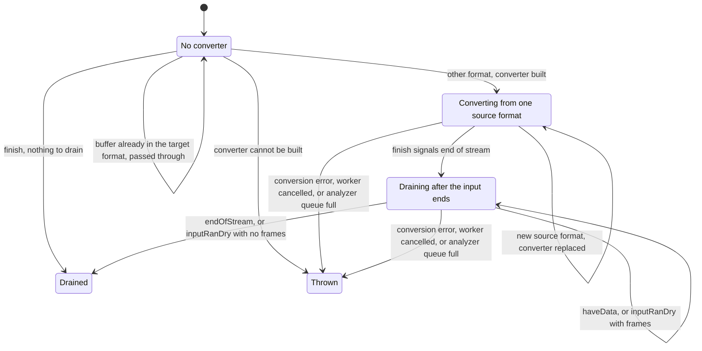

**Invariants**

- Enforced: a source format is recorded only after its converter is built ([L267-L273](../../Sources/Transcription/AppleTranscriber.swift#L267-L273)).
- Enforced: output capacity follows the sample-rate ratio, and the drain uses the largest capacity seen ([L279-L282](../../Sources/Transcription/AppleTranscriber.swift#L279-L282), [L315-L318](../../Sources/Transcription/AppleTranscriber.swift#L315-L318)).
- Enforced: the drain keeps only buffers with frames and stops at end of stream or an empty `inputRanDry` ([L327-L339](../../Sources/Transcription/AppleTranscriber.swift#L327-L339)).
- Enforced: the worker checks cancellation before each yield and fails on a dropped buffer ([L235-L247](../../Sources/Transcription/AppleTranscriber.swift#L235-L247)).
- Assumed: the source format stays fixed during a capture; a change replaces the converter and drops its buffered tail.
- Assumed: `finish` is called once per run; nothing stops a convert after it.
- Assumed: a yield to a terminated stream is not treated as a failure ([L238](../../Sources/Transcription/AppleTranscriber.swift#L238), [L245](../../Sources/Transcription/AppleTranscriber.swift#L245)); the analyzer has been cancelled by then.

**Tests.** [`AppleTranscriberTests`](../../Tests/SyrupTests/AppleTranscriberTests.swift): `matchingFormatConversionReturnsOriginalBuffer`, `conversionProducesTargetFormat`, `finishDrainsConverterTailFrames`, `audioFeedWorkerYieldsConvertedAnalyzerInputs`. [`StreamingSpeechTests`](../../Tests/SyrupTests/StreamingSpeechTests.swift): `theSameAudioUncancelledDrainsTheConverterBeforeFinishing`.

**Open questions.** None.

### M12 Ordered streaming sessions

`StreamingSpeechEngine` runs every call into a streaming backend strictly in order, and numbers sessions so a cancelled run cannot feed audio into the next one. `begin` takes the next session number before it waits, and any later `append` or `finish` with an older number is refused when it joins the queue. Work already accepted still runs, in order, before the next run's reset; a mistake here would put a cancelled run's speech into the next delivered transcript.

**State variables**

- [`StreamingSpeechEngine.backend`](../../Sources/Transcription/StreamingSpeech.swift#L22)
- [`tail`](../../Sources/Transcription/StreamingSpeech.swift#L23), the end of the call queue
- [`isLoaded`](../../Sources/Transcription/StreamingSpeech.swift#L24)
- [`currentSession`](../../Sources/Transcription/StreamingSpeech.swift#L26)
- `previous` and `task` inside [`inOrder`](../../Sources/Transcription/StreamingSpeech.swift#L64-L72)

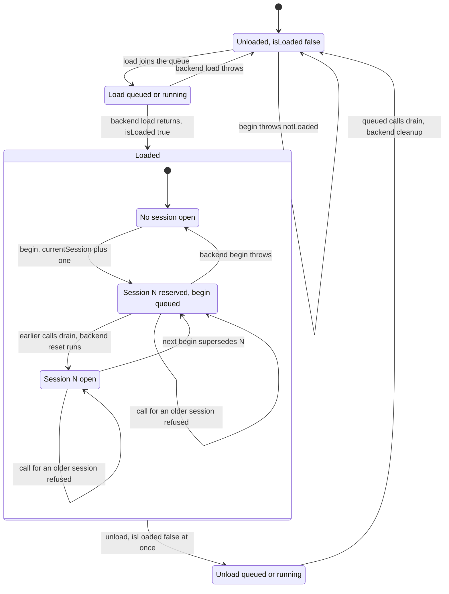

**Invariants**

- Enforced: backend calls never overlap through the engine; each waits for the one before ([L64-L72](../../Sources/Transcription/StreamingSpeech.swift#L64-L72)).
- Enforced: the session number is taken before the wait, so once a new begin has started, any new call for the old session is refused ([L46-L47](../../Sources/Transcription/StreamingSpeech.swift#L46-L47), [L55](../../Sources/Transcription/StreamingSpeech.swift#L55), [L60](../../Sources/Transcription/StreamingSpeech.swift#L60)).
- Enforced: calls accepted before a begin run before its reset ([L64-L71](../../Sources/Transcription/StreamingSpeech.swift#L64-L71)).
- Enforced: a begin before load throws `notLoaded` ([L45](../../Sources/Transcription/StreamingSpeech.swift#L45)).
- Assumed: `isLoaded` matches the backend because `SpeechModelManager` never overlaps a load and an unload for one engine ([SpeechModelManager.swift L134-L139](../../Sources/Transcription/SpeechModelManager.swift#L134-L139), [L156-L158](../../Sources/Transcription/SpeechModelManager.swift#L156-L158)). If they overlapped, the load could set `isLoaded` after the unload cleared it, over an unloaded backend; begin would then fail in the backend with the same `notLoaded`.
- Assumed: a cancelled caller's queued call still runs; caller cancellation is not passed to backend work ([L64-L71](../../Sources/Transcription/StreamingSpeech.swift#L64-L71)).
- Assumed: nothing marks a session finished. [M13](#m13-streaming-run-feed-and-drain)'s control flow is what prevents an append after finish.
- Assumed: partial transcripts carry no session number; the next begin's reset installs the new run's callback ([M14](#m14-streaming-backend-residency-and-reset)).

**Tests.** [`StreamingSpeechTests`](../../Tests/SyrupTests/StreamingSpeechTests.swift): `refusesToRunBeforeLoading`, `feedsEveryBufferReportsPartialsAndTrimsTheResult`, `aNewRunWaitsForTheChunkACancelledRunIsStillProcessing`, `aCancelledRunCannotFeedItsLastSamplesToTheNextRun`, `aCallFromAnEarlierSessionIsRefused`. They use gated fake backends, so they pin ordering, not FluidAudio.

**Open questions.** None beyond the caller contracts above.

### M13 Streaming run, feed, and drain

`StreamingTranscriber.transcribe` drives one streaming run: begin a session, feed converted buffers, drain the converter, finish. Every call carries the session number from begin, so once a newer run starts, this run's next call is refused.

**State variables**

- [`converter`](../../Sources/Transcription/StreamingSpeech.swift#L81) and [`session`](../../Sources/Transcription/StreamingSpeech.swift#L82)
- The feed loop ([L83-L86](../../Sources/Transcription/StreamingSpeech.swift#L83-L86)) and the drain loop ([L87-L90](../../Sources/Transcription/StreamingSpeech.swift#L87-L90))
- Cancellation checks at [L84](../../Sources/Transcription/StreamingSpeech.swift#L84), [L88](../../Sources/Transcription/StreamingSpeech.swift#L88), and [L91](../../Sources/Transcription/StreamingSpeech.swift#L91), then [`finish`](../../Sources/Transcription/StreamingSpeech.swift#L92)

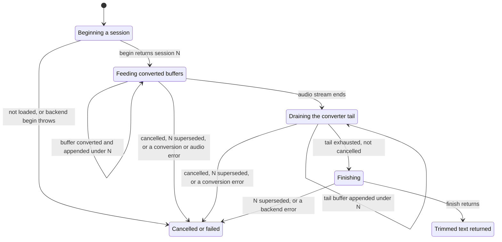

**Invariants**

- Enforced: every append and the finish carry the run's session ([L82-L92](../../Sources/Transcription/StreamingSpeech.swift#L82-L92)).
- Enforced: no tail append after an observed cancel ([L88](../../Sources/Transcription/StreamingSpeech.swift#L88)), and the tail goes in before finish ([L87-L92](../../Sources/Transcription/StreamingSpeech.swift#L87-L92)).
- Assumed: a cancel during the final `finish` await does not stop the result; there is no check after it, so the caller must discard it ([L91-L92](../../Sources/Transcription/StreamingSpeech.swift#L91-L92)).
- Assumed: a run abandoned midway leaves backend state that the next begin resets ([M14](#m14-streaming-backend-residency-and-reset)).

**Tests.** [`StreamingSpeechTests`](../../Tests/SyrupTests/StreamingSpeechTests.swift): `feedsEveryBufferReportsPartialsAndTrimsTheResult`, `aCancelledRunCannotFeedItsLastSamplesToTheNextRun`, `theSameAudioUncancelledDrainsTheConverterBeforeFinishing`.

**Open questions.** None.

### M14 Streaming backend residency and reset

`NemotronBackend` and `ParakeetUnifiedBackend` wrap FluidAudio's streaming managers. Each publishes its SDK manager only after a load and a silent warm-up, and resets the SDK session at every begin. Nemotron also sets the language, turns on final punctuation, and feeds 300 ms of silence so the first word is not lost.

**State variables**

- [`NemotronBackend.manager`](../../Sources/Transcription/StreamingSpeech.swift#L116) and [`ParakeetUnifiedBackend.manager`](../../Sources/Transcription/StreamingSpeech.swift#L190)
- The unpublished manager during load ([L149-L153](../../Sources/Transcription/StreamingSpeech.swift#L149-L153), [L215-L219](../../Sources/Transcription/StreamingSpeech.swift#L215-L219))
- Fixed settings: [`chunkMs`](../../Sources/Transcription/StreamingSpeech.swift#L114) and [`leadingSilenceSamples`](../../Sources/Transcription/StreamingSpeech.swift#L115)

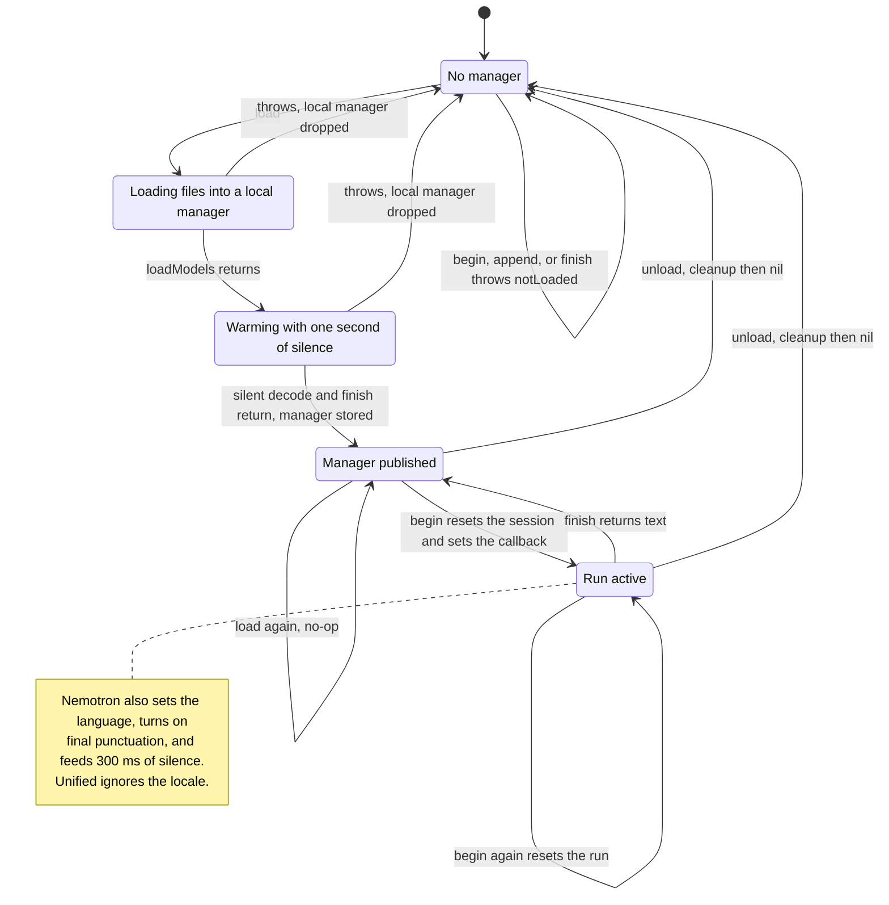

**Invariants**

- Enforced: the manager is stored only after load and warm-up succeed ([L147-L154](../../Sources/Transcription/StreamingSpeech.swift#L147-L154), [L213-L220](../../Sources/Transcription/StreamingSpeech.swift#L213-L220)).
- Enforced: begin, append, and finish throw `notLoaded` without a manager ([L162](../../Sources/Transcription/StreamingSpeech.swift#L162), [L172](../../Sources/Transcription/StreamingSpeech.swift#L172), [L177](../../Sources/Transcription/StreamingSpeech.swift#L177), [L228](../../Sources/Transcription/StreamingSpeech.swift#L228), [L234](../../Sources/Transcription/StreamingSpeech.swift#L234), [L240](../../Sources/Transcription/StreamingSpeech.swift#L240)).
- Enforced: each begin resets the SDK session first ([L163](../../Sources/Transcription/StreamingSpeech.swift#L163), [L229](../../Sources/Transcription/StreamingSpeech.swift#L229)).
- Assumed: FluidAudio's reset clears the transcript and decoder state, and the new callback replaces the old one.
- Assumed: calls arrive one at a time through [M12](#m12-ordered-streaming-sessions); these actors are reentrant at every await.
- Assumed: a manager dropped after a failed warm-up needs no explicit cleanup.

**Tests.** [`StreamingSpeechTests`](../../Tests/SyrupTests/StreamingSpeechTests.swift) use fake backends; `aStreamingModelCountsAsInstalledOnlyWithEveryFileItLoads` and `everyWayToBuildAFluidAudioEngineSilencesItsLogging` touch the real types. No test runs FluidAudio.

**Open questions.** None.

### M15 Parakeet residency

`ParakeetEngine` holds one loaded Parakeet TDT model. It publishes the model only after a one-second silent decode, and builds a fresh decoder state for every transcription, so one dictation's state never carries into the next.

**State variables**

- [`ParakeetEngine.model`](../../Sources/Transcription/ParakeetEngine.swift#L36) and [`manager`](../../Sources/Transcription/ParakeetEngine.swift#L37)
- The unpublished manager and warm-up state during load ([L68-L72](../../Sources/Transcription/ParakeetEngine.swift#L68-L72))
- The decoder state made for each transcription ([L82-L84](../../Sources/Transcription/ParakeetEngine.swift#L82-L84))

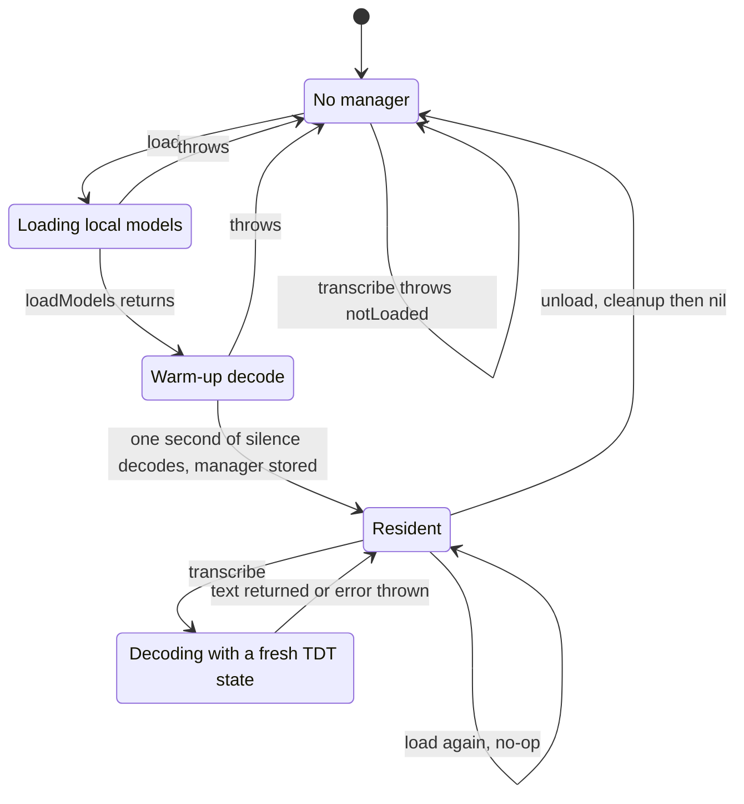

**Invariants**

- Enforced: warm-up finishes before the manager is stored ([L66-L73](../../Sources/Transcription/ParakeetEngine.swift#L66-L73)).
- Enforced: every transcription makes a new `TdtDecoderState` ([L82](../../Sources/Transcription/ParakeetEngine.swift#L82)).
- Enforced: load reads local files only; download is a separate path that checks completeness ([L56-L64](../../Sources/Transcription/ParakeetEngine.swift#L56-L64)).
- Assumed: `SpeechModelManager`'s queue is the only caller of load and unload; the actor alone does not stop two loads overlapping at their awaits.

**Tests.** [`SpeechModelManagerTests`](../../Tests/SyrupTests/SpeechModelManagerTests.swift) use fake operations, and [`ParakeetTranscriberTests`](../../Tests/SyrupTests/ParakeetTranscriberTests.swift) use a `ParakeetDecoding` double. No test loads a real engine.

**Open questions**

- `unload` is queued behind downloads and loads, not behind dictations. A Delete during a Parakeet dictation can run FluidAudio's `cleanup` while `transcribe` is suspended inside the SDK ([L75-L85](../../Sources/Transcription/ParakeetEngine.swift#L75-L85)). Is that safe in FluidAudio?

### M16 Parakeet segmentation

`ParakeetTranscriber` decides where to cut long dictations. Up to 60 seconds decodes as one piece; past 60 s it cuts at a quiet 300 ms within the last 15 s, and at 75 s it forces a cut at the quietest point. Pieces without speech are skipped, and short speech is padded to 0.5 s.

**State variables**

- [`languageCode`](../../Sources/Transcription/ParakeetTranscriber.swift#L26), [`converter`](../../Sources/Transcription/ParakeetTranscriber.swift#L27), [`pending`](../../Sources/Transcription/ParakeetTranscriber.swift#L28), [`texts`](../../Sources/Transcription/ParakeetTranscriber.swift#L30)
- Fixed limits: [`shortestDecode`, `wholeDecodeLimit`, `pauseSearch`, `longestDecode`](../../Sources/Transcription/ParakeetTranscriber.swift#L13-L16)
- The cut decision ([L34-L38](../../Sources/Transcription/ParakeetTranscriber.swift#L34-L38))


**Invariants**

- Enforced: a dictation of up to 60 s decodes once, even across pauses ([L34](../../Sources/Transcription/ParakeetTranscriber.swift#L34)).
- Enforced: a cut needs a quiet stretch until 75 s; from then the quietest point is forced ([L34-L35](../../Sources/Transcription/ParakeetTranscriber.swift#L34-L35), [SpeechSegmenter.swift L23-L31](../../Sources/Transcription/SpeechSegmenter.swift#L23-L31)).
- Enforced: the converter tail is decoded ([L40-L44](../../Sources/Transcription/ParakeetTranscriber.swift#L40-L44)).
- Enforced: noise-only pieces never reach the model, and short speech is padded ([L49-L51](../../Sources/Transcription/ParakeetTranscriber.swift#L49-L51)).
- Assumed: capture buffers are small, so one buffer cannot push `pending` far past 75 s; at most one cut is made per buffer ([L34-L38](../../Sources/Transcription/ParakeetTranscriber.swift#L34-L38)).
- Assumed: a cancel after the final decode is handled by the caller; there is no check after [L44](../../Sources/Transcription/ParakeetTranscriber.swift#L44).

**Tests.** [`ParakeetTranscriberTests`](../../Tests/SyrupTests/ParakeetTranscriberTests.swift): `dictationsUpToAMinuteDecodeOnceEvenAcrossPauses`, `longerDictationsAreCutInsideARealPause`, `withoutAPauseNoCutComesBeforeAMinuteAndNoDecodeExceeds75Seconds`, `aShortRecordingIsPaddedToTheShortestDecodableLength`, `roomNoiseWithoutSpeechIsNeverDecoded`, `aShortWordTenDecibelsAboveRoomNoiseIsDecoded`, `roomNoiseLeftAfterTheLastCutAddsNoWords`.

**Open questions.** None.

### M17 Canary residency

`CanaryEngine` holds the Canary Core ML model. Load, unload, and transcribe are synchronous methods on one actor, so they never interleave: an unload waits for the window being predicted.

**State variables**

- [`CanaryEngine.model`](../../Sources/Transcription/CanaryTranscriber.swift#L11)
- [`windowSamples`](../../Sources/Transcription/CanaryTranscriber.swift#L13), 160,000 samples (10 s) until a model loads
- [`load`](../../Sources/Transcription/CanaryTranscriber.swift#L15-L20), [`unload`](../../Sources/Transcription/CanaryTranscriber.swift#L22-L24), [`transcribe`](../../Sources/Transcription/CanaryTranscriber.swift#L26-L29)

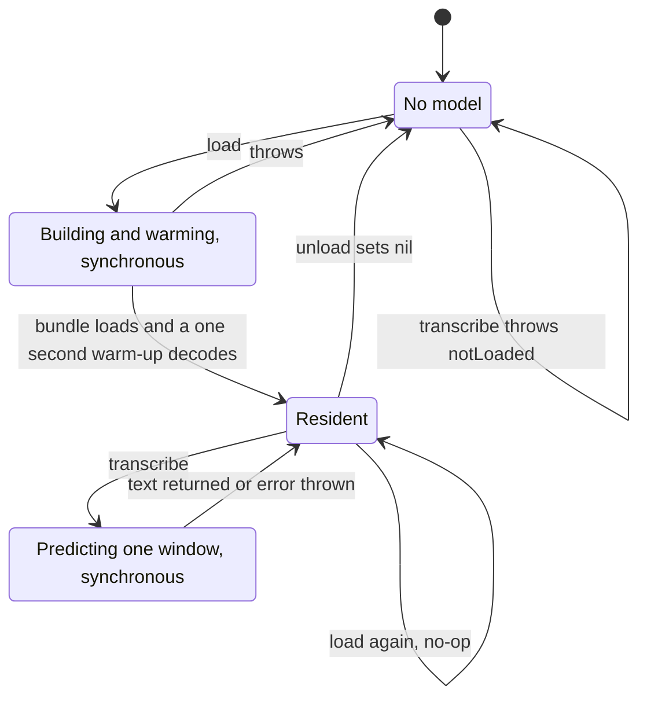

**Invariants**

- Enforced: the model is stored only after a one-second warm-up succeeds ([L17-L19](../../Sources/Transcription/CanaryTranscriber.swift#L17-L19)).
- Enforced: predictions and unloading cannot overlap, because the methods never await ([L15-L29](../../Sources/Transcription/CanaryTranscriber.swift#L15-L29)).
- Assumed: Core ML predictions finish in reasonable time; there is no timeout or cancellation inside a window.

**Tests.** [`CanaryTests`](../../Tests/SyrupTests/CanaryTests.swift) use a `CanaryDecoding` fake. No test loads a real engine.

**Open questions.** None.

### M18 Canary token decode and empty-window recovery

`CanaryModel.transcribe` decodes one window: encode, prefill a nine-token prompt, then greedy steps until end of text or 220 tokens. `transcribeRecovering` handles Canary's habit of ending a window at once with no words: if a window of at least 4 s comes back empty, it splits at the quietest point of the middle half and decodes each half once. An empty result can make the pipeline fall back to Apple.

**State variables**

- [`prompt`](../../Sources/Transcription/CanaryModel.swift#L146), [features and frames](../../Sources/Transcription/CanaryModel.swift#L148), [`embeddings` and `mask`](../../Sources/Transcription/CanaryModel.swift#L154-L155)
- [`output`](../../Sources/Transcription/CanaryModel.swift#L157), the logits and decoder cache; [`endOfText`](../../Sources/Transcription/CanaryModel.swift#L162); [`tokens`](../../Sources/Transcription/CanaryModel.swift#L163); the greedy loop ([L164-L180](../../Sources/Transcription/CanaryModel.swift#L164-L180))
- The recovery split ([L186-L196](../../Sources/Transcription/CanaryModel.swift#L186-L196))


**Invariants**

- Enforced: only en, de, es, and fr are accepted, with the same language as source and target ([L131-L142](../../Sources/Transcription/CanaryModel.swift#L131-L142)).
- Enforced: audio beyond one window is cut off, so callers segment first ([L144](../../Sources/Transcription/CanaryModel.swift#L144), [L148](../../Sources/Transcription/CanaryModel.swift#L148)).
- Enforced: at most 220 tokens ([L145](../../Sources/Transcription/CanaryModel.swift#L145), [L164](../../Sources/Transcription/CanaryModel.swift#L164)).
- Enforced: recovery splits once; each half calls `transcribe`, not `transcribeRecovering` ([L192-L193](../../Sources/Transcription/CanaryModel.swift#L192-L193)).
- Enforced: control tokens never reach the text ([L199-L204](../../Sources/Transcription/CanaryModel.swift#L199-L204)).
- Enforced: a half that throws during recovery counts as empty text; recovery itself never throws ([L193](../../Sources/Transcription/CanaryModel.swift#L193)).
- Assumed: model outputs have the expected shapes; a missing output throws `missingOutput` ([L154-L155](../../Sources/Transcription/CanaryModel.swift#L154-L155), [L165-L168](../../Sources/Transcription/CanaryModel.swift#L165-L168)).

**Tests.** [`CanaryTests`](../../Tests/SyrupTests/CanaryTests.swift): `piecesJoinIntoWordsWithoutControlTokens`, `featuresHaveTheEncoderShapeAndAreNormalizedPerBin`. No test runs the greedy loop or the recovery split on a real model.

**Open questions.** None.

### M19 Resumable Canary bundle fetch

`CanaryModel.download` fetches the 14 files of a pinned Hugging Face revision one at a time. A file already on disk with the right size, and the right SHA-256 where the manifest has one, is kept, so a retry resumes file by file. A file that arrives wrong is deleted and the download fails.

**State variables**

- [`directory`, `total`, `finished`](../../Sources/Transcription/CanaryModel.swift#L58-L60), the file loop ([L61-L82](../../Sources/Transcription/CanaryModel.swift#L61-L82)), and [`base`](../../Sources/Transcription/CanaryModel.swift#L73) for progress
- The manifest ([L23-L42](../../Sources/Transcription/CanaryModel.swift#L23-L42)), checked by [`matches`](../../Sources/Transcription/CanaryModel.swift#L85-L89)
- On disk: each file's size and hash; [`isComplete`](../../Sources/Transcription/CanaryModel.swift#L46-L53) checks sizes only

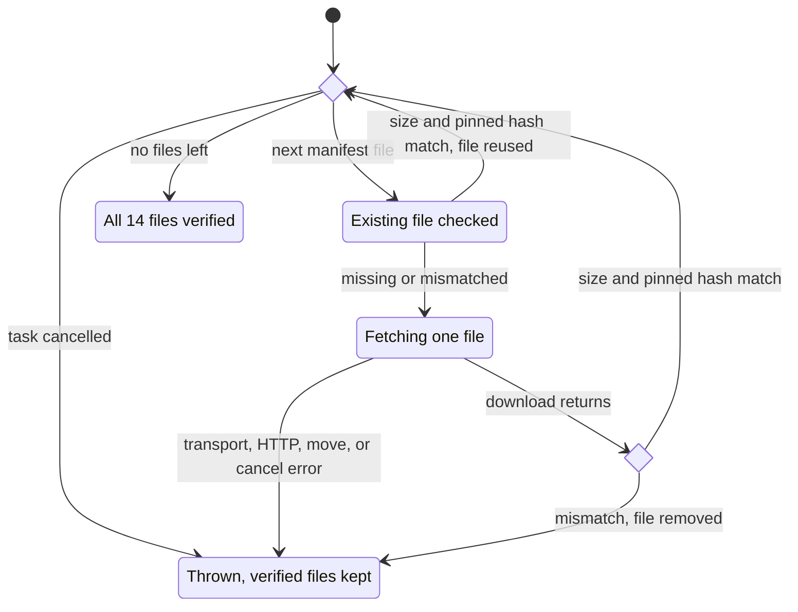

**Invariants**

- Enforced: the revision is pinned ([L25](../../Sources/Transcription/CanaryModel.swift#L25), [L70](../../Sources/Transcription/CanaryModel.swift#L70)).
- Enforced: each file must match its size, and its SHA-256 for the 9 of 14 entries that carry one ([L85-L89](../../Sources/Transcription/CanaryModel.swift#L85-L89)).
- Enforced: a valid file is reused ([L64-L68](../../Sources/Transcription/CanaryModel.swift#L64-L68)), and cancellation is checked before each file ([L62](../../Sources/Transcription/CanaryModel.swift#L62)).
- Assumed: the five size-only files are authentic.
- Assumed: the launch check compares sizes only; hashes are checked at download ([L46-L53](../../Sources/Transcription/CanaryModel.swift#L46-L53)).
- Assumed: [M02](#m02-staged-model-publication) keeps a partial bundle out of the model folder.

**Tests.** [`CanaryTests`](../../Tests/SyrupTests/CanaryTests.swift): `aBundleIsCompleteOnlyWithEveryFileAtItsSize`. No test runs `FileDownload` or rejects a bad hash.

**Open questions.** None.

### M20 URL download continuation

`FileDownload` bridges one `URLSession` download to async code. Delegate callbacks move the temporary file into place and record any move error, and the completion resumes the continuation once. A lost or doubled continuation would hang a model download or report a missing file as fetched.

**State variables**

- [`destination`](../../Sources/Transcription/CanaryModel.swift#L354), [`progress`](../../Sources/Transcription/CanaryModel.swift#L355), [`continuation`](../../Sources/Transcription/CanaryModel.swift#L356), [`moveError`](../../Sources/Transcription/CanaryModel.swift#L357), [`lock`](../../Sources/Transcription/CanaryModel.swift#L358)
- The download [`task`](../../Sources/Transcription/CanaryModel.swift#L369), the cancellation handler ([L375-L377](../../Sources/Transcription/CanaryModel.swift#L375-L377)), and the final check ([L378](../../Sources/Transcription/CanaryModel.swift#L378))

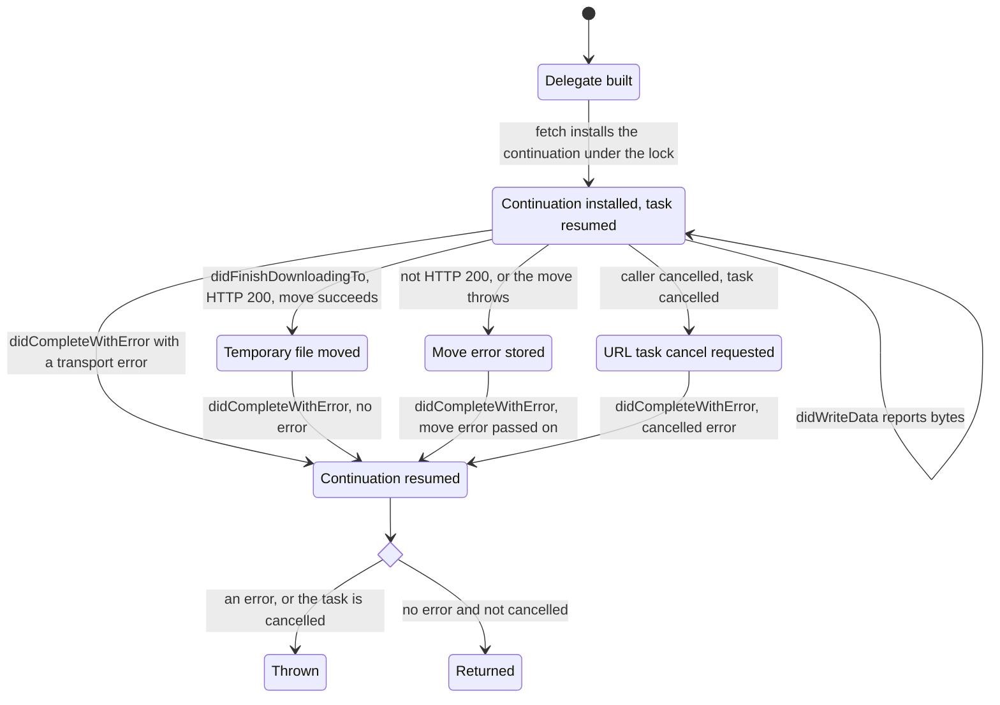

**Invariants**

- Enforced: the continuation is taken and cleared under the lock before it resumes, so it resumes at most once ([L397-L405](../../Sources/Transcription/CanaryModel.swift#L397-L405)).
- Enforced: `moveError` is read and written under the lock ([L392](../../Sources/Transcription/CanaryModel.swift#L392), [L401](../../Sources/Transcription/CanaryModel.swift#L401)).
- Enforced: a cancelled fetch throws even if the transfer finished ([L378](../../Sources/Transcription/CanaryModel.swift#L378)).
- Enforced: a response other than HTTP 200 is an error ([L388](../../Sources/Transcription/CanaryModel.swift#L388)).
- Assumed: `URLSession` calls `didFinishDownloadingTo` before `didCompleteWithError`, and calls `didCompleteWithError` once.

**Tests.** None run `FileDownload`.

**Open questions**

- If the task is already cancelled when `fetch` starts, for example when Cancel is pressed while `matches` hashes a large file, the cancellation handler cancels the URL task before the continuation is installed ([L370-L377](../../Sources/Transcription/CanaryModel.swift#L370-L377)). If `URLSession` delivered `didCompleteWithError` in that gap, it would find no continuation, and the fetch would never resume. This depends on `URLSession` timing and was not observed.

### M21 Canary window segmentation

`CanaryTranscriber` keeps at most one model window of samples pending. Whenever more arrive, it cuts at the quietest point in the window's last 4 seconds, decodes that piece, and keeps the rest. It refuses languages Canary does not transcribe, so the pipeline uses Apple instead.

**State variables**

- [`language`](../../Sources/Transcription/CanaryTranscriber.swift#L44-L45), [`window`](../../Sources/Transcription/CanaryTranscriber.swift#L46), [`converter`](../../Sources/Transcription/CanaryTranscriber.swift#L47), [`pending`](../../Sources/Transcription/CanaryTranscriber.swift#L48), [`texts`](../../Sources/Transcription/CanaryTranscriber.swift#L49)
- The piece and cut in the window loop ([L66-L67](../../Sources/Transcription/CanaryTranscriber.swift#L66-L67)) and the fixed [`pauseSearch`](../../Sources/Transcription/CanaryTranscriber.swift#L35)

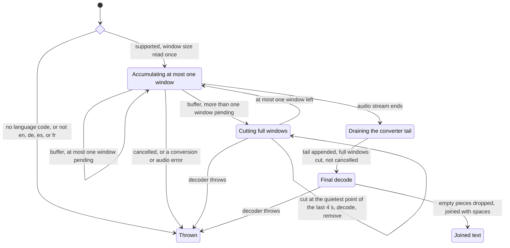

**Invariants**

- Enforced: unsupported languages throw before any decode ([L44-L45](../../Sources/Transcription/CanaryTranscriber.swift#L44-L45)).
- Enforced: each decoded piece is at most one window ([L65-L68](../../Sources/Transcription/CanaryTranscriber.swift#L65-L68)), because `CanaryModel` cuts off anything longer ([M18](#m18-canary-token-decode-and-empty-window-recovery)).
- Enforced: pieces without speech are not decoded ([L74](../../Sources/Transcription/CanaryTranscriber.swift#L74)).
- Assumed: `windowSamples` is positive and the forced cut falls inside the window ([L67](../../Sources/Transcription/CanaryTranscriber.swift#L67)).
- Assumed: cancellation is checked per capture buffer ([L51](../../Sources/Transcription/CanaryTranscriber.swift#L51)) and once after the drain ([L59](../../Sources/Transcription/CanaryTranscriber.swift#L59)), not between window decodes ([L64-L70](../../Sources/Transcription/CanaryTranscriber.swift#L64-L70)).

**Tests.** [`CanaryTests`](../../Tests/SyrupTests/CanaryTests.swift): `longDictationIsCutIntoWindowsTheModelCanSee`, `silenceIsNeverDecoded`, `portugueseIsRefusedSoThePipelineUsesApple`.

**Open questions.** None.

## Glossary learning

### M22 Whisper model download, removal, and load latch

`WhisperModelManager` decides whether the 626 MB Whisper comparison model and its tokenizer are on disk and usable for glossary learning. It downloads both into a staging folder and moves them into place only when they are complete, current, and not cancelled. A model that failed to load is latched, so background passes stop using it until the person retries or deletes it; reporting a broken model as ready would make every pass fail.

**State variables**

- [`state`](../../Sources/Learning/WhisperModelManager.swift#L61), the published [`State`](../../Sources/Learning/WhisperModelManager.swift#L23-L28)
- [`failure`](../../Sources/Learning/WhisperModelManager.swift#L70), the hidden reason behind Failed ([`Failure`](../../Sources/Learning/WhisperModelManager.swift#L57-L59): download, load, or removal)
- [`generation`](../../Sources/Learning/WhisperModelManager.swift#L69), [`lastOperation`](../../Sources/Learning/WhisperModelManager.swift#L72), [`downloadTask`](../../Sources/Learning/WhisperModelManager.swift#L73)
- On disk: [`modelDirectory` and `tokenizerDirectory`](../../Sources/Learning/WhisperModelManager.swift#L62-L64) under `storageDirectory`, judged by [`bundleFiles` and `tokenizerFiles`](../../Sources/Learning/WhisperModelManager.swift#L51-L55), plus the [staging folder](../../Sources/Learning/WhisperModelManager.swift#L204-L206)

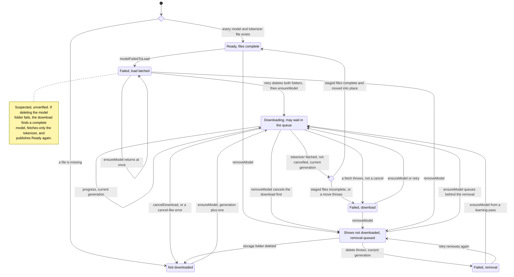

`removeModel` is accepted in every state, including Not downloaded; the chart shows the transitions Settings offers.

**Invariants**

- Enforced: Ready at launch needs every model bundle file and every tokenizer file ([L86-L88](../../Sources/Learning/WhisperModelManager.swift#L86-L88)).
- Enforced: stale completions and progress change nothing; each compares its generation ([L192](../../Sources/Learning/WhisperModelManager.swift#L192), [L217](../../Sources/Learning/WhisperModelManager.swift#L217), [L230](../../Sources/Learning/WhisperModelManager.swift#L230), [L254](../../Sources/Learning/WhisperModelManager.swift#L254)).
- Enforced: downloads and removals run one at a time through `lastOperation` ([L159-L161](../../Sources/Learning/WhisperModelManager.swift#L159-L161), [L189-L196](../../Sources/Learning/WhisperModelManager.swift#L189-L196)).
- Enforced: staged files move into place only when complete, current, and not cancelled, and Ready is set only after both moves, on the main actor with no await between ([L216-L228](../../Sources/Learning/WhisperModelManager.swift#L216-L228)).
- Enforced: after a load failure, `ensureModel` does nothing until Retry or Delete ([L103](../../Sources/Learning/WhisperModelManager.swift#L103), [L146-L149](../../Sources/Learning/WhisperModelManager.swift#L146-L149)).
- Enforced: a cancel, or an error that is really a cancel, returns to Not downloaded instead of Failed ([L232-L233](../../Sources/Learning/WhisperModelManager.swift#L232-L233)).
- Enforced: a failed removal shows Failed, and Retry removes again ([L170-L173](../../Sources/Learning/WhisperModelManager.swift#L170-L173), [L131-L133](../../Sources/Learning/WhisperModelManager.swift#L131-L133)).
- Enforced: progress stays between 0 and 1 ([L253-L256](../../Sources/Learning/WhisperModelManager.swift#L253-L256)). Unlike [M01](#m01-download-load-and-remove-queue), no highest value is kept, so it can move backwards.
- Assumed: named files present means the model loads; a load failure is reported by the learning pass ([GlossaryLearningCoordinator.swift L144-L148](../../Sources/Learning/GlossaryLearningCoordinator.swift#L144-L148)).
- Assumed: the load latch lives in memory. After a relaunch with the same files the state is Ready again, and the next pass tries the load once more ([L70](../../Sources/Learning/WhisperModelManager.swift#L70), [L86-L88](../../Sources/Learning/WhisperModelManager.swift#L86-L88)).
- Assumed: only this manager writes under `storageDirectory`.

**Tests.** [`WhisperModelRemovalTests`](../../Tests/SyrupTests/WhisperModelManagerTests.swift): `removeModelDeletesFilesAndResetsState`, `removeModelWithoutFilesIsANoOpReset`, `aDownloadOfThePublishedFilesBecomesReady`, `aModelAlreadyOnDiskFetchesOnlyItsTokenizer`, `aDownloadMissingAModelFileFails`, `cancelStopsTheDownloadAndMovesNothingIntoPlace`, `deleteDuringADownloadCancelsItThenRemovesTheFiles`, `aModelThatFailedToLoadIsDownloadedAgainOnlyOnRetry`, `retryAfterAFailedRemovalRemovesAgain`. `WhisperModelManagerTests` in [`GlossaryLearningCoordinatorTests.swift`](../../Tests/SyrupTests/GlossaryLearningCoordinatorTests.swift): `incompleteDownloadIsNotReportedReady`, `modelFoldersWithoutTheirCompiledDataAreNotReady`, `thePublishedLayoutWithItsTokenizerIsReady`, `thePublishedLayoutWithoutItsTokenizerIsNotReady`.

**Suspected defect (unverified, from the inventory).** Retry after a load failure can publish the same broken model. Sequence: the model files are complete but fail to load, so the pass calls `modelFailedToLoad`, and the state is Failed with the load reason; the person presses Retry; the `try?` deletion of `modelDirectory` fails and the files stay ([L134-L135](../../Sources/Learning/WhisperModelManager.swift#L134-L135)); Retry clears the latch and calls `ensureModel` anyway ([L136-L138](../../Sources/Learning/WhisperModelManager.swift#L136-L138)); `download` sees a complete model, skips the model fetch, fetches the tokenizer, and publishes Ready ([L207-L228](../../Sources/Learning/WhisperModelManager.swift#L207-L228)). The next pass fails to load it again. Retry is documented as a full download ([L127-L128](../../Sources/Learning/WhisperModelManager.swift#L127-L128)). It needs a deletion failure; `aModelThatFailedToLoadIsDownloadedAgainOnlyOnRetry` covers only a successful deletion.

**Open questions**

- After a failed Delete, a learning pass's `ensureModel` downloads the model again, while Retry would remove it again. Settings' help says a pending recording can download the model again after Delete ([GlossarySettingsView.swift L362](../../Sources/Settings/GlossarySettingsView.swift#L362)). Is that also intended after a failed Delete?
- Should the load latch survive a relaunch?

### M23 Recording entry lifetime

`RecordingArchive` decides whether one voice run's audio becomes a recording kept for glossary learning. A run opens a provisional entry, a protected empty WAV that the tee fills; only a commit while the ID is still active writes the sidecar that makes it a recording. Discard, delete, and opt-out remove the files, so a cancelled, failed, or opted-out run must never leave a committed pair behind.

**State variables**

- [`RecordingArchive.activeIDs`](../../Sources/Learning/RecordingArchive.swift#L51), provisional entries allowed to commit
- [`RecordingArchive.awaitingDeletion`](../../Sources/Learning/RecordingArchive.swift#L54), entries whose deletion failed ([M24](#m24-archive-retention-and-cleanup-debt))
- [`storageDirectory`](../../Sources/Learning/RecordingArchive.swift#L57), `Application Support/Syrup/Recordings`
- On disk: the WAV and JSON named by the entry ID ([L373-L375](../../Sources/Learning/RecordingArchive.swift#L373-L375)); the sidecar [`RecordingSidecar`](../../Sources/Learning/RecordingArchive.swift#L4-L11) holds `id`, `createdAt`, `localeID`, `appleTranscript`, `attempts`, and `nextAttemptAt`

One machine runs per entry ID.

```mermaid
stateDiagram-v2
    state DeleteFiles <<choice>>
    state "No files" as Absent
    state "Provisional, active ID, 0600 placeholder WAV" as Provisional
    state "Committed WAV and sidecar" as Committed
    state "Deletion pending in awaitingDeletion" as Pending
    state "Inactive WAV, no sidecar" as Orphan
    [*] --> Absent
    Absent --> Provisional: beginEntry with no cleanup debt
    Absent --> Absent: beginEntry refused or throws, placeholder removed
    Provisional --> Provisional: tee writes audio outside the actor
    Provisional --> Committed: commitEntry, ID still active, sidecar written
    Provisional --> DeleteFiles: discardEntry
    Provisional --> DeleteFiles: commitEntry cannot write the sidecar
    Committed --> DeleteFiles: analyzed, retired, over a cap, or pair broken
    DeleteFiles --> Absent: WAV and sidecar both gone
    DeleteFiles --> Pending: a removal throws
    Pending --> DeleteFiles: retried by begin, pendingEntries, or unresolvedDeletions
    Provisional --> Absent: deleteAll removes the folder
    Committed --> Absent: deleteAll removes the folder
    Provisional --> Orphan: deleteAll fails after clearing the active ID
    Provisional --> Orphan: app quits before filing
    Orphan --> Orphan: late commitEntry ignored
    Orphan --> DeleteFiles: next reconcile finds no pair
    note right of Committed
        Commit needs a delivered run, archived audio,
        a live opt-in, and a nonempty Apple transcript.
        RecordingFiler checks these, not the archive.
    end note
```

**Invariants**

- Enforced: only an active ID can commit ([L104](../../Sources/Learning/RecordingArchive.swift#L104)); delete, discard, and `deleteAll` clear it ([L227](../../Sources/Learning/RecordingArchive.swift#L227), [L255](../../Sources/Learning/RecordingArchive.swift#L255)), so a late filing after opt-out writes no sidecar.
- Enforced: a begin while deletion debt remains is refused and creates no file ([L84-L88](../../Sources/Learning/RecordingArchive.swift#L84-L88)).
- Enforced: the folder is 0700; the placeholder WAV and the sidecar are 0600 ([L91-L93](../../Sources/Learning/RecordingArchive.swift#L91-L93), [L116-L119](../../Sources/Learning/RecordingArchive.swift#L116-L119), [L313-L329](../../Sources/Learning/RecordingArchive.swift#L313-L329)).
- Enforced: the sidecar is written atomically, and a failed commit discards the entry ([L118](../../Sources/Learning/RecordingArchive.swift#L118), [L121-L124](../../Sources/Learning/RecordingArchive.swift#L121-L124)).
- Enforced: errors are logged with an operation name and a code only ([L377-L381](../../Sources/Learning/RecordingArchive.swift#L377-L381)).
- Assumed: `RecordingFiler` commits only a delivered run whose tee returned true, with learning still on and a nonempty Apple transcript, and discards everything else ([RecordingFiler.swift L44-L55](../../Sources/App/RecordingFiler.swift#L44-L55)). The archive checks none of these.
- Assumed: a failed or cancelled run's tee is joined before its discard ([RecordingFiler.swift L60-L64](../../Sources/App/RecordingFiler.swift#L60-L64)).
- Assumed: a tee writer that opens its file only after `deleteAll` and a new begin recreated the folder can recreate a WAV for an invalidated ID. Its commit is ignored, and the next reconcile removes it.
- Assumed: entry IDs are fresh UUIDs and never reused.

**Validation.** `LearningOptOutModel` ([model](../../Tests/SyrupTests/StateMachines/LearningOptOutModel.swift), [rules](../../Tests/SyrupTests/StateMachines/LearningOptOutModelTests.swift), [replay](../../Tests/SyrupTests/StateMachines/LearningOptOutConformanceTests.swift)) explores every reachable state of the opt-in, one run, and up to two archive entries, with file removals that can start or stop failing at any step. Its walks are replayed against the real `PrivacyOptIns`, `RecordingFiler`, and `RecordingArchive` on a temporary folder. It checks that a recording begins and commits only while learning is on, that no recording is on disk once an opt-out has finished with learning off, and that no new recording begins while a failed deletion is unresolved. The tee is reduced to a filing step, and the caps are not modeled. It landed in commit `cf9e1a4`, after this document's brief; this document did not run it.

**Tests.** [`RecordingArchiveTests`](../../Tests/SyrupTests/RecordingArchiveTests.swift): `beginAndCommitCreateProtectedAudioAndSidecarFiles`, `beginFailureRemovesTheUnprotectedPlaceholder`, `discardRemovesAudioAndSidecarFiles`, `deleteEntryRemovesAudioAndSidecarFiles`, `deleteAllRemovesTheRecordingDirectory`. [`AppStateLearningTests`](../../Tests/SyrupTests/AppStateLearningTests.swift), with a spy archive: `learningEnabledArchivesSuccessfulVoiceRun`, `turningLearningOnMidRunDoesNotRecordThatRun`, `cancelledLearningRunDiscardsRecording`, `archiveFinalizationDoesNotDelayDeliveryAndHonorsOptOut`, `learningDisabledNeverTouchesArchive`, `failedLearningRunNeverPublishesRecording`, `emptyTranscriptLearningRunLeavesNoRecording`, `disablingLearningDuringActiveRunPreventsCommit`.

**Open questions**

- A failed `deleteAll` leaves provisional and committed files with nothing in `awaitingDeletion`; see [M24](#m24-archive-retention-and-cleanup-debt).

### M24 Archive retention and cleanup debt

This is the archive-wide side of [M23](#m23-recording-entry-lifetime). It enforces the 50-recording and 7-day caps, removes broken or orphaned files, and turns any deletion it cannot do into cleanup debt that blocks new recordings, so Syrup never claims a deletion that did not happen. There is no timer: maintenance runs when `pendingEntries` or `commitEntry` runs, that is at launch with learning on, at each learning pass, at each commit, and when Settings reads counts.

**State variables**

- [`awaitingDeletion`](../../Sources/Learning/RecordingArchive.swift#L54), the cleanup debt
- [`activeIDs`](../../Sources/Learning/RecordingArchive.swift#L51), exempt from reconciliation
- [`maxEntries`](../../Sources/Learning/RecordingArchive.swift#L59) and [`maxAge`](../../Sources/Learning/RecordingArchive.swift#L60), 50 and 7 days by default ([L48-L49](../../Sources/Learning/RecordingArchive.swift#L48-L49)), and the clock [`now`](../../Sources/Learning/RecordingArchive.swift#L61)
- On disk: every WAV and JSON in the folder ([L361-L371](../../Sources/Learning/RecordingArchive.swift#L361-L371)), with each sidecar's `createdAt` and `id`
- Maintenance: [`enforceCaps`](../../Sources/Learning/RecordingArchive.swift#L269-L282), [`reconcileInvalidArtifacts`](../../Sources/Learning/RecordingArchive.swift#L284-L311), [`retryAwaitingDeletion`](../../Sources/Learning/RecordingArchive.swift#L238-L242), [`deleteAll`](../../Sources/Learning/RecordingArchive.swift#L253-L267)

Archive-wide view; the per-entry states are in M23.

```mermaid
stateDiagram-v2
    state Maintain <<choice>>
    state Retry <<choice>>
    state "No cleanup debt" as Clean
    state "Cleanup debt, new entries refused" as Debt
    state "Files left by a failed deleteAll, no debt" as Residual
    [*] --> Clean
    Clean --> Maintain: pendingEntries or commitEntry runs enforceCaps
    Maintain --> Clean: invalid, expired, and excess files removed
    Maintain --> Debt: a removal throws, its UUID recorded
    Clean --> Debt: discardEntry or deleteEntry cannot remove a file
    Debt --> Debt: beginEntry refused with cleanupPending
    Debt --> Retry: beginEntry, pendingEntries, or unresolvedDeletions
    Retry --> Clean: every recorded removal succeeds
    Retry --> Debt: a removal still throws
    Clean --> Clean: deleteAll removes the folder
    Debt --> Clean: deleteAll removes the folder, debt cleared
    Debt --> Debt: deleteAll throws, debt kept
    Clean --> Residual: deleteAll throws after clearing active IDs
    Residual --> Residual: beginEntry admits a new WAV
    Residual --> Maintain: pendingEntries or commitEntry runs enforceCaps
    note right of Residual
        Suspected, unverified. Survivors are not
        added to awaitingDeletion. Reconcile finds
        only invalid, expired, or excess ones.
    end note
```

**Invariants**

- Enforced: an active ID's files are never reconciled away ([L292](../../Sources/Learning/RecordingArchive.swift#L292)).
- Enforced: debt entries are left out of `pendingEntries` and the published count ([L210](../../Sources/Learning/RecordingArchive.swift#L210)).
- Enforced: a begin is refused while any debt remains after a retry ([L84-L88](../../Sources/Learning/RecordingArchive.swift#L84-L88)).
- Enforced: each `enforceCaps` removes entries created before now minus 7 days and then the oldest beyond 50, oldest first with a stable tie-break ([L274-L281](../../Sources/Learning/RecordingArchive.swift#L274-L281), [L383-L388](../../Sources/Learning/RecordingArchive.swift#L383-L388)); an entry exactly at the cutoff stays.
- Enforced: a name without both a WAV and a decodable sidecar carrying the same ID is removed ([L293-L306](../../Sources/Learning/RecordingArchive.swift#L293-L306)).
- Enforced: `storedRecordingCount` counts every WAV or JSON name on disk, pending or not, for the truthful leftover count after a failed opt-out ([L245-L251](../../Sources/Learning/RecordingArchive.swift#L245-L251)).
- Assumed: debt lives in memory. After a relaunch it is rebuilt only for files that reconcile or the caps reject; a valid pair whose deletion failed after analysis comes back as pending and is analyzed again.
- Assumed: files use UUID names; an undeletable file with another name is not tracked as debt ([L305](../../Sources/Learning/RecordingArchive.swift#L305)).

**Validation.** Partly model-checked. `LearningOptOutModel` (see [M23](#m23-recording-entry-lifetime)) covers cleanup debt that blocks new entries, the orphans a failed `deleteAll` leaves, and their removal at the next commit. It does not model the age and count caps, broken sidecars, or a relaunch.

**Tests.** [`RecordingArchiveTests`](../../Tests/SyrupTests/RecordingArchiveTests.swift): `deniedDiscardIsReportedRetriedAndBlocksNewEntries`, `entriesThatCannotBeDeletedNeverExceedTheCapOrReachAnalysis`, `entryCapDeletesTheOldestPairs`, `ageCapDeletesExpiredPairsOnTheNextCommit`, `pendingEntriesPrunesExpiredPairsWithoutANewCommit`, `pendingEntriesAreSortedOldestFirst`, `nextCommitDeletesOrphanedAndCorruptArtifacts`. [`PipelineLifecycleRegressionTests`](../../Tests/SyrupTests/PipelineLifecycleRegressionTests.swift): `listingPendingMustPreserveActiveWAV`. [`HardRuleTests`](../../Tests/SyrupTests/HardRuleTests.swift): `privacyTurningLearningOffDeletesTheRecordingsOrStaysOn`, with a spy archive. [`AppSettingsTests`](../../Tests/SyrupTests/AppSettingsTests.swift): `failedStartupCleanupNeverEnablesGlossaryLearning`. In `nextCommitDeletesOrphanedAndCorruptArtifacts` the orphan is still active, so reconcile keeps its WAV; the test passes because its `entryExists` helper requires both files ([RecordingArchiveTests.swift L453-L458](../../Tests/SyrupTests/RecordingArchiveTests.swift#L453-L458)). It shows that the orphan never gets a sidecar, not that an orphan WAV is deleted.

**Suspected defect (unverified, from the inventory).** A failed `deleteAll` records no cleanup debt. Sequence: a committed pair is on disk and there is no debt; the person turns learning off; `deleteAll` clears the active IDs, the folder removal throws, and nothing is added to `awaitingDeletion` ([L253-L266](../../Sources/Learning/RecordingArchive.swift#L253-L266)); `setGlossaryLearning` turns learning back on ([AppSettings.swift L774-L781](../../Sources/Settings/AppSettings.swift#L774-L781)); the next voice run's `beginEntry` retries an empty debt set and admits a new WAV ([L82-L95](../../Sources/Learning/RecordingArchive.swift#L82-L95)). Reading the caller, admitting the new recording matches the hard rule, because learning is on again, and the survivors stay ordinary pending entries under the caps. The open part is whether a failed opt-out should block new recordings until the leftovers are gone, as `awaitingDeletion` does for a single failed deletion. `LearningOptOutModel` includes a failed `deleteAll`, and the [README](README.md) records new recordings after one, with learning back on, as documented behavior rather than a rule violation. Not induced for this document.

**Open questions**

- Should a failed `deleteAll` record the surviving names as debt?
- Should debt survive a relaunch?
- The comment on `awaitingDeletion` says it is retried before every operation ([L52-L53](../../Sources/Learning/RecordingArchive.swift#L52-L53)); only `beginEntry`, `pendingEntries`, and `unresolvedDeletions` retry it ([L84](../../Sources/Learning/RecordingArchive.swift#L84), [L140](../../Sources/Learning/RecordingArchive.swift#L140), [L146](../../Sources/Learning/RecordingArchive.swift#L146)). Should the comment or the code change?

### M26 Recording retry and backoff

Decides when a recording that failed analysis may be tried again and when it is given up. Each ordinary failure, a decode error or a judge that gave no answer, adds an attempt and a backoff of 30 minutes, then 60; the third deletes the recording. A cancel and a model that will not load cost nothing.

**State variables**

- On disk: [`RecordingSidecar.attempts`](../../Sources/Learning/RecordingArchive.swift#L9), [`nextAttemptAt`](../../Sources/Learning/RecordingArchive.swift#L10), and [`createdAt`](../../Sources/Learning/RecordingArchive.swift#L6), written by [`recordAttempt`](../../Sources/Learning/RecordingArchive.swift#L179-L195)
- In the coordinator: the due filter ([L114](../../Sources/Learning/GlossaryLearningCoordinator.swift#L114)), the five-entry limit ([L119](../../Sources/Learning/GlossaryLearningCoordinator.swift#L119)), and [`recordFailure`](../../Sources/Learning/GlossaryLearningCoordinator.swift#L158-L162)

```mermaid
stateDiagram-v2
    state DeleteFiles <<choice>>
    state "Attempts 0" as Fresh
    state "Attempts 1, due 30 min later" as Wait1
    state "Attempts 2, due 60 min later" as Wait2
    state "Deleted" as Gone
    state "Cleanup debt" as Debt
    [*] --> Fresh: commitEntry
    Fresh --> Wait1: ordinary failure
    Wait1 --> Wait2: ordinary failure once due
    Wait2 --> DeleteFiles: third ordinary failure, retired
    Fresh --> DeleteFiles: judged and handled
    Wait1 --> DeleteFiles: judged and handled once due
    Wait2 --> DeleteFiles: judged and handled once due
    Fresh --> Fresh: pass cancelled or model unavailable, no charge
    Wait1 --> Wait1: not yet due, skipped before the limit of five
    Wait2 --> Wait2: not yet due, skipped before the limit of five
    DeleteFiles --> Gone: both files removed
    DeleteFiles --> Debt: a removal throws
    note right of Wait2
        A sidecar that cannot be read or rewritten
        is discarded and counts as retired.
        Caps and opt-out can delete at any point.
    end note
```

**Invariants**

- Enforced: the attempt count and the next date are written to the sidecar atomically, 0600 ([L184-L188](../../Sources/Learning/RecordingArchive.swift#L184-L188)).
- Enforced: entries not yet due are filtered out before the limit of five, so newer recordings pass older ones in backoff ([GlossaryLearningCoordinator.swift L114](../../Sources/Learning/GlossaryLearningCoordinator.swift#L114), [L119](../../Sources/Learning/GlossaryLearningCoordinator.swift#L119)).
- Enforced: the third ordinary failure deletes the recording ([GlossaryLearningCoordinator.swift L158-L161](../../Sources/Learning/GlossaryLearningCoordinator.swift#L158-L161)).
- Enforced: a cancel and `modelUnavailable` record no attempt ([GlossaryLearningCoordinator.swift L142-L150](../../Sources/Learning/GlossaryLearningCoordinator.swift#L142-L150)).
- Enforced: a sidecar that cannot be read or rewritten is discarded, and `recordAttempt` returns 3 so the caller retires it ([L190-L194](../../Sources/Learning/RecordingArchive.swift#L190-L194)).
- Assumed: decoded attempt counts are valid. The backoff formula keeps doubling up to 24 hours ([L185](../../Sources/Learning/RecordingArchive.swift#L185)), but the coordinator deletes at three.
- Assumed: there is no durable "in progress" mark. A pass cut short by quitting repeats the comparison, and the judge can receive the same pair again.

**Tests.** [`RecordingArchiveTests`](../../Tests/SyrupTests/RecordingArchiveTests.swift): `recordAttemptIncrementsAndPersistsTheSidecarCount`. [`GlossaryLearningCoordinatorTests`](../../Tests/SyrupTests/GlossaryLearningCoordinatorTests.swift): `sinkFailureCountsTowardBoundedRetries`, `thirdTranscriptionFailureDeletesRecording`, `judgeFailuresBackOffAndAllowNewerRecordingsToProgress`, `threeJudgeFailuresRetireRecording`, `foregroundRunCancelsLearningAndReleasesModelsWithoutChargingRetry`, `aModelThatFailsToLoadUsesUpNoRecordings`.

**Open questions.** None.

### M27 Live forwarding and the archive writer

`RecordingTee` copies a run's live audio to a WAV for glossary learning without ever slowing the live path. A forwarder passes each buffer to the transcriber first and then to a bounded write queue; a separate writer task writes the file. If the writer falls behind, archiving is abandoned for that run and dictation continues; this is where audio reaches the disk, so a false result must lead to a discard.

**State variables**

- [`RecordingTeeSession.stream`, `forwarder`, and `writer`](../../Sources/Learning/RecordingTee.swift#L12-L14)
- The live stream ([L69](../../Sources/Learning/RecordingTee.swift#L69)) and the write queue, bounded to `AudioBufferStream.capacity`, 256 buffers ([L70-L72](../../Sources/Learning/RecordingTee.swift#L70-L72), [AudioBufferStream.swift L7](../../Sources/Audio/AudioBufferStream.swift#L7))
- [`ArchiveAbandonment.flag`](../../Sources/Learning/RecordingTee.swift#L130), shared by both tasks ([L73](../../Sources/Learning/RecordingTee.swift#L73))
- Writer: [`audioFile`](../../Sources/Learning/RecordingTee.swift#L76) and [`isWritingEnabled`](../../Sources/Learning/RecordingTee.swift#L77)
- Forwarder: [`isArchiving`](../../Sources/Learning/RecordingTee.swift#L102)

Two tasks run at once; each is drawn as its own region.

```mermaid
stateDiagram-v2
    state Forwarder {
        state "Forwarding and archiving" as ForwardArchive
        state "Forwarding only, archive abandoned" as ForwardOnly
        state "Forwarder done, both streams finished" as ForwardDone
        [*] --> ForwardArchive
        ForwardArchive --> ForwardArchive: buffer to the live stream, then the write queue
        ForwardArchive --> ForwardOnly: write queue full, abandon, finish writes
        ForwardOnly --> ForwardOnly: buffer to the live stream only
        ForwardArchive --> ForwardDone: source ends, throws, or is cancelled, or live queue full
        ForwardOnly --> ForwardDone: source ends, throws, or is cancelled, or live queue full
    }
    state Writer {
        state WriterEnd <<choice>>
        state "No file open" as Unopened
        state "Writing the WAV" as Writing
        state "Writing disabled" as Disabled
        state "Returns true, WAV kept" as Accepted
        state "Returns false, WAV removal tried" as Rejected
        state "Returns false, WAV kept" as CancelledKept
        [*] --> Unopened
        Unopened --> Writing: first buffer, file opened, chmod 0600
        Writing --> Writing: buffer written
        Unopened --> Disabled: open or chmod throws
        Writing --> Disabled: write throws
        Disabled --> Disabled: later buffers skipped
        Unopened --> WriterEnd: write queue ends
        Writing --> WriterEnd: write queue ends
        Disabled --> WriterEnd: write queue ends
        WriterEnd --> Rejected: disabled or abandoned
        WriterEnd --> CancelledKept: writer task cancelled
        WriterEnd --> Accepted: otherwise
    }
```

**Invariants**

- Enforced: forwarding never waits on the disk; the writer is a separate utility-priority task fed through a bounded queue ([L70-L75](../../Sources/Learning/RecordingTee.swift#L70-L75), [L101](../../Sources/Learning/RecordingTee.swift#L101)).
- Enforced: a full write queue abandons archiving, and forwarding continues ([L109-L113](../../Sources/Learning/RecordingTee.swift#L109-L113)).
- Enforced: a full live queue ends the run with `audioBufferOverflow` instead of dropping speech ([L105-L107](../../Sources/Learning/RecordingTee.swift#L105-L107), [AudioBufferStream.swift L13-L19](../../Sources/Audio/AudioBufferStream.swift#L13-L19)).
- Enforced: an upstream error reaches the live stream unchanged ([L115-L117](../../Sources/Learning/RecordingTee.swift#L115-L117)).
- Enforced: only the writer task touches the file, and the file is set to 0600 when opened ([L76-L93](../../Sources/Learning/RecordingTee.swift#L76-L93)).
- Enforced: `waitForCompletion` and `cancelAndWait` join both tasks ([L25-L40](../../Sources/Learning/RecordingTee.swift#L25-L40)), and `RecordingFiler` discards a failed run only after `cancelAndWait` returns ([RecordingFiler.swift L60-L64](../../Sources/App/RecordingFiler.swift#L60-L64)).
- Assumed: true means the WAV holds every buffer the writer received, not that the run succeeded. A live overflow, an upstream error, or the live consumer stopping still ends with true; `RecordingFiler` decides whether to commit ([RecordingFiler.swift L44-L55](../../Sources/App/RecordingFiler.swift#L44-L55)).
- Assumed: false does not prove the file is gone. A cancelled writer keeps it ([L98](../../Sources/Learning/RecordingTee.swift#L98)), and the removal can fail ([L95](../../Sources/Learning/RecordingTee.swift#L95)); the caller's discard deletes it or records debt.
- Assumed: a writer that never receives a buffer returns true with the 0-byte placeholder from `beginEntry`. A commit also needs a nonempty Apple transcript, which needs audio.
- Assumed: the source and live streams end when their consuming task is cancelled.

**Tests.** [`RecordingArchiveTests`](../../Tests/SyrupTests/RecordingArchiveTests.swift): `teeForwardsEveryBufferAndWritesReadableWAV`, `teeKeepsForwardingAfterTheWriterCannotOpen`, `slowArchiveWriterNeverDelaysForwardingAndAbandonsTheFile`, `teeWriteFailureRemovesThePlaceholderAndCommitReconcilesTheSidecar`, `cancelledTeeStopsBeforeTheArchiveIsDiscarded`. [`AudioFailureTests`](../../Tests/SyrupTests/AudioFailureTests.swift): `audioStagesPreserveUpstreamFailure`, `audioBufferOverflowFailsExplicitlyAndBoundsQueue`.

**Open questions**

- When the live consumer stops, only the forwarder is cancelled ([L122-L124](../../Sources/Learning/RecordingTee.swift#L122-L124)); the writer finishes and returns true. A cancelled run then relies on the pipeline calling `RecordingFiler.discard`, which `AppStateLearningTests.cancelledLearningRunDiscardsRecording` covers with a spy archive. Should the writer see the cancel itself?

### M28 Learning schedule and pass

`GlossaryLearningCoordinator` decides when recordings are analyzed. Every 30 minutes, with 15 minutes of tolerance, or on Compare Now, it runs one pass if learning is on, no dictation is running, and no pass is active. A pass takes up to five due recordings, oldest first, decodes each with Whisper, sends the transcript pair to the judge, and then deletes the recording or charges an attempt; a mistake in its order could analyze a recording after opt-out or charge a dictation's interruption as a failure.

**State variables**

- [`isRunning`](../../Sources/Learning/GlossaryLearningCoordinator.swift#L65), [`foregroundActive`](../../Sources/Learning/GlossaryLearningCoordinator.swift#L66), [`passTask`](../../Sources/Learning/GlossaryLearningCoordinator.swift#L67)
- [`backgroundScheduler`](../../Sources/Learning/GlossaryLearningCoordinator.swift#L62), set up at [L173-L190](../../Sources/Learning/GlossaryLearningCoordinator.swift#L173-L190), and the clock [`now`](../../Sources/Learning/GlossaryLearningCoordinator.swift#L68)
- Pass locals: [`pendingEntries`](../../Sources/Learning/GlossaryLearningCoordinator.swift#L114), the entry loop ([L119-L153](../../Sources/Learning/GlossaryLearningCoordinator.swift#L119-L153)), [`whisperTranscript`](../../Sources/Learning/GlossaryLearningCoordinator.swift#L124), [`pair`](../../Sources/Learning/GlossaryLearningCoordinator.swift#L129-L134), [`handled`](../../Sources/Learning/GlossaryLearningCoordinator.swift#L135)
- Read from elsewhere: `settings.glossaryLearningEnabled` and the Whisper model state ([M22](#m22-whisper-model-download-removal-and-load-latch))

```mermaid
stateDiagram-v2
    state "Idle" as Idle
    state "Dictation running" as Blocked
    state "Cancelling, isRunning still true" as Cancelling
    state Pass {
        state "Listing due entries" as Listing
        state "Ensuring the Whisper model" as Ensuring
        state "Decoding one entry" as Decoding
        state "Judging the pair" as Judging
        state "Recording the outcome" as Accounting
        state "Releasing models" as Releasing
        state "Early exit, nothing loaded" as EarlyExit
        [*] --> Listing
        Listing --> EarlyExit: nothing due, learning off, or cancelled
        Listing --> Ensuring: due entries
        Ensuring --> EarlyExit: model not ready, learning off, or cancelled
        Ensuring --> Decoding: model ready, first of at most five
        Decoding --> Judging: transcript, learning on, not cancelled
        Decoding --> Accounting: other decode error, one attempt charged
        Decoding --> Releasing: cancelled, opted out, or model unavailable
        Judging --> Accounting: handled deletes, not handled charges an attempt
        Judging --> Releasing: opted out or cancelled
        Accounting --> Decoding: next due entry, learning on, not cancelled
        Accounting --> Releasing: five done, none left, opted out, or cancelled
        Releasing --> [*]
        EarlyExit --> [*]
    }
    [*] --> Idle
    Idle --> Blocked: foreground starts
    Blocked --> Idle: foreground ends
    Idle --> Pass: tick or Compare Now, learning on, isRunning set
    Pass --> Idle: child returns, isRunning cleared
    Pass --> Cancelling: foreground starts or the caller cancels
    Cancelling --> Blocked: child returns, dictation still running
    Cancelling --> Idle: child returns after a caller cancel
```

A tick or Compare Now while a dictation runs, while learning is off, or during a pass returns at once ([L102](../../Sources/Learning/GlossaryLearningCoordinator.swift#L102)).

**Invariants**

- Enforced: at most one pass per coordinator; `isRunning` is set before the first await and cleared after the child returns ([L102-L110](../../Sources/Learning/GlossaryLearningCoordinator.swift#L102-L110)).
- Enforced: a dictation cancels the pass at once ([L96-L99](../../Sources/Learning/GlossaryLearningCoordinator.swift#L96-L99)), and no pass starts during one ([L102](../../Sources/Learning/GlossaryLearningCoordinator.swift#L102)).
- Enforced: the opt-in and cancellation are checked again after every awaited step ([L115](../../Sources/Learning/GlossaryLearningCoordinator.swift#L115), [L117](../../Sources/Learning/GlossaryLearningCoordinator.swift#L117), [L120](../../Sources/Learning/GlossaryLearningCoordinator.swift#L120), [L128](../../Sources/Learning/GlossaryLearningCoordinator.swift#L128), [L136](../../Sources/Learning/GlossaryLearningCoordinator.swift#L136)).
- Enforced: a cancel and `modelUnavailable` charge no attempt; `modelUnavailable` latches the model failure unless the pass was cancelled ([L142-L148](../../Sources/Learning/GlossaryLearningCoordinator.swift#L142-L148)).
- Enforced: models are released after every loop exit ([L155](../../Sources/Learning/GlossaryLearningCoordinator.swift#L155)); the two early exits come before any model loads.
- Enforced: each transcript in the pair is cut to 4,000 characters ([L169-L171](../../Sources/Learning/GlossaryLearningCoordinator.swift#L169-L171)).
- Assumed: turning learning off does not cancel the pass. An in-flight decode or judge request finishes, the next check stops the pass, and the opt-out's `deleteAll` removes the files ([AppSettings.swift L770-L781](../../Sources/Settings/AppSettings.swift#L770-L781)). A judge request already sent cannot be recalled.
- Assumed: WhisperKit and the judge's transformer honor cancellation ([M29](#m29-whisper-pipeline-residency-and-decode-cancellation), [M34](#m34-pair-judging-and-proposal-publication)).
- Assumed: Settings keeps Remove Model and Clear disabled while `isRunning` ([L63-L64](../../Sources/Learning/GlossaryLearningCoordinator.swift#L63-L64), [GlossarySettingsView.swift L361](../../Sources/Settings/GlossarySettingsView.swift#L361)).
- Assumed: nothing keeps a pass from running beside a suggestion batch ([M30](#m30-suggestion-batch-and-per-term-results)); both stop on the same foreground signal ([SyrupApp.swift L132-L138](../../Sources/App/SyrupApp.swift#L132-L138)).

**Tests.** [`GlossaryLearningCoordinatorTests`](../../Tests/SyrupTests/GlossaryLearningCoordinatorTests.swift): `disabledSettingBailsOutBeforeModelOrTranscription`, `passProcessesOnlyFiveOldestEntriesSequentially`, `sinkSuccessDeletesRecordingAndUsesLanguageSubtag`, `unavailableJudgeRetainsRecordingThroughRealSink`, `existingGlossaryTermsAreFilteredLocallyNotSentToTheJudge`, `repeatedFindingCreatesOnlyOneProposal`, `transcriptPairIsBoundedToFourThousandCharacters`, `aModelThatFailsToLoadUsesUpNoRecordings`, `emptyQueueDoesNotDownloadRemovedModel`, `foregroundRunCancelsLearningAndReleasesModelsWithoutChargingRetry`. They inject the schedule; `NSBackgroundActivityScheduler` timing is not tested.

**Open questions**

- Should turning learning off cancel `passTask` directly, so an in-flight decode or judge request stops at once instead of at the next check?

### M29 Whisper pipeline residency and decode cancellation

`WhisperKitBatchTranscriber` loads the WhisperKit pipeline from local files on a pass's first decode, reuses it for the rest of the pass, and unloads it when the pass ends. A cancel during a decode sets a flag that WhisperKit's progress callback reads, so the decode stops early.

**State variables**

- [`pipeline`](../../Sources/Learning/BatchTranscriber.swift#L22), with the fixed [`modelDirectory`](../../Sources/Learning/BatchTranscriber.swift#L18) and [`tokenizerBase`](../../Sources/Learning/BatchTranscriber.swift#L21)
- The per-call [`cancelled`](../../Sources/Learning/BatchTranscriber.swift#L30) flag, read by the [callback](../../Sources/Learning/BatchTranscriber.swift#L38) and set by the [cancellation handler](../../Sources/Learning/BatchTranscriber.swift#L42-L44)
- [`loadedPipeline`](../../Sources/Learning/BatchTranscriber.swift#L52-L76)

```mermaid
stateDiagram-v2
    state "No pipeline" as Absent
    state "Loading the local pipeline" as Loading
    state "Pipeline cached for the pass" as Loaded
    state "Decoding a file" as Decoding
    state "Decode told to stop" as Stopping
    state "Unloading" as Unloading
    [*] --> Absent
    Absent --> Loading: transcribe, not cancelled
    Loading --> Loaded: WhisperKit loads with downloading off
    Loading --> Absent: cancel-like error, CancellationError thrown
    Loading --> Absent: other load error, modelUnavailable thrown
    Loaded --> Decoding: transcribe, not cancelled, explicit language
    Decoding --> Loaded: text returned after the cancellation check
    Decoding --> Loaded: decode throws, error rethrown
    Decoding --> Stopping: caller cancels, flag set
    Stopping --> Loaded: callback stops the decode, CancellationError thrown
    Loaded --> Unloading: releaseModels after the pass
    Unloading --> Absent: unloadModels returns
```

**Invariants**

- Enforced: cancellation is checked before load, after load, and after decode ([L32](../../Sources/Learning/BatchTranscriber.swift#L32), [L34](../../Sources/Learning/BatchTranscriber.swift#L34), [L40](../../Sources/Learning/BatchTranscriber.swift#L40)).
- Enforced: the decode callback reads cancellation through a `Mutex` ([L30](../../Sources/Learning/BatchTranscriber.swift#L30), [L38](../../Sources/Learning/BatchTranscriber.swift#L38), [L43](../../Sources/Learning/BatchTranscriber.swift#L43)).
- Enforced: a cancel-like load failure throws `CancellationError`, not `modelUnavailable` ([L67-L72](../../Sources/Learning/BatchTranscriber.swift#L67-L72)).
- Enforced: the pipeline loads only local files, with the tokenizer folder given and downloading off ([L59-L66](../../Sources/Learning/BatchTranscriber.swift#L59-L66)).
- Assumed: WhisperKit stops when the callback returns false.
- Assumed: the coordinator never overlaps two decodes, or a decode and `releaseModels`; two direct calls could each load a pipeline.

**Tests.** [`GlossaryLearningCoordinatorTests`](../../Tests/SyrupTests/GlossaryLearningCoordinatorTests.swift) use `BatchTranscribing` fakes: `aModelThatFailsToLoadUsesUpNoRecordings`, `foregroundRunCancelsLearningAndReleasesModelsWithoutChargingRetry`. No test runs WhisperKit.

**Open questions.** None.

### M30 Suggestion batch and per-term results

`MishearingSuggestionModel` runs Suggest checks for glossary terms: one batch at a time, one term at a time, and never during a dictation. Each term's result is cached by term ID and exact spelling, so renaming a term hides its old result, and a cancel restores the state the term had before.

**State variables**

- [`TermState`](../../Sources/Learning/MishearingSuggestionModel.swift#L7-L14), one per term in [`states`](../../Sources/Learning/MishearingSuggestionModel.swift#L21)
- [`progress`](../../Sources/Learning/MishearingSuggestionModel.swift#L22), [`isRunning`](../../Sources/Learning/MishearingSuggestionModel.swift#L23), [`isForegroundActive`](../../Sources/Learning/MishearingSuggestionModel.swift#L24), and the derived [`canProbe`](../../Sources/Learning/MishearingSuggestionModel.swift#L25)
- [`task`](../../Sources/Learning/MishearingSuggestionModel.swift#L38), [`probedTerms`](../../Sources/Learning/MishearingSuggestionModel.swift#L39), [`dismissed`](../../Sources/Learning/MishearingSuggestionModel.swift#L40)
- [`localeIDs`](../../Sources/Learning/MishearingSuggestionModel.swift#L27-L34), at most three voice-workflow locales, the active workflow first

Drawn as two charts: the batch, then one term.

```mermaid
stateDiagram-v2
    state "Idle" as Idle
    state "Dictation running" as Blocked
    state "Running a batch" as Running
    state "Cancelled, isRunning still true" as Unwinding
    [*] --> Idle
    Idle --> Blocked: foreground starts
    Blocked --> Idle: foreground ends
    Idle --> Running: probe or probeAll, canProbe and terms present
    Running --> Idle: every term processed
    Running --> Unwinding: cancel, foreground starts, or the caller cancels
    Unwinding --> Idle: child returns, no dictation running
    Unwinding --> Blocked: child returns, dictation running
```

```mermaid
stateDiagram-v2
    state Classify <<choice>>
    state "Idle, never checked or spelling changed" as TermIdle
    state "Running" as TermRunning
    state "Results with offered forms" as Results
    state "Recognized correctly" as Recognized
    state "Unavailable" as Unavailable
    state "Failed" as Failed
    [*] --> TermIdle
    TermIdle --> TermRunning: batch reaches the term
    Results --> TermRunning: checked again
    Recognized --> TermRunning: checked again
    Unavailable --> TermRunning: checked again
    Failed --> TermRunning: checked again
    TermRunning --> Classify: result, not cancelled, same spelling
    Classify --> Results: samples, some misheard
    Classify --> Recognized: every sample exact, nothing discarded, failed, or unavailable
    Classify --> Unavailable: no samples, none failed or discarded
    Classify --> Failed: no samples, some failed or discarded
    TermRunning --> Failed: probe throws, not cancelled
    TermRunning --> TermIdle: term renamed or deleted during the probe
    Results --> Results: accept or dismiss removes an offered form
    Results --> TermIdle: term renamed, old result hidden
    note right of TermRunning
        A cancel restores the state saved before
        the probe, even after a late result.
    end note
```

**Invariants**

- Enforced: one batch at a time; a probe is ignored while running, during a dictation, or with no voice-workflow locale ([L25](../../Sources/Learning/MishearingSuggestionModel.swift#L25), [L99](../../Sources/Learning/MishearingSuggestionModel.swift#L99)).
- Enforced: one term is probed at a time ([L116-L155](../../Sources/Learning/MishearingSuggestionModel.swift#L116-L155)).
- Enforced: a cancel drops even a result that arrived after it, and restores the saved state ([L131](../../Sources/Learning/MishearingSuggestionModel.swift#L131), [L147-L151](../../Sources/Learning/MishearingSuggestionModel.swift#L147-L151)).
- Enforced: a term renamed or deleted during its probe gets no result ([L132-L137](../../Sources/Learning/MishearingSuggestionModel.swift#L132-L137)), and `state(for:)` hides a result for an old spelling ([L47-L54](../../Sources/Learning/MishearingSuggestionModel.swift#L47-L54)).
- Enforced: accepting a form merges it into the term's current hints and refuses one already there ([L73-L82](../../Sources/Learning/MishearingSuggestionModel.swift#L73-L82)).
- Enforced: dismissals and results live in memory only ([L39-L40](../../Sources/Learning/MishearingSuggestionModel.swift#L39-L40)).
- Assumed: the probe engine returns soon after a cancel.
- Assumed: changing workflows or the shared vocabulary does not invalidate a cached result; the cache key is the term ID and spelling.

**Tests.** [`MishearingSuggestionModelTests`](../../Tests/SyrupTests/MishearingSuggestionModelTests.swift): `idleAndLocaleOrderReflectCurrentVoiceWorkflows`, `sequentialProgressStatesAndSharedVocabulary`, `viewsReadingAnUncheckedTermHearItsFirstCheck`, `acceptancePersistsThroughSettingsAndDismissalOnlyLivesInMemory`, `cancellationRestoresStateAndForegroundBlocksStarts`, `callerCancellationReachesOwnedTask`, `unavailableFailedAndDiscardedStates`, `editsDuringProbeDiscardStaleResultsAndAcceptanceMergesCurrentHints`.

**Open questions.** None.

### M31 Probe sample accumulation

`MishearingProbeEngine.probe` checks how Apple recognition hears one term. For each locale it picks up to two system voices, speaks the term inside a carrier sentence, recognizes it check-only, and counts what came back. It reports a term as recognized correctly only when every sample was exact and nothing was discarded, failed, or unavailable.

**State variables**

- [`forms`, `formLocales`, `samples`, `exact`, `discarded`, `failed`, `unavailable`](../../Sources/Learning/MishearingProbe.swift#L183-L189) and [`voices`](../../Sources/Learning/MishearingProbe.swift#L190)
- The locale and voice loops ([L191-L218](../../Sources/Learning/MishearingProbe.swift#L191-L218)) and the summary ([L219-L228](../../Sources/Learning/MishearingProbe.swift#L219-L228))
- The result: [`MishearingProbeResult`](../../Sources/Learning/MishearingProbe.swift#L132-L150), including [`recognizedCorrectly`](../../Sources/Learning/MishearingProbe.swift#L146-L149)

```mermaid
stateDiagram-v2
    state NextLocale <<choice>>
    state NextVoice <<choice>>
    state Extract <<choice>>
    state "Choosing voices, checking availability" as LocaleCheck
    state "Synthesizing the carrier sentence" as Synthesizing
    state "Recognizing, check-only" as Recognizing
    state "Result summarized" as Result
    state "Cancelled, nothing returned" as Cancelled
    [*] --> NextLocale
    NextLocale --> LocaleCheck: locale left, not cancelled
    NextLocale --> Result: no locale left, suggestions cleaned and capped
    NextLocale --> Cancelled: task cancelled
    LocaleCheck --> NextLocale: no eligible voice, issue recorded
    LocaleCheck --> NextLocale: recognizer unavailable, issue recorded
    LocaleCheck --> NextVoice: up to two voices chosen
    NextVoice --> Synthesizing: voice left, not cancelled
    NextVoice --> NextLocale: voices done
    Synthesizing --> Recognizing: buffers, not cancelled
    Recognizing --> Extract: transcript, not cancelled
    Extract --> NextVoice: carrier broken, discarded count plus one
    Extract --> NextVoice: carrier intact, sample counted, exact if it matches
    Synthesizing --> NextVoice: ordinary error, failed count plus one
    Recognizing --> NextVoice: ordinary error, failed count plus one
    Synthesizing --> Cancelled: cancellation
    Recognizing --> Cancelled: cancellation
```

**Invariants**

- Enforced: at most two distinct voices per locale, in the same language, with novelty and personal voices excluded ([L11-L26](../../Sources/Learning/MishearingProbe.swift#L11-L26)).
- Enforced: availability is checked before any synthesis ([L198-L201](../../Sources/Learning/MishearingProbe.swift#L198-L201)).
- Enforced: nothing is recognized after an observed cancel, and a cancel returns no partial result ([L192](../../Sources/Learning/MishearingProbe.swift#L192), [L204-L209](../../Sources/Learning/MishearingProbe.swift#L204-L209), [L215](../../Sources/Learning/MishearingProbe.swift#L215), [L219](../../Sources/Learning/MishearingProbe.swift#L219)).
- Enforced: a sample counts only when both ends of the carrier match ([L210](../../Sources/Learning/MishearingProbe.swift#L210), [L47-L61](../../Sources/Learning/MishearingProbe.swift#L47-L61)).
- Enforced: suggestions are cleaned, deduplicated against the term and its hints, plausible, and capped at three ([L220](../../Sources/Learning/MishearingProbe.swift#L220), [L83-L95](../../Sources/Learning/MishearingProbe.swift#L83-L95)).
- Enforced: a form's everyday check uses the locale that first produced it ([L214](../../Sources/Learning/MishearingProbe.swift#L214), [L225-L226](../../Sources/Learning/MishearingProbe.swift#L225-L226)).
- Assumed: the caller passes at most three locales ([M30](#m30-suggestion-batch-and-per-term-results)).
- Assumed: synthesis and recognition stay in memory and never prompt or download ([M32](#m32-synthetic-speech-callbacks-and-timer), [M33](#m33-check-only-recognition)).

**Tests.** [`MishearingProbeTests`](../../Tests/SyrupTests/MishearingProbeTests.swift): `usesVocabularyAndAggregatesAcrossVoicesAndLocales`, `missingVoicesAndAssetsNeverStartSynthesisOrRecognition`, `exactDiscardedAndFailedSamplesRemainDistinct`, `dropsCarrierSpillAndFlagsEverydayFormsByTheirOwnLocale`, `plausibleFormsNeedTwoLettersAndStayNearTheTermLength`, `canceledEngineDoesNotProceedToRecognition`, and the helper tests `extractsOnlyCompleteCarriers`, `normalizesAndDeduplicatesWithoutRemovingAccents`, `picksExactLocaleThenQualityAndDistinctVoices`, `skipsNoveltyVoicesAndPrefersSiriEraVoicesAtEqualQuality`.

**Open questions.** None.

### M32 Synthetic speech callbacks and timer

`SystemMishearingSynthesizer.synthesize` turns a carrier sentence into audio buffers in memory. The speech callbacks, a 30-second timer, and the caller's cancel can each end the stream; whichever finishes it first wins, and on every exit the timer is cancelled and speech stops.

**State variables**

- [`synthesizer`](../../Sources/Learning/SystemMishearingSpeech.swift#L21), [`utterance`](../../Sources/Learning/SystemMishearingSpeech.swift#L22), and the [stream and continuation](../../Sources/Learning/SystemMishearingSpeech.swift#L24)
- The [write callback](../../Sources/Learning/SystemMishearingSpeech.swift#L25-L36), the [timer](../../Sources/Learning/SystemMishearingSpeech.swift#L37-L42), and the [cleanup](../../Sources/Learning/SystemMishearingSpeech.swift#L43-L46)
- The collected [`buffers` and `seconds`](../../Sources/Learning/SystemMishearingSpeech.swift#L48-L49) and the [cancellation handler](../../Sources/Learning/SystemMishearingSpeech.swift#L59-L61)

```mermaid
stateDiagram-v2
    state "No system voice, thrown" as NoVoice
    state "Receiving PCM callbacks" as Receiving
    state "Stream finished normally" as EndOfStream
    state "Buffers returned" as Done
    state "Thrown" as Thrown
    state "Timer cancelled, speech stopped" as Stopped
    [*] --> NoVoice: voice ID not found
    [*] --> Receiving: utterance written, 30 s timer started
    Receiving --> Receiving: buffer with frames, copied and collected
    Receiving --> EndOfStream: buffer with zero frames
    Receiving --> Thrown: non-PCM buffer, or the copy fails
    Receiving --> Thrown: 30 s timer fires
    Receiving --> Thrown: collected audio passes 30 s
    Receiving --> Thrown: caller cancels
    EndOfStream --> Done: buffers present, not cancelled
    EndOfStream --> Thrown: no buffers, or cancelled
    Done --> Stopped: cleanup
    Thrown --> Stopped: cleanup
```

**Invariants**

- Enforced: each buffer is copied before it is kept, so no framework-owned memory is held ([L31](../../Sources/Learning/SystemMishearingSpeech.swift#L31), [L64-L74](../../Sources/Learning/SystemMishearingSpeech.swift#L64-L74)).
- Enforced: audio stays in memory; nothing is written to disk.
- Enforced: the call ends within 30 s of wall time, and collected audio is capped at 30 s ([L37-L42](../../Sources/Learning/SystemMishearingSpeech.swift#L37-L42), [L52-L53](../../Sources/Learning/SystemMishearingSpeech.swift#L52-L53)).
- Enforced: an empty result throws ([L57](../../Sources/Learning/SystemMishearingSpeech.swift#L57)).
- Enforced: the timer is cancelled and speech stops on every exit after setup ([L43-L46](../../Sources/Learning/SystemMishearingSpeech.swift#L43-L46)).
- Assumed: the stream's first finish wins when callbacks, the timer, and a cancel race.
- Assumed: the stream's unbounded buffering is safe because the timer and the cap bound the call ([L24](../../Sources/Learning/SystemMishearingSpeech.swift#L24)).

**Tests.** [`MishearingProbeRealTests`](../../Tests/SyrupTests/MishearingProbeRealTests.swift): `publicCarrierSynthesisStaysInMemory`, gated on `SYRUP_MISHEARING_REAL=1` and not run for this document. The probe tests use fake synthesizers.

**Open questions.** None.

### M33 Check-only recognition

`AppleMishearingRecognizer` recognizes synthetic speech without side effects: it reports a locale unavailable instead of prompting for permission or downloading a language model. It combines the synthesized buffers into one, so a burst cannot overflow the analyzer's bounded input, and gives Apple 60 seconds.

**State variables**

- [`transcriber`](../../Sources/Learning/SystemMishearingSpeech.swift#L79), built with [`allowAssetPreparation: false`](../../Sources/Learning/SystemMishearingSpeech.swift#L82)
- [`availability`](../../Sources/Learning/SystemMishearingSpeech.swift#L85-L96), a snapshot of support, installation, and permission
- [`recognize`](../../Sources/Learning/SystemMishearingSpeech.swift#L98-L106) and [`combinedBuffer`](../../Sources/Learning/SystemMishearingSpeech.swift#L108-L132)

```mermaid
stateDiagram-v2
    state Support <<choice>>
    state Installed <<choice>>
    state Permission <<choice>>
    state "Unsupported locale" as Unsupported
    state "Speech model not installed" as NotInstalled
    state "Speech permission required" as NoPermission
    state "Available" as Available
    state "One combined buffer queued, input finished" as Combined
    state "Apple analysis, 60 s bound" as Analyzing
    state "Transcript returned" as Done
    state "Thrown" as Failed
    [*] --> Support: availability
    Support --> Unsupported: transcriber unavailable or no supported locale
    Support --> Installed: supported
    Installed --> NotInstalled: locale not in installedLocales
    Installed --> Permission: installed
    Permission --> NoPermission: not authorized
    Permission --> Available: authorized
    Available --> Combined: recognize, buffers share one format
    Available --> Failed: empty, mixed formats, or too many frames
    Combined --> Analyzing: AppleTranscriber with preparation off
    Analyzing --> Done: transcript
    Analyzing --> Failed: timeout, cancellation, or an asset or permission change
```

**Invariants**

- Enforced: recognition never prompts and never prepares assets ([L82](../../Sources/Learning/SystemMishearingSpeech.swift#L82), [TranscriberAssetManager.swift L151-L155](../../Sources/Transcription/TranscriberAssetManager.swift#L151-L155), [L177-L181](../../Sources/Transcription/TranscriberAssetManager.swift#L177-L181)).
- Enforced: buffers must share one format and total between 1 and `UInt32.max` frames ([L109-L116](../../Sources/Learning/SystemMishearingSpeech.swift#L109-L116)).
- Enforced: the analyzer receives one complete buffer, then end of input ([L99-L102](../../Sources/Learning/SystemMishearingSpeech.swift#L99-L102)).
- Enforced: the Apple call returns within 60 s ([L103-L105](../../Sources/Learning/SystemMishearingSpeech.swift#L103-L105)).
- Assumed: availability is a snapshot; recognition can still fail if assets or permission change.
- Assumed: sharing the dictation `TranscriberAssetManager` is harmless ([SyrupApp.swift L126](../../Sources/App/SyrupApp.swift#L126)). Probe readiness checks can update Settings' language-model status for the probed key, and a recognition error invalidates the shared installed-locale entry ([AppleTranscriber.swift L86-L87](../../Sources/Transcription/AppleTranscriber.swift#L86-L87)).

**Tests.** [`MishearingProbeTests`](../../Tests/SyrupTests/MishearingProbeTests.swift): `offlineFeedCombinesBuffersWithoutDroppingFrames`. [`MishearingProbeRealTests`](../../Tests/SyrupTests/MishearingProbeRealTests.swift): `publicTermsWithInstalledAssetsOnly`, gated and not run.

**Open questions.** None.

### M34 Pair judging and proposal publication

`JudgingCrossCheckSink` sends one opted-in transcript pair to the configured provider through `LLMMishearingJudge`, and turns the supported findings into glossary proposals. The judge returns nil when it could not judge, which keeps the recording for a retry, and an empty list when it judged and found nothing. After the await, nothing is added unless learning is still on and the pass was not cancelled.

**State variables**

- [`JudgingCrossCheckSink.settings` and `judge`](../../Sources/Learning/GlossaryLearningCoordinator.swift#L20-L21), and [`process`](../../Sources/Learning/GlossaryLearningCoordinator.swift#L30-L46)
- [`LLMMishearingJudge.findings`](../../Sources/Learning/MishearingJudge.swift#L45-L62), which fixes the body, provider, snapshot, and transformer for one call
- The nil-versus-empty contract ([L4-L7](../../Sources/Learning/MishearingJudge.swift#L4-L7))

```mermaid
stateDiagram-v2
    state ConsentCheck <<choice>>
    state "Pair received" as Received
    state "Transform in flight" as Transforming
    state "Judge unavailable, nil" as Unavailable
    state "Verified findings, maybe empty" as Findings
    state "Returned false, nothing added" as NotHandled
    state "Proposals offered, returned true" as Handled
    [*] --> Received
    Received --> Transforming: provider read, snapshot taken, fixed instruction
    Transforming --> Unavailable: transform throws, fixed log line
    Transforming --> Unavailable: reply does not parse
    Transforming --> Findings: parsed, filtered, checked against both transcripts
    Unavailable --> NotHandled: sink returns false
    Findings --> ConsentCheck
    ConsentCheck --> NotHandled: learning off or task cancelled
    ConsentCheck --> Handled: learning on, batch added once
    Handled --> [*]
    NotHandled --> [*]
    note right of NotHandled
        The pass charges an attempt for false
        only while learning is on and not cancelled.
    end note
```

**Invariants**

- Enforced: the request body holds only the Apple and Whisper transcripts, and the instruction is fixed text ([MishearingJudge.swift L17-L28](../../Sources/Learning/MishearingJudge.swift#L17-L28), [L46-L50](../../Sources/Learning/MishearingJudge.swift#L46-L50)).
- Enforced: glossary terms, pending proposals, and dismissals are filtered locally and never sent ([GlossaryLearningCoordinator.swift L28-L29](../../Sources/Learning/GlossaryLearningCoordinator.swift#L28-L29), [GlossaryProposal.swift L31-L35](../../Sources/Learning/GlossaryProposal.swift#L31-L35)).
- Enforced: a finding needs a confidence of at least 0.6, a term found in transcript B, and a mishearing found in transcript A, as whole words; at most 5 findings, 3 mishearings each, and 60 characters per phrase ([L85-L127](../../Sources/Learning/MishearingJudge.swift#L85-L127)).
- Enforced: nothing is added after an opt-out or a cancel ([GlossaryLearningCoordinator.swift L35](../../Sources/Learning/GlossaryLearningCoordinator.swift#L35)).
- Enforced: the failure log line carries no content ([L59](../../Sources/Learning/MishearingJudge.swift#L59)).
- Assumed: the pair was captured under the opt-in; a request already sent cannot be recalled.
- Assumed: the provider bounds the request; the judge has no timeout of its own.

**Tests.** [`MishearingJudgeTests`](../../Tests/SyrupTests/MishearingJudgeTests.swift): `judgeUsesConfiguredProviderAndSendsOnlyTheTranscriptPair`, `onlyFindingsBothTranscriptsSupportAreKept`, `aFloodOfFindingsIsCapped`, `parserDistinguishesGarbageFromAnEmptyFindingSet`, `parserAppliesConfidenceAndMishearingValidityFilters`. [`GlossaryLearningCoordinatorTests`](../../Tests/SyrupTests/GlossaryLearningCoordinatorTests.swift): `unavailableJudgeRetainsRecordingThroughRealSink`, `existingGlossaryTermsAreFilteredLocallyNotSentToTheJudge`, `repeatedFindingCreatesOnlyOneProposal`.

**Open questions.** None.

### M35 Proposal and dismissal lifetime

`GlossaryProposalList` decides whether a judged finding becomes a proposal the person sees, and remembers dismissals so the same term is not proposed again. Nothing reaches the glossary without the person's Add. Settings stores the list as the versioned `glossaryProposalsV1` blob.

**State variables**

- [`version`](../../Sources/Learning/GlossaryProposal.swift#L18), [`proposals`](../../Sources/Learning/GlossaryProposal.swift#L19), [`dismissedKeys`](../../Sources/Learning/GlossaryProposal.swift#L20)
- The caps [`maximumProposals`](../../Sources/Learning/GlossaryProposal.swift#L14), 50, and [`maximumDismissedKeys`](../../Sources/Learning/GlossaryProposal.swift#L16), 500
- The stored copy [`AppSettings.glossaryProposals`](../../Sources/Settings/AppSettings.swift#L199-L203), written by [`persistGlossaryProposals`](../../Sources/Settings/AppSettings.swift#L548-L553)

```mermaid
stateDiagram-v2
    state Admit <<choice>>
    state "Rejected, list unchanged" as Rejected
    state "Pending proposal" as Pending
    state "Removed" as Removed
    state "Dismissed, key remembered" as Dismissed
    state "Key forgotten" as Forgotten
    [*] --> Admit: addIfNew
    Admit --> Rejected: empty term, 50 pending, or already in the glossary, pending, or dismissed
    Admit --> Pending: trimmed term and hints stored
    Pending --> Removed: Add in Settings, or removeProposal
    Pending --> Dismissed: dismiss, lowercased key appended
    Dismissed --> Dismissed: later finding for the key rejected
    Dismissed --> Forgotten: 500 newer dismissals push the key out
    Forgotten --> Admit: later finding
```

**Invariants**

- Enforced: a term is proposed once, compared case-insensitively against the glossary, the pending list, and the dismissals ([L27-L35](../../Sources/Learning/GlossaryProposal.swift#L27-L35)).
- Enforced: at most 50 pending and 500 remembered dismissals; the oldest dismissal is forgotten first ([L14-L16](../../Sources/Learning/GlossaryProposal.swift#L14-L16), [L31](../../Sources/Learning/GlossaryProposal.swift#L31), [L58-L61](../../Sources/Learning/GlossaryProposal.swift#L58-L61)).
- Enforced: a batch of findings is written to Settings once ([AppSettings.swift L471-L475](../../Sources/Settings/AppSettings.swift#L471-L475)).
- Enforced: nothing is added to the glossary automatically.
- Assumed: a decoded list is within the caps; the type does not check a decoded blob again.
- Assumed: Settings' versioned storage keeps a newer build's blob intact ([AppSettings.swift L555-L557](../../Sources/Settings/AppSettings.swift#L555-L557)).
- Assumed: every finding has at least one hint. `addIfNew` drops hints that trim to empty and can store a proposal with none ([L41-L43](../../Sources/Learning/GlossaryProposal.swift#L41-L43)); the judge's filters normally prevent that ([MishearingJudge.swift L90-L93](../../Sources/Learning/MishearingJudge.swift#L90-L93)).

**Tests.** [`AppSettingsTests`](../../Tests/SyrupTests/AppSettingsTests.swift): `glossaryProposalsPersistAndReloadAsVersionedBlob`. [`GlossaryProposalTests`](../../Tests/SyrupTests/GlossaryProposalTests.swift): `addIfNewNormalizesAndDeduplicatesAcrossAllSources`, `removeProposalRemovesOnlyMatchingID`, `dismissRemovesProposalAndRecordsPermanentKey` (despite its name, 500 later dismissals push the key out), `codableRoundTripPreservesProposalList`. [`MishearingJudgeTests`](../../Tests/SyrupTests/MishearingJudgeTests.swift): `storedProposalsAndDismissalsAreCapped`. [`HardRuleTests`](../../Tests/SyrupTests/HardRuleTests.swift): `settingsANewerBuildsBlobsLoadEmptyOrAsTheDefaultWorkflowAndAreNeverOverwritten`.

**Open questions.** None.

### M36 Launch cleanup decision

At launch, if learning is off, `deleteLeftoverRecordingsIfLearningIsOff` deletes recordings left from a time it was on. A failure is swallowed and retried at the next launch; it never turns learning on, because the person did not change the setting.

**State variables**

- None of its own. It reads [`settings.glossaryLearningEnabled`](../../Sources/Learning/GlossaryLearningRetention.swift#L11) and calls [`deleteAll`](../../Sources/Learning/GlossaryLearningRetention.swift#L12)
- The launch task reads the setting first and runs maintenance after the cleanup when learning was on ([SyrupApp.swift L139-L146](../../Sources/App/SyrupApp.swift#L139-L146))

```mermaid
stateDiagram-v2
    state Guard <<choice>>
    state "Nothing to do" as NoAction
    state "deleteAll requested" as Cleaning
    state "Clean, learning off" as CleanOff
    state "Files left, learning off" as ResidualOff
    [*] --> Guard: launch
    Guard --> NoAction: learning on, or no archive
    Guard --> Cleaning: learning off and an archive
    Cleaning --> CleanOff: deleteAll returns
    Cleaning --> ResidualOff: deleteAll throws, error swallowed
    ResidualOff --> Guard: next launch
    note right of ResidualOff
        The opt-in is never turned on here.
        Settings shows the leftover count from
        storedRecordingCount.
    end note
```

**Invariants**

- Enforced: it never changes the opt-in ([L11-L12](../../Sources/Learning/GlossaryLearningRetention.swift#L11-L12)).
- Enforced: only a launch with learning off and an archive deletes anything ([L11](../../Sources/Learning/GlossaryLearningRetention.swift#L11)).
- Assumed: Settings shows leftover files truthfully from `storedRecordingCount` ([GlossarySettingsView.swift L106](../../Sources/Settings/GlossarySettingsView.swift#L106), [L379](../../Sources/Settings/GlossarySettingsView.swift#L379)).
- Assumed: the setting is read once. If the person turns learning on while the cleanup runs, a recording begun before `deleteAll` reaches the archive is deleted with the rest; that errs toward deleting.

**Tests.** [`AppSettingsTests`](../../Tests/SyrupTests/AppSettingsTests.swift): `failedStartupCleanupNeverEnablesGlossaryLearning`. [`HardRuleTests`](../../Tests/SyrupTests/HardRuleTests.swift): `privacyTurningLearningOffDeletesTheRecordingsOrStaysOn` covers the interactive opt-out, which turns learning back on when deletion fails.

**Open questions.** None.

## Small machines

These hold state for one call or one object and have no chart.

| Machine | Owner | What it holds | Source | Tests |
|---|---|---|---|---|
| M10 One-shot converter input callbacks | `SingleBufferInputProvider`, `EndOfStreamInputProvider` | One Bool each: hand over the buffer, or end of stream, once, then report `noDataNow` | [AppleTranscriber.swift L356-L389](../../Sources/Transcription/AppleTranscriber.swift#L356-L389) | Indirect: `AppleTranscriberTests.conversionProducesTargetFormat`, `finishDrainsConverterTailFrames` |
| M11 Speech metric intervals | `AppleTranscriberMetricsRecorder` | One signpost interval per stage, closed once on success, cancel, or failure; the log line holds stage, outcome, a per-call UUID, and duration | [AppleTranscriber.swift L171-L222](../../Sources/Transcription/AppleTranscriber.swift#L171-L222) | None |
| M25 Pending-count subscriptions | `RecordingArchive` | `countObservers` and `lastPublishedCount`; each subscriber gets the current count, then changes, newest only. It counts eligible pending entries, not files on disk | [RecordingArchive.swift L55-L56](../../Sources/Learning/RecordingArchive.swift#L55-L56), [L150-L173](../../Sources/Learning/RecordingArchive.swift#L150-L173) | `RecordingArchiveCountTests.archiveCountsFollowCommitsDeletesAndNewSubscribers` |
| M37 Speech energy filter | `SpeechSegmenter` | High-pass filter history, reset on every call | [SpeechSegmenter.swift L42-L55](../../Sources/Transcription/SpeechSegmenter.swift#L42-L55) | `ParakeetTranscriberTests.roomNoiseWithoutSpeechIsNeverDecoded`, `longerDictationsAreCutInsideARealPause` |
| M37 Mel spectrogram FFT setup | `CanaryMelSpectrogram` | An FFT setup made in `init` and destroyed in `deinit`; scratch arrays per call | [CanaryModel.swift L245-L326](../../Sources/Transcription/CanaryModel.swift#L245-L326) | `CanaryTests.featuresHaveTheEncoderShapeAndAreNormalizedPerBin` |
| M37 Scan helpers | Probe, suggestion, judge, and Canary helpers | Seen sets, cursors, and best-so-far values for one call: voice choice, carrier word ranges, suggestion keys, locale keys, reply parsing, logits argmax | [MishearingProbe.swift L11-L26](../../Sources/Learning/MishearingProbe.swift#L11-L26), [L63-L72](../../Sources/Learning/MishearingProbe.swift#L63-L72), [L83-L89](../../Sources/Learning/MishearingProbe.swift#L83-L89); [MishearingSuggestionModel.swift L27-L34](../../Sources/Learning/MishearingSuggestionModel.swift#L27-L34); [MishearingJudge.swift L64-L83](../../Sources/Learning/MishearingJudge.swift#L64-L83); [CanaryModel.swift L215-L224](../../Sources/Transcription/CanaryModel.swift#L215-L224) | `MishearingProbeTests` helper tests; `MishearingJudgeTests.parserDistinguishesGarbageFromAnEmptyFindingSet` |
| M37 FluidAudio logging latch | `FluidAudioLogging` | Sets FluidAudio's process-wide logger to faults only and off the console before any engine works; set again by each engine, never restored | [ParakeetEngine.swift L88-L96](../../Sources/Transcription/ParakeetEngine.swift#L88-L96) | `StreamingSpeechTests.everyWayToBuildAFluidAudioEngineSilencesItsLogging` |
