# Speech and glossary check state machines

`Sources/Transcription` and `Sources/Learning` contain 28 state machines, and six of them matter most. Three keep a model's published state in step with its files: the speech model machine ([M01](#m01-download-load-and-remove-queue)), staged publication ([M02](#m02-staged-model-publication)), and per-locale Apple assets ([M04](#m04-per-locale-asset-preparation)). A mistake there shows a broken model as ready, hides a model that is on disk, or shows a download that nothing is running. Two keep each dictation's audio inside its own run: the Apple analyzer session ([M07](#m07-apple-analyzer-session)) and the ordered streaming sessions ([M12](#m12-ordered-streaming-sessions)). The last, the retired learning cleanup ([M38](#m38-retired-learning-cleanup)), deletes the recordings and the comparison model that glossary learning left on disk, and keeps Privacy from saying nothing is left when it cannot tell. Only M01 is formally validated: `SpeechModelExplorerTests` runs the production `SpeechModelMachine` over every interleaving of clicks and job steps, and `SpeechModelConformanceTests` replays the explored transitions on the real `SpeechModelManager`; the handover in [M03](#m03-retired-model-handover) is explored with it. The other 26 machines are not formally validated. Two suspected defects are recorded, both unverified and both from the 2026-11-14 inventory.

## How to read this

The charts were drawn from the source on 2026-11-14, starting from a read-only inventory made that day at commit `4837945`, and checked again on 2026-11-15 against `5386bbc`. Since the first check, glossary learning was removed from the app: its Whisper model, recording archive, recording tee, background passes, judge, and launch cleanup are gone, and so are their machines (M22 to M29, M34, M36). `SpeechModelManager` became an interpreter of the explicit `SpeechModelMachine`, which M01 now charts, and Settings gained Delete Partial Download. Machine numbers follow the inventory; the one new machine, M38, takes the next free number. For each High machine, every state, event, and guard in the chart was checked against the code. For Medium and Low machines, the state variables and line numbers were spot-checked.

- **Kind.** Explicit: a Swift enum names the states. Implicit: the state lives in flags, optionals, tasks, continuations, counters, or files. Mixed: an enum plus hidden variables that change what the enum means.
- **Importance.** High: an AGENTS.md hard rule, or a failure the person sees across runs, is at stake. Medium: a wrong transcript, a stall, or a misleading status within one feature. Low: diagnostics, or a helper that lives for one call.
- **Invariants.** Enforced: a guard, lock, actor, or ordered queue in the cited code makes it hold. Assumed: it holds only if a caller, the OS, or a framework behaves as described.
- **Charts.** Files on disk count as state where the code reads them. A choice point is a decision inside one handler. "Queued" means the work waits behind an earlier task.
- **Validation status.** "Exhaustively explored" means a test runs the production machine itself over every reachable state, and its transitions are replayed against the real type; the [README](README.md) describes the method used for the other validated models. "Not formally validated" means no model checking or exhaustive search covers the machine; unit tests may still pin parts of it. A suspected defect is a reading of the code with an event sequence; none was reproduced.

## Machines

| Machine | Owner type | Kind | Importance | Validation status |
|---|---|---|---|---|
| [M01 Download, load, and remove queue](#m01-download-load-and-remove-queue) | `SpeechModelMachine`, `SpeechModelManager` | explicit | High | Exhaustively explored (`SpeechModelExplorerTests`), replayed on the real manager (`SpeechModelConformanceTests`) |
| [M02 Staged model publication](#m02-staged-model-publication) | `SpeechModelCatalog` | implicit | High | Not formally validated |
| [M03 Retired-model handover](#m03-retired-model-handover) | `SpeechModelMachine`, `SpeechModelManager`, `SpeechModelCatalog` | mixed | Medium | Explored with M01; a failed folder deletion is not modeled |
| [M04 Per-locale asset preparation](#m04-per-locale-asset-preparation) | `TranscriberAssetManager` | mixed | High | Not formally validated |
| [M05 Installed-locale cache](#m05-installed-locale-cache) | `TranscriberInstalledLocaleCache` | implicit | Medium | Not formally validated |
| [M06 Speech authorization bridge](#m06-speech-authorization-bridge) | `TranscriberAssetManager`, `SpeechPermissionRequester` | mixed | Medium | Not formally validated |
| [M07 Apple analyzer session](#m07-apple-analyzer-session) | `AppleTranscriber` | implicit | High | Not formally validated |
| [M08 Final and volatile transcript accumulator](#m08-final-and-volatile-transcript-accumulator) | `AppleTranscriber` | implicit | Medium | Not formally validated |
| [M09 Audio conversion, feed, and drain](#m09-audio-conversion-feed-and-drain) | `AnalyzerAudioConverter`, `AnalyzerAudioFeedWorker` | implicit | Medium | Not formally validated |
| [M10 One-shot converter input callbacks](#small-machines) | `SingleBufferInputProvider`, `EndOfStreamInputProvider` | implicit | Low | Not formally validated |
| [M11 Speech metric intervals](#small-machines) | `AppleTranscriberMetricsRecorder` | implicit | Low | Not formally validated |
| [M12 Ordered streaming sessions](#m12-ordered-streaming-sessions) | `StreamingSpeechEngine` | implicit | High | Not formally validated |
| [M13 Streaming run, feed, and drain](#m13-streaming-run-feed-and-drain) | `StreamingTranscriber` | implicit | Medium | Not formally validated |
| [M14 Streaming backend residency and reset](#m14-streaming-backend-residency-and-reset) | `NemotronBackend`, `ParakeetUnifiedBackend` | implicit | Medium | Not formally validated |
| [M15 Parakeet residency](#m15-parakeet-residency) | `ParakeetEngine` | implicit | Medium | Not formally validated |
| [M16 Parakeet segmentation](#m16-parakeet-segmentation) | `ParakeetTranscriber` | implicit | Medium | Not formally validated |
| [M17 Canary residency](#m17-canary-residency) | `CanaryEngine` | implicit | Medium | Not formally validated |
| [M18 Canary token decode and empty-window recovery](#m18-canary-token-decode-and-empty-window-recovery) | `CanaryModel` | implicit | Medium | Not formally validated |
| [M19 Resumable Canary bundle fetch](#m19-resumable-canary-bundle-fetch) | `CanaryModel` | implicit | Medium | Not formally validated |
| [M20 URL download continuation](#m20-url-download-continuation) | `FileDownload` | implicit | Medium | Not formally validated |
| [M21 Canary window segmentation](#m21-canary-window-segmentation) | `CanaryTranscriber` | implicit | Medium | Not formally validated |
| [M30 Suggestion batch and per-term results](#m30-suggestion-batch-and-per-term-results) | `MishearingSuggestionModel` | mixed | Medium | Not formally validated |
| [M31 Probe sample accumulation](#m31-probe-sample-accumulation) | `MishearingProbeEngine` | mixed | Medium | Not formally validated |
| [M32 Synthetic speech callbacks and timer](#m32-synthetic-speech-callbacks-and-timer) | `SystemMishearingSynthesizer` | implicit | Medium | Not formally validated |
| [M33 Check-only recognition](#m33-check-only-recognition) | `AppleMishearingRecognizer` | mixed | Medium | Not formally validated |
| [M35 Proposal and dismissal lifetime](#m35-proposal-and-dismissal-lifetime) | `GlossaryProposalList` | implicit | Medium | Not formally validated |
| [M37 Small algorithm, resource, and global latches](#small-machines) | `SpeechSegmenter`, `CanaryMelSpectrogram`, scan helpers, `FluidAudioLogging` | implicit | Low | Not formally validated |
| [M38 Retired learning cleanup](#m38-retired-learning-cleanup) | `RetiredGlossaryLearning`, `PrivacySettingsPane` | implicit | High | Not formally validated |

## Suspected defects

Both are unverified. Each section gives the full event sequence.

- [M03](#m03-retired-model-handover): if deleting the retired Parakeet v3 folder fails during a cancelled handover, the next launch starts the cancelled download again.
- [M04](#m04-per-locale-asset-preparation): a framework `CancellationError` leaves a locale shown as Checking or Downloading with no worker.

## Speech models and transcription

### M01 Download, load, and remove queue

`SpeechModelMachine` decides what one downloadable speech model shows in Settings and whether dictation can use it, and `SpeechModelManager` runs what it decides. The machine is a pure function from an event (a click, a job's start or finish, a progress report, or a reading of the disk) to a new state and a list of effects; it touches no file and starts no work, so a test can run it over every interleaving. Downloads, loads, and removals run one job at a time, in order. Each click that changes what the person asked for moves a generation counter on; a job from an earlier generation is stale, its result changes nothing, and a stale download or load is skipped when its task begins. A removal always runs. The published enum is only part of the state: a queued removal shows Not downloaded while the files are still on disk, and a Delete must never leave a model that dictation can load.

**State variables**

- [`SpeechModelManager.state`](../../Sources/Transcription/SpeechModelManager.swift#L21), the published [`SpeechModelState`](../../Sources/Transcription/SpeechModelState.swift#L9-L16), copied from the machine after every event ([L152](../../Sources/Transcription/SpeechModelManager.swift#L152))
- The machine's [`state`, `generation`, `failure`, `running`, `queue`, and `handoverPending`](../../Sources/Transcription/SpeechModelMachine.swift#L61-L66); `failure` remembers whether a download, a load, or a removal failed ([`Failure`](../../Sources/Transcription/SpeechModelMachine.swift#L22-L24))
- [`SpeechModelManager.runningTask`](../../Sources/Transcription/SpeechModelManager.swift#L34), the one task of the running job
- [`SpeechModelManager.hasPartialDownload`](../../Sources/Transcription/SpeechModelManager.swift#L24), see "Partial download" below
- [`SpeechModelManager.replacedDirectory`](../../Sources/Transcription/SpeechModelManager.swift#L36), see [M03](#m03-retired-model-handover)
- On disk: the model folder [`directory`](../../Sources/Transcription/SpeechModelManager.swift#L25) and its staging sibling from [`stagingDirectory`](../../Sources/Transcription/SpeechModelManager.swift#L61-L65), judged by [`Operations.modelsExist`](../../Sources/Transcription/SpeechModelManager.swift#L11)

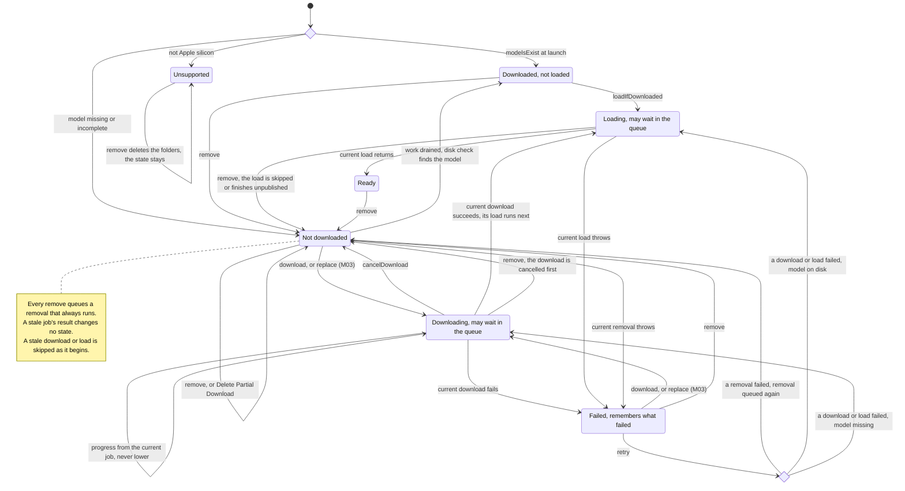

**Invariants**

- Enforced: jobs run one at a time, in order. A job waits behind the running one, and the next starts only when the running one finishes or is skipped ([SpeechModelMachine.swift L193-L217](../../Sources/Transcription/SpeechModelMachine.swift#L193-L217)); the manager keeps one task per job ([SpeechModelManager.swift L128-L136](../../Sources/Transcription/SpeechModelManager.swift#L128-L136)).
- Enforced: a stale job's result never changes the state; `finished` acts only for the current generation ([L164-L191](../../Sources/Transcription/SpeechModelMachine.swift#L164-L191)).
- Enforced: a stale download or load does no work. Its task reports that it began, and the machine skips it if a click made it stale meanwhile ([L106-L110](../../Sources/Transcription/SpeechModelMachine.swift#L106-L110)); a stale job still in the queue is dropped ([L208-L217](../../Sources/Transcription/SpeechModelMachine.swift#L208-L217)). The task asks the machine and starts the work with no suspension in between ([SpeechModelManager.swift L129-L135](../../Sources/Transcription/SpeechModelManager.swift#L129-L135)).
- Enforced: every accepted removal runs and deletes, even when a later click made it stale ([L108](../../Sources/Transcription/SpeechModelMachine.swift#L108), [L212](../../Sources/Transcription/SpeechModelMachine.swift#L212)), and Retry after a failed removal removes again ([L95](../../Sources/Transcription/SpeechModelMachine.swift#L95)).
- Enforced: a Delete shows Not downloaded at once, so `loadIfDownloaded`, which acts only in Downloaded, cannot start a load meanwhile ([L97-L99](../../Sources/Transcription/SpeechModelMachine.swift#L97-L99), [L152-L162](../../Sources/Transcription/SpeechModelMachine.swift#L152-L162)).
- Enforced: once the work drains, the disk decides: Not downloaded with the model on disk becomes Downloaded ([L113-L120](../../Sources/Transcription/SpeechModelMachine.swift#L113-L120), [L193-L197](../../Sources/Transcription/SpeechModelMachine.swift#L193-L197)); the manager reads the disk for it ([SpeechModelManager.swift L144-L148](../../Sources/Transcription/SpeechModelManager.swift#L144-L148)).
- Enforced: published progress comes only from the current download, stays between 0 and 1, and never moves backwards ([L102-L105](../../Sources/Transcription/SpeechModelMachine.swift#L102-L105)).
- Enforced: a successful download is followed by its load before anything else runs ([L170-L176](../../Sources/Transcription/SpeechModelMachine.swift#L170-L176)).
- Enforced: on a Mac without Apple silicon nothing downloads or loads, and a removal leaves the state Unsupported ([L124-L130](../../Sources/Transcription/SpeechModelMachine.swift#L124-L130), [L158](../../Sources/Transcription/SpeechModelMachine.swift#L158), [L183-L186](../../Sources/Transcription/SpeechModelMachine.swift#L183-L186)).
- Enforced: `loadIfDownloaded`, which runs at every dictation trigger, reads nothing from the disk ([SpeechModelManager.swift L93-L96](../../Sources/Transcription/SpeechModelManager.swift#L93-L96)).
- Assumed: each job finishes. There is no timeout, so a hung download or load holds every later job.
- Assumed: a load that returns means the engine can transcribe.
- Assumed: only this manager writes its two folders.
- Assumed: a click that arrives after a job's work has started does not stop that work, except Cancel, which cancels a running download's task ([SpeechModelManager.swift L140-L141](../../Sources/Transcription/SpeechModelManager.swift#L140-L141)). The call into the operation leaves the main actor and can be overtaken there, as the manager's comment says ([L29-L34](../../Sources/Transcription/SpeechModelManager.swift#L29-L34)).

**Partial download.** A cancelled or failed download leaves what it fetched in the staging folder, so the next download can resume. `hasPartialDownload` says whether that folder exists. It is read at launch ([L56](../../Sources/Transcription/SpeechModelManager.swift#L56)) and whenever the work drains ([L146-L147](../../Sources/Transcription/SpeechModelManager.swift#L146-L147)), never at a dictation trigger. While the model is Not downloaded and the flag is set, Settings shows Delete Partial Download beside Download ([SpeechModelViews.swift L12-L23](../../Sources/Settings/SpeechModelViews.swift#L12-L23)). The button calls `remove`, whose removal deletes the model folder and the staging folder ([SpeechModelManager.swift L167-L172](../../Sources/Transcription/SpeechModelManager.swift#L167-L172)), so it adds no state to the machine. Limits that follow from the code: an empty staging folder also shows the button; the button appears only once a cancelled download has stopped, and stays until its own removal has finished; a failed Delete Partial Download shows "Couldn't remove the model."

**Validation.** `SpeechModelExplorerTests` runs the production `SpeechModelMachine`, not a copy of its rules, breadth first over every interleaving of the five clicks (Download, Cancel, Delete, Load, Retry) and the job steps (begin, report progress, land the files, succeed, fail, fail keeping the model, fail after deleting the files but not the folder) on a simulated disk. A started job begins in a step of its own, so clicks can come between a job being queued and its task running, and a cancelled download can still land. Generations are compared only as current or stale, so the space is finite; queues longer than three are not expanded. It reaches 1,584 states and 6,430 transitions from no model and 1,573 states and 6,357 transitions from a model on disk (each start with and without an older folder being replaced), and 11 states from an unsupported model, with no violation. After every step it checks that:

- the simulated disk runs exactly the machine's job, and never two at once;
- a stale download or load never does its work, and no download starts before an accepted Delete has run;
- every Delete, and every Retry after a failed removal, queues a removal of its own, and none is left unrun once the work is idle; a Retry after a failed removal starts no download or load;
- once idle, Downloaded and Ready have the model on disk, Not downloaded does not, and nothing stays Downloading or Loading;
- stale progress changes nothing, and progress never goes back;
- the handover rules of [M03](#m03-retired-model-handover) hold, and an unsupported model stays unsupported.

`SpeechModelConformanceTests` replays every explored transition with a queue of at most one and no progress step on the real `SpeechModelManager` with a real folder. It holds each job's start through `Operations.willBeginJob`, fails removals with file permissions, and after every step compares the manager's state, the model on disk, and the older folder with the machine: 1,297 transitions from no model, 1,340 from no model while replacing an older folder, and 1,297 from a model on disk. The counts were taken on 2026-11-15 by running the explorer's code at `5386bbc` outside the test suite; the suites themselves were not run for this update. Not covered: real downloads, and [M02](#m02-staged-model-publication)'s staging, since the fakes write the model straight into its folder. Only one progress value is explored; `downloadIsExplicitReportsProgressAndLoads` checks that progress never goes back.

**Tests.** [`SpeechModelExplorerTests`](../../Tests/SyrupTests/SpeechModelExplorerTests.swift): `everyInterleavingKeepsTheInvariants`, `anUnsupportedModelStaysUnsupported`. [`SpeechModelConformanceTests`](../../Tests/SyrupTests/SpeechModelConformanceTests.swift): `theManagerFollowsTheMachineOnEveryExploredTransition`. [`SpeechModelRegressionTests`](../../Tests/SyrupTests/SpeechModelRegressionTests.swift): `retryAfterAFailedDeleteDeletesAgain`, `cancelAsTheFilesLandLeavesAStateThatAgreesWithTheDisk`, `deleteRightAfterALoadRequestSkipsTheLoad`, `cancelRightAfterDownloadDownloadsNothing`, `aJobOvertakenAfterItBeganDoesNoWork`, `aPartialDownloadIsReportedAndDeleteRemovesIt`, `lateProgressFromACancelledDownloadDoesNotMoveTheNextOne`. [`SpeechModelManagerTests`](../../Tests/SyrupTests/SpeechModelManagerTests.swift): `loadIfDownloadedNeverDownloads`, `loadIfDownloadedLoadsAModelAlreadyOnDisk`, `downloadIsExplicitReportsProgressAndLoads`, `failuresAreReportedAndRetryable`, `retryAfterALoadFailureLoadsAgainInsteadOfDownloading`, `retryAfterADownloadFailureDownloadsAgain`, `removeUnloadsAndDeletesTheModel`, `cancelStopsTheDownload`, `aNewDownloadWaitsForACancelledOneToStop`, `aLoadAskedForRightAfterDeleteDoesNotKeepTheModel`, `deleteDuringAStartedLoadStillRemovesTheModel`, `downloadRightAfterDeleteStartsFromNothing`, `deleteWhileDownloadingCancelsTheDownloadThenRemovesWhatItFetched`, `unsupportedMacsNeverDownloadOrLoad`. [`SpeechModelSequenceTests`](../../Tests/SyrupTests/SpeechModelSequenceTests.swift): `everySequenceLeavesTheManagerAgreeingWithTheDisk`, all 155 sequences of up to three steps from a model on disk and from none.

**Open questions.** None. Retry after a failed Delete now removes again.

### M02 Staged model publication

`SpeechModelCatalog.stagedDownload` decides when downloaded files may become the model folder. It downloads into a hidden sibling folder and moves the finished child into place only if the task was not cancelled, so a model folder that exists is meant to be complete. Every downloader in the catalog goes through it; a partial folder published as installed would fail to load on every retry.

**State variables**

- On disk: the destination folder and its completeness through `modelsExist` ([L111](../../Sources/Transcription/SpeechModelCatalog.swift#L111))
- On disk: the staging folder from [`SpeechModelManager.stagingDirectory`](../../Sources/Transcription/SpeechModelManager.swift#L61-L65) and the staged child named after the destination ([L112-L125](../../Sources/Transcription/SpeechModelCatalog.swift#L112-L125))
- The task's cancellation flag, checked at [L115](../../Sources/Transcription/SpeechModelCatalog.swift#L115) and [L120](../../Sources/Transcription/SpeechModelCatalog.swift#L120)


**Invariants**

- Enforced: a complete destination is kept and nothing downloads ([L111](../../Sources/Transcription/SpeechModelCatalog.swift#L111)).
- Enforced: a cancelled download is never moved into place, even if it finished; cancellation is checked after the download and after removing an old folder ([L115](../../Sources/Transcription/SpeechModelCatalog.swift#L115), [L120](../../Sources/Transcription/SpeechModelCatalog.swift#L120)).
- Enforced: an incomplete destination is removed before the move, so a broken folder does not block every retry ([L117-L121](../../Sources/Transcription/SpeechModelCatalog.swift#L117-L121)).
- Assumed: the downloader returns only when the staged child is complete and named after the destination. Parakeet checks `modelsExist` after fetching ([ParakeetEngine.swift L56-L64](../../Sources/Transcription/ParakeetEngine.swift#L56-L64)), Canary verifies every file ([M19](#m19-resumable-canary-bundle-fetch)), and the Unified backend loads what it fetched ([StreamingSpeech.swift L207-L211](../../Sources/Transcription/StreamingSpeech.swift#L207-L211)). Nemotron returns whatever FluidAudio's `downloadVariant` leaves ([StreamingSpeech.swift L141-L145](../../Sources/Transcription/StreamingSpeech.swift#L141-L145)).
- Assumed: the manager's queue ([M01](#m01-download-load-and-remove-queue)) is the only writer of these folders; there is no file lock.
- Assumed: the move is the publication point. A crash after an old folder is removed and before the move leaves no destination, and the next download publishes from staging.

**Tests.** [`SpeechModelManagerTests`](../../Tests/SyrupTests/SpeechModelManagerTests.swift): `aDownloadReplacesAnIncompleteModelFolder`, `aCompleteModelAtTheDestinationIsKeptAndNothingDownloads`, `removeLeavesOtherModelsInPlaceAndClearsItsUnfinishedDownload`. [`StreamingSpeechTests`](../../Tests/SyrupTests/StreamingSpeechTests.swift): `aStreamingModelCountsAsInstalledOnlyWithEveryFileItLoads`. [`CanaryTests`](../../Tests/SyrupTests/CanaryTests.swift): `aBundleIsCompleteOnlyWithEveryFileAtItsSize`. No test injects a failure between the steps.

**Open questions**

- Should the Nemotron download check `modelsExist` on the staged child, as Parakeet does, before it can be published?

### M03 Retired-model handover

At launch, a Parakeet v3 folder left by Syrup 0.9 means Ultra should replace it. `SpeechModelManager.replace` remembers the folder and sends `replace` to the machine, which sets `handoverPending`: with Ultra already on disk the folder goes at once; otherwise Ultra downloads, and the folder goes once the current download succeeds, or once the person cancels or deletes Ultra. The v3 folder is the only record across launches: no flag is stored, so the folder makes every launch try again.

**State variables**

- [`SpeechModelManager.replacedDirectory`](../../Sources/Transcription/SpeechModelManager.swift#L36) and the machine's [`handoverPending`](../../Sources/Transcription/SpeechModelMachine.swift#L66)
- On disk: the retired folder found by [`SpeechModelCatalog.replaceRetiredParakeetV3`](../../Sources/Transcription/SpeechModelCatalog.swift#L30-L36), named by [`SpeechEngine.retiredParakeetV3Folder`](../../Sources/Core/SpeechEngine.swift#L168)
- Ultra's state in [M01](#m01-download-load-and-remove-queue), read when the machine handles [`replace`](../../Sources/Transcription/SpeechModelMachine.swift#L80-L90)

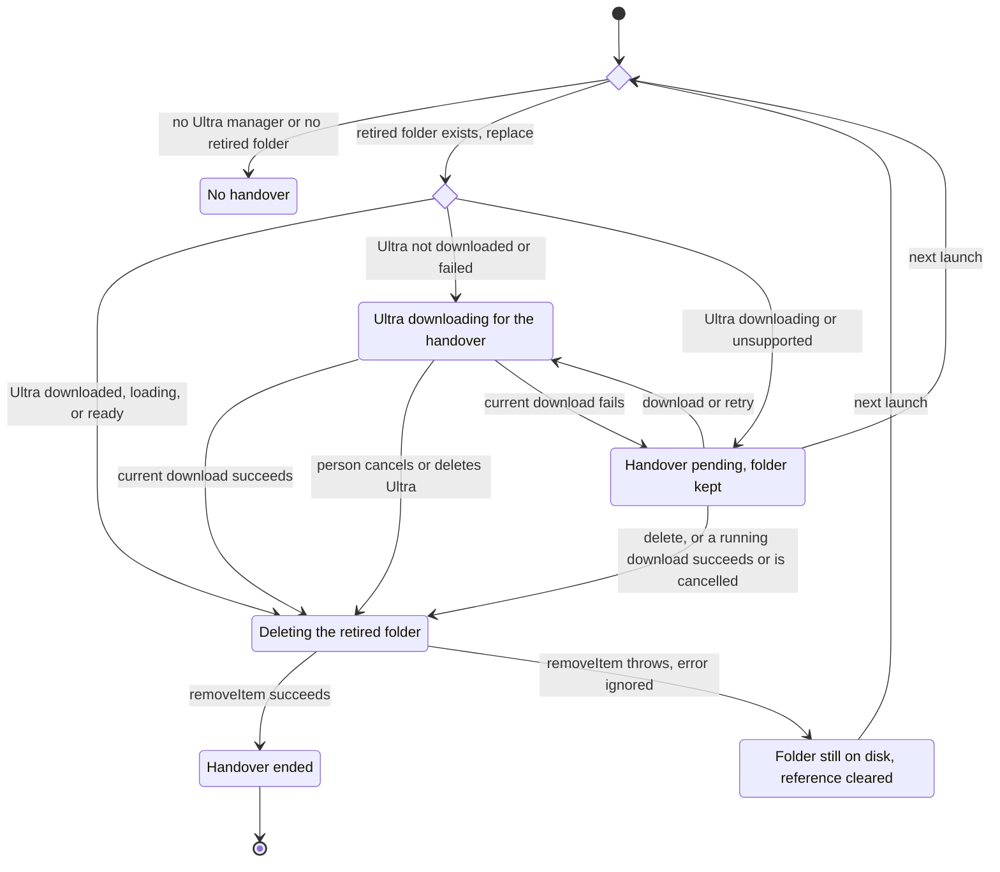

**Invariants**

- Enforced: the v3 folder is kept when the Ultra download fails, so the next launch tries again; only the current download's success ends the handover ([SpeechModelMachine.swift L170-L178](../../Sources/Transcription/SpeechModelMachine.swift#L170-L178)).
- Enforced: Cancel and Delete end the handover and delete the folder ([L136-L144](../../Sources/Transcription/SpeechModelMachine.swift#L136-L144), [L154-L162](../../Sources/Transcription/SpeechModelMachine.swift#L154-L162), [L219-L223](../../Sources/Transcription/SpeechModelMachine.swift#L219-L223)).
- Enforced: with Ultra already downloaded, loading, or ready, the folder goes at once ([L82-L85](../../Sources/Transcription/SpeechModelMachine.swift#L82-L85)).
- Enforced: only the retired sibling folder is targeted ([SpeechModelCatalog.swift L32-L35](../../Sources/Transcription/SpeechModelCatalog.swift#L32-L35)).
- Assumed: deleting the folder succeeds. The reference is cleared before the `try?` removal, and a failure is not recorded ([SpeechModelManager.swift L180-L184](../../Sources/Transcription/SpeechModelManager.swift#L180-L184)).
- Assumed: `replace` runs once, right after the catalog is built at launch ([SyrupApp.swift L91](../../Sources/App/SyrupApp.swift#L91)), when Ultra can only be Unsupported, Not downloaded, or Downloaded.

**Validation.** Explored with [M01](#m01-download-load-and-remove-queue): the explorer starts with and without an older folder, and checks that the folder exists exactly while `handoverPending` is set; that it is gone after a Delete, after a Cancel that stopped a download, and whenever Ultra is Downloaded, Loading, or Ready; and that it goes only then or when the current download succeeds. The conformance test replays the start "no model, replacing an older folder" on the real manager. The simulated deletion always succeeds, so a folder that cannot be deleted is not modeled.

**Tests.** [`SpeechModelManagerTests`](../../Tests/SyrupTests/SpeechModelManagerTests.swift): `aParakeetV3DownloadIsRemovedAndUltraDownloadsInItsPlace`, `cancellingTheUltraHandoverDeletesV3SoTheNextLaunchDoesNotStartItAgain`, `aFailedUltraDownloadKeepsParakeetV3SoTheNextLaunchTriesAgain`, `withoutAParakeetV3DownloadNothingDownloads`. [`SpeechModelRegressionTests`](../../Tests/SyrupTests/SpeechModelRegressionTests.swift): `replacingWithTheModelAlreadyOnDiskDeletesTheOlderFolderAtOnce`. The explorer and conformance tests of M01.

**Suspected defect (unverified, from the inventory).** A cancelled handover can restart at a later launch. Sequence: launch with a v3 folder and no Ultra; `replace` starts the Ultra download; the person cancels, and the machine ends the handover ([SpeechModelMachine.swift L136-L144](../../Sources/Transcription/SpeechModelMachine.swift#L136-L144)); `removeReplacedDirectory` clears the reference, and its `try?` removal of the v3 folder fails ([SpeechModelManager.swift L180-L184](../../Sources/Transcription/SpeechModelManager.swift#L180-L184)); the folder stays; the next launch finds it ([SpeechModelCatalog.swift L30-L36](../../Sources/Transcription/SpeechModelCatalog.swift#L30-L36)), and `replace` starts the download the person cancelled. It needs a filesystem failure and was not induced; the explorer cannot reach it, because its simulated deletion always succeeds.

**Open questions**

- Should a failed removal keep the reference, or be logged, so the cleanup can be retried without starting the download again?

### M04 Per-locale asset preparation

`TranscriberAssetManager` decides, for each BCP 47 locale, whether Apple's on-device language model is installed, downloading, unsupported, or failed, and runs at most one preparation per locale. Settings shows the selected locale's state, and other locales prepare in the background without changing it. The hotkey path never waits for a download: it starts preparation and fails the run with "installing", so a state stuck in Downloading or wrongly Installed leaves the locale unusable.

**State variables**

- [`TranscriberAssetManager.AssetState`](../../Sources/Transcription/TranscriberAssetManager.swift#L25-L32)
- [`localeStates`](../../Sources/Transcription/TranscriberAssetManager.swift#L39), one entry per normalized key
- [`preparationTasks`](../../Sources/Transcription/TranscriberAssetManager.swift#L37) and [`progressTasks`](../../Sources/Transcription/TranscriberAssetManager.swift#L38)
- [`selectedLocaleID`](../../Sources/Transcription/TranscriberAssetManager.swift#L40) and [`selectedLocaleAssetState`](../../Sources/Transcription/TranscriberAssetManager.swift#L35), the Settings projection
- [`supportedLocales`](../../Sources/Transcription/TranscriberAssetManager.swift#L34)
- [`installedLocaleCache`](../../Sources/Transcription/TranscriberAssetManager.swift#L41), see [M05](#m05-installed-locale-cache)
- Outside the app: `SpeechTranscriber.installedLocales` and the `AssetInventory` installation request with its `Progress` ([L209-L233](../../Sources/Transcription/TranscriberAssetManager.swift#L209-L233))

One machine runs per locale key.


`requireInstalled` can also write Installed, Unsupported, or Failed for the requested key from any state ([L157-L186](../../Sources/Transcription/TranscriberAssetManager.swift#L157-L186)); the chart shows one such edge.

**Invariants**

- Enforced: keys are normalized to BCP 47, and a key has at most one preparation task ([L105](../../Sources/Transcription/TranscriberAssetManager.swift#L105), [L113](../../Sources/Transcription/TranscriberAssetManager.swift#L113), [L117-L118](../../Sources/Transcription/TranscriberAssetManager.swift#L117-L118)).
- Enforced: an Installed key is not prepared again ([L119](../../Sources/Transcription/TranscriberAssetManager.swift#L119)).
- Enforced: a key's result reaches Settings only if it is the selected key ([L137-L140](../../Sources/Transcription/TranscriberAssetManager.swift#L137-L140)), so a background locale never retargets the display.
- Enforced: progress is clamped to 0 to 1, or nil when not finite ([L273-L278](../../Sources/Transcription/TranscriberAssetManager.swift#L273-L278)).
- Enforced: `requireInstalled` never waits for a download; it starts preparation and throws `languageModelInstalling` ([L175-L181](../../Sources/Transcription/TranscriberAssetManager.swift#L175-L181)).
- Enforced: a check-only caller (`allowPreparation` false) never prompts, skips the cache fast path, and never starts preparation ([L151-L155](../../Sources/Transcription/TranscriberAssetManager.swift#L151-L155), [L157](../../Sources/Transcription/TranscriberAssetManager.swift#L157), [L177-L181](../../Sources/Transcription/TranscriberAssetManager.swift#L177-L181)).
- Assumed: a nil installation request means the assets are usable; the state becomes Installed without caching ([L217-L219](../../Sources/Transcription/TranscriberAssetManager.swift#L217-L219)).
- Assumed: nothing in the app cancels a preparation task, so `CancellationError` comes only from the framework.
- Assumed: `invalidateInstalledLocale` clears the key's entry but not the selected projection; Settings keeps its last value until the next write for that key ([L142-L145](../../Sources/Transcription/TranscriberAssetManager.swift#L142-L145)).
- Assumed: `refreshSupportedLocales` writes Failed straight to the projection, not to `localeStates` ([L74-L86](../../Sources/Transcription/TranscriberAssetManager.swift#L74-L86)).

**Tests.** [`LocalePreparationTests`](../../Tests/SyrupTests/LocalePreparationTests.swift): `localePreparationsAreIndependentAndDeduplicated`. [`TranscriberAssetManagerTests`](../../Tests/SyrupTests/TranscriberAssetManagerTests.swift): `bcp47ComparisonTreatsUnderscoreAndHyphenLocaleIDsAsEquivalent`, `downloadingStateExposesMessageAndProgress`, `installedStateHasNoProgressValue`. No test drives a real installation or its cancellation branch.

**Suspected defect (unverified, from the inventory, extended in this check).** A framework `CancellationError` leaves a key shown as busy with no worker. Sequence: `prepareLocale` sets Checking; the installation request returns; `observeProgress` sets Downloading ([L222](../../Sources/Transcription/TranscriberAssetManager.swift#L222), [L236-L245](../../Sources/Transcription/TranscriberAssetManager.swift#L236-L245)); `downloadAndInstall` throws `CancellationError`; the handler cancels the observer and writes no state ([L227-L228](../../Sources/Transcription/TranscriberAssetManager.swift#L227-L228)); the task clears `preparationTasks[key]` ([L128](../../Sources/Transcription/TranscriberAssetManager.swift#L128)). Settings shows a download that nothing is running until another prepare or readiness check for that key. This check adds a second case: if the installation request itself throws `CancellationError`, Checking stays on screen the same way. Both need the framework to throw `CancellationError` and were not induced.

**Open questions**

- `requireInstalled` records state under the requested key but prepares the supported locale's key ([L148](../../Sources/Transcription/TranscriberAssetManager.swift#L148), [L178](../../Sources/Transcription/TranscriberAssetManager.swift#L178)). When they differ, for example a stored `en` that the framework maps to `en-US`, does Settings watch a key the preparation never updates?

### M05 Installed-locale cache

A small cache of locales the framework has confirmed installed, so a warm dictation skips the framework queries. It has no expiry: an entry goes only when readiness finds the assets missing, preparation fails, or an analyzer error invalidates the locale.

**State variables**

- [`TranscriberInstalledLocaleCache.localesByIdentifier`](../../Sources/Transcription/TranscriberAssetManager.swift#L311)
- [`TranscriberAssetManager.installedLocaleCache`](../../Sources/Transcription/TranscriberAssetManager.swift#L41)

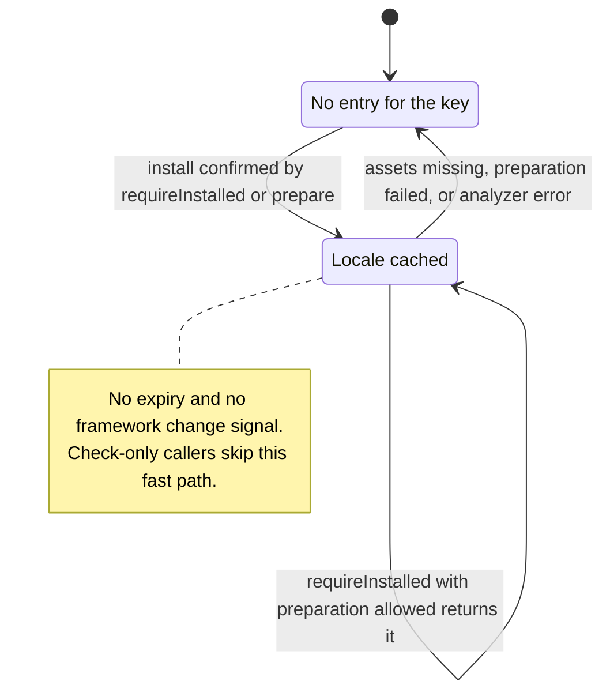

**Invariants**

- Enforced: store, remove, and lookup use the BCP 47 key ([L313-L324](../../Sources/Transcription/TranscriberAssetManager.swift#L313-L324)).
- Enforced: entries are stored only after the framework lists the locale as installed or a download succeeds ([L184](../../Sources/Transcription/TranscriberAssetManager.swift#L184), [L211](../../Sources/Transcription/TranscriberAssetManager.swift#L211), [L225](../../Sources/Transcription/TranscriberAssetManager.swift#L225)).
- Assumed: an entry stays true until an error says otherwise. If Apple removes a model while Syrup runs, the next dictation fails once before [M07](#m07-apple-analyzer-session) invalidates it ([AppleTranscriber.swift L86-L87](../../Sources/Transcription/AppleTranscriber.swift#L86-L87)).

**Tests.** [`TranscriberAssetManagerTests`](../../Tests/SyrupTests/TranscriberAssetManagerTests.swift): `installedLocaleCacheReturnsNormalizedLocale`.

**Open questions.** None.

### M06 Speech authorization bridge

Decides whether a dictation may use Speech recognition, and prompts when the status is not yet determined. The status lives in the system; Syrup holds only a checked continuation while the system callback is pending. Check-only callers never prompt. Microphone permission is a separate machine outside this area.

**State variables**

- The system status, read at [L248](../../Sources/Transcription/TranscriberAssetManager.swift#L248) and, for check-only callers, at [L152](../../Sources/Transcription/TranscriberAssetManager.swift#L152)
- The checked continuation in [`SpeechPermissionRequester.requestAuthorization`](../../Sources/Transcription/SpeechPermissionRequester.swift#L7-L19)

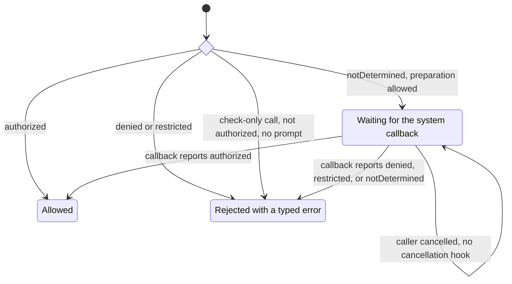

**Invariants**

- Enforced: a check-only call never prompts ([L151-L155](../../Sources/Transcription/TranscriberAssetManager.swift#L151-L155)).
- Enforced: the system completion only resumes a Sendable continuation, so no actor-isolated closure runs on the callback's queue ([SpeechPermissionRequester.swift L7-L19](../../Sources/Transcription/SpeechPermissionRequester.swift#L7-L19)).
- Assumed: the system calls the completion exactly once; a checked continuation reports a second resume but does not prevent it.
- Assumed: a cancelled caller keeps waiting for the system callback; there is no cancellation handler.

**Tests.** [`SpeechPermissionRequesterTests`](../../Tests/SyrupTests/SpeechPermissionRequesterTests.swift): `requestAuthorizationCanResumeFromBackgroundQueueWhenCalledOnMainActor`. No test covers denial, two callers at once, or a cancel before the callback.

**Open questions**

- Two first dictations at notDetermined each request authorization. Does the system show one prompt and answer both?

### M07 Apple analyzer session

`AppleTranscriber.transcribe` runs one `SpeechAnalyzer` session for one dictation: readiness, format, prepare, feed, finalize, collect. It decides when the session ends. On cancel or error it closes the input and cancels the session without waiting for the framework, so a stuck analyzer cannot hold the run open or delay a cancel.

**State variables** (locals of one call)

- [`supportedLocale`](../../Sources/Transcription/AppleTranscriber.swift#L21-L23), from readiness ([M04](#m04-per-locale-asset-preparation), [M06](#m06-speech-authorization-bridge))
- [`transcriber` and `analyzer`](../../Sources/Transcription/AppleTranscriber.swift#L24-L32)
- [`analyzerFormat`](../../Sources/Transcription/AppleTranscriber.swift#L34-L39)
- [`analyzerInput`](../../Sources/Transcription/AppleTranscriber.swift#L41), bounded to `AudioBufferStream.capacity`
- [`resultsTask`](../../Sources/Transcription/AppleTranscriber.swift#L42-L45), see [M08](#m08-final-and-volatile-transcript-accumulator)
- The cancellation handler and error paths ([L47-L97](../../Sources/Transcription/AppleTranscriber.swift#L47-L97))
- [`AppleTranscriber.allowAssetPreparation`](../../Sources/Transcription/AppleTranscriber.swift#L8), false for check-only recognition ([M33](#m33-check-only-recognition))

The results task runs alongside feeding; the chart folds it into the Feeding state.

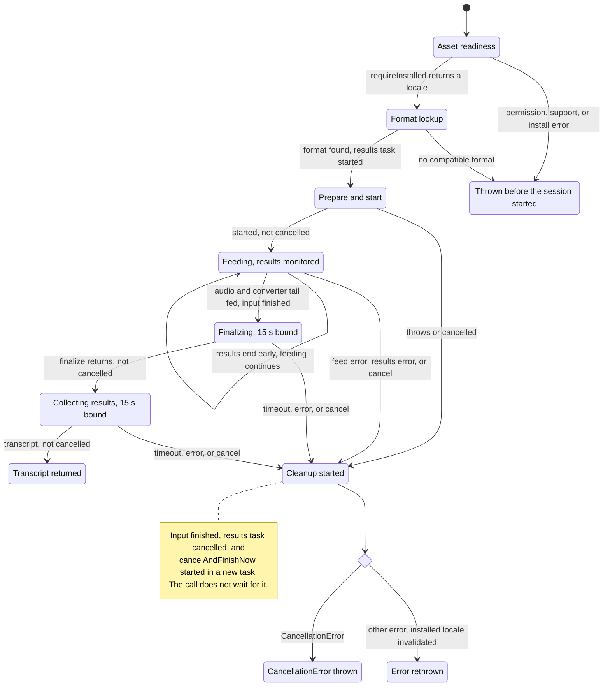

**Invariants**

- Enforced: the analyzer input holds at most `AudioBufferStream.capacity` buffers, and a dropped buffer fails the run ([L41](../../Sources/Transcription/AppleTranscriber.swift#L41), [L238-L247](../../Sources/Transcription/AppleTranscriber.swift#L238-L247)).
- Enforced: cancellation is checked after start, after feeding, after finalization, and after collection ([L57](../../Sources/Transcription/AppleTranscriber.swift#L57), [L66](../../Sources/Transcription/AppleTranscriber.swift#L66), [L72](../../Sources/Transcription/AppleTranscriber.swift#L72), [L76](../../Sources/Transcription/AppleTranscriber.swift#L76)).
- Enforced: a results error cancels the feed, and results ending normally do not cut it short ([L59-L80](../../Sources/Transcription/AppleTranscriber.swift#L59-L80), [OperationTimeout.swift L31-L46](../../Sources/Core/OperationTimeout.swift#L31-L46)).
- Enforced: finalization and result collection each return within 15 s, even if the framework ignores cancellation ([L68-L75](../../Sources/Transcription/AppleTranscriber.swift#L68-L75), [OperationTimeout.swift L7-L29](../../Sources/Core/OperationTimeout.swift#L7-L29)).
- Enforced: cancel and error paths close the input, cancel the results task, and request `cancelAndFinishNow` without awaiting it ([L81-L97](../../Sources/Transcription/AppleTranscriber.swift#L81-L97)).
- Enforced: log lines carry the stage, the outcome, a per-call UUID, and the duration only ([L218-L220](../../Sources/Transcription/AppleTranscriber.swift#L218-L220)).
- Assumed: `cancelAndFinishNow` tolerates two requests, from the cancellation handler and from the catch, and frees the session later.
- Assumed: readiness, format lookup, and prepare return in bounded time; only finalization and collection have timeouts.

**Tests.** [`AppleTranscriberTests`](../../Tests/SyrupTests/AppleTranscriberTests.swift): `onlyExplicitFastPreferenceEnablesFastResults`, `analysisContextUsesOnlyFirstHundredExactTerms`. [`AudioFailureTests`](../../Tests/SyrupTests/AudioFailureTests.swift): `recognitionFailureCancelsAudioFeedBeforeRelease`. [`OperationTimeoutTests`](../../Tests/SyrupTests/OperationTimeoutTests.swift): `timeoutReturnsEvenWhenOperationIgnoresCancellation`, `frameworkMonitorCannotHoldTimeoutCleanupOpen`. No test starts a real analyzer.

**Open questions**

- Every error other than a cancel invalidates the installed-locale entry, including audio overflow and capture errors that say nothing about assets ([L86-L87](../../Sources/Transcription/AppleTranscriber.swift#L86-L87)). The cost is one extra framework query. Is the broad trigger intended?
- `prepareToAnalyze` and `start` have no timeout. If either stalls, the run waits for the person's cancel. Is that bound enough?

### M08 Final and volatile transcript accumulator

The results task builds the transcript from the analyzer's results. Final results are appended; the latest volatile result is kept as a suffix that the next result replaces. It publishes each partial and returns prefix plus suffix when the sequence ends.

**State variables**

- [`finalized`](../../Sources/Transcription/AppleTranscriber.swift#L122) and [`volatile`](../../Sources/Transcription/AppleTranscriber.swift#L123) in `collectResults`
- Each result's `isFinal` ([L128](../../Sources/Transcription/AppleTranscriber.swift#L128)) and the partial callback ([L134](../../Sources/Transcription/AppleTranscriber.swift#L134))

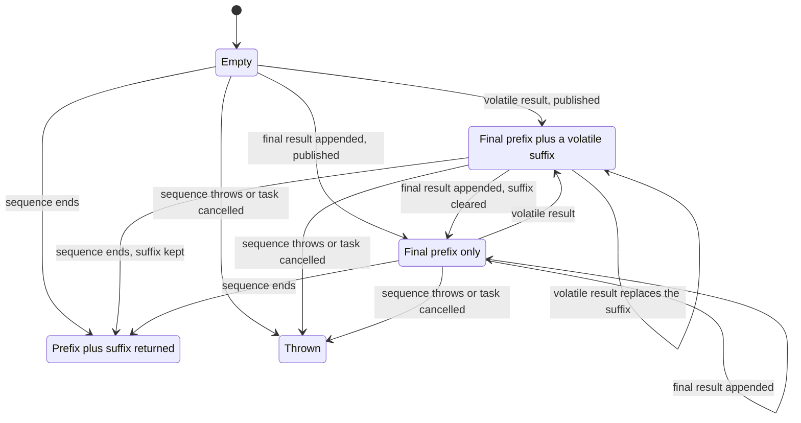

**Invariants**

- Enforced: at most one volatile suffix; a new one replaces the old ([L131-L133](../../Sources/Transcription/AppleTranscriber.swift#L131-L133)).
- Enforced: a final result clears the suffix ([L128-L130](../../Sources/Transcription/AppleTranscriber.swift#L128-L130)).
- Enforced: a cancel surfaces as `CancellationError`, and other errors propagate from the task ([L136-L138](../../Sources/Transcription/AppleTranscriber.swift#L136-L138)).
- Assumed: final segments are incremental, do not overlap, and carry their own spacing; they are joined verbatim ([L129](../../Sources/Transcription/AppleTranscriber.swift#L129), [L140](../../Sources/Transcription/AppleTranscriber.swift#L140)).
- Assumed: the partial callback is safe to call off the main actor; it is `@Sendable` ([L119](../../Sources/Transcription/AppleTranscriber.swift#L119)).

**Tests.** None target the accumulator directly.

**Open questions**

- If the sequence ends with a volatile suffix, the returned text includes words the analyzer never finalized ([L140](../../Sources/Transcription/AppleTranscriber.swift#L140)). Is that wanted for the delivered transcript?

### M09 Audio conversion, feed, and drain

`AnalyzerAudioConverter` turns capture buffers into the model's format, keeps one converter per source format, and drains the converter's tail at the end. `AnalyzerAudioFeedWorker` feeds the converted buffers into the analyzer's bounded input. A lost tail or a silent overflow would cut off spoken words. The streaming, Parakeet, and Canary transcribers use their own copy of the converter but not the worker ([StreamingSpeech.swift L81](../../Sources/Transcription/StreamingSpeech.swift#L81), [ParakeetTranscriber.swift L27](../../Sources/Transcription/ParakeetTranscriber.swift#L27), [CanaryTranscriber.swift L47](../../Sources/Transcription/CanaryTranscriber.swift#L47)).

**State variables**

- [`AnalyzerAudioFeedWorker.converter`](../../Sources/Transcription/AppleTranscriber.swift#L225) and its feed loop ([L235-L248](../../Sources/Transcription/AppleTranscriber.swift#L235-L248))
- [`AnalyzerAudioConverter.targetFormat`](../../Sources/Transcription/AppleTranscriber.swift#L253), [`sourceFormat`](../../Sources/Transcription/AppleTranscriber.swift#L254), [`converter`](../../Sources/Transcription/AppleTranscriber.swift#L255), [`drainFrameCapacity`](../../Sources/Transcription/AppleTranscriber.swift#L256)

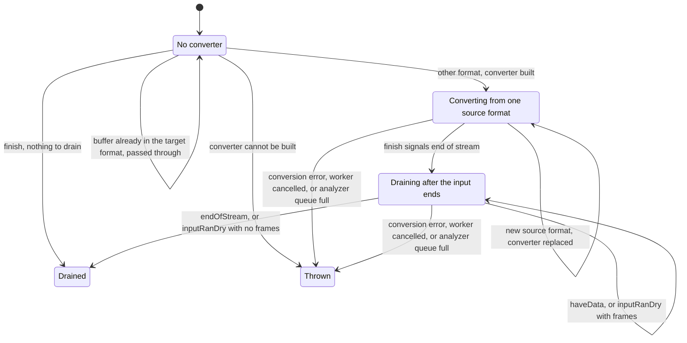

**Invariants**

- Enforced: a source format is recorded only after its converter is built ([L267-L273](../../Sources/Transcription/AppleTranscriber.swift#L267-L273)).
- Enforced: output capacity follows the sample-rate ratio, and the drain uses the largest capacity seen ([L279-L282](../../Sources/Transcription/AppleTranscriber.swift#L279-L282), [L315-L318](../../Sources/Transcription/AppleTranscriber.swift#L315-L318)).
- Enforced: the drain keeps only buffers with frames and stops at end of stream or an empty `inputRanDry` ([L327-L339](../../Sources/Transcription/AppleTranscriber.swift#L327-L339)).
- Enforced: the worker checks cancellation before each yield and fails on a dropped buffer ([L235-L247](../../Sources/Transcription/AppleTranscriber.swift#L235-L247)).
- Assumed: the source format stays fixed during a capture; a change replaces the converter and drops its buffered tail.
- Assumed: `finish` is called once per run; nothing stops a convert after it.
- Assumed: a yield to a terminated stream is not treated as a failure ([L238](../../Sources/Transcription/AppleTranscriber.swift#L238), [L245](../../Sources/Transcription/AppleTranscriber.swift#L245)); the analyzer has been cancelled by then.

**Tests.** [`AppleTranscriberTests`](../../Tests/SyrupTests/AppleTranscriberTests.swift): `matchingFormatConversionReturnsOriginalBuffer`, `conversionProducesTargetFormat`, `finishDrainsConverterTailFrames`, `audioFeedWorkerYieldsConvertedAnalyzerInputs`. [`StreamingSpeechTests`](../../Tests/SyrupTests/StreamingSpeechTests.swift): `theSameAudioUncancelledDrainsTheConverterBeforeFinishing`.

**Open questions.** None.

### M12 Ordered streaming sessions

`StreamingSpeechEngine` runs every call into a streaming backend strictly in order, and numbers sessions so a cancelled run cannot feed audio into the next one. `begin` takes the next session number before it waits, and any later `append` or `finish` with an older number is refused when it joins the queue. Work already accepted still runs, in order, before the next run's reset; a mistake here would put a cancelled run's speech into the next delivered transcript.

**State variables**

- [`StreamingSpeechEngine.backend`](../../Sources/Transcription/StreamingSpeech.swift#L22)
- [`tail`](../../Sources/Transcription/StreamingSpeech.swift#L23), the end of the call queue
- [`isLoaded`](../../Sources/Transcription/StreamingSpeech.swift#L24)
- [`currentSession`](../../Sources/Transcription/StreamingSpeech.swift#L26)
- `previous` and `task` inside [`inOrder`](../../Sources/Transcription/StreamingSpeech.swift#L64-L72)

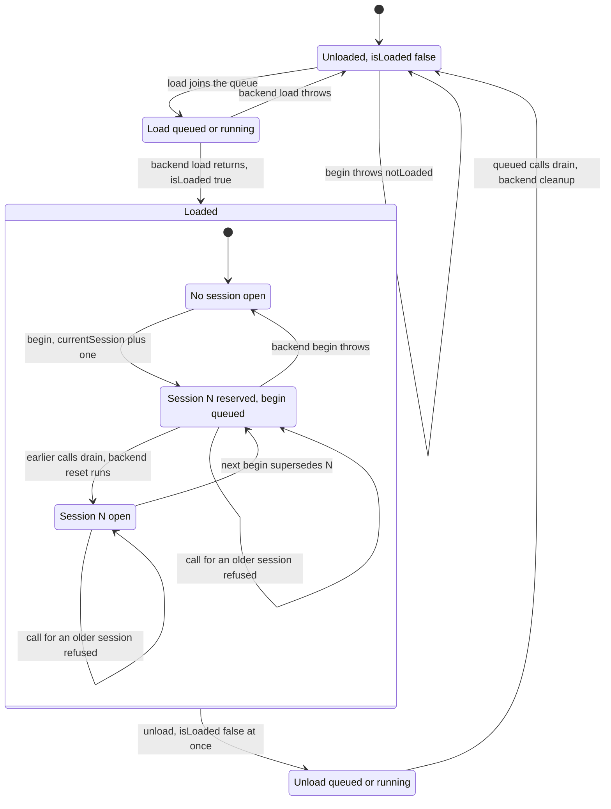

**Invariants**

- Enforced: backend calls never overlap through the engine; each waits for the one before ([L64-L72](../../Sources/Transcription/StreamingSpeech.swift#L64-L72)).
- Enforced: the session number is taken before the wait, so once a new begin has started, any new call for the old session is refused ([L46-L47](../../Sources/Transcription/StreamingSpeech.swift#L46-L47), [L55](../../Sources/Transcription/StreamingSpeech.swift#L55), [L60](../../Sources/Transcription/StreamingSpeech.swift#L60)).
- Enforced: calls accepted before a begin run before its reset ([L64-L71](../../Sources/Transcription/StreamingSpeech.swift#L64-L71)).
- Enforced: a begin before load throws `notLoaded` ([L45](../../Sources/Transcription/StreamingSpeech.swift#L45)).
- Assumed: `isLoaded` matches the backend because `SpeechModelManager` never overlaps a load and an unload for one engine: its machine runs one job at a time ([SpeechModelMachine.swift L199-L217](../../Sources/Transcription/SpeechModelMachine.swift#L199-L217)), and a removal unloads inside its own job ([SpeechModelManager.swift L167-L168](../../Sources/Transcription/SpeechModelManager.swift#L167-L168)). If they overlapped, the load could set `isLoaded` after the unload cleared it, over an unloaded backend; begin would then fail in the backend with the same `notLoaded`.
- Assumed: a cancelled caller's queued call still runs; caller cancellation is not passed to backend work ([L64-L71](../../Sources/Transcription/StreamingSpeech.swift#L64-L71)).
- Assumed: nothing marks a session finished. [M13](#m13-streaming-run-feed-and-drain)'s control flow is what prevents an append after finish.
- Assumed: partial transcripts carry no session number; the next begin's reset installs the new run's callback ([M14](#m14-streaming-backend-residency-and-reset)).

**Tests.** [`StreamingSpeechTests`](../../Tests/SyrupTests/StreamingSpeechTests.swift): `refusesToRunBeforeLoading`, `feedsEveryBufferReportsPartialsAndTrimsTheResult`, `aNewRunWaitsForTheChunkACancelledRunIsStillProcessing`, `aCancelledRunCannotFeedItsLastSamplesToTheNextRun`, `aCallFromAnEarlierSessionIsRefused`. They use gated fake backends, so they pin ordering, not FluidAudio.

**Open questions.** None beyond the caller contracts above.

### M13 Streaming run, feed, and drain

`StreamingTranscriber.transcribe` drives one streaming run: begin a session, feed converted buffers, drain the converter, finish. Every call carries the session number from begin, so once a newer run starts, this run's next call is refused.

**State variables**

- [`converter`](../../Sources/Transcription/StreamingSpeech.swift#L81) and [`session`](../../Sources/Transcription/StreamingSpeech.swift#L82)
- The feed loop ([L83-L86](../../Sources/Transcription/StreamingSpeech.swift#L83-L86)) and the drain loop ([L87-L90](../../Sources/Transcription/StreamingSpeech.swift#L87-L90))
- Cancellation checks at [L84](../../Sources/Transcription/StreamingSpeech.swift#L84), [L88](../../Sources/Transcription/StreamingSpeech.swift#L88), and [L91](../../Sources/Transcription/StreamingSpeech.swift#L91), then [`finish`](../../Sources/Transcription/StreamingSpeech.swift#L92)

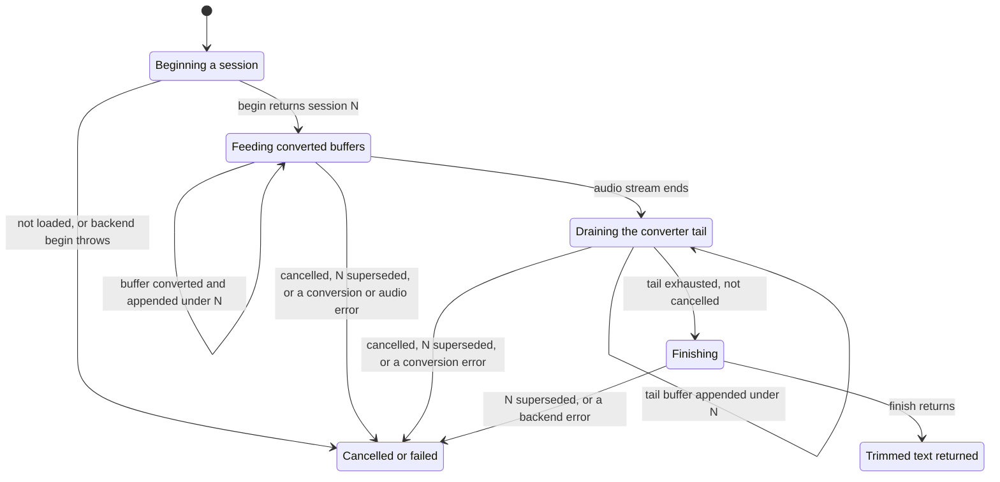

**Invariants**

- Enforced: every append and the finish carry the run's session ([L82-L92](../../Sources/Transcription/StreamingSpeech.swift#L82-L92)).
- Enforced: no tail append after an observed cancel ([L88](../../Sources/Transcription/StreamingSpeech.swift#L88)), and the tail goes in before finish ([L87-L92](../../Sources/Transcription/StreamingSpeech.swift#L87-L92)).
- Assumed: a cancel during the final `finish` await does not stop the result; there is no check after it, so the caller must discard it ([L91-L92](../../Sources/Transcription/StreamingSpeech.swift#L91-L92)).
- Assumed: a run abandoned midway leaves backend state that the next begin resets ([M14](#m14-streaming-backend-residency-and-reset)).

**Tests.** [`StreamingSpeechTests`](../../Tests/SyrupTests/StreamingSpeechTests.swift): `feedsEveryBufferReportsPartialsAndTrimsTheResult`, `aCancelledRunCannotFeedItsLastSamplesToTheNextRun`, `theSameAudioUncancelledDrainsTheConverterBeforeFinishing`.

**Open questions.** None.

### M14 Streaming backend residency and reset

`NemotronBackend` and `ParakeetUnifiedBackend` wrap FluidAudio's streaming managers. Each publishes its SDK manager only after a load and a silent warm-up, and resets the SDK session at every begin. Nemotron also sets the language, turns on final punctuation, and feeds 300 ms of silence so the first word is not lost.

**State variables**

- [`NemotronBackend.manager`](../../Sources/Transcription/StreamingSpeech.swift#L116) and [`ParakeetUnifiedBackend.manager`](../../Sources/Transcription/StreamingSpeech.swift#L190)
- The unpublished manager during load ([L149-L153](../../Sources/Transcription/StreamingSpeech.swift#L149-L153), [L215-L219](../../Sources/Transcription/StreamingSpeech.swift#L215-L219))
- Fixed settings: [`chunkMs`](../../Sources/Transcription/StreamingSpeech.swift#L114) and [`leadingSilenceSamples`](../../Sources/Transcription/StreamingSpeech.swift#L115)

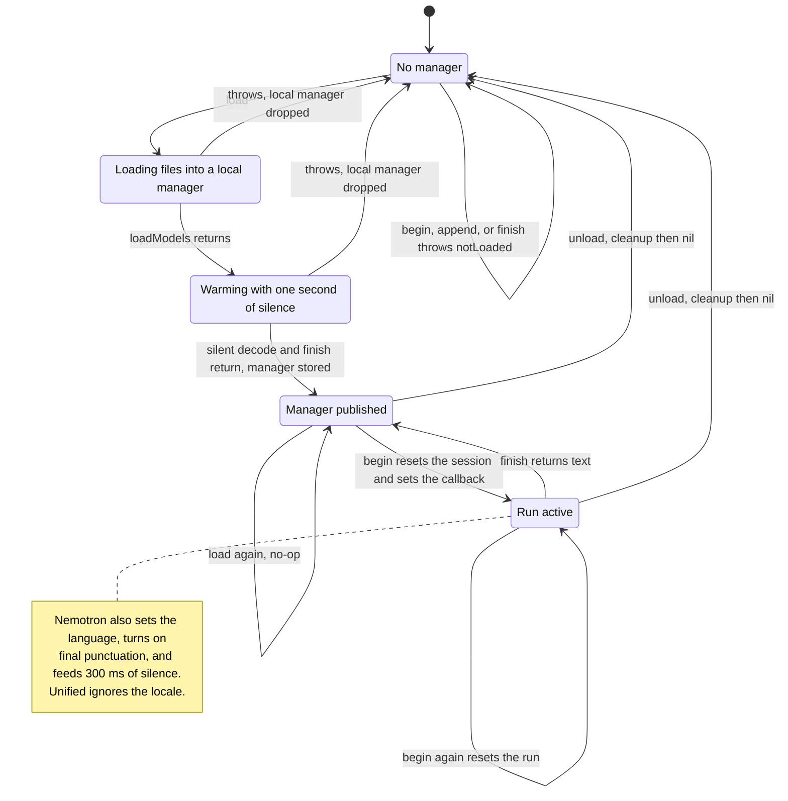

**Invariants**

- Enforced: the manager is stored only after load and warm-up succeed ([L147-L154](../../Sources/Transcription/StreamingSpeech.swift#L147-L154), [L213-L220](../../Sources/Transcription/StreamingSpeech.swift#L213-L220)).
- Enforced: begin, append, and finish throw `notLoaded` without a manager ([L162](../../Sources/Transcription/StreamingSpeech.swift#L162), [L172](../../Sources/Transcription/StreamingSpeech.swift#L172), [L177](../../Sources/Transcription/StreamingSpeech.swift#L177), [L228](../../Sources/Transcription/StreamingSpeech.swift#L228), [L234](../../Sources/Transcription/StreamingSpeech.swift#L234), [L240](../../Sources/Transcription/StreamingSpeech.swift#L240)).
- Enforced: each begin resets the SDK session first ([L163](../../Sources/Transcription/StreamingSpeech.swift#L163), [L229](../../Sources/Transcription/StreamingSpeech.swift#L229)).
- Assumed: FluidAudio's reset clears the transcript and decoder state, and the new callback replaces the old one.
- Assumed: calls arrive one at a time through [M12](#m12-ordered-streaming-sessions); these actors are reentrant at every await.
- Assumed: a manager dropped after a failed warm-up needs no explicit cleanup.

**Tests.** [`StreamingSpeechTests`](../../Tests/SyrupTests/StreamingSpeechTests.swift) use fake backends; `aStreamingModelCountsAsInstalledOnlyWithEveryFileItLoads` and `everyWayToBuildAFluidAudioEngineSilencesItsLogging` touch the real types. No test runs FluidAudio.

**Open questions.** None.

### M15 Parakeet residency

`ParakeetEngine` holds one loaded Parakeet TDT model. It publishes the model only after a one-second silent decode, and builds a fresh decoder state for every transcription, so one dictation's state never carries into the next.

**State variables**

- [`ParakeetEngine.model`](../../Sources/Transcription/ParakeetEngine.swift#L36) and [`manager`](../../Sources/Transcription/ParakeetEngine.swift#L37)
- The unpublished manager and warm-up state during load ([L68-L72](../../Sources/Transcription/ParakeetEngine.swift#L68-L72))
- The decoder state made for each transcription ([L82-L84](../../Sources/Transcription/ParakeetEngine.swift#L82-L84))

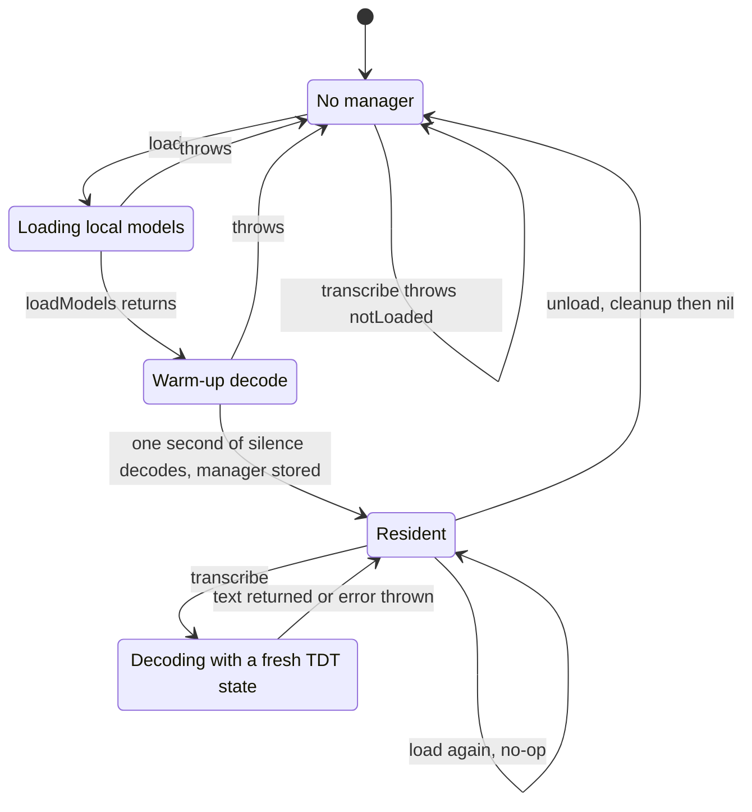

**Invariants**

- Enforced: warm-up finishes before the manager is stored ([L66-L73](../../Sources/Transcription/ParakeetEngine.swift#L66-L73)).
- Enforced: every transcription makes a new `TdtDecoderState` ([L82](../../Sources/Transcription/ParakeetEngine.swift#L82)).
- Enforced: load reads local files only; download is a separate path that checks completeness ([L56-L64](../../Sources/Transcription/ParakeetEngine.swift#L56-L64)).
- Assumed: `SpeechModelManager`'s queue is the only caller of load and unload; the actor alone does not stop two loads overlapping at their awaits.

**Tests.** [`SpeechModelManagerTests`](../../Tests/SyrupTests/SpeechModelManagerTests.swift) use fake operations, and [`ParakeetTranscriberTests`](../../Tests/SyrupTests/ParakeetTranscriberTests.swift) use a `ParakeetDecoding` double. No test loads a real engine.

**Open questions**

- `unload` is queued behind downloads and loads, not behind dictations. A Delete during a Parakeet dictation can run FluidAudio's `cleanup` while `transcribe` is suspended inside the SDK ([L75-L85](../../Sources/Transcription/ParakeetEngine.swift#L75-L85)). Is that safe in FluidAudio?

### M16 Parakeet segmentation

`ParakeetTranscriber` decides where to cut long dictations. Up to 60 seconds decodes as one piece; past 60 s it cuts at a quiet 300 ms within the last 15 s, and at 75 s it forces a cut at the quietest point. Pieces without speech are skipped, and short speech is padded to 0.5 s.

**State variables**

- [`languageCode`](../../Sources/Transcription/ParakeetTranscriber.swift#L26), [`converter`](../../Sources/Transcription/ParakeetTranscriber.swift#L27), [`pending`](../../Sources/Transcription/ParakeetTranscriber.swift#L28), [`texts`](../../Sources/Transcription/ParakeetTranscriber.swift#L30)
- Fixed limits: [`shortestDecode`, `wholeDecodeLimit`, `pauseSearch`, `longestDecode`](../../Sources/Transcription/ParakeetTranscriber.swift#L13-L16)
- The cut decision ([L34-L38](../../Sources/Transcription/ParakeetTranscriber.swift#L34-L38))

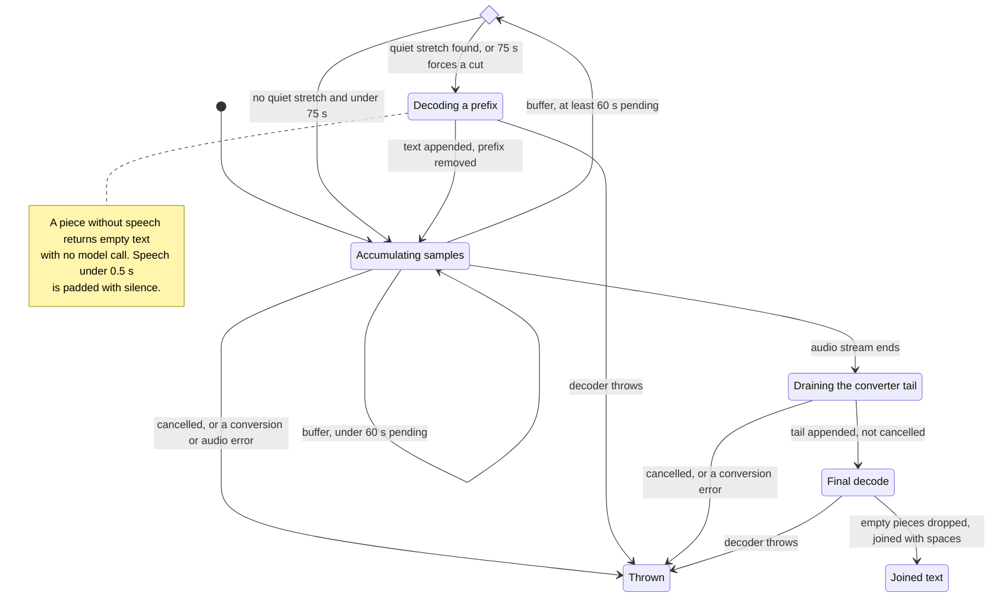

**Invariants**

- Enforced: a dictation of up to 60 s decodes once, even across pauses ([L34](../../Sources/Transcription/ParakeetTranscriber.swift#L34)).
- Enforced: a cut needs a quiet stretch until 75 s; from then the quietest point is forced ([L34-L35](../../Sources/Transcription/ParakeetTranscriber.swift#L34-L35), [SpeechSegmenter.swift L23-L31](../../Sources/Transcription/SpeechSegmenter.swift#L23-L31)).
- Enforced: the converter tail is decoded ([L40-L44](../../Sources/Transcription/ParakeetTranscriber.swift#L40-L44)).
- Enforced: noise-only pieces never reach the model, and short speech is padded ([L49-L51](../../Sources/Transcription/ParakeetTranscriber.swift#L49-L51)).
- Assumed: capture buffers are small, so one buffer cannot push `pending` far past 75 s; at most one cut is made per buffer ([L34-L38](../../Sources/Transcription/ParakeetTranscriber.swift#L34-L38)).
- Assumed: a cancel after the final decode is handled by the caller; there is no check after [L44](../../Sources/Transcription/ParakeetTranscriber.swift#L44).

**Tests.** [`ParakeetTranscriberTests`](../../Tests/SyrupTests/ParakeetTranscriberTests.swift): `dictationsUpToAMinuteDecodeOnceEvenAcrossPauses`, `longerDictationsAreCutInsideARealPause`, `withoutAPauseNoCutComesBeforeAMinuteAndNoDecodeExceeds75Seconds`, `aShortRecordingIsPaddedToTheShortestDecodableLength`, `roomNoiseWithoutSpeechIsNeverDecoded`, `aShortWordTenDecibelsAboveRoomNoiseIsDecoded`, `roomNoiseLeftAfterTheLastCutAddsNoWords`.

**Open questions.** None.

### M17 Canary residency

`CanaryEngine` holds the Canary Core ML model. Load, unload, and transcribe are synchronous methods on one actor, so they never interleave: an unload waits for the window being predicted.

**State variables**

- [`CanaryEngine.model`](../../Sources/Transcription/CanaryTranscriber.swift#L11)
- [`windowSamples`](../../Sources/Transcription/CanaryTranscriber.swift#L13), 160,000 samples (10 s) until a model loads
- [`load`](../../Sources/Transcription/CanaryTranscriber.swift#L15-L20), [`unload`](../../Sources/Transcription/CanaryTranscriber.swift#L22-L24), [`transcribe`](../../Sources/Transcription/CanaryTranscriber.swift#L26-L29)

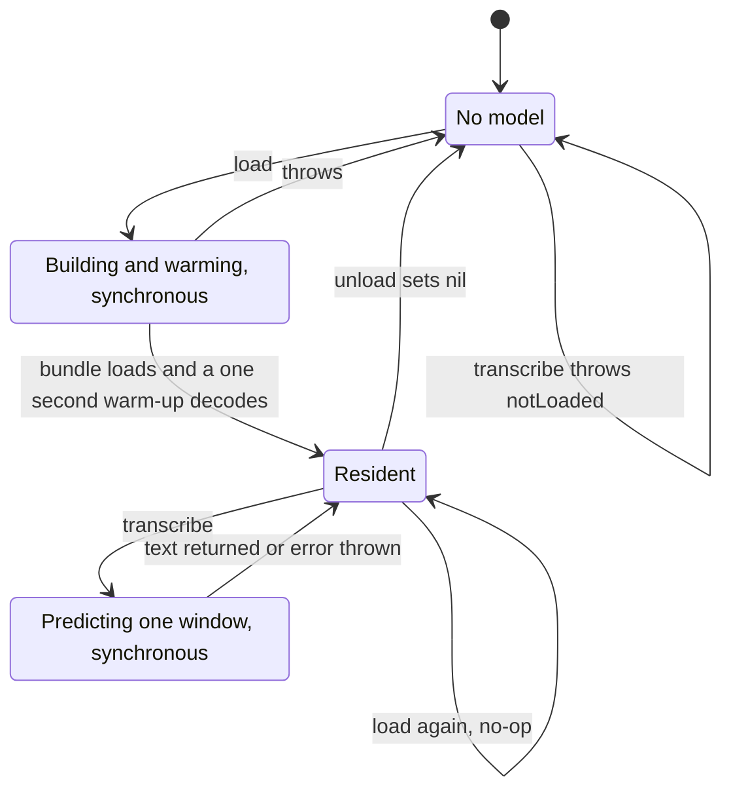

**Invariants**

- Enforced: the model is stored only after a one-second warm-up succeeds ([L17-L19](../../Sources/Transcription/CanaryTranscriber.swift#L17-L19)).
- Enforced: predictions and unloading cannot overlap, because the methods never await ([L15-L29](../../Sources/Transcription/CanaryTranscriber.swift#L15-L29)).
- Assumed: Core ML predictions finish in reasonable time; there is no timeout or cancellation inside a window.

**Tests.** [`CanaryTests`](../../Tests/SyrupTests/CanaryTests.swift) use a `CanaryDecoding` fake. No test loads a real engine.

**Open questions.** None.

### M18 Canary token decode and empty-window recovery

`CanaryModel.transcribe` decodes one window: encode, prefill a nine-token prompt, then greedy steps until end of text or 220 tokens. `transcribeRecovering` handles Canary's habit of ending a window at once with no words: if a window of at least 4 s comes back empty, it splits at the quietest point of the middle half and decodes each half once. An empty result can make the pipeline fall back to Apple.

**State variables**

- [`prompt`](../../Sources/Transcription/CanaryModel.swift#L146), [features and frames](../../Sources/Transcription/CanaryModel.swift#L148), [`embeddings` and `mask`](../../Sources/Transcription/CanaryModel.swift#L154-L155)
- [`output`](../../Sources/Transcription/CanaryModel.swift#L157), the logits and decoder cache; [`endOfText`](../../Sources/Transcription/CanaryModel.swift#L162); [`tokens`](../../Sources/Transcription/CanaryModel.swift#L163); the greedy loop ([L164-L180](../../Sources/Transcription/CanaryModel.swift#L164-L180))
- The recovery split ([L186-L196](../../Sources/Transcription/CanaryModel.swift#L186-L196))

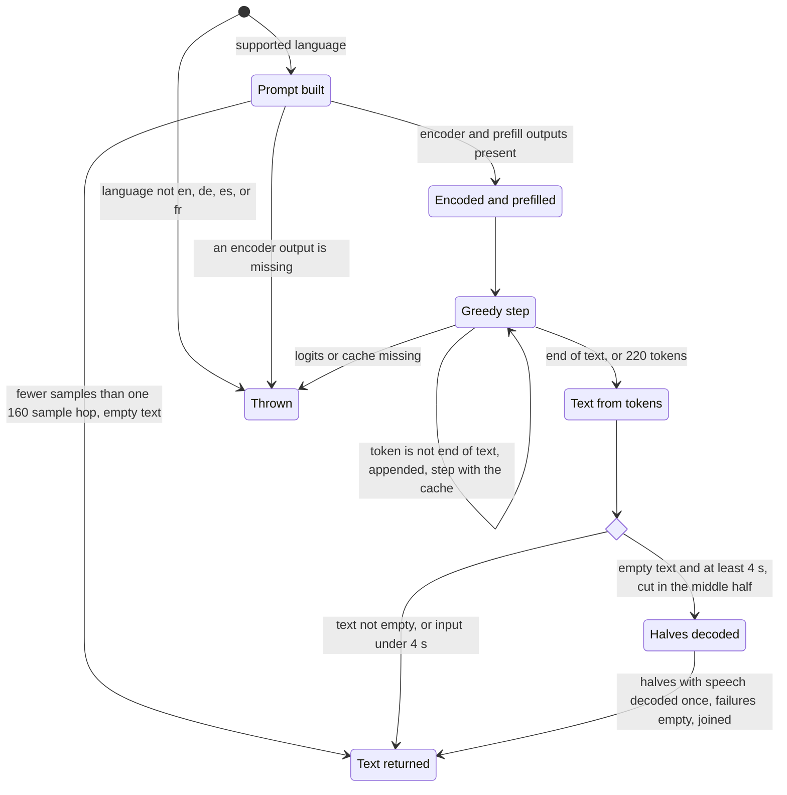

**Invariants**

- Enforced: only en, de, es, and fr are accepted, with the same language as source and target ([L131-L142](../../Sources/Transcription/CanaryModel.swift#L131-L142)).
- Enforced: audio beyond one window is cut off, so callers segment first ([L144](../../Sources/Transcription/CanaryModel.swift#L144), [L148](../../Sources/Transcription/CanaryModel.swift#L148)).
- Enforced: at most 220 tokens ([L145](../../Sources/Transcription/CanaryModel.swift#L145), [L164](../../Sources/Transcription/CanaryModel.swift#L164)).
- Enforced: recovery splits once; each half calls `transcribe`, not `transcribeRecovering` ([L192-L193](../../Sources/Transcription/CanaryModel.swift#L192-L193)).
- Enforced: control tokens never reach the text ([L199-L204](../../Sources/Transcription/CanaryModel.swift#L199-L204)).
- Enforced: a half that throws during recovery counts as empty text; recovery itself never throws ([L193](../../Sources/Transcription/CanaryModel.swift#L193)).
- Assumed: model outputs have the expected shapes; a missing output throws `missingOutput` ([L154-L155](../../Sources/Transcription/CanaryModel.swift#L154-L155), [L165-L168](../../Sources/Transcription/CanaryModel.swift#L165-L168)).

**Tests.** [`CanaryTests`](../../Tests/SyrupTests/CanaryTests.swift): `piecesJoinIntoWordsWithoutControlTokens`, `featuresHaveTheEncoderShapeAndAreNormalizedPerBin`. No test runs the greedy loop or the recovery split on a real model.

**Open questions.** None.

### M19 Resumable Canary bundle fetch

`CanaryModel.download` fetches the 14 files of a pinned Hugging Face revision one at a time. A file already on disk with the right size, and the right SHA-256 where the manifest has one, is kept, so a retry resumes file by file. A file that arrives wrong is deleted and the download fails.

**State variables**

- [`directory`, `total`, `finished`](../../Sources/Transcription/CanaryModel.swift#L58-L60), the file loop ([L61-L82](../../Sources/Transcription/CanaryModel.swift#L61-L82)), and [`base`](../../Sources/Transcription/CanaryModel.swift#L73) for progress
- The manifest ([L23-L42](../../Sources/Transcription/CanaryModel.swift#L23-L42)), checked by [`matches`](../../Sources/Transcription/CanaryModel.swift#L85-L89)
- On disk: each file's size and hash; [`isComplete`](../../Sources/Transcription/CanaryModel.swift#L46-L53) checks sizes only

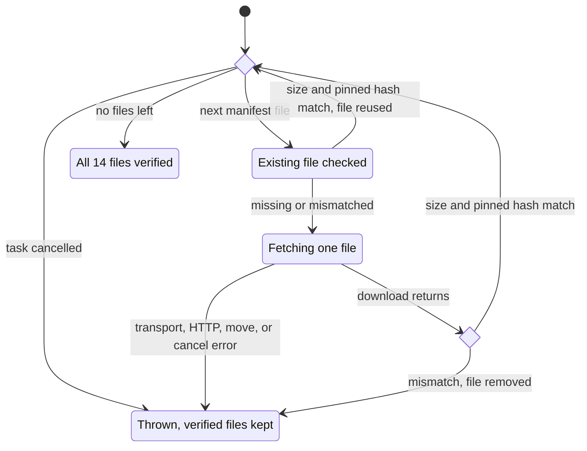

**Invariants**

- Enforced: the revision is pinned ([L25](../../Sources/Transcription/CanaryModel.swift#L25), [L70](../../Sources/Transcription/CanaryModel.swift#L70)).
- Enforced: each file must match its size, and its SHA-256 for the 9 of 14 entries that carry one ([L85-L89](../../Sources/Transcription/CanaryModel.swift#L85-L89)).
- Enforced: a valid file is reused ([L64-L68](../../Sources/Transcription/CanaryModel.swift#L64-L68)), and cancellation is checked before each file ([L62](../../Sources/Transcription/CanaryModel.swift#L62)).
- Assumed: the five size-only files are authentic.
- Assumed: the launch check compares sizes only; hashes are checked at download ([L46-L53](../../Sources/Transcription/CanaryModel.swift#L46-L53)).
- Assumed: [M02](#m02-staged-model-publication) keeps a partial bundle out of the model folder.

**Tests.** [`CanaryTests`](../../Tests/SyrupTests/CanaryTests.swift): `aBundleIsCompleteOnlyWithEveryFileAtItsSize`. No test runs `FileDownload` or rejects a bad hash.

**Open questions.** None.

### M20 URL download continuation

`FileDownload` bridges one `URLSession` download to async code. Delegate callbacks move the temporary file into place and record any move error, and the completion resumes the continuation once. A lost or doubled continuation would hang a model download or report a missing file as fetched.

**State variables**

- [`destination`](../../Sources/Transcription/CanaryModel.swift#L354), [`progress`](../../Sources/Transcription/CanaryModel.swift#L355), [`continuation`](../../Sources/Transcription/CanaryModel.swift#L356), [`moveError`](../../Sources/Transcription/CanaryModel.swift#L357), [`lock`](../../Sources/Transcription/CanaryModel.swift#L358)
- The download [`task`](../../Sources/Transcription/CanaryModel.swift#L369), the cancellation handler ([L375-L377](../../Sources/Transcription/CanaryModel.swift#L375-L377)), and the final check ([L378](../../Sources/Transcription/CanaryModel.swift#L378))


**Invariants**

- Enforced: the continuation is taken and cleared under the lock before it resumes, so it resumes at most once ([L397-L405](../../Sources/Transcription/CanaryModel.swift#L397-L405)).
- Enforced: `moveError` is read and written under the lock ([L392](../../Sources/Transcription/CanaryModel.swift#L392), [L401](../../Sources/Transcription/CanaryModel.swift#L401)).
- Enforced: a cancelled fetch throws even if the transfer finished ([L378](../../Sources/Transcription/CanaryModel.swift#L378)).
- Enforced: a response other than HTTP 200 is an error ([L388](../../Sources/Transcription/CanaryModel.swift#L388)).
- Assumed: `URLSession` calls `didFinishDownloadingTo` before `didCompleteWithError`, and calls `didCompleteWithError` once.

**Tests.** None run `FileDownload`.

**Open questions**

- If the task is already cancelled when `fetch` starts, for example when Cancel is pressed while `matches` hashes a large file, the cancellation handler cancels the URL task before the continuation is installed ([L370-L377](../../Sources/Transcription/CanaryModel.swift#L370-L377)). If `URLSession` delivered `didCompleteWithError` in that gap, it would find no continuation, and the fetch would never resume. This depends on `URLSession` timing and was not observed.

### M21 Canary window segmentation

`CanaryTranscriber` keeps at most one model window of samples pending. Whenever more arrive, it cuts at the quietest point in the window's last 4 seconds, decodes that piece, and keeps the rest. It refuses languages Canary does not transcribe, so the pipeline uses Apple instead.

**State variables**

- [`language`](../../Sources/Transcription/CanaryTranscriber.swift#L44-L45), [`window`](../../Sources/Transcription/CanaryTranscriber.swift#L46), [`converter`](../../Sources/Transcription/CanaryTranscriber.swift#L47), [`pending`](../../Sources/Transcription/CanaryTranscriber.swift#L48), [`texts`](../../Sources/Transcription/CanaryTranscriber.swift#L49)
- The piece and cut in the window loop ([L66-L67](../../Sources/Transcription/CanaryTranscriber.swift#L66-L67)) and the fixed [`pauseSearch`](../../Sources/Transcription/CanaryTranscriber.swift#L35)


**Invariants**

- Enforced: unsupported languages throw before any decode ([L44-L45](../../Sources/Transcription/CanaryTranscriber.swift#L44-L45)).
- Enforced: each decoded piece is at most one window ([L65-L68](../../Sources/Transcription/CanaryTranscriber.swift#L65-L68)), because `CanaryModel` cuts off anything longer ([M18](#m18-canary-token-decode-and-empty-window-recovery)).
- Enforced: pieces without speech are not decoded ([L74](../../Sources/Transcription/CanaryTranscriber.swift#L74)).
- Assumed: `windowSamples` is positive and the forced cut falls inside the window ([L67](../../Sources/Transcription/CanaryTranscriber.swift#L67)).
- Assumed: cancellation is checked per capture buffer ([L51](../../Sources/Transcription/CanaryTranscriber.swift#L51)) and once after the drain ([L59](../../Sources/Transcription/CanaryTranscriber.swift#L59)), not between window decodes ([L64-L70](../../Sources/Transcription/CanaryTranscriber.swift#L64-L70)).

**Tests.** [`CanaryTests`](../../Tests/SyrupTests/CanaryTests.swift): `longDictationIsCutIntoWindowsTheModelCanSee`, `silenceIsNeverDecoded`, `portugueseIsRefusedSoThePipelineUsesApple`.

**Open questions.** None.

## Glossary checks, proposals, and learning leftovers

What is left in `Sources/Learning`: the Suggest check that asks how Apple recognition hears a glossary term ([M30](#m30-suggestion-batch-and-per-term-results) to [M33](#m33-check-only-recognition)), the proposal list ([M35](#m35-proposal-and-dismissal-lifetime)), and the cleanup of what glossary learning left on disk ([M38](#m38-retired-learning-cleanup)).

### M30 Suggestion batch and per-term results

`MishearingSuggestionModel` runs Suggest checks for glossary terms: one batch at a time, one term at a time, and never during a dictation. Each term's result is cached by term ID and exact spelling, so renaming a term hides its old result, and a cancel restores the state the term had before.

**State variables**

- [`TermState`](../../Sources/Learning/MishearingSuggestionModel.swift#L7-L14), one per term in [`states`](../../Sources/Learning/MishearingSuggestionModel.swift#L21)
- [`progress`](../../Sources/Learning/MishearingSuggestionModel.swift#L22), [`isRunning`](../../Sources/Learning/MishearingSuggestionModel.swift#L23), [`isForegroundActive`](../../Sources/Learning/MishearingSuggestionModel.swift#L24), and the derived [`canProbe`](../../Sources/Learning/MishearingSuggestionModel.swift#L25)
- [`task`](../../Sources/Learning/MishearingSuggestionModel.swift#L38), [`probedTerms`](../../Sources/Learning/MishearingSuggestionModel.swift#L39), [`dismissed`](../../Sources/Learning/MishearingSuggestionModel.swift#L40)
- [`localeIDs`](../../Sources/Learning/MishearingSuggestionModel.swift#L27-L34), at most three voice-workflow locales, the active workflow first

Drawn as two charts: the batch, then one term.

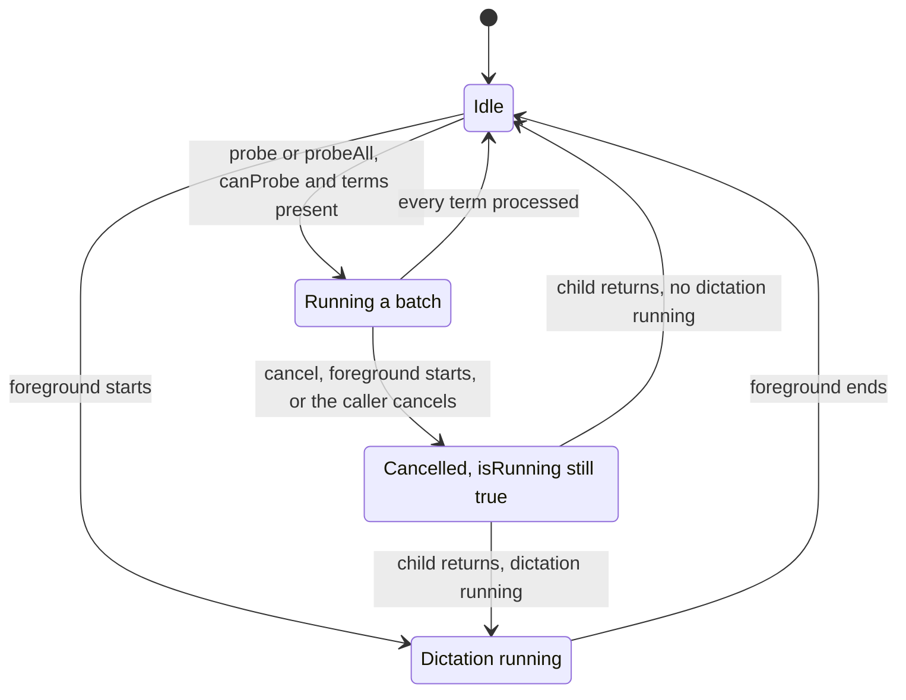

```mermaid
stateDiagram-v2
    state Classify <<choice>>
    state "Idle, never checked or spelling changed" as TermIdle
    state "Running" as TermRunning
    state "Results with offered forms" as Results
    state "Recognized correctly" as Recognized
    state "Unavailable" as Unavailable
    state "Failed" as Failed
    [*] --> TermIdle
    TermIdle --> TermRunning: batch reaches the term
    Results --> TermRunning: checked again
    Recognized --> TermRunning: checked again
    Unavailable --> TermRunning: checked again
    Failed --> TermRunning: checked again
    TermRunning --> Classify: result, not cancelled, same spelling
    Classify --> Results: samples, some misheard
    Classify --> Recognized: every sample exact, nothing discarded, failed, or unavailable
    Classify --> Unavailable: no samples, none failed or discarded
    Classify --> Failed: no samples, some failed or discarded
    TermRunning --> Failed: probe throws, not cancelled
    TermRunning --> TermIdle: term renamed or deleted during the probe
    Results --> Results: accept or dismiss removes an offered form
    Results --> TermIdle: term renamed, old result hidden
    note right of TermRunning
        A cancel restores the state saved before
        the probe, even after a late result.
    end note
```

**Invariants**

- Enforced: one batch at a time; a probe is ignored while running, during a dictation, or with no voice-workflow locale ([L25](../../Sources/Learning/MishearingSuggestionModel.swift#L25), [L99](../../Sources/Learning/MishearingSuggestionModel.swift#L99)).
- Enforced: one term is probed at a time ([L116-L155](../../Sources/Learning/MishearingSuggestionModel.swift#L116-L155)).
- Enforced: a cancel drops even a result that arrived after it, and restores the saved state ([L131](../../Sources/Learning/MishearingSuggestionModel.swift#L131), [L147-L151](../../Sources/Learning/MishearingSuggestionModel.swift#L147-L151)).
- Enforced: a term renamed or deleted during its probe gets no result ([L132-L137](../../Sources/Learning/MishearingSuggestionModel.swift#L132-L137)), and `state(for:)` hides a result for an old spelling ([L47-L54](../../Sources/Learning/MishearingSuggestionModel.swift#L47-L54)).
- Enforced: accepting a form merges it into the term's current hints and refuses one already there ([L73-L82](../../Sources/Learning/MishearingSuggestionModel.swift#L73-L82)).
- Enforced: dismissals and results live in memory only ([L39-L40](../../Sources/Learning/MishearingSuggestionModel.swift#L39-L40)).
- Assumed: the probe engine returns soon after a cancel.
- Assumed: changing workflows or the shared vocabulary does not invalidate a cached result; the cache key is the term ID and spelling.

**Tests.** [`MishearingSuggestionModelTests`](../../Tests/SyrupTests/MishearingSuggestionModelTests.swift): `idleAndLocaleOrderReflectCurrentVoiceWorkflows`, `sequentialProgressStatesAndSharedVocabulary`, `viewsReadingAnUncheckedTermHearItsFirstCheck`, `acceptancePersistsThroughSettingsAndDismissalOnlyLivesInMemory`, `cancellationRestoresStateAndForegroundBlocksStarts`, `callerCancellationReachesOwnedTask`, `unavailableFailedAndDiscardedStates`, `editsDuringProbeDiscardStaleResultsAndAcceptanceMergesCurrentHints`.

**Open questions.** None.

### M31 Probe sample accumulation

`MishearingProbeEngine.probe` checks how Apple recognition hears one term. For each locale it picks up to two system voices, speaks the term inside a carrier sentence, recognizes it check-only, and counts what came back. It reports a term as recognized correctly only when every sample was exact and nothing was discarded, failed, or unavailable.

**State variables**

- [`forms`, `formLocales`, `samples`, `exact`, `discarded`, `failed`, `unavailable`](../../Sources/Learning/MishearingProbe.swift#L183-L189) and [`voices`](../../Sources/Learning/MishearingProbe.swift#L190)
- The locale and voice loops ([L191-L218](../../Sources/Learning/MishearingProbe.swift#L191-L218)) and the summary ([L219-L228](../../Sources/Learning/MishearingProbe.swift#L219-L228))
- The result: [`MishearingProbeResult`](../../Sources/Learning/MishearingProbe.swift#L132-L150), including [`recognizedCorrectly`](../../Sources/Learning/MishearingProbe.swift#L146-L149)

```mermaid
stateDiagram-v2
    state NextLocale <<choice>>
    state NextVoice <<choice>>
    state Extract <<choice>>
    state "Choosing voices, checking availability" as LocaleCheck
    state "Synthesizing the carrier sentence" as Synthesizing
    state "Recognizing, check-only" as Recognizing
    state "Result summarized" as Result
    state "Cancelled, nothing returned" as Cancelled
    [*] --> NextLocale
    NextLocale --> LocaleCheck: locale left, not cancelled
    NextLocale --> Result: no locale left, suggestions cleaned and capped
    NextLocale --> Cancelled: task cancelled
    LocaleCheck --> NextLocale: no eligible voice, issue recorded
    LocaleCheck --> NextLocale: recognizer unavailable, issue recorded
    LocaleCheck --> NextVoice: up to two voices chosen
    NextVoice --> Synthesizing: voice left, not cancelled
    NextVoice --> NextLocale: voices done
    Synthesizing --> Recognizing: buffers, not cancelled
    Recognizing --> Extract: transcript, not cancelled
    Extract --> NextVoice: carrier broken, discarded count plus one
    Extract --> NextVoice: carrier intact, sample counted, exact if it matches
    Synthesizing --> NextVoice: ordinary error, failed count plus one
    Recognizing --> NextVoice: ordinary error, failed count plus one
    Synthesizing --> Cancelled: cancellation
    Recognizing --> Cancelled: cancellation
```

**Invariants**

- Enforced: at most two distinct voices per locale, in the same language, with novelty and personal voices excluded ([L11-L26](../../Sources/Learning/MishearingProbe.swift#L11-L26)).
- Enforced: availability is checked before any synthesis ([L198-L201](../../Sources/Learning/MishearingProbe.swift#L198-L201)).
- Enforced: nothing is recognized after an observed cancel, and a cancel returns no partial result ([L192](../../Sources/Learning/MishearingProbe.swift#L192), [L204-L209](../../Sources/Learning/MishearingProbe.swift#L204-L209), [L215](../../Sources/Learning/MishearingProbe.swift#L215), [L219](../../Sources/Learning/MishearingProbe.swift#L219)).
- Enforced: a sample counts only when both ends of the carrier match ([L210](../../Sources/Learning/MishearingProbe.swift#L210), [L47-L61](../../Sources/Learning/MishearingProbe.swift#L47-L61)).
- Enforced: suggestions are cleaned, deduplicated against the term and its hints, plausible, and capped at three ([L220](../../Sources/Learning/MishearingProbe.swift#L220), [L83-L95](../../Sources/Learning/MishearingProbe.swift#L83-L95)).
- Enforced: a form's everyday check uses the locale that first produced it ([L214](../../Sources/Learning/MishearingProbe.swift#L214), [L225-L226](../../Sources/Learning/MishearingProbe.swift#L225-L226)).
- Assumed: the caller passes at most three locales ([M30](#m30-suggestion-batch-and-per-term-results)).
- Assumed: synthesis and recognition stay in memory and never prompt or download ([M32](#m32-synthetic-speech-callbacks-and-timer), [M33](#m33-check-only-recognition)).

**Tests.** [`MishearingProbeEngineTests`](../../Tests/SyrupTests/MishearingProbeTests.swift): `usesVocabularyAndAggregatesAcrossVoicesAndLocales`, `missingVoicesAndAssetsNeverStartSynthesisOrRecognition`, `exactDiscardedAndFailedSamplesRemainDistinct`, `dropsCarrierSpillAndFlagsEverydayFormsByTheirOwnLocale`, `plausibleFormsNeedTwoLettersAndStayNearTheTermLength`, `canceledEngineDoesNotProceedToRecognition`, and the helper tests in [`MishearingProbeTextTests`](../../Tests/SyrupTests/MishearingProbeTests.swift): `extractsOnlyCompleteCarriers`, `normalizesAndDeduplicatesWithoutRemovingAccents`, `picksExactLocaleThenQualityAndDistinctVoices`, `skipsNoveltyVoicesAndPrefersSiriEraVoicesAtEqualQuality`.

**Open questions.** None.

### M32 Synthetic speech callbacks and timer

`SystemMishearingSynthesizer.synthesize` turns a carrier sentence into audio buffers in memory. The speech callbacks, a 30-second timer, and the caller's cancel can each end the stream; whichever finishes it first wins, and on every exit the timer is cancelled and speech stops.

**State variables**

- [`synthesizer`](../../Sources/Learning/SystemMishearingSpeech.swift#L21), [`utterance`](../../Sources/Learning/SystemMishearingSpeech.swift#L22), and the [stream and continuation](../../Sources/Learning/SystemMishearingSpeech.swift#L24)
- The [write callback](../../Sources/Learning/SystemMishearingSpeech.swift#L25-L36), the [timer](../../Sources/Learning/SystemMishearingSpeech.swift#L37-L42), and the [cleanup](../../Sources/Learning/SystemMishearingSpeech.swift#L43-L46)
- The collected [`buffers` and `seconds`](../../Sources/Learning/SystemMishearingSpeech.swift#L48-L49) and the [cancellation handler](../../Sources/Learning/SystemMishearingSpeech.swift#L59-L61)

```mermaid
stateDiagram-v2
    state "No system voice, thrown" as NoVoice
    state "Receiving PCM callbacks" as Receiving
    state "Stream finished normally" as EndOfStream
    state "Buffers returned" as Done
    state "Thrown" as Thrown
    state "Timer cancelled, speech stopped" as Stopped
    [*] --> NoVoice: voice ID not found
    [*] --> Receiving: utterance written, 30 s timer started
    Receiving --> Receiving: buffer with frames, copied and collected
    Receiving --> EndOfStream: buffer with zero frames
    Receiving --> Thrown: non-PCM buffer, or the copy fails
    Receiving --> Thrown: 30 s timer fires
    Receiving --> Thrown: collected audio passes 30 s
    Receiving --> Thrown: caller cancels
    EndOfStream --> Done: buffers present, not cancelled
    EndOfStream --> Thrown: no buffers, or cancelled
    Done --> Stopped: cleanup
    Thrown --> Stopped: cleanup
```

**Invariants**

- Enforced: each buffer is copied before it is kept, so no framework-owned memory is held ([L31](../../Sources/Learning/SystemMishearingSpeech.swift#L31), [L64-L74](../../Sources/Learning/SystemMishearingSpeech.swift#L64-L74)).
- Enforced: audio stays in memory; nothing is written to disk.
- Enforced: the call ends within 30 s of wall time, and collected audio is capped at 30 s ([L37-L42](../../Sources/Learning/SystemMishearingSpeech.swift#L37-L42), [L52-L53](../../Sources/Learning/SystemMishearingSpeech.swift#L52-L53)).
- Enforced: an empty result throws ([L57](../../Sources/Learning/SystemMishearingSpeech.swift#L57)).
- Enforced: the timer is cancelled and speech stops on every exit after setup ([L43-L46](../../Sources/Learning/SystemMishearingSpeech.swift#L43-L46)).
- Assumed: the stream's first finish wins when callbacks, the timer, and a cancel race.
- Assumed: the stream's unbounded buffering is safe because the timer and the cap bound the call ([L24](../../Sources/Learning/SystemMishearingSpeech.swift#L24)).

**Tests.** [`MishearingProbeRealTests`](../../Tests/SyrupTests/MishearingProbeRealTests.swift): `publicCarrierSynthesisStaysInMemory`, gated on `SYRUP_MISHEARING_REAL=1` and not run for this document. The probe tests use fake synthesizers.

**Open questions.** None.

### M33 Check-only recognition

`AppleMishearingRecognizer` recognizes synthetic speech without side effects: it reports a locale unavailable instead of prompting for permission or downloading a language model. It combines the synthesized buffers into one, so a burst cannot overflow the analyzer's bounded input, and gives Apple 60 seconds.

**State variables**

- [`transcriber`](../../Sources/Learning/SystemMishearingSpeech.swift#L79), built with [`allowAssetPreparation: false`](../../Sources/Learning/SystemMishearingSpeech.swift#L82)
- [`availability`](../../Sources/Learning/SystemMishearingSpeech.swift#L85-L96), a snapshot of support, installation, and permission
- [`recognize`](../../Sources/Learning/SystemMishearingSpeech.swift#L98-L106) and [`combinedBuffer`](../../Sources/Learning/SystemMishearingSpeech.swift#L108-L132)

```mermaid
stateDiagram-v2
    state Support <<choice>>
    state Installed <<choice>>
    state Permission <<choice>>
    state "Unsupported locale" as Unsupported
    state "Speech model not installed" as NotInstalled
    state "Speech permission required" as NoPermission
    state "Available" as Available
    state "One combined buffer queued, input finished" as Combined
    state "Apple analysis, 60 s bound" as Analyzing
    state "Transcript returned" as Done
    state "Thrown" as Failed
    [*] --> Support: availability
    Support --> Unsupported: transcriber unavailable or no supported locale
    Support --> Installed: supported
    Installed --> NotInstalled: locale not in installedLocales
    Installed --> Permission: installed
    Permission --> NoPermission: not authorized
    Permission --> Available: authorized
    Available --> Combined: recognize, buffers share one format
    Available --> Failed: empty, mixed formats, or too many frames
    Combined --> Analyzing: AppleTranscriber with preparation off
    Analyzing --> Done: transcript
    Analyzing --> Failed: timeout, cancellation, or an asset or permission change
```

**Invariants**

- Enforced: recognition never prompts and never prepares assets ([L82](../../Sources/Learning/SystemMishearingSpeech.swift#L82), [TranscriberAssetManager.swift L151-L155](../../Sources/Transcription/TranscriberAssetManager.swift#L151-L155), [L177-L181](../../Sources/Transcription/TranscriberAssetManager.swift#L177-L181)).
- Enforced: buffers must share one format and total between 1 and `UInt32.max` frames ([L109-L116](../../Sources/Learning/SystemMishearingSpeech.swift#L109-L116)).
- Enforced: the analyzer receives one complete buffer, then end of input ([L99-L102](../../Sources/Learning/SystemMishearingSpeech.swift#L99-L102)).
- Enforced: the Apple call returns within 60 s ([L103-L105](../../Sources/Learning/SystemMishearingSpeech.swift#L103-L105)).
- Assumed: availability is a snapshot; recognition can still fail if assets or permission change.
- Assumed: sharing the dictation `TranscriberAssetManager` is harmless ([SyrupApp.swift L103](../../Sources/App/SyrupApp.swift#L103)). Probe readiness checks can update Settings' language-model status for the probed key, and a recognition error invalidates the shared installed-locale entry ([AppleTranscriber.swift L86-L87](../../Sources/Transcription/AppleTranscriber.swift#L86-L87)).

**Tests.** [`MishearingProbeEngineTests`](../../Tests/SyrupTests/MishearingProbeTests.swift): `offlineFeedCombinesBuffersWithoutDroppingFrames`. [`MishearingProbeRealTests`](../../Tests/SyrupTests/MishearingProbeRealTests.swift): `publicTermsWithInstalledAssetsOnly`, gated and not run.

**Open questions.** None.

### M35 Proposal and dismissal lifetime

`GlossaryProposalList` holds the glossary proposals Settings shows, each with Add and Dismiss, and remembers dismissals so the same term is not proposed again. Nothing reaches the glossary without the person's Add. Settings stores the list as the versioned `glossaryProposalsV1` blob. Glossary learning's judge was the only producer of proposals. Nothing in the app calls `addIfNew` now: its one wrapper, [`AppSettings.addGlossaryProposal`](../../Sources/Settings/AppSettings.swift#L457-L460), is called only by tests. So the list holds proposals stored by an earlier version, and it can only shrink.

**State variables**

- [`version`](../../Sources/Learning/GlossaryProposal.swift#L18), [`proposals`](../../Sources/Learning/GlossaryProposal.swift#L19), [`dismissedKeys`](../../Sources/Learning/GlossaryProposal.swift#L20)
- The caps [`maximumProposals`](../../Sources/Learning/GlossaryProposal.swift#L14), 50, and [`maximumDismissedKeys`](../../Sources/Learning/GlossaryProposal.swift#L16), 500
- The stored copy [`AppSettings.glossaryProposals`](../../Sources/Settings/AppSettings.swift#L193-L197), written by [`persistGlossaryProposals`](../../Sources/Settings/AppSettings.swift#L533-L538) on every change

```mermaid
stateDiagram-v2
    state Admit <<choice>>
    state "Rejected, list unchanged" as Rejected
    state "Pending proposal" as Pending
    state "Removed" as Removed
    state "Dismissed, key remembered" as Dismissed
    state "Key forgotten" as Forgotten
    [*] --> Pending: loaded from the stored blob
    [*] --> Admit: addIfNew, called only by tests
    Admit --> Rejected: empty term, 50 pending, or already in the glossary, pending, or dismissed
    Admit --> Pending: trimmed term and hints stored
    Pending --> Removed: Add in Settings, or removeProposal
    Pending --> Dismissed: dismiss, lowercased key appended
    Dismissed --> Dismissed: a later addIfNew for the key is rejected
    Dismissed --> Forgotten: 500 newer dismissals push the key out
    Forgotten --> Admit: a later addIfNew
```

**Invariants**

- Enforced: a term is proposed once, compared case-insensitively against the glossary, the pending list, and the dismissals ([L27-L35](../../Sources/Learning/GlossaryProposal.swift#L27-L35)).
- Enforced: at most 50 pending and 500 remembered dismissals; the oldest dismissal is forgotten first ([L14-L16](../../Sources/Learning/GlossaryProposal.swift#L14-L16), [L31](../../Sources/Learning/GlossaryProposal.swift#L31), [L58-L61](../../Sources/Learning/GlossaryProposal.swift#L58-L61)).
- Enforced: nothing is added to the glossary automatically; a proposal reaches it only through Add in Settings, which adds the term and removes the proposal ([GlossarySettingsView.swift L280-L286](../../Sources/Settings/GlossarySettingsView.swift#L280-L286)).
- Assumed: a decoded list is within the caps; the type does not check a decoded blob again.
- Assumed: Settings' versioned storage keeps a newer build's blob intact ([AppSettings.swift L547-L552](../../Sources/Settings/AppSettings.swift#L547-L552)).
- Assumed: a stored proposal has at least one hint. `addIfNew` drops hints that trim to empty and can store a proposal with none ([L41-L43](../../Sources/Learning/GlossaryProposal.swift#L41-L43)).

**Tests.** [`AppSettingsTests`](../../Tests/SyrupTests/AppSettingsTests.swift): `glossaryProposalsPersistAndReloadAsVersionedBlob`. [`GlossaryProposalTests`](../../Tests/SyrupTests/GlossaryProposalTests.swift): `addIfNewNormalizesAndDeduplicatesAcrossAllSources`, `removeProposalRemovesOnlyMatchingID`, `dismissRemovesProposalAndRecordsPermanentKey` (despite its name, 500 later dismissals push the key out), `codableRoundTripPreservesProposalList`. [`GlossaryTests`](../../Tests/SyrupTests/GlossaryTests.swift): `storedProposalsAndDismissalsAreCapped`. [`HardRuleTests`](../../Tests/SyrupTests/HardRuleTests.swift): `settingsANewerBuildsBlobsLoadEmptyOrAsTheDefaultWorkflowAndAreNeverOverwritten`.

**Open questions**

- With no producer left, the Settings section, still titled "Suggested from your recordings" ([GlossarySettingsView.swift L243-L263](../../Sources/Settings/GlossarySettingsView.swift#L243-L263)), shows only proposals stored by an earlier version. Should it be retired once those are added or dismissed?

### M38 Retired learning cleanup

Glossary learning kept dictation audio under `Recordings/` and a 626 MB comparison model under `WhisperModels/` in Syrup's Application Support folder, behind the `glossaryLearningEnabled` setting. The feature is gone, and `RetiredGlossaryLearning` deletes what it left at every launch, and nothing else. A folder it cannot delete stays on disk, is tried again at the next launch, and is shown in Privacy with Show in Finder and Delete Now. The order matters: Privacy reads the folders only after the launch cleanup has finished, so a deletion still under way is never shown as one that failed, and a folder that cannot be inspected counts as left, so Privacy never says nothing is left when it cannot tell.

**State variables**

- [`RetiredGlossaryLearning.launchCleanup`](../../Sources/Learning/RetiredGlossaryLearning.swift#L12), the detached task `SyrupApp` starts at launch ([SyrupApp.swift L118-L120](../../Sources/App/SyrupApp.swift#L118-L120))
- On disk: the two [`folders`](../../Sources/Learning/RetiredGlossaryLearning.swift#L9) and the [`settingKey`](../../Sources/Learning/RetiredGlossaryLearning.swift#L10) in UserDefaults; [`remainingFolders`](../../Sources/Learning/RetiredGlossaryLearning.swift#L39-L45) lists every folder the system does not report as missing
- Privacy's [`retiredLearningLeftovers` and `retiredLearningDeletionFailed`](../../Sources/Settings/PrivacySettingsPane.swift#L16-L17), filled by its [first task](../../Sources/Settings/PrivacySettingsPane.swift#L40-L42) and by [Delete Now](../../Sources/Settings/PrivacySettingsPane.swift#L167-L175)

```mermaid
stateDiagram-v2
    state LaunchResult <<choice>>
    state DeleteResult <<choice>>
    state "Launch cleanup running" as Cleaning
    state "Nothing left" as Clean
    state "Folders left, tried again at the next launch" as Left
    state "Privacy waiting for the launch cleanup" as Waiting
    state "Privacy row hidden" as Hidden
    state "Privacy row shown" as Shown
    state "Delete Now running" as Deleting
    state "Row shown with the failure line" as ShownFailed
    [*] --> Cleaning: launch
    Cleaning --> LaunchResult: removeItem on each folder, setting key removed
    LaunchResult --> Clean: every folder reported missing
    LaunchResult --> Left: a delete threw, or a folder cannot be inspected
    Left --> Cleaning: next launch
    [*] --> Waiting: Privacy pane appears
    Waiting --> Hidden: cleanup done, no folder reported
    Waiting --> Shown: cleanup done, some folder reported
    Shown --> Deleting: Delete Now
    ShownFailed --> Deleting: Delete Now
    Deleting --> DeleteResult: removeLeftovers returns
    DeleteResult --> Hidden: no folder reported
    DeleteResult --> ShownFailed: some folder still reported
```

**Invariants**

- Enforced: only the `Recordings` and `WhisperModels` folders in Syrup's Application Support folder, and the `glossaryLearningEnabled` key, are removed ([L9-L10](../../Sources/Learning/RetiredGlossaryLearning.swift#L9-L10), [L18-L34](../../Sources/Learning/RetiredGlossaryLearning.swift#L18-L34), [L83-L87](../../Sources/Learning/RetiredGlossaryLearning.swift#L83-L87)).
- Enforced: a symbolic link in a folder's place is reported and removed, never what it points to ([L42-L43](../../Sources/Learning/RetiredGlossaryLearning.swift#L42-L43), [L47-L59](../../Sources/Learning/RetiredGlossaryLearning.swift#L47-L59)).
- Enforced: a folder counts as gone only when the system reports it missing; one that cannot be inspected is reported as left ([L36-L45](../../Sources/Learning/RetiredGlossaryLearning.swift#L36-L45), [L49-L58](../../Sources/Learning/RetiredGlossaryLearning.swift#L49-L58)).
- Enforced: Privacy reads the folders only after the launch cleanup has finished, and off the main actor ([L61-L68](../../Sources/Learning/RetiredGlossaryLearning.swift#L61-L68)).
- Enforced: a failed delete is logged with its error code only, and tried again at the next launch ([L25-L31](../../Sources/Learning/RetiredGlossaryLearning.swift#L25-L31)).
- Enforced: Privacy's description names only the folders reported ([L72-L81](../../Sources/Learning/RetiredGlossaryLearning.swift#L72-L81)), and the row appears only while some folder is reported ([PrivacySettingsPane.swift L152-L154](../../Sources/Settings/PrivacySettingsPane.swift#L152-L154)).
- Assumed: nothing in the app creates either folder any more; no source file outside `RetiredGlossaryLearning` names them.
- Assumed: `launchCleanup` is set before Privacy can appear. `SyrupApp.init` sets it before any scene is built; were it nil, Privacy would read the folders at once.
- Assumed: Delete Now has no running state, so a second click runs a second deletion alongside the first. Both end by reading the folders again, so the row still shows only what is left.

**Tests.** [`RetiredGlossaryLearningTests`](../../Tests/SyrupTests/RetiredGlossaryLearningTests.swift): `launchRemovesTheRecordingsAndComparisonModelAndNothingElse`, `eitherFolderAloneIsRemoved`, `aFolderThatCannotBeDeletedGoesAtTheNextLaunch`, `foldersThatCannotBeInspectedAreReported`, `aLinkInAFoldersPlaceIsRemovedAndItsTargetKept`, `aSupportPathThatIsAFileReportsNothing`, `privacyReadsTheFoldersOnlyAfterTheLaunchCleanup`, `launchWithNothingLeftOverChangesNothing`. [`RetiredLearningCopyTests`](../../Tests/SyrupTests/SettingsCopyTests.swift): `theLeftoverRowNamesOnlyWhatIsLeft`. No test hosts the Privacy row.

**Open questions.** None.

## Small machines

These hold state for one call or one object and have no chart.

| Machine | Owner | What it holds | Source | Tests |
|---|---|---|---|---|
| M10 One-shot converter input callbacks | `SingleBufferInputProvider`, `EndOfStreamInputProvider` | One Bool each: hand over the buffer, or end of stream, once, then report `noDataNow` | [AppleTranscriber.swift L356-L389](../../Sources/Transcription/AppleTranscriber.swift#L356-L389) | Indirect: `AppleTranscriberTests.conversionProducesTargetFormat`, `finishDrainsConverterTailFrames` |
| M11 Speech metric intervals | `AppleTranscriberMetricsRecorder` | One signpost interval per stage, closed once on success, cancel, or failure; the log line holds stage, outcome, a per-call UUID, and duration | [AppleTranscriber.swift L171-L222](../../Sources/Transcription/AppleTranscriber.swift#L171-L222) | None |
| M37 Speech energy filter | `SpeechSegmenter` | High-pass filter history, reset on every call | [SpeechSegmenter.swift L42-L55](../../Sources/Transcription/SpeechSegmenter.swift#L42-L55) | `ParakeetTranscriberTests.roomNoiseWithoutSpeechIsNeverDecoded`, `longerDictationsAreCutInsideARealPause` |
| M37 Mel spectrogram FFT setup | `CanaryMelSpectrogram` | An FFT setup made in `init` and destroyed in `deinit`; scratch arrays per call | [CanaryModel.swift L245-L326](../../Sources/Transcription/CanaryModel.swift#L245-L326) | `CanaryTests.featuresHaveTheEncoderShapeAndAreNormalizedPerBin` |
| M37 Scan helpers | Probe, suggestion, and Canary helpers | Seen sets, cursors, and best-so-far values for one call: voice choice, carrier word ranges, suggestion keys, locale keys, logits argmax | [MishearingProbe.swift L11-L26](../../Sources/Learning/MishearingProbe.swift#L11-L26), [L63-L72](../../Sources/Learning/MishearingProbe.swift#L63-L72), [L83-L89](../../Sources/Learning/MishearingProbe.swift#L83-L89); [MishearingSuggestionModel.swift L27-L34](../../Sources/Learning/MishearingSuggestionModel.swift#L27-L34); [CanaryModel.swift L215-L224](../../Sources/Transcription/CanaryModel.swift#L215-L224) | `MishearingProbeTextTests` helper tests |
| M37 FluidAudio logging latch | `FluidAudioLogging` | Sets FluidAudio's process-wide logger to faults only and off the console before any engine works; set again by each engine, never restored | [ParakeetEngine.swift L88-L96](../../Sources/Transcription/ParakeetEngine.swift#L88-L96) | `StreamingSpeechTests.everyWayToBuildAFluidAudioEngineSilencesItsLogging` |
